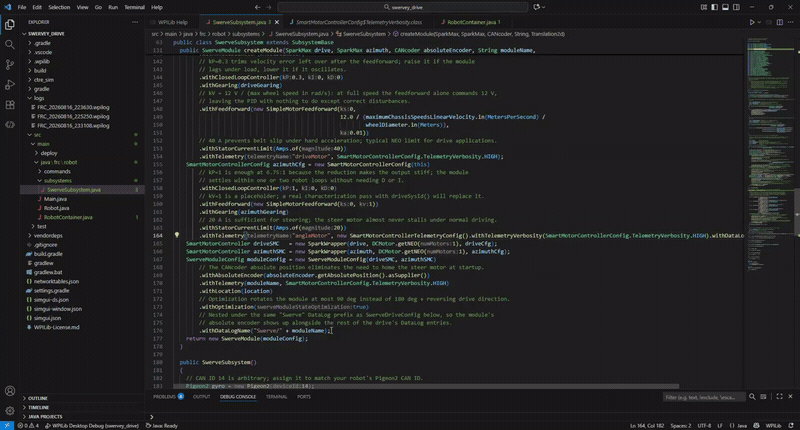
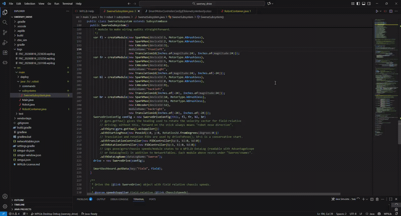
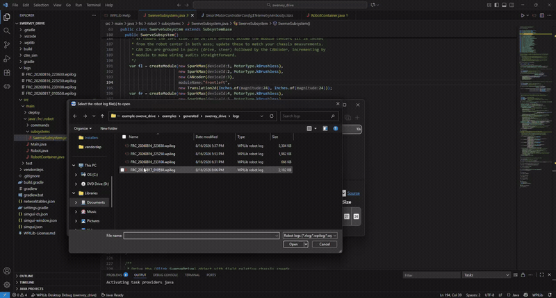
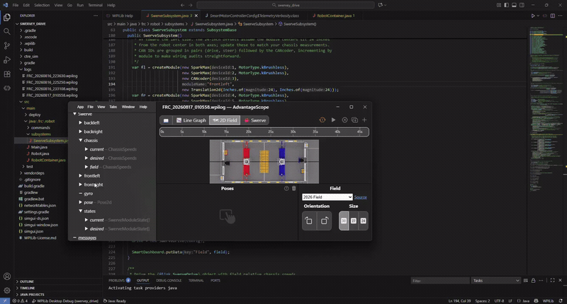

# How do I view my DataLog in AdvantageScope?

Record what your robot did to a DataLog file, then open that file in AdvantageScope to replay the run on a graph, a field and a swerve view. This page does it for the swerve drive from the [Swerve Drive tutorial](../tutorials/swerve-drive.md). Any YAMS mechanism works the same way.

You need:

* [AdvantageScope](https://docs.advantagescope.org/) installed on your computer.
* A robot project with YAMS telemetry, on the robot or in simulation.


This is not AdvantageKit's [Log Replay](https://docs.advantagekit.org/getting-started/what-is-advantagekit), which runs your code again against a recorded log. Here you only open the file and look at the values. It works with every YAMS project, with or without AdvantageKit.




### Start the DataLog

WPILib's `DataLogManager` owns the file; YAMS writes into it. Start it once, at the top of the `Robot` constructor:


```java
import org.wpilib.driverstation.DriverStation;
import org.wpilib.system.DataLogManager;

public Robot() {
  DataLogManager.start();
  // Optional: also log the Driver Station and joysticks.
  DriverStation.startDataLog(DataLogManager.getLog());
}
```


Without this call, the log starts the first time YAMS writes to it. Calling it yourself starts the log at power on, and lets you add the Driver Station data.

Where the file goes:

* **On the robot:** a USB drive, if one is plugged in. Otherwise `/home/systemcore/logs` on the SystemCore.
* **In simulation:** the `logs/` folder next to `build.gradle`.

The file starts as `WPILIB_TBD_<random>.wpilog`. Once the Driver Station connects and the time is known, it is renamed to a timestamp, such as `WPILIB_20260817_010558.wpilog`, and the console prints `DataLog: Renamed log file from '...' to '...'`.

**Check it:** run the code in simulation. A `.wpilog` file appears in the `logs/` folder.



### Turn on the DataLog for the swerve drive

A DataLog name turns logging on, and it is set on each telemetry config. The drive, each module and each motor have their own config, and setting one does not set the others. In the swerve tutorial, change three `withTelemetry(...)` calls:

<figure><figcaption><p>The three places a DataLog name goes.</p></figcaption></figure>



In `createModule()`, the azimuth motor's config (from [The module motors](../tutorials/swerve-drive/module-motors.md)), in place of `.withTelemetry("angleMotor", TelemetryVerbosity.HIGH)`:

```java
.withTelemetry("angleMotor", new SmartMotorControllerTelemetryConfig()
    .withTelemetryVerbosity(TelemetryVerbosity.HIGH)
    .withDataLogName("Swerve/" + moduleName + "/angleMotor"));
```

In `createModule()`, the module's config (from [The modules and the drive](../tutorials/swerve-drive/modules-and-drive.md)), in place of `.withTelemetry(moduleName, TelemetryVerbosity.HIGH)`:

```java
.withTelemetry(moduleName, new SwerveModuleTelemetryConfig(TelemetryVerbosity.HIGH)
    .withDataLogName("Swerve/" + moduleName))
```

In the constructor, the drive's config:

```java
.withTelemetry("swerve", new SwerveDriveTelemetryConfig(TelemetryVerbosity.HIGH)
    .withDataLogName("Swerve"))
```

The `*TelemetryConfig` classes are in `yams.core.telemetry`, and `TelemetryVerbosity` is in `yams.core.telemetry.enums`.



The same three changes, with `WithDataLogName`. From the [C++ swerve example](https://github.com/Yet-Another-Software-Suite/YAMS/blob/master/examples/cpptest/src/main/cpp/subsystems/SwerveSubsystem.cpp):

```cpp
// The drive.
.WithTelemetry("swerve", yams::telemetry::SwerveDriveTelemetryConfig(SwerveDriveConfig::TelemetryVerbosity::HIGH)
    .WithDataLogName("Swerve"))

// Each module.
.WithTelemetry(moduleName, yams::telemetry::SwerveModuleTelemetryConfig(Cfg::TelemetryVerbosity::HIGH)
    .WithDataLogName("Swerve/" + moduleName))
```

The azimuth motor takes a `yams::telemetry::SmartMotorControllerTelemetryConfig` with `.WithDataLogName(...)`, as on the [Telemetry](../understanding/telemetry.md#recording-a-match-to-a-datalog) page.



Starting each name with `Swerve/` puts everything in one `Swerve` group in AdvantageScope. The drive motors are left out here; give them a DataLog name the same way if you want them.


**At competition**, keep the DataLog but stop sending to NetworkTables, so the dashboard link stays light. `withNetworkTables(...)` is read once, when the code starts, so drive it from a constant you set to `true` before you deploy for matches:

```java
// Constants.COMPETITION is a boolean you add to Constants.java.
.withTelemetry("angleMotor", new SmartMotorControllerTelemetryConfig()
    .withTelemetryVerbosity(TelemetryVerbosity.HIGH)
    .withDataLogName("Swerve/" + moduleName + "/angleMotor")
    .withNetworkTables(!Constants.COMPETITION));
```

`RobotState.isFMSAttached()` does not work here: the code starts before the field connects, so it reads `false` and NetworkTables stays on.

[DataLog best practices](../details/datalog-best-practices.md) covers choosing what to log.


**Check it:** the code builds.



### Record a run

Deploy or simulate the robot, enable it, and drive around for a bit. Every loop writes to NetworkTables and to the DataLog.

<figure><figcaption><p>Driving the swerve example in simulation to record a run.</p></figcaption></figure>

**Check it:** stop the run. The newest `.wpilog` file has grown while you drove.



### Open the file in AdvantageScope

1. Copy the `.wpilog` from the USB drive or `/home/systemcore/logs`, or find it in your project's `logs/` folder after a simulation.
2. In AdvantageScope, choose **File > Open File...**, or drag the file onto the window. Don't use **Connect to Robot** or **Connect to Simulator**: those show live values, not the recording.

<figure><figcaption><p>Opening the newest <code>.wpilog</code> in the <code>logs/</code> folder.</p></figcaption></figure>

The sidebar shows everything in the file, grouped by the DataLog names. Under `Swerve`:

| Entry | What it is |
| --- | --- |
| `Swerve/pose` | The robot's pose |
| `Swerve/chassis/current`, `Swerve/chassis/desired` | The robot's measured and requested velocity |
| `Swerve/states/current`, `Swerve/states/desired` | The four module states |
| `Swerve/degrees/gyro` | The gyro angle |
| `Swerve/frontleft/degrees/encoder` | A module's absolute encoder angle (one per module) |
| `Swerve/frontleft/state` | A module's own state |
| `Swerve/frontleft/angleMotor/rotations/mechanism/position` | One of the azimuth motor's values (one group per module) |

Numbers are filed under a folder named after their unit, such as `degrees` or `rotations`, so you always know what you are looking at. Poses and states have no unit folder.

**Check it:** the sidebar has a `Swerve` group.



### Explore the run

* **Swerve tab:** drag `Swerve/states/current` into **Sources** to watch the wheels turn and spin as they did.
* **2D Field tab:** drag `Swerve/pose` in to see the path the robot drove.
* **Line Graph tab:** drag in any number, such as `Swerve/degrees/gyro` or a motor's current. To show it in other units, right-click it in the legend and choose **Convert Units...** ([more on units](../details/live-tuning/keys-and-units.md#see-both-in-the-same-units-with-advantagescope)).

<figure><figcaption><p>Replaying the recorded module states in the Swerve tab.</p></figcaption></figure>

Drag the timeline at the top to move through the run, or press play to watch it at normal speed. The file needs nothing else running, so you can open two matches side by side, or send the file to a teammate.

**Check it:** dragging the timeline moves the wheels in the Swerve tab.



## Check it

The sidebar has a `Swerve` group with the entries in the table above, and dragging `Swerve/pose` into a 2D Field tab draws the path you drove.

## If it did not work

* **There is no `.wpilog` file.** The DataLog never started. Call `DataLogManager.start()` in the `Robot` constructor, as in [Start the DataLog](#start-the-datalog).
* **The `Swerve` group is missing, but NetworkTables shows the values.** That telemetry config has no `withDataLogName(...)`. The drive, each module and each motor need their own.
* **A number you can see live isn't in the file.** Values you can edit under `NT:/Tuning`, such as gains, are not written to the DataLog.
* **Something else.** See [Troubleshooting](../tutorials/troubleshooting.md).
