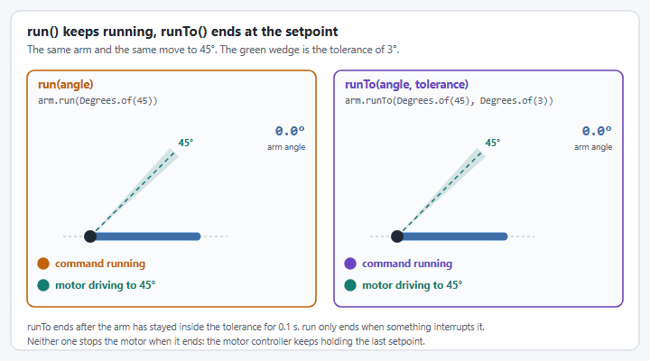

# How do I set an arm's target angle?

**Goal:** send your `Arm` to an angle from a button, an autonomous routine or your own code.

This page assumes you already have an `Arm` in a subsystem. If you do not, build one with the [Arm tutorial](../tutorials/arm.md) first; it ends with complete files you can copy.

An arm's target is an `Angle` (`org.wpilib.units.measure.Angle`), for example `Degrees.of(45)`. YAMS gives you three ways to set it:

| Use | When | Ends? |
| --- | --- | --- |
| `arm.run(angle)` | Hold an angle for as long as a button is held, or as a default command. | No. It runs until something interrupts it. |
| `arm.runTo(angle, tolerance)` | A step in a sequence or autonomous routine: go there, then move on. | Yes, once the arm has stayed within `tolerance` of the angle for 0.1 seconds. |
| `arm.setMechanismPositionSetpoint(angle)` | Your own code, inside a command you already wrote. | It is a method, not a command. It sets the target once. |

<figure><figcaption><p><code>run()</code> keeps running until something interrupts it. <code>runTo()</code> ends at the setpoint, and the default command takes over.</p></figcaption></figure>

All three start the closed loop controller again if an open loop command (`set` or `setVoltage`) stopped it. For more on the difference, see [run() vs runTo() Commands](../details/run-vs-runto.md).

## Add the commands to your subsystem

These methods go in the subsystem (Commands v2) or mechanism (Commands v3) that owns the `arm` field. They are fragments: the rest of the class is in the [Arm tutorial](../tutorials/arm/commands.md).




```java
/** Go to an angle and hold it. Never ends on its own. */
public Command run(Angle angle) {
  return arm.run(angle);
}

/** Go to an angle, then end once the arm is within tolerance. */
public Command runTo(Angle angle, Angle tolerance) {
  return arm.runTo(angle, tolerance);
}

/** Set the target from your own code. */
public void setAngleSetpoint(Angle angle) {
  arm.setMechanismPositionSetpoint(angle);
}
```





```java
/** Go to an angle and hold it. Never ends on its own. */
public Command setAngle(Angle angle) {
  return arm.run(angle);
}

/** Go to an angle, then end once the arm is within tolerance. */
public Command moveTo(Angle angle, Angle tolerance) {
  return arm.runTo(angle, tolerance);
}

/** Hold an angle at the lowest priority, so any other command can take over. For the default command. */
public Command hold(Angle angle) {
  return run(coroutine -> coroutine.await(arm.run(angle)))
      .withPriority(Command.LOWEST_PRIORITY)
      .named("Arm Hold");
}

/** Set the target from your own code. */
public void setAngleSetpoint(Angle angle) {
  arm.setMechanismPositionSetpoint(angle);
}
```




## Bind them to buttons

Every target must be inside your soft limits. This example assumes `.withSoftLimits(Degrees.of(-20), Degrees.of(80))` in the `SmartMotorControllerConfig`, so -5 and 45 degrees are both reachable.




```java
// Hold the arm at 0 degrees when nothing else is using it.
m_exampleSubsystem.setDefaultCommand(m_exampleSubsystem.run(Degrees.of(0)));

// Hold -5 or 45 degrees while A or B is held.
m_driverController.a().whileTrue(m_exampleSubsystem.run(Degrees.of(-5)));
m_driverController.b().whileTrue(m_exampleSubsystem.run(Degrees.of(45)));

// Go to 45 degrees, then (once within 2 degrees) do the next thing.
m_driverController.x().onTrue(
    m_exampleSubsystem.runTo(Degrees.of(45), Degrees.of(2))
        .andThen(Commands.print("Arm is at 45 degrees")));
```





```java
// In Robot(): hold the arm at 0 degrees when nothing else is using it.
exampleMechanism.setDefaultCommand(exampleMechanism.hold(Degrees.of(0)));

// In the opmode constructor: hold -5 or 45 degrees while A or B is held.
controller.a().whileTrue(robot.exampleMechanism.setAngle(Degrees.of(-5)));
controller.b().whileTrue(robot.exampleMechanism.setAngle(Degrees.of(45)));
```




In Commands v3 a `Mechanism` already has a `run(...)` method that takes a coroutine, so the wrappers are called `setAngle`, `moveTo` and `hold`, as in the tutorial.

If the target comes from a `Supplier<Angle>` (for example an aiming calculation), `run(supplier)` and `runTo(supplier, tolerance)` follow the supplier every loop. `runTo` ends once the arm has been within the tolerance of the supplier's current value for 0.1 seconds.

## Check it

1. Start the simulation (or enable the robot) and open **NetworkTables > Mechanisms > Arm > mechanism** in your dashboard. `Arm` is the name you gave `ArmConfig.withTelemetry`.
2. Hold B. The drawn arm should swing to 45 degrees and stay there.
3. Release B. The default command takes over and the arm returns to 0 degrees.

## If it did not work

* **The arm stops short of the target.** The target is outside your soft limits. YAMS clamps the setpoint to the nearest limit and prints a warning ("Setpoint is higher than Mechanism ... upper limit") in the Driver Station. Widen the soft limits or pick a target inside them. A `runTo` to a clamped target never ends, because the arm never gets within tolerance.
* **The arm sags below the target, or falls when you let go.** `kG` is still 0. The gains in the tutorial are placeholders; find `kG` and then `kP` with [Step 5: Tune it](../tutorials/arm/tune.md).
* **`runTo` never ends.** The tolerance is tighter than the arm can hold. Try 2 or 3 degrees, and tune `kP`.
* **Something else.** See [Troubleshooting](../tutorials/troubleshooting.md).

## Next

Tune the arm so it reaches the target quickly and holds it: [Step 5: Tune it](../tutorials/arm/tune.md).
