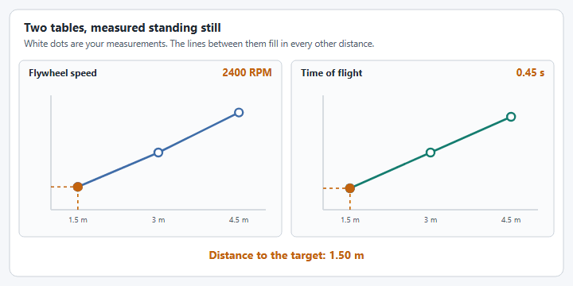

# Strategy 1: A lookup table, standing still

The simplest strategy does no physics at all. You find the shots that score from a few distances by trying them, write them in a table, and let the code fill in the distances in between. This is WPILib's [Static Shooting via Look-Up Table](https://frc-docs--3242.org.readthedocs.build/en/3242/docs/software/advanced-controls/fire-control/static-shooting.html), and it is the base that the two moving strategies are built on.


The WPILib pages on fire control are a work in progress in [wpilib-docs #3242](https://github.com/wpilibsuite/wpilib-docs/pull/3242). They have not been merged, so the links go to the pull request's preview and may move.


## How it works

1. Work out the distance from the robot to the target.
2. Look up the flywheel speed for that distance in the table.
3. Turn to face the target, spin up, and shoot.

<figure><figcaption><p>Measure a few distances. The table fills in the rest.</p></figcaption></figure>

## 1. Measure the table

With the robot standing still, pick a few distances that cover where you shoot from. At each one, adjust the flywheel speed until the shot scores every time, and write the distance and the speed down.

While you are there, **measure the time of flight** for each distance as well. Strategy 1 does not use it, but strategies 2 and 3 are built on it, and it is far easier to measure now than later. A slow motion phone video is enough. [Time of Flight Determination](https://www.chiefdelphi.com/t/time-of-flight-determination/512542) on Chief Delphi compares the ways teams find it.


If the shooter does not put the game piece in the same place twice from the same spot, no software will fix it. Get the mechanism consistent first.


## 2. The calculator

`ShotCalculator` holds the two tables in WPILib's [`InterpolatingDoubleTreeMap`](https://github.wpilib.org/allwpilib/docs/release/java/edu/wpi/first/math/interpolation/InterpolatingDoubleTreeMap.html), which fills in the distances between your measurements. `shotAt` turns a point on the field into a shot, and every strategy ends by calling it.


```java
package first.robot;

import static org.wpilib.units.Units.RPM;

import org.wpilib.math.geometry.Pose2d;
import org.wpilib.math.geometry.Rotation2d;
import org.wpilib.math.geometry.Translation2d;
import org.wpilib.math.interpolation.InterpolatingDoubleTreeMap;
import org.wpilib.math.kinematics.ChassisVelocities;
import org.wpilib.units.measure.AngularVelocity;

/** Works out where to aim and how fast to spin the flywheel. */
public final class ShotCalculator {
  /** Where to aim, and the flywheel speed that reaches it. */
  public record Shot(Pose2d target, AngularVelocity flywheelSpeed) {}

  // Where the real target is on the field, in meters.
  private static final Translation2d TARGET = new Translation2d(4.6, 4.0);

  // Distance to the target in meters, to flywheel speed in RPM.
  private static final InterpolatingDoubleTreeMap FLYWHEEL_RPM = new InterpolatingDoubleTreeMap();
  // Distance to the target in meters, to how long the shot is in the air in seconds.
  private static final InterpolatingDoubleTreeMap TIME_OF_FLIGHT = new InterpolatingDoubleTreeMap();

  static {
    // Measure these on your own robot, standing still.
    FLYWHEEL_RPM.put(1.5, 2400.0);
    FLYWHEEL_RPM.put(3.0, 3000.0);
    FLYWHEEL_RPM.put(4.5, 3700.0);

    TIME_OF_FLIGHT.put(1.5, 0.45);
    TIME_OF_FLIGHT.put(3.0, 0.70);
    TIME_OF_FLIGHT.put(4.5, 0.95);
  }

  private ShotCalculator() {}

  /** The shot that reaches a point on the field from where the robot is. */
  private static Shot shotAt(Pose2d robotPose, Translation2d aimPoint) {
    double distance = robotPose.getTranslation().getDistance(aimPoint);
    return new Shot(new Pose2d(aimPoint, new Rotation2d()), RPM.of(FLYWHEEL_RPM.get(distance)));
  }

  /** Strategy 1: aim at the real target. Only right while the robot is standing still. */
  public static Shot standing(Pose2d robotPose) {
    return shotAt(robotPose, TARGET);
  }
}
```


**For your robot:** set `TARGET` to your game's target, fill both tables with your own measurements, and flip the target for the red alliance. WPILib's [Coordinate System](https://docs.wpilib.org/en/stable/docs/software/basic-programming/coordinate-system.html) page explains the field coordinates. If your shooter is not at the center of the robot, measure the distance from where the shooter is: see [Transformations](https://docs.wpilib.org/en/stable/docs/software/advanced-controls/geometry/transformations.html).

## 3. Use it

Follow steps 4 and 5 of [How do I shoot on the move?](../how-do-i-shoot-on-the-move.md), with this as `shot()`:




```java
private ShotCalculator.Shot shot() {
  return ShotCalculator.standing(drive.getPose());
}
```





```java
ShotCalculator.Shot shot() {
  return ShotCalculator.standing(drive.getPose());
}
```




The bindings there need no changes. `withAim` faces the real target, `withAimLookahead` does nothing while the robot's velocity is zero, and `aimLock` tells you when the robot has finished turning.

## Where it stops working

This strategy aims at the real target, so it is only right while the robot is standing still. Shoot while driving and every shot drifts by the robot's velocity multiplied by the time of flight, as the first animation on [How do I shoot on the move?](../how-do-i-shoot-on-the-move.md) shows. To shoot while driving, move on to [Strategy 2: Time of flight recursion](time-of-flight-recursion.md).
