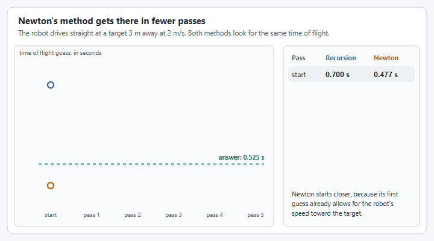

# Strategy 3: Newton's method

The recursion in [Strategy 2](time-of-flight-recursion.md) uses each answer as the next guess. That is simple, but it can swing back and forth around the answer, most of all when the robot drives straight at the target. Newton's method looks for the same time of flight, and it also uses how fast the error is changing to decide how far to step. It settles in one or two passes where the recursion needs five. This is WPILib's [Newton's Method for Dynamic Shooting](https://frc-docs--3242.org.readthedocs.build/en/3242/docs/software/advanced-controls/fire-control/newton-shooting.html).


The WPILib pages on fire control are a work in progress in [wpilib-docs #3242](https://github.com/wpilibsuite/wpilib-docs/pull/3242). They have not been merged, so the links go to the pull request's preview and may move.


<figure><figcaption><p>The recursion swings either side of the answer. Newton's method is there after a pass or two.</p></figcaption></figure>

## How it works

The answer is the time of flight that agrees with itself: lead the target by that time, look the new distance up in the table, and you get the same time back. Call the difference between the guess and what the table says the **error**. Newton's method drives the error to zero:

1. **Make a first guess** that already allows for the robot's motion: the distance, divided by the speed of the game piece plus the speed the robot is closing on the target.
2. **Find the virtual target** for that guess, and its distance.
3. **Work out the error**: the guess, minus the time of flight the table gives for that distance.
4. **Work out the slope**: how fast the error changes as the guess changes. This comes from how the distance to the virtual target shrinks or grows as the lead gets longer.
5. **Step** the guess by the error divided by the slope, and go back to step 2.

The error always comes from your measured table, so the answer is as accurate as the recursion's. The slope uses a simpler model, in which the game piece covers ground at a steady speed. An approximate slope only changes how quickly the method settles, and not where it ends up.

If the virtual target itself is new to you, read Eeshwar's [Shooting on the fly, part 1](https://blog.eeshwark.com/robotblog/shooting-on-the-fly) and [part 2](https://blog.eeshwark.com/robotblog/shooting-on-the-fly-pt2) before this page. Newton's method is a faster way to reach the same answer they describe.

## The calculator

Add this method to the `ShotCalculator` from [Strategy 1](lookup-table.md).


```java
/** Strategy 3: find the same time of flight with Newton's method, which needs fewer passes. */
public static Shot newton(Pose2d robotPose, ChassisVelocities fieldVelocity) {
  Translation2d toTarget = TARGET.minus(robotPose.getTranslation());
  double distance = toTarget.getNorm();
  // How fast the game piece covers ground, from the standing shot at this distance.
  double projectileSpeed = distance / TIME_OF_FLIGHT.get(distance);
  // How fast the robot is closing on the target. Negative while it drives away.
  double closingSpeed = (toTarget.getX() * fieldVelocity.vx + toTarget.getY() * fieldVelocity.vy) / distance;

  // A first guess that already allows for the robot's motion toward or away from the target.
  double timeOfFlight = distance / (projectileSpeed + closingSpeed);
  for (int i = 0; i < 3; i++) {
    // The virtual target for this guess.
    double dx = toTarget.getX() - fieldVelocity.vx * timeOfFlight;
    double dy = toTarget.getY() - fieldVelocity.vy * timeOfFlight;
    double virtualDistance = Math.hypot(dx, dy);
    // How far the guess is from what the table says for that distance.
    double error = timeOfFlight - TIME_OF_FLIGHT.get(virtualDistance);
    // How fast that error changes as the guess changes.
    double slope = 1 + (dx * fieldVelocity.vx + dy * fieldVelocity.vy) / (projectileSpeed * virtualDistance);
    timeOfFlight -= error / slope;
  }
  Translation2d virtualTarget = TARGET.minus(
      new Translation2d(fieldVelocity.vx * timeOfFlight, fieldVelocity.vy * timeOfFlight));
  return shotAt(robotPose, virtualTarget);
}
```


**For your robot:** nothing here needs tuning beyond the tables. The speed of the game piece is taken from the standing shot at the robot's distance.

## Use it

Follow steps 4 and 5 of [How do I shoot on the move?](../how-do-i-shoot-on-the-move.md), with this as `shot()`:




```java
private ShotCalculator.Shot shot() {
  return ShotCalculator.newton(drive.getPose(), drive.getFieldVelocity());
}
```





```java
ShotCalculator.Shot shot() {
  return ShotCalculator.newton(drive.getPose(), drive.getFieldVelocity());
}
```




Nothing else changes: the bindings, the lookahead and the aim lock are the same as for the recursion.

## What to watch for

* **The first guess matters.** Newton's method goes to the solution nearest its starting point, and a moving shot has two. One of them puts the virtual target behind the robot. The first guess in the code is chosen to start near the one you want, which is why it is not simply the standing shot's time of flight.
* **It does not make an impossible shot possible.** A robot closing on the target faster than the game piece travels still has no sensible answer. Newton's method handles the hard cases better, but check `aimed` and your flywheel speed before feeding all the same.
* **Air drag at high speed** needs the same correction as the recursion, with one more term in the slope. WPILib's [Linear Drag (First-Order Air Friction)](https://frc-docs--3242.org.readthedocs.build/en/3242/docs/software/advanced-controls/fire-control/linear-drag.html) page has both.

If the recursion already settles well for the way your robot drives, you do not need this. It earns its place on robots that shoot while driving fast toward or away from the target.
