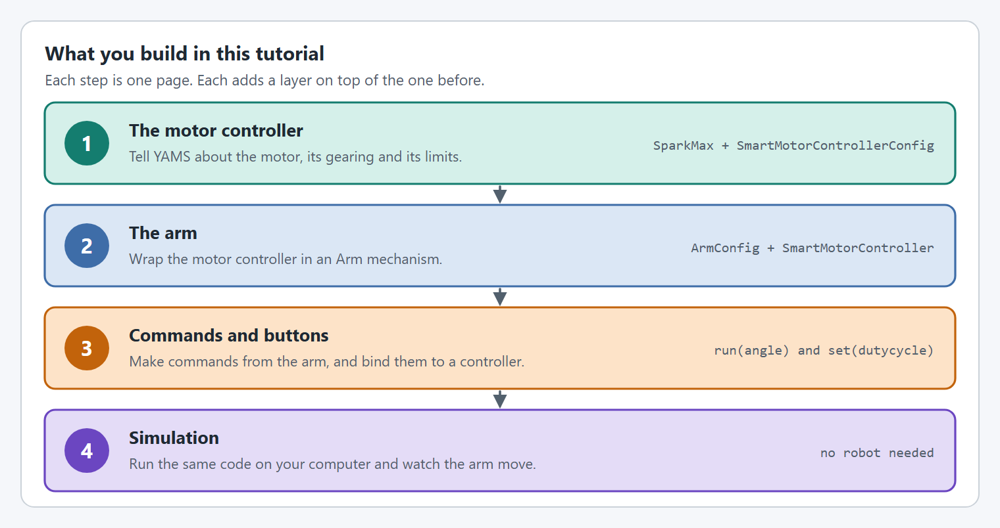

# Arm


Two motors on one shaft or gearbox? Add the second as a follower with `withFollowers`. Two motors that aren't on the same shaft or gearbox, such as one on each side of the mechanism? Make the second a loosely coupled follower with `withLooselyCoupledFollowers`: the mechanism still works as this tutorial shows. [Followers](../details/editor/config/followers.md) explains both.


## Intro

At the end of this tutorial you will have an `Arm` that works in both real life and simulation with the same code!



#### Simulation

<figure><figcaption></figcaption></figure>



#### Real Life





## Details

This `Arm` uses the following hardware and controls:

* A `SparkMax` driving one NEO controls the `Arm`
* A `12:1` gearbox on the `Arm`
* Holding the bottom face button (`A` on an Xbox controller) takes the `Arm` to -5 degrees
* Holding the right face button (`B` on an Xbox controller) takes the `Arm` to 15 degrees
* Holding the left face button (`X` on an Xbox controller) drives the `Arm` up
* Holding the top face button (`Y` on an Xbox controller) drives the `Arm` down
* With no button held, the `Arm` goes to 0 degrees

## The steps

<figure><figcaption>
Four steps, one page each.
</figcaption></figure>

Every step has a tab for **Java with Commands v2**, **Java with Commands v3** and **C++**.

| Step                                                    | What you do                                                                                   |
| ------------------------------------------------------- | --------------------------------------------------------------------------------------------- |
| [Before you start](project-setup.md)                    | Create a WPILib project and install YAMS and REVLib. Skip this if you already have a project. |
| [Step 1: The motor controller](arm/motor-controller.md) | Configure the `SparkMax` and wrap it in a `SmartMotorController`.                             |
| [Step 2: The arm](arm/mechanism.md)                     | Describe the arm with an `ArmConfig` and create the `Arm`.                                    |
| [Step 3: Commands and buttons](arm/commands.md)         | Turn the `Arm` into commands and bind them to controller buttons.                             |
| [Step 4: Simulate it](arm/simulate.md)                  | Run the code on your computer and drive the arm with a controller.                            |

## Complete Example

The following files show a complete, working Arm from the YAMS `simple_robot-2027` Commands v2 example. It uses a `TalonFX` with a `CANcoder` instead of the `SparkMax` in this tutorial; the YAMS code is otherwise the same.





The same robot in the other two flavors:

* **Java, Commands v3:** [`mechanisms/ArmMechanism.java`](https://github.com/Yet-Another-Software-Suite/YAMS/blob/master/examples/commands3/simple_robot-2027/src/main/java/first/robot/mechanisms/ArmMechanism.java) in `examples/commands3/simple_robot-2027`
* **C++:** [`ArmSubsystem.h`](https://github.com/Yet-Another-Software-Suite/YAMS/blob/master/examples/cpptest/src/main/include/subsystems/ArmSubsystem.h) and [`ArmSubsystem.cpp`](https://github.com/Yet-Another-Software-Suite/YAMS/blob/master/examples/cpptest/src/main/cpp/subsystems/ArmSubsystem.cpp) in `examples/cpptest`
