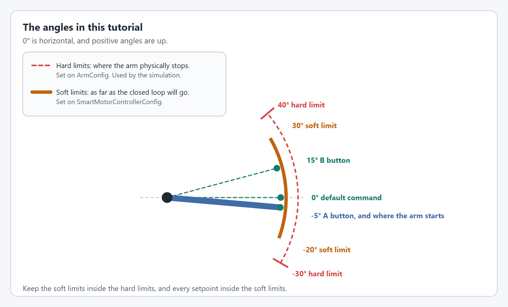

# Step 2: The arm

The `SmartMotorController` from step 1 can already spin the motor. An `Arm` adds what makes it an arm: a physics simulation, a drawing of the mechanism for your dashboard, and the commands and triggers you will use in step 3.

<figure><figcaption>
Two configs go into one mechanism.
</figcaption></figure>

`ArmConfig` describes the arm itself: its length and its hard limits. The simulation uses both. The hard limits are where the arm physically stops, which is different from the soft limits you set in step 1.

<figure><figcaption>
The soft limits from step 1 sit inside the hard limits from this step.
</figcaption></figure>

## The code



Lines in **bold** are new in this step.

`ArmSubsystem` extends `SubsystemBase`, so the scheduler calls `periodic()` and `simulationPeriodic()` for you.

<pre class="language-java" data-title="subsystems/ArmSubsystem.java" data-line-numbers><code class="lang-java">package first.robot.subsystems;

import static org.wpilib.units.Units.Amps;
import static org.wpilib.units.Units.Degrees;
import static org.wpilib.units.Units.DegreesPerSecond;
import static org.wpilib.units.Units.DegreesPerSecondPerSecond;
<strong>import static org.wpilib.units.Units.Feet;
</strong>
import com.revrobotics.spark.SparkLowLevel.MotorType;
import com.revrobotics.spark.SparkMax;
import org.wpilib.command2.SubsystemBase;
import org.wpilib.hardware.bus.CANPort;
import org.wpilib.math.controller.ArmFeedforward;
import org.wpilib.math.system.DCMotor;
import yams.commands2.config.SmartMotorControllerConfig;
<strong>import yams.commands2.mechanisms.Arm;
</strong>import yams.core.gearing.GearBox;
import yams.core.gearing.MechanismGearing;
<strong>import yams.core.mechanisms.config.ArmConfig;
</strong>import yams.core.motorcontrollers.SmartMotorController;
import yams.core.motorcontrollers.enums.ControlMode;
import yams.core.motorcontrollers.enums.MotorMode;
import yams.core.motorcontrollers.local.SparkWrapper;
import yams.core.telemetry.enums.TelemetryVerbosity;

public class ArmSubsystem extends SubsystemBase {

  // What the motor controller should do: its control mode, gains, gearing and limits.
  private final SmartMotorControllerConfig smcConfig = new SmartMotorControllerConfig(this)
      .withControlMode(ControlMode.CLOSED_LOOP)
      // Feedback constants (PID), on the real robot and in simulation.
      .withClosedLoopController(50, 0, 0)
      .withSimClosedLoopController(50, 0, 0)
      // The fastest the closed loop is allowed to move and accelerate the arm.
      .withTrapezoidalProfile(DegreesPerSecond.of(90), DegreesPerSecondPerSecond.of(45))
      // Feedforward constants, on the real robot and in simulation.
      .withFeedforward(new ArmFeedforward(0, 0, 0))
      .withSimFeedforward(new ArmFeedforward(0, 0, 0))
      // Gearing from the motor rotor to the arm: a 3:1 stage and a 4:1 stage, 12:1 in total.
      .withGearing(new MechanismGearing(GearBox.fromReductionStages(3, 4)))
      .withMotorInverted(false)
      .withZeroPower(MotorMode.BRAKE)
      .withStatorCurrentLimit(Amps.of(40))
      // Where the arm is when the robot turns on.
      .withStartingPosition(Degrees.of(-5))
      // The closed loop will not take the arm past these angles.
      .withSoftLimits(Degrees.of(-20), Degrees.of(30))
      // Telemetry name and how much to publish.
      .withTelemetry("ArmMotor", TelemetryVerbosity.HIGH);

  // The vendor motor controller object: a SPARK MAX with CAN ID 4.
  private final SparkMax spark = new SparkMax(CANPort.CAN_S0, 4, MotorType.kBrushless);

  // The SmartMotorController applies the config to the SPARK MAX, which drives one NEO.
  private final SmartMotorController motor = new SparkWrapper(spark, DCMotor.getNEO(1), smcConfig);

<strong>  private final ArmConfig armConfig = new ArmConfig()
</strong><strong>      // The hard stops, used by the simulation.
</strong><strong>      .withHardLimits(Degrees.of(-30), Degrees.of(40))
</strong><strong>      // The length of the arm, used by the simulation.
</strong><strong>      .withLength(Feet.of(3))
</strong><strong>      // Telemetry name and how much to publish.
</strong><strong>      .withTelemetry("Arm", TelemetryVerbosity.HIGH);
</strong>
<strong>  // The arm mechanism.
</strong><strong>  private final Arm arm = new Arm(armConfig, motor);
</strong>
<strong>  @Override
</strong><strong>  public void periodic() {
</strong><strong>    // Publishes the arm's telemetry, and applies anything changed through live tuning.
</strong><strong>    arm.updateTelemetry();
</strong><strong>  }
</strong>
<strong>  @Override
</strong><strong>  public void simulationPeriodic() {
</strong><strong>    // Runs the arm's physics simulation.
</strong><strong>    arm.simIterate();
</strong><strong>  }
</strong>}
</code></pre>



Lines in **bold** are new in this step.

Nothing calls a periodic method on a Commands v3 `Mechanism`, so give the class its own `periodic()` and `simulationPeriodic()`, create the mechanism in `Robot.java`, and call both from `robotPeriodic()` before the scheduler runs.

<pre class="language-java" data-title="mechanisms/ArmMechanism.java" data-line-numbers><code class="lang-java">package first.robot.mechanisms;

import static org.wpilib.units.Units.Amps;
import static org.wpilib.units.Units.Degrees;
import static org.wpilib.units.Units.DegreesPerSecond;
import static org.wpilib.units.Units.DegreesPerSecondPerSecond;
<strong>import static org.wpilib.units.Units.Feet;
</strong>
import com.revrobotics.spark.SparkLowLevel.MotorType;
import com.revrobotics.spark.SparkMax;
import org.wpilib.command3.Mechanism;
import org.wpilib.hardware.bus.CANPort;
import org.wpilib.math.controller.ArmFeedforward;
import org.wpilib.math.system.DCMotor;
import yams.commands3.config.SmartMotorControllerConfig;
<strong>import yams.commands3.mechanisms.Arm;
</strong>import yams.core.gearing.GearBox;
import yams.core.gearing.MechanismGearing;
<strong>import yams.core.mechanisms.config.ArmConfig;
</strong>import yams.core.motorcontrollers.SmartMotorController;
import yams.core.motorcontrollers.enums.ControlMode;
import yams.core.motorcontrollers.enums.MotorMode;
import yams.core.motorcontrollers.local.SparkWrapper;
import yams.core.telemetry.enums.TelemetryVerbosity;

public class ArmMechanism implements Mechanism {

  // What the motor controller should do: its control mode, gains, gearing and limits.
  private final SmartMotorControllerConfig smcConfig = new SmartMotorControllerConfig(this)
      .withControlMode(ControlMode.CLOSED_LOOP)
      // Feedback constants (PID), on the real robot and in simulation.
      .withClosedLoopController(50, 0, 0)
      .withSimClosedLoopController(50, 0, 0)
      // The fastest the closed loop is allowed to move and accelerate the arm.
      .withTrapezoidalProfile(DegreesPerSecond.of(90), DegreesPerSecondPerSecond.of(45))
      // Feedforward constants, on the real robot and in simulation.
      .withFeedforward(new ArmFeedforward(0, 0, 0))
      .withSimFeedforward(new ArmFeedforward(0, 0, 0))
      // Gearing from the motor rotor to the arm: a 3:1 stage and a 4:1 stage, 12:1 in total.
      .withGearing(new MechanismGearing(GearBox.fromReductionStages(3, 4)))
      .withMotorInverted(false)
      .withZeroPower(MotorMode.BRAKE)
      .withStatorCurrentLimit(Amps.of(40))
      // Where the arm is when the robot turns on.
      .withStartingPosition(Degrees.of(-5))
      // The closed loop will not take the arm past these angles.
      .withSoftLimits(Degrees.of(-20), Degrees.of(30))
      // Telemetry name and how much to publish.
      .withTelemetry("ArmMotor", TelemetryVerbosity.HIGH);

  // The vendor motor controller object: a SPARK MAX with CAN ID 4.
  private final SparkMax spark = new SparkMax(CANPort.CAN_S0, 4, MotorType.kBrushless);

  // The SmartMotorController applies the config to the SPARK MAX, which drives one NEO.
  private final SmartMotorController motor = new SparkWrapper(spark, DCMotor.getNEO(1), smcConfig);

<strong>  private final ArmConfig armConfig = new ArmConfig()
</strong><strong>      // The hard stops, used by the simulation.
</strong><strong>      .withHardLimits(Degrees.of(-30), Degrees.of(40))
</strong><strong>      // The length of the arm, used by the simulation.
</strong><strong>      .withLength(Feet.of(3))
</strong><strong>      // Telemetry name and how much to publish.
</strong><strong>      .withTelemetry("Arm", TelemetryVerbosity.HIGH);
</strong>
<strong>  // The arm mechanism.
</strong><strong>  private final Arm arm = new Arm(armConfig, motor);
</strong>
<strong>  /** Call this from Robot.robotPeriodic(), before the scheduler runs. */
</strong><strong>  public void periodic() {
</strong><strong>    // Publishes the arm's telemetry, and applies anything changed through live tuning.
</strong><strong>    arm.updateTelemetry();
</strong><strong>  }
</strong>
<strong>  /** Call this from Robot.robotPeriodic() in simulation. */
</strong><strong>  public void simulationPeriodic() {
</strong><strong>    // Runs the arm's physics simulation.
</strong><strong>    arm.simIterate();
</strong><strong>  }
</strong>}
</code></pre>

<pre class="language-java" data-title="Robot.java" data-line-numbers><code class="lang-java">package first.robot;

import org.wpilib.command3.Scheduler;
import org.wpilib.command3.button.CommandGamepad;
import org.wpilib.framework.OpModeRobot;
<strong>import org.wpilib.framework.RobotBase;
</strong>import first.robot.constants.DriverConstants;
<strong>import first.robot.mechanisms.ArmMechanism;
</strong>import first.robot.mechanisms.ExampleMechanism;

public class Robot extends OpModeRobot {
  final ExampleMechanism exampleMechanism = new ExampleMechanism();
<strong>  final ArmMechanism arm = new ArmMechanism();
</strong>  final CommandGamepad exampleController =
      new CommandGamepad(DriverConstants.DRIVER_CONTROLLER_PORT);

  public Robot() {}

  @Override
  public void robotPeriodic() {
<strong>    // Update the mechanism before the scheduler runs its commands.
</strong><strong>    arm.periodic();
</strong><strong>    if (RobotBase.isSimulation()) {
</strong><strong>      arm.simulationPeriodic();
</strong><strong>    }
</strong>    Scheduler.getDefault().run();
  }
}
</code></pre>



Lines in **bold** are new in this step.

`ArmConfig` in C++ takes the two hard limits separately, with `WithMinAngle` and `WithMaxAngle`, and `WithArmLength` is the C++ name of `withLength`. The C++ mechanism configs take a telemetry name only.

<pre class="language-cpp" data-title="include/subsystems/ArmSubsystem.hpp" data-line-numbers><code class="lang-cpp">#pragma once

#include &#x3C;optional>

#include &#x3C;rev/SparkMax.h>
#include &#x3C;wpi/commands2/SubsystemBase.hpp>
#include &#x3C;wpi/hardware/bus/CANPort.hpp>

<strong>#include "yams/mechanisms/config/ArmConfig.hpp"
</strong><strong>#include "yams/mechanisms/positional/Arm.hpp"
</strong>#include "yams/motorcontrollers/SmartMotorControllerConfig.hpp"
#include "yams/motorcontrollers/local/SparkWrapper.hpp"

class ArmSubsystem : public wpi::cmd::SubsystemBase {
 public:
  ArmSubsystem();

<strong>  void Periodic() override;
</strong><strong>  void SimulationPeriodic() override;
</strong>
 private:
  // The vendor motor controller object: a SPARK MAX with CAN ID 4.
  rev::spark::SparkMax m_spark{wpi::CANPort::CAN_S0, 4, rev::spark::SparkMax::MotorType::kBrushless};

  // What the motor controller should do. It is filled in by the constructor.
  yams::motorcontrollers::SmartMotorControllerConfig m_smcConfig;

  // The SmartMotorController, created in the constructor once the config is ready.
  std::optional&#x3C;yams::motorcontrollers::local::SparkWrapper> m_motor;

<strong>  // The arm mechanism and its config, also set up in the constructor.
</strong><strong>  yams::mechanisms::config::ArmConfig m_armConfig;
</strong><strong>  std::optional&#x3C;yams::mechanisms::positional::Arm> m_arm;
</strong>};
</code></pre>

<pre class="language-cpp" data-title="cpp/subsystems/ArmSubsystem.cpp" data-line-numbers><code class="lang-cpp">#include "subsystems/ArmSubsystem.hpp"

#include &#x3C;wpi/math/controller/ArmFeedforward.hpp>
#include &#x3C;wpi/math/system/DCMotor.hpp>
#include &#x3C;wpi/units/angle.hpp>
#include &#x3C;wpi/units/angular_acceleration.hpp>
#include &#x3C;wpi/units/angular_velocity.hpp>
#include &#x3C;wpi/units/current.hpp>
<strong>#include &#x3C;wpi/units/length.hpp>
</strong>#include &#x3C;wpi/units/voltage.hpp>

#include "yams/gearing/GearBox.hpp"
#include "yams/gearing/MechanismGearing.hpp"

using namespace yams::gearing;
using Cfg = yams::motorcontrollers::SmartMotorControllerConfig;

ArmSubsystem::ArmSubsystem() {
  // What the motor controller should do: its control mode, gains, gearing and limits.
  m_smcConfig
      .WithSubsystem(this)
      .WithClosedLoopMode()
      // Feedback constants (PID), on the real robot and in simulation.
      .WithFeedback(50, 0, 0)
      .WithSimClosedLoopController(50, 0, 0)
      // The fastest the closed loop is allowed to move and accelerate the arm.
      .WithTrapezoidProfile(90_deg_per_s, 45_deg_per_s_sq)
      // Feedforward constants: kS, kG and kV.
      .WithFeedforward(wpi::math::ArmFeedforward{
          0_V, 0_V, wpi::units::unit_t&#x3C;wpi::math::ArmFeedforward::kv_unit>{0}})
      // Gearing from the motor rotor to the arm: a 3:1 stage and a 4:1 stage, 12:1 in total.
      .WithMotorGearing(MechanismGearing{GearBox::FromReductionStages({3.0, 4.0})})
      .WithMotorInverted(false)
      .WithZeroPower(Cfg::MotorMode::BRAKE)
      .WithStatorCurrentLimit(40_A)
      // Where the arm is when the robot turns on.
      .WithStartingPosition(-5_deg)
      // The closed loop will not take the arm past these angles.
      .WithMechanismLimits(-20_deg, 30_deg)
      // Telemetry name and how much to publish.
      .WithTelemetry("ArmMotor", Cfg::TelemetryVerbosity::HIGH);

  // The SmartMotorController applies the config to the SPARK MAX, which drives one NEO.
  m_motor.emplace(&#x26;m_spark, wpi::math::DCMotor::NEO(1), &#x26;m_smcConfig);

<strong>  m_armConfig
</strong><strong>      // The hard stops, used by the simulation.
</strong><strong>      .WithMinAngle(-30_deg)
</strong><strong>      .WithMaxAngle(40_deg)
</strong><strong>      // The length of the arm, used by the simulation.
</strong><strong>      .WithArmLength(3_ft)
</strong><strong>      // Telemetry name.
</strong><strong>      .WithTelemetryName("Arm");
</strong>
<strong>  // The arm mechanism.
</strong><strong>  m_arm.emplace(&#x26;m_armConfig, &#x26;m_motor.value());
</strong>}

<strong>void ArmSubsystem::Periodic() {
</strong><strong>  // Publishes the arm's telemetry, and applies anything changed through live tuning.
</strong><strong>  m_arm->UpdateTelemetry();
</strong><strong>}
</strong>
<strong>void ArmSubsystem::SimulationPeriodic() {
</strong><strong>  // Runs the arm's physics simulation.
</strong><strong>  m_arm->SimIterate();
</strong><strong>}
</strong></code></pre>



Two calls keep the mechanism alive, and both must run every loop:

* **`updateTelemetry()`** publishes the mechanism's telemetry, and applies anything you change through live tuning.
* **`simIterate()`** runs the physics simulation. It only needs to run in simulation.

## Read more

[Arms](../../details/arms.md) and [ArmConfig](../../details/mechanism-configs/arm-config.md) cover everything the mechanism and its config can do.

Previous: [Step 1: The motor controller](motor-controller.md)

Next: [Step 3: Commands and buttons](commands.md)
