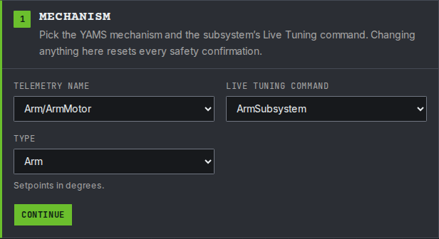
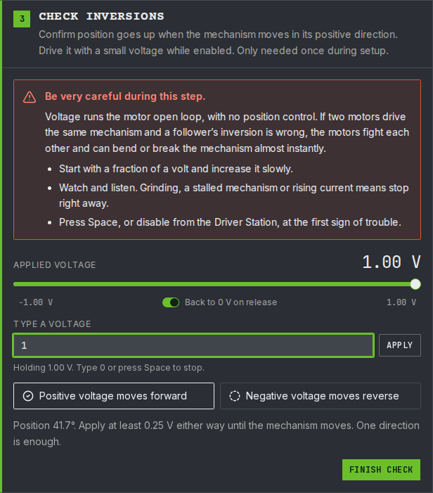
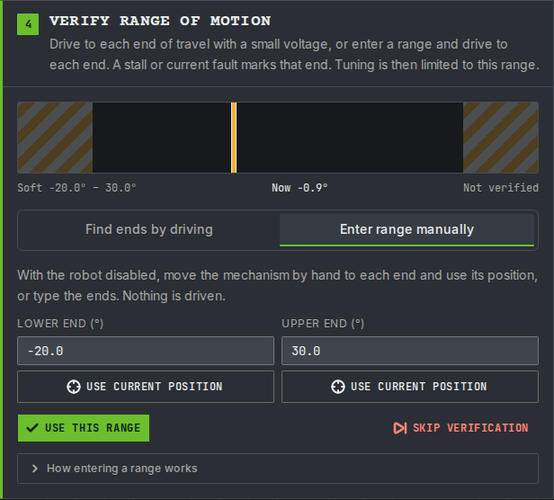
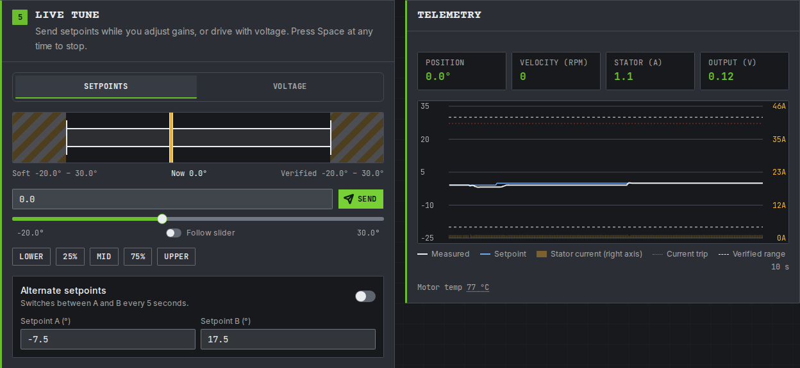
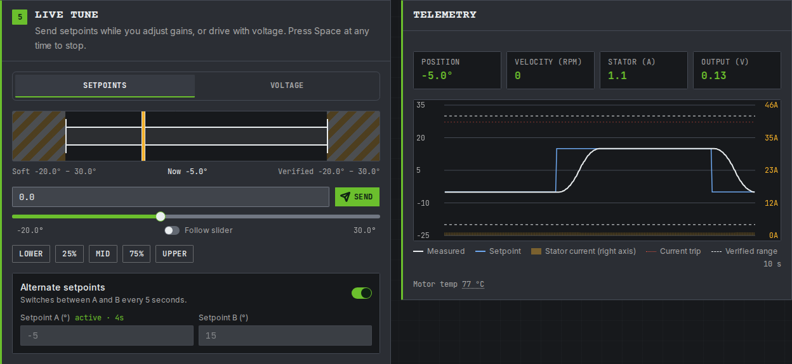
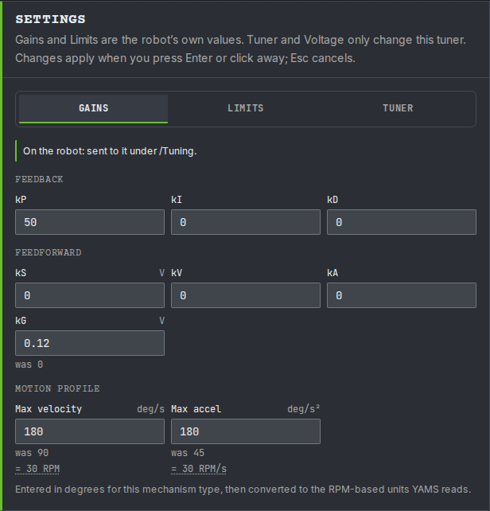

# Step 5: Tune it

The gains from step 1 are placeholders: `kP` is 50 and every feedforward gain is 0. They are enough to move the arm, but it sags below its setpoint. On this page you tune them while the simulation runs, the same way you will tune the real arm in [step 6](robot.md).

You change one number at a time on a dashboard and watch a graph. Nothing is saved until you copy the numbers into your code at the end.


**In simulation you are tuning the simulation's gains.** While the code runs in simulation, live tuning changes the `withSimClosedLoopController` and `withSimFeedforward` values. On the real robot it changes `withClosedLoopController` and `withFeedforward`. The two sets are kept apart because a simulated arm is never exactly like the real one.


## Before you start

* Start the simulation and enable **Teleoperated**, as in [step 4](simulate.md). The arm holds 0 degrees (level).
* Do not press any of the arm's buttons while you tune. A button runs another arm command, which stops live tuning. If that happens, start live tuning again.

Then tune with the YAMS Live Tuner, or by typing the values in AdvantageScope and Elastic. Both change the same values, so pick one.



The [YAMS Live Tuner](../../details/live-tuning/live-tuner.md) is a web page that walks you through it: it checks the arm before anything moves, then you send setpoints and change gains while watching a graph.



### Connect

Open [tuning.yassrobotics.com](https://tuning.yassrobotics.com/), pick **Simulation**, and press **Connect**. If your browser asks whether the page may connect to devices on your local network, allow it.

<figure><figcaption><p>Connected to the simulation, with the robot enabled in Teleop.</p></figcaption></figure>

**Check it:** the badge in the header shows `localhost`, with the robot enabled in Teleop.



### Pick the arm

1. Under **Telemetry name**, choose `Arm/ArmMotor`: the names from the arm's and the motor's `withTelemetry`.
2. Under **Live Tuning command**, choose `ArmSubsystem` (Commands v2 and C++) or `ArmMechanism` (Commands v3).
3. Set **Type** to **Arm**. Setpoints are in degrees.
4. Press **Continue**.

<figure><figcaption><p>The tutorial arm: its motor, its subsystem's <code>Live Tuning</code> command, and the Arm type.</p></figcaption></figure>

**Check it:** the telemetry card shows the arm's angle, near 0 degrees.



### Checklist and inversions

1. Tick every item on the pre-motion checklist, leave **Current trip (A)** at 40, and press **Continue**.
2. Tick the confirmation and press **Start voltage control**.
3. Drag the voltage slider all the way to the right and hold it. The arm swings up, and with no closed loop it keeps going until its hard stop, so let go once **Positive voltage moves forward** is ticked. The slider goes back to 0 V when you let go.
4. If the arm does not move with the slider all the way to the right, select the number at the slider's right end, 1.00 V to start with, and raise it a little. The number at the left end sets how far the slider goes the other way.
5. Press **Finish check**.

<figure><figcaption><p>At 1 V the arm swings up, so <strong>Positive voltage moves forward</strong> is ticked.</p></figcaption></figure>

**Check it:** **Positive voltage moves forward** was ticked when the arm swung up. If the Live Tuner warns that the angle went the wrong way, the motor or encoder inversion in step 1 is wrong.



### Set the range of motion

Choose **Enter range manually**. The ends start at the soft limits from step 1, -20 and 30 degrees, so press **Use this range**.

<figure><figcaption><p>The ends start at the arm's soft limits.</p></figcaption></figure>

**Check it:** the Live tune card opens.



### Start live tuning and find kG

Press **Start Live Tuning**. The setpoints and gains you send are now applied to the arm every loop.

`kG` is the voltage it takes to hold the arm level against gravity. YAMS scales it by the cosine of the angle, so the arm gets all of it when level and none when it points straight up or down. With `kG` at 0, only `kP` holds the arm up, so the arm sags a little below its setpoint.

1. On the **Setpoints** tab, drag the slider to 0 degrees and let go. The setpoint is sent when you let go.
2. Once the arm has stopped, read its output voltage on the telemetry card. For this arm it reads about `0.12`.
3. Type that voltage into **kG** on the Settings card's **Gains** tab, and press **Enter**.

<figure><figcaption><p>With kG at 0.12 V, the arm holds 0 degrees with no sag.</p></figcaption></figure>

**Check it:** the measured angle moves up onto the setpoint on the graph and stays there.



### Tune kP and kD

1. Turn on **Alternate setpoints**, with **Setpoint A** at `-5` and **Setpoint B** at `15`. The arm now moves between them every 5 seconds.
2. Watch each move on the graph and change **kP** on the **Gains** tab:
   * It is slow, or stops short: double `kP`.
   * It overshoots and swings back and forth: lower `kP` by about a third.
3. If it still overshoots a little at a `kP` that is quick enough, raise **kD** a little at a time, starting at `1`.

A change that made it worse? Press **was** under the value to put the last one back.

<figure><figcaption><p>What the angle looks like on the graph after each setpoint change.</p></figcaption></figure>

<figure><figcaption><p>Alternating between -5 and 15 degrees, so each change of gain can be compared with the last move.</p></figcaption></figure>

**Check it:** after each change of setpoint the arm gets there within a second or so and stops without swinging.



### Tune the motion profile and kV

The motion profile limits how fast the arm moves and speeds up. On the **Gains** tab, **Max velocity** and **Max acceleration** are in degrees per second, 90 and 45 from step 1, with the RPM YAMS uses shown under each.

1. With **Alternate setpoints** still on, raise **Max velocity** and **Max acceleration** a step at a time.
2. Stop raising them when the measured angle falls behind the setpoint while it moves, or the stator current on the graph jumps.
3. Raise **kV** until the measured angle follows the setpoint during a move, instead of falling behind and catching up at the end. `kV` only acts while the arm moves.

<figure><figcaption><p>Max velocity and max acceleration raised from 90 and 45 to 180. <strong>was</strong> shows the value before each change.</p></figcaption></figure>

**Check it:** the arm follows the setpoint through each move and arrives without lagging. Press **Space** to stop when you are done.





You type each value into its NetworkTables key yourself, and graph the arm in AdvantageScope.

Open [AdvantageScope](https://docs.advantagescope.org/) and connect it to the simulation (**File > Connect to Simulator**).



### Start live tuning

YAMS gives the arm a `Live Tuning` command. While it runs, numbers you type on the dashboard are applied to the arm straight away.

* **Commands v2 and C++:** the command is published at `NT:/Tuning/ArmSubsystem/Live Tuning`, named after the subsystem. In [Elastic](https://frc-elastic.gitbook.io/docs), add `Tuning/ArmSubsystem/Live Tuning` to a tab and press its button.
* **Commands v3:** the command is published at `NT:/Tuning/ArmMechanism/Live Tuning`, named after the mechanism. Set the boolean `NT:/Tuning/ArmMechanism/Live Tuning/running` to `true`. In AdvantageScope, first turn on tuning mode (step 2), then click the value to change it.

**Check it:** the command shows as running. The arm keeps holding 0 degrees.



### Find the numbers and graph the arm

The arm's values are under two tables. Both use the names from `withTelemetry`: `Arm` for the arm and `ArmMotor` for its motor.

| | Where | Used for |
| --- | --- | --- |
| Values you type | `NT:/Tuning/Arm/ArmMotor/` | Gains, setpoints, limits |
| Values you watch | `NT:/Mechanisms/Arm/ArmMotor/` | Where the arm is and what the motor is doing |

1. In AdvantageScope, turn on **tuning mode**: the sliders icon beside the search box at the top of the sidebar. Without it, typed values are ignored.
2. Make a **Line Graph** and drag in, from `NT:/Mechanisms/Arm/ArmMotor/`:
   * `mechanism/position`: where the arm is.
   * `closedloop/setpoint/position`: where the arm is asked to be.
   * `motor/outputVoltage`: the voltage the motor is given.


**You type degrees, you read rotations.** A setpoint typed as `15` (degrees) is graphed as `0.0417` (rotations). To graph in degrees, see [See both in the same units with AdvantageScope](../../details/live-tuning/keys-and-units.md#see-both-in-the-same-units-with-advantagescope).


**Check it:** the two position lines are close together near 0, with the measured position a little below the setpoint. That gap is the sag you fix next.



### kG: hold the arm up

`kG` is the voltage it takes to hold the arm level against gravity. YAMS scales it by the cosine of the angle, so the arm gets all of it when level and none when it points straight up or down. That only works if 0 degrees is level, as it is in this tutorial.

With `kG` at 0, only `kP` holds the arm up. `kP` only pushes when there is an error, so the arm has to sag a little before the motor pushes hard enough. The voltage it settles at is the voltage gravity needs.

1. Let the arm settle at 0 degrees and read `motor/outputVoltage`. For this arm it reads about `0.12`.
2. Type that voltage into `NT:/Tuning/Arm/ArmMotor/closedloop/feedforward/kG`.

**Check it:** the measured position moves up onto the setpoint and stays there. The output voltage stays about the same, because `kG` now supplies it instead of `kP`.

If the arm drifts, adjust `kG` a little: up if it sits low, down if it sits high.



### kP and kD: reach a setpoint

`kP` is how hard the motor pushes for each rotation of error. A `kP` of 50 is 50 volts per rotation, about 0.14 volts per degree.

1. Type `15` into `NT:/Tuning/Arm/ArmMotor/closedloop/setpoint/position`. The arm moves to 15 degrees.
2. Type `-5`, then `15` again, and watch the position line each time.
3. Compare the line with the picture below and change `NT:/Tuning/Arm/ArmMotor/closedloop/feedback/kP`:
   * It is slow, or stops short: double `kP`.
   * It overshoots and swings back and forth: lower `kP` by about a third.
4. If it still overshoots a little at a `kP` that is quick enough, raise `closedloop/feedback/kD` a little at a time, starting at `1`.

<figure><figcaption><p>What the position line looks like after a setpoint change.</p></figcaption></figure>

**Check it:** after each setpoint change the arm gets there within a second or so and stops without swinging.

The arm cannot go past the soft limits from step 1, -20 and 30 degrees. A setpoint beyond them is held at the limit.



### The motion profile and kV

The motion profile limits how fast the arm moves and speeds up: 90 degrees per second and 45 degrees per second squared from step 1. On the dashboard they are in RPM: 15 RPM and 7.5 RPM per second.

1. Raise `NT:/Tuning/Arm/ArmMotor/closedloop/motionprofile/maxVelocity` and `maxAcceleration` a step at a time while moving between `-5` and `15`.
2. Stop raising them when the measured position falls behind the setpoint while it moves, or `current/stator` jumps.
3. Add `mechanism/velocity` and `closedloop/setpoint/velocity` to the graph. Raise `closedloop/feedforward/kV` until the measured velocity follows the setpoint velocity during a move. `kV` only acts while the arm moves.

**Check it:** the measured velocity sits on top of the setpoint velocity, and the arm arrives without lagging behind.

For more on each value, see [Tuning order](../../details/live-tuning/README.md#tuning-order).





## Copy the numbers into your code

Dashboard changes are lost when the code restarts. Write the numbers you ended up with into the config from step 1. In simulation they go into the `Sim` versions.




```java
// Before
.withSimClosedLoopController(50, 0, 0)
.withSimFeedforward(new ArmFeedforward(0, 0, 0))

// After: your numbers. ArmFeedforward takes kS, kG, kV.
.withSimClosedLoopController(80, 0, 2)
.withSimFeedforward(new ArmFeedforward(0, 0.12, 0.3))
```


Copy the motion profile limits into `withTrapezoidalProfile` too, converted back to degrees per second.




```java
// Before
.withSimClosedLoopController(50, 0, 0)
.withSimFeedforward(new ArmFeedforward(0, 0, 0))

// After: your numbers. ArmFeedforward takes kS, kG, kV.
.withSimClosedLoopController(80, 0, 2)
.withSimFeedforward(new ArmFeedforward(0, 0.12, 0.3))
```


Copy the motion profile limits into `withTrapezoidalProfile` too, converted back to degrees per second.



The C++ config in step 1 has a simulation PID with `WithSimClosedLoopController`, but only one feedforward, `WithFeedforward`, which simulation uses too. Copy your numbers there:


```cpp
// Your numbers: kP, kI, kD, then kS, kG and kV.
.WithSimClosedLoopController(80, 0, 2)
.WithFeedforward(wpi::math::ArmFeedforward{
    0_V, 0.12_V, wpi::units::unit_t<wpi::math::ArmFeedforward::kv_unit>{0.3}})
```


Copy the motion profile limits into `WithTrapezoidProfile` too, converted back to degrees per second.



The numbers above are an example. Use the ones you found.

**Check it:** restart the simulation and enable it. The arm holds 0 degrees without sagging, and the A and B buttons move it smoothly.

## If it did not work

* **AdvantageScope: typing a value does nothing.** Turn on AdvantageScope's tuning mode, check the `Live Tuning` command is still running, and check you typed under `NT:/Tuning`, not `NT:/Mechanisms`.
* **Live Tuner: the arm is not in the Telemetry name list.** Check the simulation is running and you connected to **Simulation**. The list only fills in once the robot code has started.
* **Live tuning stopped on its own.** A button press, or the default command, took over the arm. On the Live Tuner, the current trip, leaving the range of motion, or pressing Space also stops it. Start it again.
* **The arm swings harder and harder.** `kP` is too high. Lower it, or disable and restart the simulation.
* **The numbers were gone after a restart.** They only last until the code stops. Copy them into your code, as in [Copy the numbers into your code](#copy-the-numbers-into-your-code).

More problems and fixes: [Troubleshooting](../troubleshooting.md).
