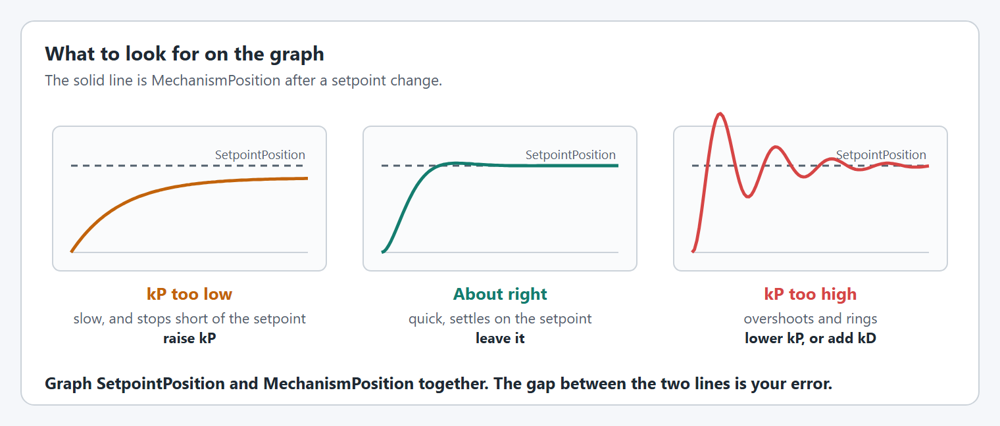

# Step 5: Tune it

The gains from step 1 are placeholders: `kP` is 50 and every feedforward gain is 0. They are enough to move the arm, but it sags below its setpoint. On this page you tune them while the simulation runs, the same way you will tune the real arm in [step 6](robot.md).

You change one number at a time on a dashboard and watch a graph. Nothing is saved until you copy the numbers into your code at the end.


**In simulation you are tuning the simulation's gains.** While the code runs in simulation, live tuning changes the `withSimClosedLoopController` and `withSimFeedforward` values. On the real robot it changes `withClosedLoopController` and `withFeedforward`. The two sets are kept apart because a simulated arm is never exactly like the real one.


## Before you start

* Start the simulation and enable **Teleoperated**, as in [step 4](simulate.md). The arm holds 0 degrees (level).
* Open [AdvantageScope](https://docs.advantagescope.org/) and connect it to the simulation (**File > Connect to Simulator**).
* Do not press any of the arm's buttons while you tune. A button runs another arm command, which stops live tuning. If that happens, start it again as in part 1.

## 1. Start live tuning

YAMS gives the arm a `Live Tuning` command. While it runs, numbers you type on the dashboard are applied to the arm straight away.



The command is published at `NT:/Tuning/ArmSubsystem/Live Tuning`, named after the subsystem.

In [Elastic](https://frc-elastic.gitbook.io/docs), add `Tuning/ArmSubsystem/Live Tuning` to a tab and press its button.



The command is published at `NT:/Tuning/ArmMechanism/Live Tuning`, named after the mechanism.

Set the boolean `NT:/Tuning/ArmMechanism/Live Tuning/running` to `true`. In AdvantageScope, first turn on tuning mode (part 2), then click the value to change it.



The command is published at `NT:/Tuning/ArmSubsystem/Live Tuning`, named after the subsystem.

In [Elastic](https://frc-elastic.gitbook.io/docs), add `Tuning/ArmSubsystem/Live Tuning` to a tab and press its button.



**Check it:** the command shows as running. The arm keeps holding 0 degrees.

## 2. Find the numbers and graph the arm

The arm's values are under two tables. Both use the names from `withTelemetry`: `Arm` for the arm and `ArmMotor` for its motor.

| | Where | Used for |
| --- | --- | --- |
| Values you type | `NT:/Tuning/Arm/ArmMotor/` | Gains, setpoints, limits |
| Values you watch | `NT:/Mechanisms/Arm/ArmMotor/` | Where the arm is and what the motor is doing |

1. In AdvantageScope, turn on **tuning mode**: the sliders icon beside the search box at the top of the sidebar. Without it, typed values are ignored.
2. Make a **Line Graph** and drag in, from `NT:/Mechanisms/Arm/ArmMotor/`:
   * `mechanism/position`: where the arm is.
   * `closedloop/setpoint/position`: where the arm is asked to be.
   * `motor/outputVoltage`: the voltage the motor is given.


**You type degrees, you read rotations.** A setpoint typed as `15` (degrees) is graphed as `0.0417` (rotations). To graph in degrees, see [See both in the same units with AdvantageScope](../../details/live-tuning/keys-and-units.md#see-both-in-the-same-units-with-advantagescope).


**Check it:** the two position lines are close together near 0, with the measured position a little below the setpoint. That gap is the sag you fix next.

## 3. kG: hold the arm up

`kG` is the voltage it takes to hold the arm level against gravity. YAMS scales it by the cosine of the angle, so the arm gets all of it when level and none when it points straight up or down. That only works if 0 degrees is level, as it is in this tutorial.

With `kG` at 0, only `kP` holds the arm up. `kP` only pushes when there is an error, so the arm has to sag a little before the motor pushes hard enough. The voltage it settles at is the voltage gravity needs.

1. Let the arm settle at 0 degrees and read `motor/outputVoltage`. Say it reads `0.9`.
2. Type that voltage into `NT:/Tuning/Arm/ArmMotor/closedloop/feedforward/kG`.

**Check it:** the measured position moves up onto the setpoint and stays there. The output voltage stays about the same, because `kG` now supplies it instead of `kP`.

If the arm drifts, adjust `kG` a little: up if it sits low, down if it sits high.

## 4. kP and kD: reach a setpoint

`kP` is how hard the motor pushes for each rotation of error. A `kP` of 50 is 50 volts per rotation, about 0.14 volts per degree.

1. Type `15` into `NT:/Tuning/Arm/ArmMotor/closedloop/setpoint/position`. The arm moves to 15 degrees.
2. Type `-5`, then `15` again, and watch the position line each time.
3. Compare the line with the picture below and change `NT:/Tuning/Arm/ArmMotor/closedloop/feedback/kP`:
   * It is slow, or stops short: double `kP`.
   * It overshoots and swings back and forth: lower `kP` by about a third.
4. If it still overshoots a little at a `kP` that is quick enough, raise `closedloop/feedback/kD` a little at a time, starting at `1`.

<figure><figcaption><p>What the position line looks like after a setpoint change.</p></figcaption></figure>

**Check it:** after each setpoint change the arm gets there within a second or so and stops without swinging.

The arm cannot go past the soft limits from step 1, -20 and 30 degrees. A setpoint beyond them is held at the limit.

## 5. The motion profile and kV

The motion profile limits how fast the arm moves and speeds up: 90 degrees per second and 45 degrees per second squared from step 1. On the dashboard they are in RPM: 15 RPM and 7.5 RPM per second.

1. Raise `NT:/Tuning/Arm/ArmMotor/closedloop/motionprofile/maxVelocity` and `maxAcceleration` a step at a time while moving between `-5` and `15`.
2. Stop raising them when the measured position falls behind the setpoint while it moves, or `current/stator` jumps.
3. Add `mechanism/velocity` and `closedloop/setpoint/velocity` to the graph. Raise `closedloop/feedforward/kV` until the measured velocity follows the setpoint velocity during a move. `kV` only acts while the arm moves.

**Check it:** the measured velocity sits on top of the setpoint velocity, and the arm arrives without lagging behind.

For more on each value, see [Tuning order](../../details/live-tuning/README.md#tuning-order).

## 6. Copy the numbers into your code

Dashboard changes are lost when the code restarts. Write the numbers you ended up with into the config from step 1. In simulation they go into the `Sim` versions.




```java
// Before
.withSimClosedLoopController(50, 0, 0)
.withSimFeedforward(new ArmFeedforward(0, 0, 0))

// After: your numbers. ArmFeedforward takes kS, kG, kV.
.withSimClosedLoopController(80, 0, 2)
.withSimFeedforward(new ArmFeedforward(0, 0.9, 0.3))
```


Copy the motion profile limits into `withTrapezoidalProfile` too, converted back to degrees per second.




```java
// Before
.withSimClosedLoopController(50, 0, 0)
.withSimFeedforward(new ArmFeedforward(0, 0, 0))

// After: your numbers. ArmFeedforward takes kS, kG, kV.
.withSimClosedLoopController(80, 0, 2)
.withSimFeedforward(new ArmFeedforward(0, 0.9, 0.3))
```


Copy the motion profile limits into `withTrapezoidalProfile` too, converted back to degrees per second.



The C++ config in step 1 has a simulation PID with `WithSimClosedLoopController`, but only one feedforward, `WithFeedforward`, which simulation uses too. Copy your numbers there:


```cpp
// Your numbers: kP, kI, kD, then kS, kG and kV.
.WithSimClosedLoopController(80, 0, 2)
.WithFeedforward(wpi::math::ArmFeedforward{
    0_V, 0.9_V, wpi::units::unit_t<wpi::math::ArmFeedforward::kv_unit>{0.3}})
```


Copy the motion profile limits into `WithTrapezoidProfile` too, converted back to degrees per second.



The numbers above are an example. Use the ones you found.

**Check it:** restart the simulation and enable it. The arm holds 0 degrees without sagging, and the A and B buttons move it smoothly.

## If it did not work

* **Typing a value does nothing.** Turn on AdvantageScope's tuning mode, check the `Live Tuning` command is still running, and check you typed under `NT:/Tuning`, not `NT:/Mechanisms`.
* **Live tuning stopped on its own.** A button press, or the default command, took over the arm. Start it again.
* **The arm swings harder and harder.** `kP` is too high. Lower it, or disable and restart the simulation.
* **The numbers were gone after a restart.** They only last until the code stops. Copy them into your code as in part 6.

More problems and fixes: [Troubleshooting](../troubleshooting.md).
