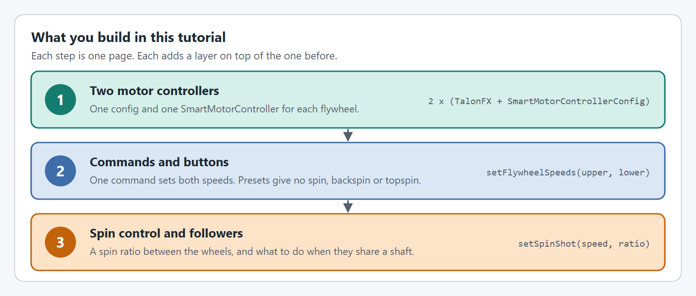

# Double FlyWheel

## Intro

At the end of this tutorial you will have a **Double FlyWheel** shooter with two independently controlled flywheels that works in both real life and simulation with the same code! Double flywheels are used where the spin on the game piece matters: running one wheel faster than the other adds backspin or topspin to a shot.


This tutorial does not use the `FlyWheel` class from the [Shooter/FlyWheels](shooter-flywheels.md) tutorial. A `FlyWheel` drives one wheel, or several motors that always turn together, at one speed. Here each wheel needs its own speed, so the subsystem controls the two motor controllers directly. If you have not done the Shooter/FlyWheels tutorial, it is the easier place to start.


## What is a Double FlyWheel?

A double flywheel is a shooter with two separate flywheels, one on each side of the game piece:

* **Upper FlyWheel**: drives the top surface of the game piece
* **Lower FlyWheel**: drives the bottom surface of the game piece

<figure><figcaption>
The faster wheel drags its side of the ball forward. Lower wheel faster is backspin; upper wheel faster is topspin.
</figcaption></figure>

By running them at different speeds, you can:

* Add **backspin** (lower faster than upper)
* Add **topspin** (upper faster than lower)
* Shoot with **no spin** (equal speeds)

## Details

This double flywheel uses the following hardware and controls:

* Two `TalonFX` (Kraken X60), one for each flywheel
* No gearbox: each wheel is driven 1:1 from its motor. **Top speed = motor free speed / reduction**, so each wheel can reach about 6000 RPM (a Kraken X60's free speed) / 1 = 6000 RPM, comfortably above the 3500 RPM fastest preset. A 3:1 gearbox would cap it at 2000 RPM, too slow for these presets.
* 4 inch diameter, 1 pound flywheels
* Pressing the bottom face button (`A` on an Xbox controller) sets both flywheels to 3000 RPM (no spin)
* Pressing the right face button (`B` on an Xbox controller) sets the upper to 2500 RPM and the lower to 3500 RPM (backspin)
* Pressing the left face button (`X` on an Xbox controller) sets the upper to 3500 RPM and the lower to 2500 RPM (topspin)
* Pressing the top face button (`Y` on an Xbox controller) lets both flywheels coast to a stop

## The steps

<figure><figcaption>
Three steps, one page each. Then you tune it and run it on the robot.
</figcaption></figure>

Every step has a tab for **Java with Commands v2**, **Java with Commands v3** and **C++**.

| Step | What you do |
| --- | --- |
| [Before you start](project-setup.md) | Create a WPILib project and install YAMS and Phoenix 6. Skip this if you already have a project. |
| [Step 1: Two motor controllers](double-flywheel/motor-controllers.md) | One config and one `SmartMotorController` for each flywheel. |
| [Step 2: Commands and buttons](double-flywheel/commands.md) | One command that sets both speeds, presets for each kind of shot, the buttons, and a check in simulation. |
| [Step 3: Spin ratio and shared shafts](double-flywheel/spin-and-followers.md) | A spin ratio between the wheels, and what to change when two motors drive one wheel. |
| [Step 4: Tune it](double-flywheel/tune.md) | Tune one wheel with the YAMS Live Tuner, copy its gains to the other, then put it on the robot. |


A subsystem should hold at most one YAMS mechanism class, so that live tuning keeps working. Both flywheels here are driven together by one subsystem, so this tutorial controls the two `SmartMotorController`s directly instead of creating two `FlyWheel` mechanisms. This is the same approach as the `DoubleFlyWheelSubsystem` in the YAMS examples.

If you would rather have a `FlyWheel` mechanism (with its `Mechanism2d` and Trigger factories) for each wheel, give each wheel its own subsystem and follow the [Shooter/FlyWheels](shooter-flywheels.md) tutorial for both.


## Complete Example

The following files from the YAMS `simple_robot-2027` Commands v2 example show a complete double flywheel subsystem with two independent flywheels, and a hood pivot in its own subsystem. Its CAN IDs, gearing and gains differ from this tutorial's.





The same subsystem in the other two flavors:

* **Java, Commands v3:** [`DoubleFlyWheelMechanism.java`](https://github.com/Yet-Another-Software-Suite/YAMS/blob/master/examples/commands3/simple_robot-2027/src/main/java/first/robot/mechanisms/doubleflywheel/DoubleFlyWheelMechanism.java) in `examples/commands3/simple_robot-2027`
* **C++:** [`DoubleFlyWheelSubsystem.h`](https://github.com/Yet-Another-Software-Suite/YAMS/blob/master/examples/cpptest/src/main/include/subsystems/doubleflywheel/DoubleFlyWheelSubsystem.h) and [`DoubleFlyWheelSubsystem.cpp`](https://github.com/Yet-Another-Software-Suite/YAMS/blob/master/examples/cpptest/src/main/cpp/subsystems/doubleflywheel/DoubleFlyWheelSubsystem.cpp) in `examples/cpptest`
