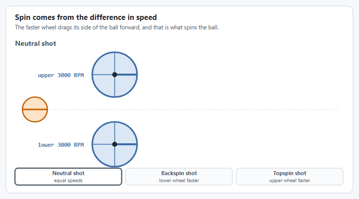

# Step 2: Commands and buttons

One command sets both velocity setpoints, so the two wheels always change together. Everything else is a preset built on that one command.


**In a hurry?** Jump to [the complete file](#the-complete-file), copy it, and change the values called out under **For your robot**. The numbered parts explain each piece in a sentence or two. You do not need to understand all of it to get moving: the pages under **Understanding** go deeper when you want them.


## 1. One command for both wheels

A single command sets both velocity setpoints every loop, so the two wheels always change together.




```java
/** Spin both flywheels. One command sets both speeds, so the two always change together. */
public Command setFlywheelSpeeds(AngularVelocity upperSpeed, AngularVelocity lowerSpeed) {
  return run(() -> {
    upperMotor.setVelocity(upperSpeed);
    lowerMotor.setVelocity(lowerSpeed);
  }).withName("Set FlyWheel Speeds");
}
```





```java
/** Spin both flywheels. One command sets both speeds, so the two always change together. */
public Command setFlywheelSpeeds(AngularVelocity upperSpeed, AngularVelocity lowerSpeed) {
  return run(coroutine -> {
    while (true) {
      upperMotor.setVelocity(upperSpeed);
      lowerMotor.setVelocity(lowerSpeed);
      coroutine.yield();
    }
  }).named("Set FlyWheel Speeds");
}
```





```cpp
/** Spin both flywheels. One command sets both speeds, so the two always change together. */
wpi::cmd::CommandPtr SetFlywheelSpeeds(wpi::units::revolutions_per_minute_t upperSpeed,
                                       wpi::units::revolutions_per_minute_t lowerSpeed);
```



```cpp
wpi::cmd::CommandPtr DoubleFlywheelSubsystem::SetFlywheelSpeeds(
    wpi::units::revolutions_per_minute_t upperSpeed, wpi::units::revolutions_per_minute_t lowerSpeed) {
  return Run([this, upperSpeed, lowerSpeed] {
           m_upperMotor->SetVelocity(wpi::units::turns_per_second_t{upperSpeed});
           m_lowerMotor->SetVelocity(wpi::units::turns_per_second_t{lowerSpeed});
         })
      .WithName("Set FlyWheel Speeds");
}
```




## 2. Preset shots

Each preset is that one command with two speeds filled in.

| Preset | Upper | Lower | Spin |
| --- | --- | --- | --- |
| Neutral shot | 3000 RPM | 3000 RPM | none |
| Backspin shot | 2500 RPM | 3500 RPM | backspin |
| Topspin shot | 3500 RPM | 2500 RPM | topspin |
| Stop | 0 RPM | 0 RPM | |

<figure><figcaption><p>The faster wheel drags its side of the ball forward. Lower wheel faster is backspin; upper wheel faster is topspin.</p></figcaption></figure>




```java
/** Both flywheels at the same speed: no spin. */
public Command neutralSpinShot() {
  return setFlywheelSpeeds(RPM.of(3000), RPM.of(3000));
}

/** The lower flywheel faster: backspin. */
public Command backspinShot() {
  return setFlywheelSpeeds(RPM.of(2500), RPM.of(3500));
}

/** The upper flywheel faster: topspin. */
public Command topspinShot() {
  return setFlywheelSpeeds(RPM.of(3500), RPM.of(2500));
}

/** Bring both flywheels to a stop. */
public Command stopFlywheels() {
  return setFlywheelSpeeds(RPM.of(0), RPM.of(0));
}
```





```java
/** Both flywheels at the same speed: no spin. */
public Command neutralSpinShot() {
  return setFlywheelSpeeds(RPM.of(3000), RPM.of(3000));
}

/** The lower flywheel faster: backspin. */
public Command backspinShot() {
  return setFlywheelSpeeds(RPM.of(2500), RPM.of(3500));
}

/** The upper flywheel faster: topspin. */
public Command topspinShot() {
  return setFlywheelSpeeds(RPM.of(3500), RPM.of(2500));
}

/** Bring both flywheels to a stop. */
public Command stopFlywheels() {
  return setFlywheelSpeeds(RPM.of(0), RPM.of(0));
}
```





```cpp
/** Both flywheels at the same speed: no spin. */
wpi::cmd::CommandPtr NeutralSpinShot();

/** The lower flywheel faster: backspin. */
wpi::cmd::CommandPtr BackspinShot();

/** The upper flywheel faster: topspin. */
wpi::cmd::CommandPtr TopspinShot();

/** Bring both flywheels to a stop. */
wpi::cmd::CommandPtr StopFlywheels();
```



```cpp
wpi::cmd::CommandPtr DoubleFlywheelSubsystem::NeutralSpinShot() {
  return SetFlywheelSpeeds(3000_rpm, 3000_rpm);
}

wpi::cmd::CommandPtr DoubleFlywheelSubsystem::BackspinShot() {
  return SetFlywheelSpeeds(2500_rpm, 3500_rpm);
}

wpi::cmd::CommandPtr DoubleFlywheelSubsystem::TopspinShot() {
  return SetFlywheelSpeeds(3500_rpm, 2500_rpm);
}

wpi::cmd::CommandPtr DoubleFlywheelSubsystem::StopFlywheels() {
  return SetFlywheelSpeeds(0_rpm, 0_rpm);
}
```




**For your robot:** Change the speeds to the shots your robot needs, and add a preset for each one.

## 3. Know when it is ready

This tells you when both wheels have reached their speeds, so that you can hold the feeder back until the shooter is ready.




```java
/** True when both flywheels are within the tolerance of their target speeds. */
public boolean atTargetVelocity(AngularVelocity upperTarget, AngularVelocity lowerTarget, AngularVelocity tolerance) {
  return upperMotor.getMechanismVelocity().isNear(upperTarget, tolerance)
      && lowerMotor.getMechanismVelocity().isNear(lowerTarget, tolerance);
}
```





```java
/** True when both flywheels are within the tolerance of their target speeds. */
public boolean atTargetVelocity(AngularVelocity upperTarget, AngularVelocity lowerTarget, AngularVelocity tolerance) {
  return upperMotor.getMechanismVelocity().isNear(upperTarget, tolerance)
      && lowerMotor.getMechanismVelocity().isNear(lowerTarget, tolerance);
}
```





```cpp
/** True when both flywheels are within the tolerance of their target speeds. */
bool AtTargetVelocity(wpi::units::revolutions_per_minute_t upperTarget,
                      wpi::units::revolutions_per_minute_t lowerTarget,
                      wpi::units::revolutions_per_minute_t tolerance);
```



```cpp
bool DoubleFlywheelSubsystem::AtTargetVelocity(wpi::units::revolutions_per_minute_t upperTarget,
                                               wpi::units::revolutions_per_minute_t lowerTarget,
                                               wpi::units::revolutions_per_minute_t tolerance) {
  return wpi::units::math::abs(m_upperMotor->GetMechanismVelocity() - upperTarget) <= tolerance &&
         wpi::units::math::abs(m_lowerMotor->GetMechanismVelocity() - lowerTarget) <= tolerance;
}
```




Want the details? [How do I shoot with a shooter?](../../how-to/how-to-shoot-with-a-shooter.md) does the same for one flywheel.

## 4. Create it and bind the buttons

`onTrue` starts a shot with one press. The shot keeps running after the button is released, until another shot or the stop button replaces it.




```java
import first.robot.subsystems.DoubleFlywheelSubsystem;

private final DoubleFlywheelSubsystem doubleFlywheel = new DoubleFlywheelSubsystem();

// Bottom (A): no spin. Right (B): backspin. Left (X): topspin. Top (Y): stop.
driverController.faceDown().onTrue(doubleFlywheel.neutralSpinShot());
driverController.faceRight().onTrue(doubleFlywheel.backspinShot());
driverController.faceLeft().onTrue(doubleFlywheel.topspinShot());
driverController.faceUp().onTrue(doubleFlywheel.stopFlywheels());
```





```java
// Bottom (A): no spin. Right (B): backspin. Left (X): topspin. Top (Y): stop.
robot.exampleController.faceDown().onTrue(robot.doubleFlywheel.neutralSpinShot());
robot.exampleController.faceRight().onTrue(robot.doubleFlywheel.backspinShot());
robot.exampleController.faceLeft().onTrue(robot.doubleFlywheel.topspinShot());
robot.exampleController.faceUp().onTrue(robot.doubleFlywheel.stopFlywheels());
```





```cpp
#include "subsystems/DoubleFlywheelSubsystem.hpp"

DoubleFlywheelSubsystem doubleFlywheel;
```



```cpp
// Bottom (A): no spin. Right (B): backspin. Left (X): topspin. Top (Y): stop.
driverController.FaceDown().OnTrue(doubleFlywheel.NeutralSpinShot());
driverController.FaceRight().OnTrue(doubleFlywheel.BackspinShot());
driverController.FaceLeft().OnTrue(doubleFlywheel.TopspinShot());
driverController.FaceUp().OnTrue(doubleFlywheel.StopFlywheels());
```




**For your robot:** Pick your own buttons.

## The complete file



The highlighted lines are new in this step.

Add the commands to `DoubleFlywheelSubsystem.java`, then create the subsystem and bind the buttons in `RobotContainer.java`. The template bound the right face button to its example command; that binding is replaced.

<pre class="language-java" data-title="subsystems/DoubleFlywheelSubsystem.java" data-line-numbers><code class="lang-java">package first.robot.subsystems;

import static org.wpilib.units.Units.Amps;
import static org.wpilib.units.Units.Inches;
import static org.wpilib.units.Units.Pounds;
<strong>import static org.wpilib.units.Units.RPM;
</strong>
import com.ctre.phoenix6.CANBus;
import com.ctre.phoenix6.hardware.TalonFX;
<strong>import org.wpilib.command2.Command;
</strong>import org.wpilib.command2.SubsystemBase;
import org.wpilib.hardware.bus.CANPort;
import org.wpilib.math.controller.SimpleMotorFeedforward;
import org.wpilib.math.system.DCMotor;
<strong>import org.wpilib.units.measure.AngularVelocity;
</strong>import yams.commands2.config.SmartMotorControllerConfig;
import yams.core.gearing.GearBox;
import yams.core.gearing.MechanismGearing;
import yams.core.motorcontrollers.SmartMotorController;
import yams.core.motorcontrollers.enums.ControlMode;
import yams.core.motorcontrollers.enums.MotorMode;
import yams.core.motorcontrollers.remote.TalonFXWrapper;
import yams.core.telemetry.enums.TelemetryVerbosity;

public class DoubleFlywheelSubsystem extends SubsystemBase {

  // Each flywheel gets its own config, so that each can be given its own speed.
  private final SmartMotorControllerConfig upperConfig = new SmartMotorControllerConfig(this)
      .withControlMode(ControlMode.CLOSED_LOOP)
      // Feedback and feedforward constants, on the real robot and in simulation.
      .withClosedLoopController(0.1, 0, 0)
      .withSimClosedLoopController(0.1, 0, 0)
      .withFeedforward(new SimpleMotorFeedforward(0.1, 0.12, 0))
      .withSimFeedforward(new SimpleMotorFeedforward(0.1, 0.12, 0))
      // Gearing from the motor rotor to the flywheel: 3:1.
      .withGearing(new MechanismGearing(GearBox.fromReductionStages(3)))
      // There is no FlyWheel mechanism to describe the wheel, so the simulation
      // gets the wheel's diameter and weight from here.
      .withMomentOfInertia(Inches.of(4), Pounds.of(1))
      .withMotorInverted(false)
      .withZeroPower(MotorMode.COAST)
      .withStatorCurrentLimit(Amps.of(40))
      .withTelemetry("UpperFlyWheel", TelemetryVerbosity.HIGH);

  // The lower flywheel is the same, except that its motor faces the other way.
  private final SmartMotorControllerConfig lowerConfig = new SmartMotorControllerConfig(this)
      .withControlMode(ControlMode.CLOSED_LOOP)
      .withClosedLoopController(0.1, 0, 0)
      .withSimClosedLoopController(0.1, 0, 0)
      .withFeedforward(new SimpleMotorFeedforward(0.1, 0.12, 0))
      .withSimFeedforward(new SimpleMotorFeedforward(0.1, 0.12, 0))
      .withGearing(new MechanismGearing(GearBox.fromReductionStages(3)))
      .withMomentOfInertia(Inches.of(4), Pounds.of(1))
      .withMotorInverted(true)
      .withZeroPower(MotorMode.COAST)
      .withStatorCurrentLimit(Amps.of(40))
      .withTelemetry("LowerFlyWheel", TelemetryVerbosity.HIGH);

  // The vendor motor controller objects: two TalonFX, with CAN IDs 1 and 2.
  private final TalonFX upperTalon = new TalonFX(1, new CANBus(CANPort.CAN_S0));
  private final TalonFX lowerTalon = new TalonFX(2, new CANBus(CANPort.CAN_S0));

  // One SmartMotorController for each flywheel, each driving one Kraken X60.
  private final SmartMotorController upperMotor = new TalonFXWrapper(upperTalon, DCMotor.getKrakenX60(1), upperConfig);
  private final SmartMotorController lowerMotor = new TalonFXWrapper(lowerTalon, DCMotor.getKrakenX60(1), lowerConfig);

  public DoubleFlywheelSubsystem() {
    // A mechanism class would do this for us. Without one, set up the telemetry
    // (and live tuning) of each motor controller ourselves.
    upperMotor.setupTelemetry();
    lowerMotor.setupTelemetry();
  }

<strong>  /** Spin both flywheels. One command sets both speeds, so the two always change together. */
</strong><strong>  public Command setFlywheelSpeeds(AngularVelocity upperSpeed, AngularVelocity lowerSpeed) {
</strong><strong>    return run(() -> {
</strong><strong>      upperMotor.setVelocity(upperSpeed);
</strong><strong>      lowerMotor.setVelocity(lowerSpeed);
</strong><strong>    }).withName("Set FlyWheel Speeds");
</strong><strong>  }
</strong>
<strong>  /** Both flywheels at the same speed: no spin. */
</strong><strong>  public Command neutralSpinShot() {
</strong><strong>    return setFlywheelSpeeds(RPM.of(3000), RPM.of(3000));
</strong><strong>  }
</strong>
<strong>  /** The lower flywheel faster: backspin. */
</strong><strong>  public Command backspinShot() {
</strong><strong>    return setFlywheelSpeeds(RPM.of(2500), RPM.of(3500));
</strong><strong>  }
</strong>
<strong>  /** The upper flywheel faster: topspin. */
</strong><strong>  public Command topspinShot() {
</strong><strong>    return setFlywheelSpeeds(RPM.of(3500), RPM.of(2500));
</strong><strong>  }
</strong>
<strong>  /** Bring both flywheels to a stop. */
</strong><strong>  public Command stopFlywheels() {
</strong><strong>    return setFlywheelSpeeds(RPM.of(0), RPM.of(0));
</strong><strong>  }
</strong>
<strong>  /** True when both flywheels are within the tolerance of their target speeds. */
</strong><strong>  public boolean atTargetVelocity(AngularVelocity upperTarget, AngularVelocity lowerTarget, AngularVelocity tolerance) {
</strong><strong>    return upperMotor.getMechanismVelocity().isNear(upperTarget, tolerance)
</strong><strong>        &#x26;&#x26; lowerMotor.getMechanismVelocity().isNear(lowerTarget, tolerance);
</strong><strong>  }
</strong>
  @Override
  public void periodic() {
    // Publishes each flywheel's telemetry, and applies anything changed through live tuning.
    upperMotor.updateTelemetry();
    lowerMotor.updateTelemetry();
  }

  @Override
  public void simulationPeriodic() {
    // Runs each flywheel's physics simulation.
    upperMotor.simIterate();
    lowerMotor.simIterate();
  }
}
</code></pre>

<pre class="language-java" data-title="RobotContainer.java" data-line-numbers><code class="lang-java">package first.robot;

import org.wpilib.command2.Command;
import org.wpilib.command2.button.CommandGamepad;
import org.wpilib.command2.button.Trigger;
import first.robot.Constants.OperatorConstants;
import first.robot.commands.Autos;
import first.robot.commands.ExampleCommand;
<strong>import first.robot.subsystems.DoubleFlywheelSubsystem;
</strong>import first.robot.subsystems.ExampleSubsystem;

/**
 * This class is where the bulk of the robot should be declared. Since Command-based is a
 * "declarative" paradigm, very little robot logic should actually be handled in the {@link Robot}
 * periodic methods (other than the scheduler calls). Instead, the structure of the robot (including
 * subsystems, commands, and trigger mappings) should be declared here.
 */
public class RobotContainer {
  // The robot's subsystems and commands are defined here...
  private final ExampleSubsystem exampleSubsystem = new ExampleSubsystem();
<strong>  private final DoubleFlywheelSubsystem doubleFlywheel = new DoubleFlywheelSubsystem();
</strong>
  private final CommandGamepad driverController =
      new CommandGamepad(OperatorConstants.DRIVER_CONTROLLER_PORT);

  /** The container for the robot. Contains subsystems, OI devices, and commands. */
  public RobotContainer() {
    // Configure the trigger bindings
    configureBindings();
  }

  /**
   * Use this method to define your trigger->command mappings. Triggers can be created via the
   * {@link Trigger#Trigger(java.util.function.BooleanSupplier)} constructor with an arbitrary
   * predicate, or via the named factories in {@link org.wpilib.command2.button.CommandGenericHID}'s
   * subclasses for {@link CommandGamepad Gamepad} gamepads or {@link
   * org.wpilib.command2.button.CommandJoystick Flight joysticks}.
   */
  private void configureBindings() {
    // Schedule `ExampleCommand` when `exampleCondition` changes to `true`
    new Trigger(exampleSubsystem::exampleCondition).onTrue(new ExampleCommand(exampleSubsystem));

<strong>    // Bottom (A): no spin. Right (B): backspin. Left (X): topspin. Top (Y): stop.
</strong><strong>    driverController.faceDown().onTrue(doubleFlywheel.neutralSpinShot());
</strong><strong>    driverController.faceRight().onTrue(doubleFlywheel.backspinShot());
</strong><strong>    driverController.faceLeft().onTrue(doubleFlywheel.topspinShot());
</strong><strong>    driverController.faceUp().onTrue(doubleFlywheel.stopFlywheels());
</strong>  }

  /**
   * Use this to pass the autonomous command to the main {@link Robot} class.
   *
   * @return the command to run in autonomous
   */
  public Command getAutonomousCommand() {
    // An example command will be run in autonomous
    return Autos.exampleAuto(exampleSubsystem);
  }
}
</code></pre>



The highlighted lines are new in this step.

Add the commands to `DoubleFlywheelMechanism.java` and bind the buttons in `ExampleTeleop.java`. A Commands v3 command is a coroutine: it sets both speeds, yields until the next loop, and repeats until something interrupts it.

<pre class="language-java" data-title="mechanisms/DoubleFlywheelMechanism.java" data-line-numbers><code class="lang-java">package first.robot.mechanisms;

import static org.wpilib.units.Units.Amps;
import static org.wpilib.units.Units.Inches;
import static org.wpilib.units.Units.Pounds;
<strong>import static org.wpilib.units.Units.RPM;
</strong>
import com.ctre.phoenix6.CANBus;
import com.ctre.phoenix6.hardware.TalonFX;
<strong>import org.wpilib.command3.Command;
</strong>import org.wpilib.command3.Mechanism;
import org.wpilib.hardware.bus.CANPort;
import org.wpilib.math.controller.SimpleMotorFeedforward;
import org.wpilib.math.system.DCMotor;
<strong>import org.wpilib.units.measure.AngularVelocity;
</strong>import yams.commands3.config.SmartMotorControllerConfig;
import yams.core.gearing.GearBox;
import yams.core.gearing.MechanismGearing;
import yams.core.motorcontrollers.SmartMotorController;
import yams.core.motorcontrollers.enums.ControlMode;
import yams.core.motorcontrollers.enums.MotorMode;
import yams.core.motorcontrollers.remote.TalonFXWrapper;
import yams.core.telemetry.enums.TelemetryVerbosity;

public class DoubleFlywheelMechanism implements Mechanism {

  // Each flywheel gets its own config, so that each can be given its own speed.
  private final SmartMotorControllerConfig upperConfig = new SmartMotorControllerConfig(this)
      .withControlMode(ControlMode.CLOSED_LOOP)
      // Feedback and feedforward constants, on the real robot and in simulation.
      .withClosedLoopController(0.1, 0, 0)
      .withSimClosedLoopController(0.1, 0, 0)
      .withFeedforward(new SimpleMotorFeedforward(0.1, 0.12, 0))
      .withSimFeedforward(new SimpleMotorFeedforward(0.1, 0.12, 0))
      // Gearing from the motor rotor to the flywheel: 3:1.
      .withGearing(new MechanismGearing(GearBox.fromReductionStages(3)))
      // There is no FlyWheel mechanism to describe the wheel, so the simulation
      // gets the wheel's diameter and weight from here.
      .withMomentOfInertia(Inches.of(4), Pounds.of(1))
      .withMotorInverted(false)
      .withZeroPower(MotorMode.COAST)
      .withStatorCurrentLimit(Amps.of(40))
      .withTelemetry("UpperFlyWheel", TelemetryVerbosity.HIGH);

  // The lower flywheel is the same, except that its motor faces the other way.
  private final SmartMotorControllerConfig lowerConfig = new SmartMotorControllerConfig(this)
      .withControlMode(ControlMode.CLOSED_LOOP)
      .withClosedLoopController(0.1, 0, 0)
      .withSimClosedLoopController(0.1, 0, 0)
      .withFeedforward(new SimpleMotorFeedforward(0.1, 0.12, 0))
      .withSimFeedforward(new SimpleMotorFeedforward(0.1, 0.12, 0))
      .withGearing(new MechanismGearing(GearBox.fromReductionStages(3)))
      .withMomentOfInertia(Inches.of(4), Pounds.of(1))
      .withMotorInverted(true)
      .withZeroPower(MotorMode.COAST)
      .withStatorCurrentLimit(Amps.of(40))
      .withTelemetry("LowerFlyWheel", TelemetryVerbosity.HIGH);

  // The vendor motor controller objects: two TalonFX, with CAN IDs 1 and 2.
  private final TalonFX upperTalon = new TalonFX(1, new CANBus(CANPort.CAN_S0));
  private final TalonFX lowerTalon = new TalonFX(2, new CANBus(CANPort.CAN_S0));

  // One SmartMotorController for each flywheel, each driving one Kraken X60.
  private final SmartMotorController upperMotor = new TalonFXWrapper(upperTalon, DCMotor.getKrakenX60(1), upperConfig);
  private final SmartMotorController lowerMotor = new TalonFXWrapper(lowerTalon, DCMotor.getKrakenX60(1), lowerConfig);

  public DoubleFlywheelMechanism() {
    // A mechanism class would do this for us. Without one, set up the telemetry
    // (and live tuning) of each motor controller ourselves.
    upperMotor.setupTelemetry();
    lowerMotor.setupTelemetry();
  }

<strong>  /** Spin both flywheels. One command sets both speeds, so the two always change together. */
</strong><strong>  public Command setFlywheelSpeeds(AngularVelocity upperSpeed, AngularVelocity lowerSpeed) {
</strong><strong>    return run(coroutine -> {
</strong><strong>      while (true) {
</strong><strong>        upperMotor.setVelocity(upperSpeed);
</strong><strong>        lowerMotor.setVelocity(lowerSpeed);
</strong><strong>        coroutine.yield();
</strong><strong>      }
</strong><strong>    }).named("Set FlyWheel Speeds");
</strong><strong>  }
</strong>
<strong>  /** Both flywheels at the same speed: no spin. */
</strong><strong>  public Command neutralSpinShot() {
</strong><strong>    return setFlywheelSpeeds(RPM.of(3000), RPM.of(3000));
</strong><strong>  }
</strong>
<strong>  /** The lower flywheel faster: backspin. */
</strong><strong>  public Command backspinShot() {
</strong><strong>    return setFlywheelSpeeds(RPM.of(2500), RPM.of(3500));
</strong><strong>  }
</strong>
<strong>  /** The upper flywheel faster: topspin. */
</strong><strong>  public Command topspinShot() {
</strong><strong>    return setFlywheelSpeeds(RPM.of(3500), RPM.of(2500));
</strong><strong>  }
</strong>
<strong>  /** Bring both flywheels to a stop. */
</strong><strong>  public Command stopFlywheels() {
</strong><strong>    return setFlywheelSpeeds(RPM.of(0), RPM.of(0));
</strong><strong>  }
</strong>
<strong>  /** True when both flywheels are within the tolerance of their target speeds. */
</strong><strong>  public boolean atTargetVelocity(AngularVelocity upperTarget, AngularVelocity lowerTarget, AngularVelocity tolerance) {
</strong><strong>    return upperMotor.getMechanismVelocity().isNear(upperTarget, tolerance)
</strong><strong>        &#x26;&#x26; lowerMotor.getMechanismVelocity().isNear(lowerTarget, tolerance);
</strong><strong>  }
</strong>
  /** Call this from Robot.robotPeriodic(), before the scheduler runs. */
  public void periodic() {
    // Publishes each flywheel's telemetry, and applies anything changed through live tuning.
    upperMotor.updateTelemetry();
    lowerMotor.updateTelemetry();
  }

  /** Robot.simulationInit() runs this in its own Notifier, every robot loop. */
  public void simulationPeriodic() {
    // Runs each flywheel's physics simulation.
    upperMotor.simIterate();
    lowerMotor.simIterate();
  }
}
</code></pre>

<pre class="language-java" data-title="ExampleTeleop.java" data-line-numbers><code class="lang-java">package first.robot;

import org.wpilib.opmode.OpMode;
import org.wpilib.opmode.Teleop;

@Teleop
public class ExampleTeleop implements OpMode {
  public ExampleTeleop(Robot robot) {
    robot.exampleController.rightStick().whileTrue(robot.exampleMechanism.exampleCommand());

<strong>    // Bottom (A): no spin. Right (B): backspin. Left (X): topspin. Top (Y): stop.
</strong><strong>    robot.exampleController.faceDown().onTrue(robot.doubleFlywheel.neutralSpinShot());
</strong><strong>    robot.exampleController.faceRight().onTrue(robot.doubleFlywheel.backspinShot());
</strong><strong>    robot.exampleController.faceLeft().onTrue(robot.doubleFlywheel.topspinShot());
</strong><strong>    robot.exampleController.faceUp().onTrue(robot.doubleFlywheel.stopFlywheels());
</strong>  }
}
</code></pre>



The highlighted lines are new in this step.

Declare the commands in `DoubleFlywheelSubsystem.hpp`, define them in `DoubleFlywheelSubsystem.cpp`, then create the subsystem and bind the buttons in `RobotContainer`. The template bound the right face button to its example command; that binding is replaced.

<pre class="language-cpp" data-title="include/subsystems/DoubleFlywheelSubsystem.hpp" data-line-numbers><code class="lang-cpp">#pragma once

#include &#x3C;optional>

#include &#x3C;ctre/phoenix6/TalonFX.hpp>
<strong>#include &#x3C;wpi/commands2/CommandPtr.hpp>
</strong>#include &#x3C;wpi/commands2/SubsystemBase.hpp>
<strong>#include &#x3C;wpi/units/angular_velocity.hpp>
</strong>
#include "yams/motorcontrollers/SmartMotorControllerConfig.hpp"
#include "yams/motorcontrollers/remote/TalonFXWrapper.hpp"

class DoubleFlywheelSubsystem : public wpi::cmd::SubsystemBase {
 public:
  DoubleFlywheelSubsystem();

<strong>  /** Spin both flywheels. One command sets both speeds, so the two always change together. */
</strong><strong>  wpi::cmd::CommandPtr SetFlywheelSpeeds(wpi::units::revolutions_per_minute_t upperSpeed,
</strong><strong>                                         wpi::units::revolutions_per_minute_t lowerSpeed);
</strong>
<strong>  /** Both flywheels at the same speed: no spin. */
</strong><strong>  wpi::cmd::CommandPtr NeutralSpinShot();
</strong>
<strong>  /** The lower flywheel faster: backspin. */
</strong><strong>  wpi::cmd::CommandPtr BackspinShot();
</strong>
<strong>  /** The upper flywheel faster: topspin. */
</strong><strong>  wpi::cmd::CommandPtr TopspinShot();
</strong>
<strong>  /** Bring both flywheels to a stop. */
</strong><strong>  wpi::cmd::CommandPtr StopFlywheels();
</strong>
<strong>  /** True when both flywheels are within the tolerance of their target speeds. */
</strong><strong>  bool AtTargetVelocity(wpi::units::revolutions_per_minute_t upperTarget,
</strong><strong>                        wpi::units::revolutions_per_minute_t lowerTarget,
</strong><strong>                        wpi::units::revolutions_per_minute_t tolerance);
</strong>
  void Periodic() override;
  void SimulationPeriodic() override;

 private:
  // The vendor motor controller objects: two TalonFX, with CAN IDs 1 and 2.
  ctre::phoenix6::hardware::TalonFX m_upperTalon{1, ctre::phoenix6::CANBus{}};
  ctre::phoenix6::hardware::TalonFX m_lowerTalon{2, ctre::phoenix6::CANBus{}};

  // Each flywheel gets its own config, so that each can be given its own speed.
  yams::motorcontrollers::SmartMotorControllerConfig m_upperConfig;
  yams::motorcontrollers::SmartMotorControllerConfig m_lowerConfig;

  // One SmartMotorController for each flywheel, created in the constructor.
  std::optional&#x3C;yams::motorcontrollers::remote::TalonFXWrapper> m_upperMotor;
  std::optional&#x3C;yams::motorcontrollers::remote::TalonFXWrapper> m_lowerMotor;
};
</code></pre>

<pre class="language-cpp" data-title="cpp/subsystems/DoubleFlywheelSubsystem.cpp" data-line-numbers><code class="lang-cpp">#include "subsystems/DoubleFlywheelSubsystem.hpp"

#include &#x3C;wpi/math/controller/SimpleMotorFeedforward.hpp>
#include &#x3C;wpi/math/system/DCMotor.hpp>
#include &#x3C;wpi/units/angle.hpp>
#include &#x3C;wpi/units/current.hpp>
#include &#x3C;wpi/units/length.hpp>
#include &#x3C;wpi/units/mass.hpp>
<strong>#include &#x3C;wpi/units/math.hpp>
</strong>#include &#x3C;wpi/units/voltage.hpp>

#include "yams/gearing/GearBox.hpp"
#include "yams/gearing/MechanismGearing.hpp"

using namespace yams::gearing;
using Cfg = yams::motorcontrollers::SmartMotorControllerConfig;
using Feedforward = wpi::math::SimpleMotorFeedforward&#x3C;wpi::units::turns>;

DoubleFlywheelSubsystem::DoubleFlywheelSubsystem() {
  // The feedforward constants of both flywheels: kS and kV.
  const Feedforward feedforward{0.1_V, wpi::units::unit_t&#x3C;Feedforward::kv_unit>{0.12}};

  m_upperConfig
      .WithSubsystem(this)
      .WithClosedLoopMode()
      // Feedback and feedforward constants, on the real robot and in simulation.
      .WithFeedback(0.1, 0, 0)
      .WithSimClosedLoopController(0.1, 0, 0)
      .WithFeedforward(feedforward)
      // Gearing from the motor rotor to the flywheel: 3:1.
      .WithMotorGearing(MechanismGearing{GearBox::FromReductionStages({3.0})})
      // There is no FlyWheel mechanism to describe the wheel, so the simulation
      // gets the wheel's diameter and weight from here.
      .WithMOI(4_in, 1_lb)
      .WithMotorInverted(false)
      .WithZeroPower(Cfg::MotorMode::COAST)
      .WithStatorCurrentLimit(40_A)
      .WithTelemetry("UpperFlyWheel", Cfg::TelemetryVerbosity::HIGH);

  // The lower flywheel is the same, except that its motor faces the other way.
  m_lowerConfig
      .WithSubsystem(this)
      .WithClosedLoopMode()
      .WithFeedback(0.1, 0, 0)
      .WithSimClosedLoopController(0.1, 0, 0)
      .WithFeedforward(feedforward)
      .WithMotorGearing(MechanismGearing{GearBox::FromReductionStages({3.0})})
      .WithMOI(4_in, 1_lb)
      .WithMotorInverted(true)
      .WithZeroPower(Cfg::MotorMode::COAST)
      .WithStatorCurrentLimit(40_A)
      .WithTelemetry("LowerFlyWheel", Cfg::TelemetryVerbosity::HIGH);

  // One SmartMotorController for each flywheel, each driving one Kraken X60.
  m_upperMotor.emplace(&#x26;m_upperTalon, wpi::math::DCMotor::KrakenX60(1), &#x26;m_upperConfig);
  m_lowerMotor.emplace(&#x26;m_lowerTalon, wpi::math::DCMotor::KrakenX60(1), &#x26;m_lowerConfig);

  // A mechanism class would do this for us. Without one, set up the telemetry
  // (and live tuning) of each motor controller ourselves.
  m_upperMotor->SetupTelemetry();
  m_lowerMotor->SetupTelemetry();
}

<strong>wpi::cmd::CommandPtr DoubleFlywheelSubsystem::SetFlywheelSpeeds(
</strong><strong>    wpi::units::revolutions_per_minute_t upperSpeed, wpi::units::revolutions_per_minute_t lowerSpeed) {
</strong><strong>  return Run([this, upperSpeed, lowerSpeed] {
</strong><strong>           m_upperMotor->SetVelocity(wpi::units::turns_per_second_t{upperSpeed});
</strong><strong>           m_lowerMotor->SetVelocity(wpi::units::turns_per_second_t{lowerSpeed});
</strong><strong>         })
</strong><strong>      .WithName("Set FlyWheel Speeds");
</strong><strong>}
</strong>
<strong>wpi::cmd::CommandPtr DoubleFlywheelSubsystem::NeutralSpinShot() {
</strong><strong>  return SetFlywheelSpeeds(3000_rpm, 3000_rpm);
</strong><strong>}
</strong>
<strong>wpi::cmd::CommandPtr DoubleFlywheelSubsystem::BackspinShot() {
</strong><strong>  return SetFlywheelSpeeds(2500_rpm, 3500_rpm);
</strong><strong>}
</strong>
<strong>wpi::cmd::CommandPtr DoubleFlywheelSubsystem::TopspinShot() {
</strong><strong>  return SetFlywheelSpeeds(3500_rpm, 2500_rpm);
</strong><strong>}
</strong>
<strong>wpi::cmd::CommandPtr DoubleFlywheelSubsystem::StopFlywheels() {
</strong><strong>  return SetFlywheelSpeeds(0_rpm, 0_rpm);
</strong><strong>}
</strong>
<strong>bool DoubleFlywheelSubsystem::AtTargetVelocity(wpi::units::revolutions_per_minute_t upperTarget,
</strong><strong>                                               wpi::units::revolutions_per_minute_t lowerTarget,
</strong><strong>                                               wpi::units::revolutions_per_minute_t tolerance) {
</strong><strong>  return wpi::units::math::abs(m_upperMotor->GetMechanismVelocity() - upperTarget) &#x3C;= tolerance &#x26;&#x26;
</strong><strong>         wpi::units::math::abs(m_lowerMotor->GetMechanismVelocity() - lowerTarget) &#x3C;= tolerance;
</strong><strong>}
</strong>
void DoubleFlywheelSubsystem::Periodic() {
  // Publishes each flywheel's telemetry, and applies anything changed through live tuning.
  m_upperMotor->UpdateTelemetry();
  m_lowerMotor->UpdateTelemetry();
}

void DoubleFlywheelSubsystem::SimulationPeriodic() {
  // Runs each flywheel's physics simulation.
  m_upperMotor->SimIterate();
  m_lowerMotor->SimIterate();
}
</code></pre>

<pre class="language-cpp" data-title="include/RobotContainer.hpp" data-line-numbers><code class="lang-cpp">#pragma once

#include "Constants.hpp"
<strong>#include "subsystems/DoubleFlywheelSubsystem.hpp"
</strong>#include "subsystems/ExampleSubsystem.hpp"
#include "wpi/commands2/CommandPtr.hpp"
#include "wpi/commands2/button/CommandGamepad.hpp"

/**
 * This class is where the bulk of the robot should be declared.  Since
 * Command-based is a "declarative" paradigm, very little robot logic should
 * actually be handled in the {@link Robot} periodic methods (other than the
 * scheduler calls).  Instead, the structure of the robot (including subsystems,
 * commands, and trigger mappings) should be declared here.
 */
class RobotContainer {
 public:
  RobotContainer();

  wpi::cmd::CommandPtr GetAutonomousCommand();

 private:
  // Replace with CommandPS4Controller or CommandJoystick if needed
  wpi::cmd::CommandGamepad driverController{
      OperatorConstants::DRIVER_CONTROLLER_PORT};

  // The robot's subsystems are defined here...
  ExampleSubsystem subsystem;
<strong>  DoubleFlywheelSubsystem doubleFlywheel;
</strong>
  void ConfigureBindings();
};
</code></pre>

<pre class="language-cpp" data-title="cpp/RobotContainer.cpp" data-line-numbers><code class="lang-cpp">#include "RobotContainer.hpp"

#include "commands/Autos.hpp"
#include "commands/ExampleCommand.hpp"
#include "wpi/commands2/button/Trigger.hpp"

RobotContainer::RobotContainer() {
  // Initialize all of your commands and subsystems here

  // Configure the button bindings
  ConfigureBindings();
}

void RobotContainer::ConfigureBindings() {
  // Configure your trigger bindings here

  // Schedule `ExampleCommand` when `exampleCondition` changes to `true`
  wpi::cmd::Trigger([this] {
    return subsystem.ExampleCondition();
  }).OnTrue(ExampleCommand(&#x26;subsystem).ToPtr());

<strong>  // Bottom (A): no spin. Right (B): backspin. Left (X): topspin. Top (Y): stop.
</strong><strong>  driverController.FaceDown().OnTrue(doubleFlywheel.NeutralSpinShot());
</strong><strong>  driverController.FaceRight().OnTrue(doubleFlywheel.BackspinShot());
</strong><strong>  driverController.FaceLeft().OnTrue(doubleFlywheel.TopspinShot());
</strong><strong>  driverController.FaceUp().OnTrue(doubleFlywheel.StopFlywheels());
</strong>}

wpi::cmd::CommandPtr RobotContainer::GetAutonomousCommand() {
  // An example command will be run in autonomous
  return autos::ExampleAuto(&#x26;subsystem);
}
</code></pre>


