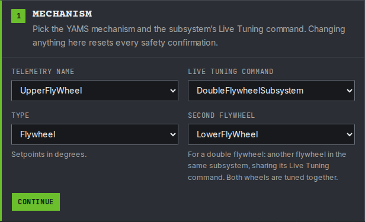
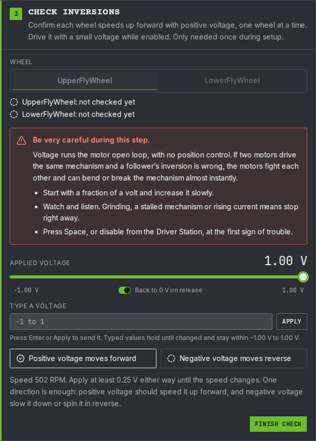
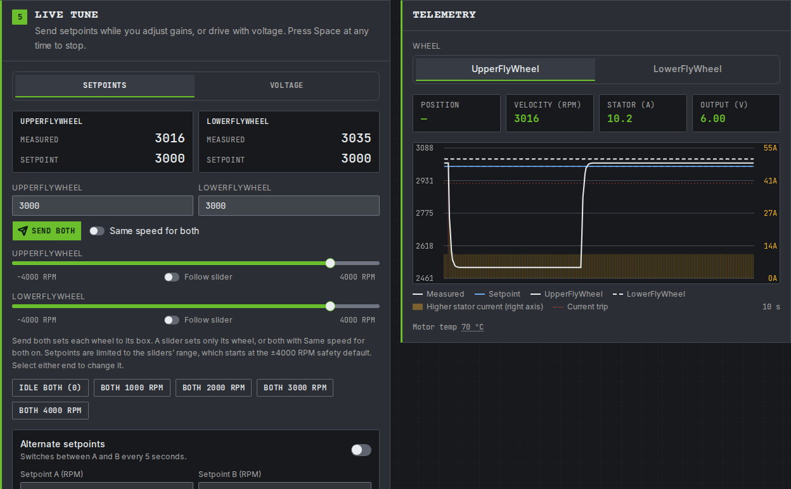
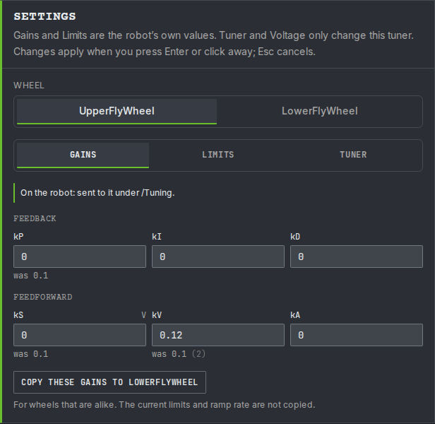
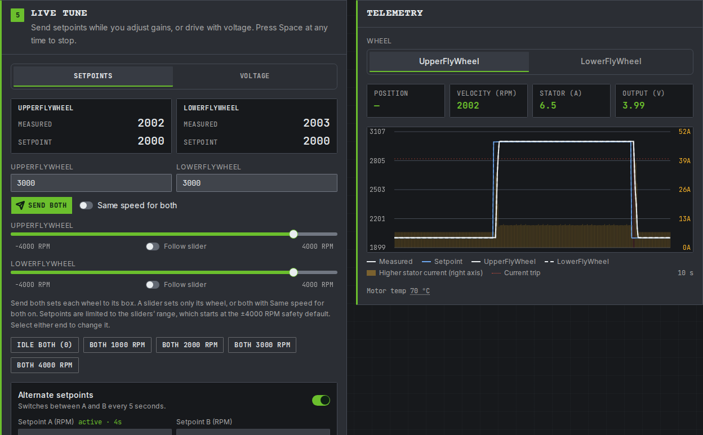

# Step 4: Tune it

The gains from step 1 are placeholders: `kS` is 0.1, `kV` is 0.12 and `kP` is 0.1 on both wheels. On this page you tune them while the simulation runs, the same way you will tune the real wheels on the robot. Nothing is saved until you copy the numbers into your code at the end.

A flywheel is tuned the way [the shooter's tune step](../shooter-flywheels/tune.md) does it: `kV` first, with `kP` turned off, then a little `kP`. The difference here is that there are two wheels. This tutorial's wheels are alike, a Kraken X60 on each at 1:1, so you tune one and copy its gains to the other.


**In simulation you are tuning the simulation's gains.** While the code runs in simulation, live tuning changes the `withSimClosedLoopController` and `withSimFeedforward` values. On the real robot it changes `withClosedLoopController` and `withFeedforward`.


## Before you start

* Start the simulation and enable **Teleoperated**, as in [step 2's check](commands.md#check-it-in-simulation). Both wheels are still.
* Do not press any of the shooter's buttons while you tune. A button runs another command on the subsystem, which stops live tuning. If that happens, start live tuning again.

Then tune with the YAMS Live Tuner, or by typing the values in AdvantageScope and Elastic. Both change the same values, so pick one.



The [YAMS Live Tuner](../../details/live-tuning/live-tuner.md) tunes both wheels of a double flywheel together: it checks each wheel before anything spins, then you send speeds and change gains while watching both on one graph.



### Connect

Open [tuning.yassrobotics.com](https://tuning.yassrobotics.com/), pick **Simulation**, and press **Connect**. If your browser asks whether the page may connect to devices on your local network, allow it.

**Check it:** the badge in the header shows `localhost`, with the robot enabled in Teleop.



### Pick both wheels

1. Under **Telemetry name**, choose `UpperFlyWheel`: the name from the upper motor's `withTelemetry`.
2. Under **Live Tuning command**, choose `DoubleFlywheelSubsystem` (Commands v2 and C++) or `DoubleFlywheelMechanism` (Commands v3). Both wheels share it.
3. Set **Type** to **Flywheel**, and **Second flywheel** to `LowerFlyWheel`.
4. Press **Continue**.

<figure><figcaption><p>Both wheels of the tutorial's shooter, tuned through one <code>Live Tuning</code> command.</p></figcaption></figure>

**Check it:** the telemetry card shows both wheels at 0 RPM.



### Checklist and inversions

The inversions are checked one wheel at a time, starting with `UpperFlyWheel`.

1. Tick every item on the pre-motion checklist, leave **Current trip (A)** at 40, and press **Continue**.
2. Tick the confirmation and press **Start voltage control**.
3. Drag the voltage slider to the right and hold it. The upper wheel spins up. Let go once **Positive voltage moves forward** is ticked: the slider goes back to 0 V.
4. If the wheel does not spin with the slider all the way to the right, select the number at the slider's right end, 1.00 V to start with, and raise it a little.
5. Press **Finish check**. `UpperFlyWheel` now reads **passed**.
6. Choose `LowerFlyWheel` under **Wheel**, press **Start voltage control**, and do the same.

<figure><figcaption><p>The upper wheel spins forward at 1 V. The lower wheel is checked the same way next.</p></figcaption></figure>

**Check it:** both wheels read **passed**, and the Live tune card opens. If the Live Tuner warns that a wheel's speed went the wrong way, that wheel's `withMotorInverted` in step 1 is wrong.



### Start live tuning and find kV

Press **Start Live Tuning**. The speeds and gains you send are now applied to both wheels every loop.

`kV` is how many volts the motor needs for each rotation per second of wheel speed. Get it right and the wheel reaches its speed on feedforward alone.

1. On the Settings card, choose `UpperFlyWheel` under **Wheel**. On its **Gains** tab, type `0` into **kP** and `0` into **kS**. The simulation has no friction, so it needs no `kS`.
2. On the **Setpoints** tab, press **Both 3000 RPM**.
3. Watch the upper wheel, the solid line on the graph. Type `0.1` into **kV**: the wheel settles well below 3000 RPM.
4. Raise **kV** a little at a time until the measured speed settles on the setpoint. For a Kraken X60 at 1:1 it ends up near `0.12`. If the wheel settles above the setpoint, lower it.

<figure><figcaption><p>The upper wheel's <code>kV</code> raised from 0.1 to 0.12: it climbs from about 2500 RPM onto 3000 RPM.</p></figcaption></figure>

**Check it:** the upper wheel settles within a few RPM of 3000, with `kP` still at 0.



### Copy the gains to the other wheel

The two wheels are alike, so the lower wheel needs the same gains.

1. With `UpperFlyWheel` still chosen on the Settings card, press **Copy these gains to LowerFlyWheel**. It copies the feedback, the feedforward and the motion profile, but not the current limits.
2. Press **Both 2000 RPM**, then **Both 3000 RPM**.

<figure><figcaption><p>The upper wheel's gains, ready to copy to the lower wheel.</p></figcaption></figure>

**Check it:** both wheels settle on each setpoint with the same `kV`. If your wheels are not alike, such as different gearing or motors, tune the lower wheel the same way instead of copying.



### Tune kP

`kP` adds a push when a wheel is slower or faster than its setpoint, such as when a game piece goes through and drags it down.

1. Type `0.1` into the upper wheel's **kP**, and copy the gains to the lower wheel again.
2. Turn on **Alternate setpoints**, with **Setpoint A** at `2000` and **Setpoint B** at `3000`. Both wheels now change speed every 5 seconds.
3. Raise **kP** a step at a time (0.2, 0.3, ...), copying it to the lower wheel each time. Each step should make the wheels reach the new speed a little faster.
4. Stop, and press **was** to go back one step, when the speed overshoots the setpoint or the line gets jittery.

<figure><figcaption><p><code>kP</code> 0.2 on both wheels, alternating between 2000 and 3000 RPM.</p></figcaption></figure>

**Check it:** both wheels reach each new speed quickly and settle on it without bouncing around it. Press **Space** to stop when you are done.





You type each value into its NetworkTables key yourself, and graph both wheels in AdvantageScope. The steps are [the shooter's tune step](../shooter-flywheels/tune.md), done once for each wheel. Only the names differ:

| | Shooter tutorial | This tutorial |
| --- | --- | --- |
| Live Tuning command, Commands v2 and C++ | `NT:/Tuning/ShooterSubsystem/Live Tuning` | `NT:/Tuning/DoubleFlywheelSubsystem/Live Tuning` |
| Live Tuning command, Commands v3 | `NT:/Tuning/ShooterMechanism/Live Tuning` | `NT:/Tuning/DoubleFlywheelMechanism/Live Tuning` |
| Values you type | `NT:/Tuning/Shooter/ShooterMotor/` | `NT:/Tuning/UpperFlyWheel/` and `NT:/Tuning/LowerFlyWheel/` |
| Values you watch | `NT:/Mechanisms/Shooter/ShooterMotor/` | `NT:/Mechanisms/UpperFlyWheel/` and `NT:/Mechanisms/LowerFlyWheel/` |

One `Live Tuning` command covers both wheels, so start it once. Then:

1. Type `0` into `closedloop/feedback/kP` and `closedloop/feedforward/kS` under both wheels.
2. Type `3000` into `closedloop/setpoint/velocity` under both wheels.
3. Raise `closedloop/feedforward/kV` under `UpperFlyWheel` until its `mechanism/velocity` settles on 50 (3000 RPM is 50 rotations per second). Type the same `kV` under `LowerFlyWheel`.
4. Raise `closedloop/feedback/kP` on both wheels, a step at a time, while you move the setpoints between `2000` and `3000`.



## Copy the numbers into your code

Dashboard changes are lost when the code restarts. Write the numbers you ended up with into both configs from step 1. In simulation they go into the `Sim` versions.




```java
// Before, in both upperConfig and lowerConfig
.withSimClosedLoopController(0.1, 0, 0)
.withSimFeedforward(new SimpleMotorFeedforward(0.1, 0.12, 0))

// After: your numbers. SimpleMotorFeedforward takes kS, kV, kA.
.withSimClosedLoopController(0.2, 0, 0)
.withSimFeedforward(new SimpleMotorFeedforward(0, 0.12, 0))
```





```java
// Before, in both upperConfig and lowerConfig
.withSimClosedLoopController(0.1, 0, 0)
.withSimFeedforward(new SimpleMotorFeedforward(0.1, 0.12, 0))

// After: your numbers. SimpleMotorFeedforward takes kS, kV, kA.
.withSimClosedLoopController(0.2, 0, 0)
.withSimFeedforward(new SimpleMotorFeedforward(0, 0.12, 0))
```




Both configs share one `feedforward` for the real robot and simulation. Give the simulation its own:


```cpp
// Your simulation numbers: kS and kV.
const Feedforward simFeedforward{0_V, wpi::units::unit_t<Feedforward::kv_unit>{0.12}};

// Then, in both m_upperConfig and m_lowerConfig: kP, kI, kD, and the feedforward.
.WithSimClosedLoopController(0.2, 0, 0)
.WithSimFeedforward(simFeedforward)
```




The numbers above are an example. Use the ones you found.

**Check it:** restart the simulation and enable it. Press **A**: both wheels reach 3000 RPM quickly and hold it. Press **B** and **X**: each wheel reaches its own speed of the backspin or topspin shot.

## If it did not work

* **Only one wheel is in the Telemetry name list.** Check that `setupTelemetry()` is called on both `SmartMotorController`s, as in step 1.
* **AdvantageScope: typing a value does nothing.** Turn on AdvantageScope's tuning mode, check the `Live Tuning` command is still running, and check you typed under `NT:/Tuning`, not `NT:/Mechanisms`.
* **Live tuning stopped on its own.** A button press took over the subsystem. On the Live Tuner, the current trip or pressing Space also stops it. Start it again.
* **The two wheels settle at different speeds with the same gains.** The wheels are not alike after all. Tune each one on its own.
* **The numbers were gone after a restart.** They only last until the code stops. Copy them into your code, as in [Copy the numbers into your code](#copy-the-numbers-into-your-code).

More problems and fixes: [Troubleshooting](../troubleshooting.md).

## Run it on the robot

Put it on the robot with [the arm's step 6: Run it on the robot](../arm/robot.md), with these differences:

* The CAN IDs are the two `TalonFX`s from step 1.
* A flywheel has no starting position and no soft limits, so skip those parts.
* For the direction check, positive should spin each wheel the way that throws a game piece **out**.
* On the first enable, press **A** (3000 RPM on both wheels) before you try the spin shots.
* Tune `kS`, then `kV`, then `kP` again on the robot. Friction means real wheels need some `kS`. Copy the robot's numbers into `withClosedLoopController` and `withFeedforward`.
