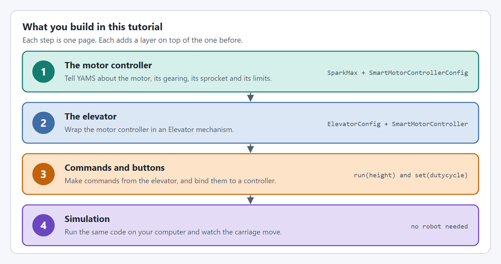

# Elevator


Mechanism classes are meant to be used with "tightly coupled" mechanisms where the Mechanism has 1 or more motor controlling it on a connected shaft, gearbox, or other linkage.

**IF** your mechanism is "loosely coupled", you **CAN** still use YAMS. **HOWEVER** you have to create and control the `SmartMotorController` directly as shown in [how-do-i-control-a-mechanism-without-a-mechanism-class.md](../how-to/how-do-i-control-a-mechanism-without-a-mechanism-class.md "mention") OR use `SmartMotorControllerConfig.withLooselyCoupledFollowers(SmartMotorController...)`


## Intro

At the end of this tutorial you will have an `Elevator` that works in both real life and simulation with the same code!



#### Simulation

<figure><figcaption></figcaption></figure>

<figure><figcaption></figcaption></figure>



#### Real Life





## Details

This `Elevator` uses the following hardware and controls:

* A `SparkMax` driving one NEO controls the `Elevator`
* A `12:1` gearbox on the `Elevator`
* #25 chain on a 22 tooth sprocket lifts the carriage
* Holding the bottom face button (`A` on an Xbox controller) takes the `Elevator` to 0.5 m
* Holding the right face button (`B` on an Xbox controller) takes the `Elevator` to 1 m
* Holding the left face button (`X` on an Xbox controller) drives the `Elevator` up
* Holding the top face button (`Y` on an Xbox controller) drives the `Elevator` down
* With no button held, the `Elevator` goes to 0 m

## The steps

<figure><figcaption>
Four steps, one page each.
</figcaption></figure>

Every step has a tab for **Java with Commands v2**, **Java with Commands v3** and **C++**.

| Step | What you do |
| --- | --- |
| [Before you start](project-setup.md) | Create a WPILib project and install YAMS and REVLib. Skip this if you already have a project. |
| [Step 1: The motor controller](elevator/motor-controller.md) | Configure the `SparkMax` and wrap it in a `SmartMotorController`. |
| [Step 2: The elevator](elevator/mechanism.md) | Describe the elevator with an `ElevatorConfig` and create the `Elevator`. |
| [Step 3: Commands and buttons](elevator/commands.md) | Turn the `Elevator` into commands and bind them to controller buttons. |
| [Step 4: Simulate it](elevator/simulate.md) | Run the code on your computer and drive the elevator with a controller. |

## Complete Example

The following files show a complete, working Elevator from the YAMS `simple_robot-2027` Commands v2 example. It uses an exponential profile instead of the trapezoidal profile in this tutorial.





The same robot in the other two flavors:

* **Java, Commands v3:** [`mechanisms/ElevatorMechanism.java`](https://github.com/Yet-Another-Software-Suite/YAMS/blob/master/examples/commands3/simple_robot-2027/src/main/java/first/robot/mechanisms/ElevatorMechanism.java) in `examples/commands3/simple_robot-2027`
* **C++:** [`ElevatorSubsystem.h`](https://github.com/Yet-Another-Software-Suite/YAMS/blob/master/examples/cpptest/src/main/include/subsystems/ElevatorSubsystem.h) and [`ElevatorSubsystem.cpp`](https://github.com/Yet-Another-Software-Suite/YAMS/blob/master/examples/cpptest/src/main/cpp/subsystems/ElevatorSubsystem.cpp) in `examples/cpptest`
