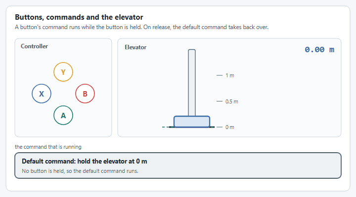
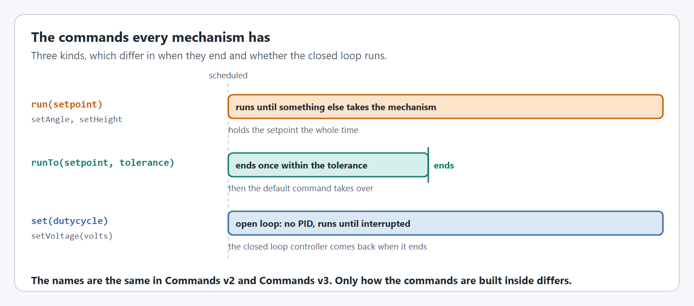

# Step 3: Commands and buttons

The `Elevator` makes commands for you. Your class hands them out, and the buttons schedule them.

<figure><figcaption>
A held button owns the elevator. Let go, and the default command brings it back down.
</figcaption></figure>

## The commands a Elevator gives you

| What it does | Java, Commands v2 | Java, Commands v3 | C++ |
| --- | --- | --- | --- |
| Go to a height and hold it. It never ends on its own. | `elevator.run(height)` | `elevator.setHeight(height)` | `m_elevator->Run(height)` |
| Go to a height, and end when the carriage is within the tolerance. | `elevator.runTo(height, tolerance)` | `elevator.runTo(height, tolerance)` | `m_elevator->RunTo(height, tolerance)` |
| Drive at a duty cycle from -1 to 1, with the closed loop off. | `elevator.set(dutycycle)` | `elevator.set(dutycycle)` | `m_elevator->Set(dutycycle)` |

The **default command** runs whenever no other command is using the elevator. Here it holds the carriage at the bottom.

## The code



Lines in **bold** are new in this step.

Add the commands to `ElevatorSubsystem.java`, then create the subsystem and bind the buttons in `RobotContainer.java`. The template bound the right face button to its example command; that binding is replaced.

<pre class="language-java" data-title="subsystems/ElevatorSubsystem.java" data-line-numbers><code class="lang-java">package first.robot.subsystems;

import static org.wpilib.units.Units.Amps;
import static org.wpilib.units.Units.Inches;
import static org.wpilib.units.Units.Meters;
import static org.wpilib.units.Units.MetersPerSecond;
import static org.wpilib.units.Units.MetersPerSecondPerSecond;
import static org.wpilib.units.Units.Pounds;

import com.revrobotics.spark.SparkLowLevel.MotorType;
import com.revrobotics.spark.SparkMax;
<strong>import org.wpilib.command2.Command;
</strong>import org.wpilib.command2.SubsystemBase;
import org.wpilib.hardware.bus.CANPort;
import org.wpilib.math.controller.ElevatorFeedforward;
import org.wpilib.math.system.DCMotor;
<strong>import org.wpilib.units.measure.Distance;
</strong>import yams.commands2.config.SmartMotorControllerConfig;
import yams.commands2.mechanisms.Elevator;
import yams.core.gearing.GearBox;
import yams.core.gearing.MechanismGearing;
import yams.core.mechanisms.config.ElevatorConfig;
import yams.core.motorcontrollers.SmartMotorController;
import yams.core.motorcontrollers.enums.ControlMode;
import yams.core.motorcontrollers.enums.MotorMode;
import yams.core.motorcontrollers.local.SparkWrapper;
import yams.core.telemetry.enums.TelemetryVerbosity;

public class ElevatorSubsystem extends SubsystemBase {

  // What the motor controller should do: its control mode, gains, gearing and limits.
  private final SmartMotorControllerConfig smcConfig = new SmartMotorControllerConfig(this)
      .withControlMode(ControlMode.CLOSED_LOOP)
      // How far the carriage moves for each turn of the output shaft:
      // #25 chain has a 0.25 inch pitch, and the sprocket has 22 teeth.
      .withDrumRadius(Inches.of(0.25), 22)
      // Feedback constants (PID), on the real robot and in simulation.
      .withClosedLoopController(4, 0, 0)
      .withSimClosedLoopController(4, 0, 0)
      // The fastest the closed loop is allowed to move and accelerate the carriage.
      .withTrapezoidalProfile(MetersPerSecond.of(0.5), MetersPerSecondPerSecond.of(0.5))
      // Feedforward constants, on the real robot and in simulation.
      .withFeedforward(new ElevatorFeedforward(0, 0, 0))
      .withSimFeedforward(new ElevatorFeedforward(0, 0, 0))
      // Gearing from the motor rotor to the sprocket: a 3:1 stage and a 4:1 stage, 12:1 in total.
      .withGearing(new MechanismGearing(GearBox.fromReductionStages(3, 4)))
      .withMotorInverted(false)
      .withZeroPower(MotorMode.BRAKE)
      .withStatorCurrentLimit(Amps.of(40))
      // Where the carriage is when the robot turns on.
      .withStartingPosition(Meters.of(0))
      // The closed loop will not take the carriage past these heights.
      .withSoftLimits(Meters.of(0), Meters.of(2))
      // Telemetry name and how much to publish.
      .withTelemetry("ElevatorMotor", TelemetryVerbosity.HIGH);

  // The vendor motor controller object: a SPARK MAX with CAN ID 4.
  private final SparkMax spark = new SparkMax(CANPort.CAN_S0, 4, MotorType.kBrushless);

  // The SmartMotorController applies the config to the SPARK MAX, which drives one NEO.
  private final SmartMotorController motor = new SparkWrapper(spark, DCMotor.getNEO(1), smcConfig);

  private final ElevatorConfig elevatorConfig = new ElevatorConfig()
      // The hard stops, used by the simulation.
      .withHardLimits(Meters.of(0), Meters.of(3))
      // The weight of the carriage and everything on it, used by the simulation.
      .withCarriageWeight(Pounds.of(16))
      // Telemetry name and how much to publish.
      .withTelemetry("Elevator", TelemetryVerbosity.HIGH);

  // The elevator mechanism.
  private final Elevator elevator = new Elevator(elevatorConfig, motor);

<strong>  /** Go to a height and hold it. This command does not end on its own. */
</strong><strong>  public Command run(Distance height) {
</strong><strong>    return elevator.run(height);
</strong><strong>  }
</strong>
<strong>  /** Go to a height, and end once the carriage is within the tolerance of it. */
</strong><strong>  public Command runTo(Distance height, Distance tolerance) {
</strong><strong>    return elevator.runTo(height, tolerance);
</strong><strong>  }
</strong>
<strong>  /** Drive the elevator with a duty cycle from -1 to 1. The closed loop is not used. */
</strong><strong>  public Command set(double dutycycle) {
</strong><strong>    return elevator.set(dutycycle);
</strong><strong>  }
</strong>
  @Override
  public void periodic() {
    // Publishes the elevator's telemetry, and applies anything changed through live tuning.
    elevator.updateTelemetry();
  }

  @Override
  public void simulationPeriodic() {
    // Runs the elevator's physics simulation.
    elevator.simIterate();
  }
}
</code></pre>

<pre class="language-java" data-title="RobotContainer.java" data-line-numbers><code class="lang-java">package first.robot;

<strong>import static org.wpilib.units.Units.Meters;
</strong>
import org.wpilib.command2.Command;
import org.wpilib.command2.button.CommandGamepad;
import org.wpilib.command2.button.Trigger;
import first.robot.Constants.OperatorConstants;
import first.robot.commands.Autos;
import first.robot.commands.ExampleCommand;
<strong>import first.robot.subsystems.ElevatorSubsystem;
</strong>import first.robot.subsystems.ExampleSubsystem;

/**
 * This class is where the bulk of the robot should be declared. Since Command-based is a
 * "declarative" paradigm, very little robot logic should actually be handled in the {@link Robot}
 * periodic methods (other than the scheduler calls). Instead, the structure of the robot (including
 * subsystems, commands, and trigger mappings) should be declared here.
 */
public class RobotContainer {
  // The robot's subsystems and commands are defined here...
  private final ExampleSubsystem exampleSubsystem = new ExampleSubsystem();
<strong>  private final ElevatorSubsystem elevator = new ElevatorSubsystem();
</strong>
  private final CommandGamepad driverController =
      new CommandGamepad(OperatorConstants.DRIVER_CONTROLLER_PORT);

  /** The container for the robot. Contains subsystems, OI devices, and commands. */
  public RobotContainer() {
    // Configure the trigger bindings
    configureBindings();

<strong>    // When no other command is using the elevator, hold it at the bottom.
</strong><strong>    elevator.setDefaultCommand(elevator.run(Meters.of(0)));
</strong>  }

  /**
   * Use this method to define your trigger->command mappings. Triggers can be created via the
   * {@link Trigger#Trigger(java.util.function.BooleanSupplier)} constructor with an arbitrary
   * predicate, or via the named factories in {@link org.wpilib.command2.button.CommandGenericHID}'s
   * subclasses for {@link CommandGamepad Gamepad} gamepads or {@link
   * org.wpilib.command2.button.CommandJoystick Flight joysticks}.
   */
  private void configureBindings() {
    // Schedule `ExampleCommand` when `exampleCondition` changes to `true`
    new Trigger(exampleSubsystem::exampleCondition).onTrue(new ExampleCommand(exampleSubsystem));

<strong>    // Hold a height while the bottom (A) or right (B) face button is held.
</strong><strong>    driverController.faceDown().whileTrue(elevator.run(Meters.of(0.5)));
</strong><strong>    driverController.faceRight().whileTrue(elevator.run(Meters.of(1)));
</strong><strong>    // Drive the elevator up or down while the left (X) or top (Y) face button is held.
</strong><strong>    driverController.faceLeft().whileTrue(elevator.set(0.3));
</strong><strong>    driverController.faceUp().whileTrue(elevator.set(-0.3));
</strong>  }

  /**
   * Use this to pass the autonomous command to the main {@link Robot} class.
   *
   * @return the command to run in autonomous
   */
  public Command getAutonomousCommand() {
    // An example command will be run in autonomous
    return Autos.exampleAuto(exampleSubsystem);
  }
}
</code></pre>



Lines in **bold** are new in this step.

Add the commands to `ElevatorMechanism.java`, set the default command in `Robot.java`, and bind the buttons in `ExampleTeleop.java`.

A `Mechanism` already has a `run(...)` method that takes a coroutine, so the commands here have their own names. The default command is wrapped with `Command.LOWEST_PRIORITY`, so that any other command for the elevator can interrupt it.

<pre class="language-java" data-title="mechanisms/ElevatorMechanism.java" data-line-numbers><code class="lang-java">package first.robot.mechanisms;

import static org.wpilib.units.Units.Amps;
import static org.wpilib.units.Units.Inches;
import static org.wpilib.units.Units.Meters;
import static org.wpilib.units.Units.MetersPerSecond;
import static org.wpilib.units.Units.MetersPerSecondPerSecond;
import static org.wpilib.units.Units.Pounds;

import com.revrobotics.spark.SparkLowLevel.MotorType;
import com.revrobotics.spark.SparkMax;
<strong>import org.wpilib.command3.Command;
</strong>import org.wpilib.command3.Mechanism;
import org.wpilib.hardware.bus.CANPort;
import org.wpilib.math.controller.ElevatorFeedforward;
import org.wpilib.math.system.DCMotor;
<strong>import org.wpilib.units.measure.Distance;
</strong>import yams.commands3.config.SmartMotorControllerConfig;
import yams.commands3.mechanisms.Elevator;
import yams.core.gearing.GearBox;
import yams.core.gearing.MechanismGearing;
import yams.core.mechanisms.config.ElevatorConfig;
import yams.core.motorcontrollers.SmartMotorController;
import yams.core.motorcontrollers.enums.ControlMode;
import yams.core.motorcontrollers.enums.MotorMode;
import yams.core.motorcontrollers.local.SparkWrapper;
import yams.core.telemetry.enums.TelemetryVerbosity;

public class ElevatorMechanism implements Mechanism {

  // What the motor controller should do: its control mode, gains, gearing and limits.
  private final SmartMotorControllerConfig smcConfig = new SmartMotorControllerConfig(this)
      .withControlMode(ControlMode.CLOSED_LOOP)
      // How far the carriage moves for each turn of the output shaft:
      // #25 chain has a 0.25 inch pitch, and the sprocket has 22 teeth.
      .withDrumRadius(Inches.of(0.25), 22)
      // Feedback constants (PID), on the real robot and in simulation.
      .withClosedLoopController(4, 0, 0)
      .withSimClosedLoopController(4, 0, 0)
      // The fastest the closed loop is allowed to move and accelerate the carriage.
      .withTrapezoidalProfile(MetersPerSecond.of(0.5), MetersPerSecondPerSecond.of(0.5))
      // Feedforward constants, on the real robot and in simulation.
      .withFeedforward(new ElevatorFeedforward(0, 0, 0))
      .withSimFeedforward(new ElevatorFeedforward(0, 0, 0))
      // Gearing from the motor rotor to the sprocket: a 3:1 stage and a 4:1 stage, 12:1 in total.
      .withGearing(new MechanismGearing(GearBox.fromReductionStages(3, 4)))
      .withMotorInverted(false)
      .withZeroPower(MotorMode.BRAKE)
      .withStatorCurrentLimit(Amps.of(40))
      // Where the carriage is when the robot turns on.
      .withStartingPosition(Meters.of(0))
      // The closed loop will not take the carriage past these heights.
      .withSoftLimits(Meters.of(0), Meters.of(2))
      // Telemetry name and how much to publish.
      .withTelemetry("ElevatorMotor", TelemetryVerbosity.HIGH);

  // The vendor motor controller object: a SPARK MAX with CAN ID 4.
  private final SparkMax spark = new SparkMax(CANPort.CAN_S0, 4, MotorType.kBrushless);

  // The SmartMotorController applies the config to the SPARK MAX, which drives one NEO.
  private final SmartMotorController motor = new SparkWrapper(spark, DCMotor.getNEO(1), smcConfig);

  private final ElevatorConfig elevatorConfig = new ElevatorConfig()
      // The hard stops, used by the simulation.
      .withHardLimits(Meters.of(0), Meters.of(3))
      // The weight of the carriage and everything on it, used by the simulation.
      .withCarriageWeight(Pounds.of(16))
      // Telemetry name and how much to publish.
      .withTelemetry("Elevator", TelemetryVerbosity.HIGH);

  // The elevator mechanism.
  private final Elevator elevator = new Elevator(elevatorConfig, motor);

<strong>  /** Go to a height and hold it. This command does not end on its own. */
</strong><strong>  public Command setHeight(Distance height) {
</strong><strong>    return elevator.setHeight(height);
</strong><strong>  }
</strong>
<strong>  /** Go to a height, and end once the carriage is within the tolerance of it. */
</strong><strong>  public Command moveTo(Distance height, Distance tolerance) {
</strong><strong>    return elevator.runTo(height, tolerance);
</strong><strong>  }
</strong>
<strong>  /** Drive the elevator with a duty cycle from -1 to 1. The closed loop is not used. */
</strong><strong>  public Command set(double dutycycle) {
</strong><strong>    return elevator.set(dutycycle);
</strong><strong>  }
</strong>
<strong>  /** Hold a height at the lowest priority, so that any other elevator command can interrupt it. */
</strong><strong>  public Command hold(Distance height) {
</strong><strong>    return run(coroutine -> coroutine.await(elevator.setHeight(height)))
</strong><strong>        .withPriority(Command.LOWEST_PRIORITY)
</strong><strong>        .named("Elevator Hold");
</strong><strong>  }
</strong>
  /** Call this from Robot.robotPeriodic(), before the scheduler runs. */
  public void periodic() {
    // Publishes the elevator's telemetry, and applies anything changed through live tuning.
    elevator.updateTelemetry();
  }

  /** Call this from Robot.robotPeriodic() in simulation. */
  public void simulationPeriodic() {
    // Runs the elevator's physics simulation.
    elevator.simIterate();
  }
}
</code></pre>

<pre class="language-java" data-title="Robot.java" data-line-numbers><code class="lang-java">package first.robot;

<strong>import static org.wpilib.units.Units.Meters;
</strong>
import org.wpilib.command3.Scheduler;
import org.wpilib.command3.button.CommandGamepad;
import org.wpilib.framework.OpModeRobot;
import org.wpilib.framework.RobotBase;
import first.robot.constants.DriverConstants;
import first.robot.mechanisms.ElevatorMechanism;
import first.robot.mechanisms.ExampleMechanism;

public class Robot extends OpModeRobot {
  final ExampleMechanism exampleMechanism = new ExampleMechanism();
  final ElevatorMechanism elevator = new ElevatorMechanism();
  final CommandGamepad exampleController =
      new CommandGamepad(DriverConstants.DRIVER_CONTROLLER_PORT);

<strong>  public Robot() {
</strong><strong>    // When no other command is using the elevator, hold it at the bottom.
</strong><strong>    elevator.setDefaultCommand(elevator.hold(Meters.of(0)));
</strong><strong>  }
</strong>
  @Override
  public void robotPeriodic() {
    // Update the mechanism before the scheduler runs its commands.
    elevator.periodic();
    if (RobotBase.isSimulation()) {
      elevator.simulationPeriodic();
    }
    Scheduler.getDefault().run();
  }
}
</code></pre>

<pre class="language-java" data-title="ExampleTeleop.java" data-line-numbers><code class="lang-java">package first.robot;

<strong>import static org.wpilib.units.Units.Meters;
</strong>
import org.wpilib.opmode.OpMode;
import org.wpilib.opmode.Teleop;

@Teleop
public class ExampleTeleop implements OpMode {
  public ExampleTeleop(Robot robot) {
    robot.exampleController.rightStick().whileTrue(robot.exampleMechanism.exampleCommand());

<strong>    // Hold a height while the bottom (A) or right (B) face button is held.
</strong><strong>    robot.exampleController.faceDown().whileTrue(robot.elevator.setHeight(Meters.of(0.5)));
</strong><strong>    robot.exampleController.faceRight().whileTrue(robot.elevator.setHeight(Meters.of(1)));
</strong><strong>    // Drive the elevator up or down while the left (X) or top (Y) face button is held.
</strong><strong>    robot.exampleController.faceLeft().whileTrue(robot.elevator.set(0.3));
</strong><strong>    robot.exampleController.faceUp().whileTrue(robot.elevator.set(-0.3));
</strong>  }
}
</code></pre>



Lines in **bold** are new in this step.

Declare the commands in `ElevatorSubsystem.hpp`, define them in `ElevatorSubsystem.cpp`, then create the subsystem and bind the buttons in `RobotContainer`. The template bound the right face button to its example command; that binding is replaced.

<pre class="language-cpp" data-title="include/subsystems/ElevatorSubsystem.hpp" data-line-numbers><code class="lang-cpp">#pragma once

#include &#x3C;optional>

#include &#x3C;rev/SparkMax.h>
<strong>#include &#x3C;wpi/commands2/CommandPtr.hpp>
</strong>#include &#x3C;wpi/commands2/SubsystemBase.hpp>
#include &#x3C;wpi/hardware/bus/CANPort.hpp>
<strong>#include &#x3C;wpi/units/length.hpp>
</strong>
#include "yams/mechanisms/config/ElevatorConfig.hpp"
#include "yams/mechanisms/positional/Elevator.hpp"
#include "yams/motorcontrollers/SmartMotorControllerConfig.hpp"
#include "yams/motorcontrollers/local/SparkWrapper.hpp"

class ElevatorSubsystem : public wpi::cmd::SubsystemBase {
 public:
  ElevatorSubsystem();

<strong>  /** Go to a height and hold it. This command does not end on its own. */
</strong><strong>  wpi::cmd::CommandPtr Run(wpi::units::meter_t height);
</strong>
<strong>  /** Go to a height, and end once the carriage is within the tolerance of it. */
</strong><strong>  wpi::cmd::CommandPtr RunTo(wpi::units::meter_t height, wpi::units::meter_t tolerance);
</strong>
<strong>  /** Drive the elevator with a duty cycle from -1 to 1. The closed loop is not used. */
</strong><strong>  wpi::cmd::CommandPtr Set(double dutycycle);
</strong>
  void Periodic() override;
  void SimulationPeriodic() override;

 private:
  // The vendor motor controller object: a SPARK MAX with CAN ID 4.
  rev::spark::SparkMax m_spark{wpi::CANPort::CAN_S0, 4, rev::spark::SparkMax::MotorType::kBrushless};

  // What the motor controller should do. It is filled in by the constructor.
  yams::motorcontrollers::SmartMotorControllerConfig m_smcConfig;

  // The SmartMotorController, created in the constructor once the config is ready.
  std::optional&#x3C;yams::motorcontrollers::local::SparkWrapper> m_motor;

  // The elevator mechanism and its config, also set up in the constructor.
  yams::mechanisms::config::ElevatorConfig m_elevatorConfig;
  std::optional&#x3C;yams::mechanisms::positional::Elevator> m_elevator;
};
</code></pre>

<pre class="language-cpp" data-title="cpp/subsystems/ElevatorSubsystem.cpp" data-line-numbers><code class="lang-cpp">#include "subsystems/ElevatorSubsystem.hpp"

#include &#x3C;wpi/math/controller/ElevatorFeedforward.hpp>
#include &#x3C;wpi/math/system/DCMotor.hpp>
#include &#x3C;wpi/units/acceleration.hpp>
#include &#x3C;wpi/units/current.hpp>
#include &#x3C;wpi/units/length.hpp>
#include &#x3C;wpi/units/mass.hpp>
#include &#x3C;wpi/units/velocity.hpp>
#include &#x3C;wpi/units/voltage.hpp>

#include "yams/gearing/GearBox.hpp"
#include "yams/gearing/MechanismGearing.hpp"

using namespace yams::gearing;
using Cfg = yams::motorcontrollers::SmartMotorControllerConfig;

ElevatorSubsystem::ElevatorSubsystem() {
  // What the motor controller should do: its control mode, gains, gearing and limits.
  m_smcConfig
      .WithSubsystem(this)
      .WithClosedLoopMode()
      // How far the carriage moves for each turn of the output shaft:
      // #25 chain has a 0.25 inch pitch, and the sprocket has 22 teeth.
      .WithMechanismCircumference(0.25_in, 22)
      // Feedback constants (PID), on the real robot and in simulation.
      .WithFeedback(4, 0, 0)
      .WithSimClosedLoopController(4, 0, 0)
      // The fastest the closed loop is allowed to move and accelerate the carriage.
      .WithLinearTrapezoidProfile(0.5_mps, 0.5_mps_sq)
      // Feedforward constants: kS, kG and kV.
      .WithFeedforward(wpi::math::ElevatorFeedforward{
          0_V, 0_V, wpi::units::unit_t&#x3C;wpi::math::ElevatorFeedforward::kv_unit>{0}})
      // Gearing from the motor rotor to the sprocket: a 3:1 stage and a 4:1 stage, 12:1 in total.
      .WithMotorGearing(MechanismGearing{GearBox::FromReductionStages({3.0, 4.0})})
      .WithMotorInverted(false)
      .WithZeroPower(Cfg::MotorMode::BRAKE)
      .WithStatorCurrentLimit(40_A)
      // Where the carriage is when the robot turns on.
      .WithStartingPosition(0_m)
      // The closed loop will not take the carriage past these heights.
      .WithMeasurementLimits(0_m, 2_m)
      // Telemetry name and how much to publish.
      .WithTelemetry("ElevatorMotor", Cfg::TelemetryVerbosity::HIGH);

  // The SmartMotorController applies the config to the SPARK MAX, which drives one NEO.
  m_motor.emplace(&#x26;m_spark, wpi::math::DCMotor::NEO(1), &#x26;m_smcConfig);

  m_elevatorConfig
      // The hard stops, used by the simulation.
      .WithMinimumHeight(0_m)
      .WithMaximumHeight(3_m)
      // The weight of the carriage and everything on it, used by the simulation.
      .WithCarriageMass(16_lb)
      // Telemetry name.
      .WithTelemetryName("Elevator");

  // The elevator mechanism.
  m_elevator.emplace(&#x26;m_elevatorConfig, &#x26;m_motor.value());
}

<strong>wpi::cmd::CommandPtr ElevatorSubsystem::Run(wpi::units::meter_t height) {
</strong><strong>  return m_elevator->Run(height);
</strong><strong>}
</strong>
<strong>wpi::cmd::CommandPtr ElevatorSubsystem::RunTo(wpi::units::meter_t height, wpi::units::meter_t tolerance) {
</strong><strong>  return m_elevator->RunTo(height, tolerance);
</strong><strong>}
</strong>
<strong>wpi::cmd::CommandPtr ElevatorSubsystem::Set(double dutycycle) {
</strong><strong>  return m_elevator->Set(dutycycle);
</strong><strong>}
</strong>
void ElevatorSubsystem::Periodic() {
  // Publishes the elevator's telemetry, and applies anything changed through live tuning.
  m_elevator->UpdateTelemetry();
}

void ElevatorSubsystem::SimulationPeriodic() {
  // Runs the elevator's physics simulation.
  m_elevator->SimIterate();
}
</code></pre>

<pre class="language-cpp" data-title="include/RobotContainer.hpp" data-line-numbers><code class="lang-cpp">#pragma once

#include "Constants.hpp"
<strong>#include "subsystems/ElevatorSubsystem.hpp"
</strong>#include "subsystems/ExampleSubsystem.hpp"
#include "wpi/commands2/CommandPtr.hpp"
#include "wpi/commands2/button/CommandGamepad.hpp"

/**
 * This class is where the bulk of the robot should be declared.  Since
 * Command-based is a "declarative" paradigm, very little robot logic should
 * actually be handled in the {@link Robot} periodic methods (other than the
 * scheduler calls).  Instead, the structure of the robot (including subsystems,
 * commands, and trigger mappings) should be declared here.
 */
class RobotContainer {
 public:
  RobotContainer();

  wpi::cmd::CommandPtr GetAutonomousCommand();

 private:
  // Replace with CommandPS4Controller or CommandJoystick if needed
  wpi::cmd::CommandGamepad driverController{
      OperatorConstants::DRIVER_CONTROLLER_PORT};

  // The robot's subsystems are defined here...
  ExampleSubsystem subsystem;
<strong>  ElevatorSubsystem elevator;
</strong>
  void ConfigureBindings();
};
</code></pre>

<pre class="language-cpp" data-title="cpp/RobotContainer.cpp" data-line-numbers><code class="lang-cpp">#include "RobotContainer.hpp"

#include "commands/Autos.hpp"
#include "commands/ExampleCommand.hpp"
#include "wpi/commands2/button/Trigger.hpp"
<strong>#include "wpi/units/length.hpp"
</strong>
RobotContainer::RobotContainer() {
  // Initialize all of your commands and subsystems here

<strong>  // When no other command is using the elevator, hold it at the bottom.
</strong><strong>  elevator.SetDefaultCommand(elevator.Run(0_m));
</strong>
  // Configure the button bindings
  ConfigureBindings();
}

void RobotContainer::ConfigureBindings() {
  // Configure your trigger bindings here

  // Schedule `ExampleCommand` when `exampleCondition` changes to `true`
  wpi::cmd::Trigger([this] {
    return subsystem.ExampleCondition();
  }).OnTrue(ExampleCommand(&#x26;subsystem).ToPtr());

<strong>  // Hold a height while the bottom (A) or right (B) face button is held.
</strong><strong>  driverController.FaceDown().WhileTrue(elevator.Run(0.5_m));
</strong><strong>  driverController.FaceRight().WhileTrue(elevator.Run(1_m));
</strong><strong>  // Drive the elevator up or down while the left (X) or top (Y) face button is held.
</strong><strong>  driverController.FaceLeft().WhileTrue(elevator.Set(0.3));
</strong><strong>  driverController.FaceUp().WhileTrue(elevator.Set(-0.3));
</strong>}

wpi::cmd::CommandPtr RobotContainer::GetAutonomousCommand() {
  // An example command will be run in autonomous
  return autos::ExampleAuto(&#x26;subsystem);
}
</code></pre>




These commands are helpers that start and stop the closed loop for you. If you would rather set setpoints from your own command or state machine, see [Setpoint Methods vs Command Helpers](../../details/setpoint-methods.md).


## Which command ends?

<figure><figcaption>
When each kind of command ends.
</figcaption></figure>

The buttons here use the command that never ends, because a button that is held should keep holding the carriage. Use the one that ends when you need to know the carriage has arrived, such as in an autonomous sequence. [run() vs runTo() Commands](../../details/run-vs-runto.md) covers the difference, and [How to set an Elevator's target Height?](../../how-to/how-to-set-an-elevators-target-height.md) has more examples.

Previous: [Step 2: The elevator](mechanism.md)

Next: [Step 4: Simulate it](simulate.md)
