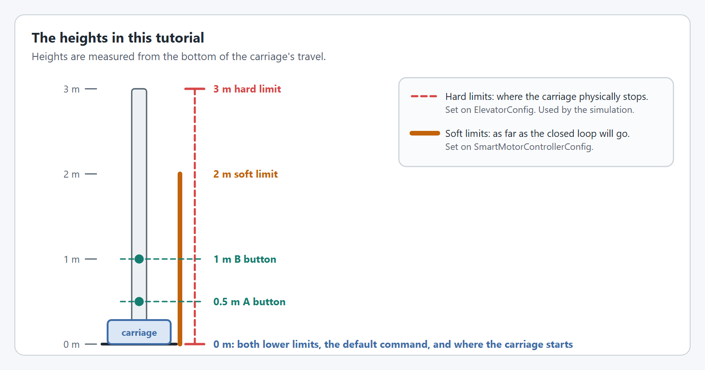

# Step 2: The elevator

The `SmartMotorController` from step 1 is configured, but nothing tells it to move yet. An `Elevator` adds what makes it an elevator: a physics simulation, a drawing of the mechanism for your dashboard, and the commands and triggers you will use in step 3.

<figure><figcaption><p>Two configs go into one mechanism.</p></figcaption></figure>


**In a hurry?** Jump to [the complete file](#the-complete-file), copy it, and change the values called out under **For your robot**. The numbered parts explain each piece in a sentence or two. You do not need to understand all of it to get moving: the pages under **Understanding** go deeper when you want them.


## 1. Describe the elevator

`ElevatorConfig` describes the elevator itself: its hard limits and the weight of its carriage. The simulation uses both. The hard limits are where the carriage physically stops, which is different from the soft limits you set in step 1.

<figure><figcaption><p>The soft limits from step 1 sit inside the hard limits from this step.</p></figcaption></figure>




```java
private final ElevatorConfig elevatorConfig = new ElevatorConfig()
    // The hard stops, used by the simulation.
    .withHardLimits(Meters.of(0), Meters.of(3))
    // The weight of the carriage and everything on it, used by the simulation.
    .withCarriageWeight(Pounds.of(16))
    // Telemetry name and how much to publish.
    .withTelemetry("Elevator", TelemetryVerbosity.HIGH);
```





```java
private final ElevatorConfig elevatorConfig = new ElevatorConfig()
    // The hard stops, used by the simulation.
    .withHardLimits(Meters.of(0), Meters.of(3))
    // The weight of the carriage and everything on it, used by the simulation.
    .withCarriageWeight(Pounds.of(16))
    // Telemetry name and how much to publish.
    .withTelemetry("Elevator", TelemetryVerbosity.HIGH);
```





```cpp
// The elevator mechanism and its config, also set up in the constructor.
yams::mechanisms::config::ElevatorConfig m_elevatorConfig;
std::optional<yams::mechanisms::positional::Elevator> m_elevator;
```



```cpp
m_elevatorConfig
    // The hard stops, used by the simulation.
    .WithMinimumHeight(0_m)
    .WithMaximumHeight(3_m)
    // The weight of the carriage and everything on it, used by the simulation.
    .WithCarriageMass(16_lb)
    // Telemetry name.
    .WithTelemetryName("Elevator");
```




**For your robot:** Set where your carriage's hard stops are, and what the carriage weighs with everything that rides on it.

Want the details? [Elevators](../../details/elevators.md) and [ElevatorConfig](../../details/mechanism-configs/elevator-config.md)

## 2. Create the Elevator

Hand the config, and the `SmartMotorController` from step 1, to the `Elevator`.




```java
// The elevator mechanism.
private final Elevator elevator = new Elevator(elevatorConfig, motor);
```





```java
// The elevator mechanism.
private final Elevator elevator = new Elevator(elevatorConfig, motor);
```





```cpp
// The elevator mechanism.
m_elevator.emplace(&m_elevatorConfig, &m_motor.value());
```




## 3. Update it every loop

Two calls keep the mechanism alive. `updateTelemetry()` publishes its telemetry and applies anything you change through live tuning. `simIterate()` runs the physics simulation, and only needs to run in simulation.

In Commands v2 and C++ the scheduler calls a subsystem's periodic methods for you, so there is nothing more to do.

In Commands v3 nothing calls a `Mechanism` every loop, so `Robot.java` does it, the same way as in [the arm tutorial's step 2](../arm/mechanism.md#3-update-it-every-loop), which explains each part. Every mechanism gets one line in `robotPeriodic()`, before `scheduler.run()`, and one in `simulationInit()`.

If your `Robot.java` already has `simulationInit()` and `startSimulation(...)` from the arm tutorial, add the lines below. If not, copy the whole `Robot.java` from the Commands v3 tab of [the complete file](#the-complete-file).




```java
@Override
public void periodic() {
  // Publishes the elevator's telemetry, and applies anything changed through live tuning.
  elevator.updateTelemetry();
}

@Override
public void simulationPeriodic() {
  // Runs the elevator's physics simulation.
  elevator.simIterate();
}
```





```java
/** Call this from Robot.robotPeriodic(), before the scheduler runs. */
public void periodic() {
  // Publishes the elevator's telemetry, and applies anything changed through live tuning.
  elevator.updateTelemetry();
}

/** Robot.simulationInit() runs this in its own Notifier, every robot loop. */
public void simulationPeriodic() {
  // Runs the elevator's physics simulation.
  elevator.simIterate();
}
```



```java
import first.robot.mechanisms.ElevatorMechanism;

// A field of Robot.
final ElevatorMechanism elevator = new ElevatorMechanism();

// In robotPeriodic(), before scheduler.run():
elevator.periodic();

// In simulationInit():
startSimulation("Elevator", elevator::simulationPeriodic);
```





```cpp
void Periodic() override;
void SimulationPeriodic() override;
```



```cpp
void ElevatorSubsystem::Periodic() {
  // Publishes the elevator's telemetry, and applies anything changed through live tuning.
  m_elevator->UpdateTelemetry();
}

void ElevatorSubsystem::SimulationPeriodic() {
  // Runs the elevator's physics simulation.
  m_elevator->SimIterate();
}
```




## The complete file



The highlighted lines are new in this step.

`ElevatorSubsystem` extends `SubsystemBase`, so the scheduler calls `periodic()` and `simulationPeriodic()` for you.

<pre class="language-java" data-title="subsystems/ElevatorSubsystem.java" data-line-numbers><code class="lang-java">package first.robot.subsystems;

import static org.wpilib.units.Units.Amps;
import static org.wpilib.units.Units.Inches;
import static org.wpilib.units.Units.Meters;
import static org.wpilib.units.Units.MetersPerSecond;
import static org.wpilib.units.Units.MetersPerSecondPerSecond;
<strong>import static org.wpilib.units.Units.Pounds;
</strong>
import com.revrobotics.spark.SparkLowLevel.MotorType;
import com.revrobotics.spark.SparkMax;
import org.wpilib.command2.SubsystemBase;
import org.wpilib.hardware.bus.CANPort;
import org.wpilib.math.controller.ElevatorFeedforward;
import org.wpilib.math.system.DCMotor;
import yams.commands2.config.SmartMotorControllerConfig;
<strong>import yams.commands2.mechanisms.Elevator;
</strong>import yams.core.gearing.GearBox;
import yams.core.gearing.MechanismGearing;
<strong>import yams.core.mechanisms.config.ElevatorConfig;
</strong>import yams.core.motorcontrollers.SmartMotorController;
import yams.core.motorcontrollers.enums.ControlMode;
import yams.core.motorcontrollers.enums.MotorMode;
import yams.core.motorcontrollers.local.SparkWrapper;
import yams.core.telemetry.enums.TelemetryVerbosity;

public class ElevatorSubsystem extends SubsystemBase {

  // What the motor controller should do: its control mode, gains, gearing and limits.
  private final SmartMotorControllerConfig smcConfig = new SmartMotorControllerConfig(this)
      .withControlMode(ControlMode.CLOSED_LOOP)
      // How far the carriage moves for each turn of the output shaft:
      // #25 chain has a 0.25 inch pitch, and the sprocket has 22 teeth,
      // so one turn moves the chain pitch x teeth = 5.5 inches.
      .withDrumRadius(Inches.of(0.25), 22)
      // Feedback constants (PID), on the real robot and in simulation.
      .withClosedLoopController(4, 0, 0)
      .withSimClosedLoopController(4, 0, 0)
      // The fastest the closed loop is allowed to move and accelerate the carriage.
      .withTrapezoidalProfile(MetersPerSecond.of(0.5), MetersPerSecondPerSecond.of(0.5))
      // Feedforward constants, on the real robot and in simulation.
      .withFeedforward(new ElevatorFeedforward(0, 0, 0))
      .withSimFeedforward(new ElevatorFeedforward(0, 0, 0))
      // Gearing from the motor rotor to the sprocket: a 3:1 stage and a 4:1 stage, 12:1 in total.
      .withGearing(new MechanismGearing(GearBox.fromReductionStages(3, 4)))
      .withMotorInverted(false)
      .withZeroPower(MotorMode.BRAKE)
      .withStatorCurrentLimit(Amps.of(40))
      // Where the carriage is when the robot turns on.
      .withStartingPosition(Meters.of(0))
      // The closed loop will not take the carriage past these heights.
      .withSoftLimits(Meters.of(0), Meters.of(2))
      // Telemetry name and how much to publish.
      .withTelemetry("ElevatorMotor", TelemetryVerbosity.HIGH);

  // The vendor motor controller object: a SPARK MAX with CAN ID 4.
  private final SparkMax spark = new SparkMax(CANPort.CAN_S0, 4, MotorType.kBrushless);

  // The SmartMotorController applies the config to the SPARK MAX, which drives one NEO.
  private final SmartMotorController motor = new SparkWrapper(spark, DCMotor.getNEO(1), smcConfig);

<strong>  private final ElevatorConfig elevatorConfig = new ElevatorConfig()
</strong><strong>      // The hard stops, used by the simulation.
</strong><strong>      .withHardLimits(Meters.of(0), Meters.of(3))
</strong><strong>      // The weight of the carriage and everything on it, used by the simulation.
</strong><strong>      .withCarriageWeight(Pounds.of(16))
</strong><strong>      // Telemetry name and how much to publish.
</strong><strong>      .withTelemetry("Elevator", TelemetryVerbosity.HIGH);
</strong>
<strong>  // The elevator mechanism.
</strong><strong>  private final Elevator elevator = new Elevator(elevatorConfig, motor);
</strong>
<strong>  @Override
</strong><strong>  public void periodic() {
</strong><strong>    // Publishes the elevator's telemetry, and applies anything changed through live tuning.
</strong><strong>    elevator.updateTelemetry();
</strong><strong>  }
</strong>
<strong>  @Override
</strong><strong>  public void simulationPeriodic() {
</strong><strong>    // Runs the elevator's physics simulation.
</strong><strong>    elevator.simIterate();
</strong><strong>  }
</strong>}
</code></pre>



The highlighted lines are new in this step.

Nothing calls a periodic method on a Commands v3 `Mechanism`, so give the class its own `periodic()` and `simulationPeriodic()` and create the mechanism in `Robot.java`. Then call its `periodic()` from `Robot.robotPeriodic()`, before the scheduler runs, and start its `simulationPeriodic()` in its own `Notifier` from `Robot.simulationInit()`.

<pre class="language-java" data-title="mechanisms/ElevatorMechanism.java" data-line-numbers><code class="lang-java">package first.robot.mechanisms;

import static org.wpilib.units.Units.Amps;
import static org.wpilib.units.Units.Inches;
import static org.wpilib.units.Units.Meters;
import static org.wpilib.units.Units.MetersPerSecond;
import static org.wpilib.units.Units.MetersPerSecondPerSecond;
<strong>import static org.wpilib.units.Units.Pounds;
</strong>
import com.revrobotics.spark.SparkLowLevel.MotorType;
import com.revrobotics.spark.SparkMax;
import org.wpilib.command3.Mechanism;
import org.wpilib.hardware.bus.CANPort;
import org.wpilib.math.controller.ElevatorFeedforward;
import org.wpilib.math.system.DCMotor;
import yams.commands3.config.SmartMotorControllerConfig;
<strong>import yams.commands3.mechanisms.Elevator;
</strong>import yams.core.gearing.GearBox;
import yams.core.gearing.MechanismGearing;
<strong>import yams.core.mechanisms.config.ElevatorConfig;
</strong>import yams.core.motorcontrollers.SmartMotorController;
import yams.core.motorcontrollers.enums.ControlMode;
import yams.core.motorcontrollers.enums.MotorMode;
import yams.core.motorcontrollers.local.SparkWrapper;
import yams.core.telemetry.enums.TelemetryVerbosity;

public class ElevatorMechanism implements Mechanism {

  // What the motor controller should do: its control mode, gains, gearing and limits.
  private final SmartMotorControllerConfig smcConfig = new SmartMotorControllerConfig(this)
      .withControlMode(ControlMode.CLOSED_LOOP)
      // How far the carriage moves for each turn of the output shaft:
      // #25 chain has a 0.25 inch pitch, and the sprocket has 22 teeth,
      // so one turn moves the chain pitch x teeth = 5.5 inches.
      .withDrumRadius(Inches.of(0.25), 22)
      // Feedback constants (PID), on the real robot and in simulation.
      .withClosedLoopController(4, 0, 0)
      .withSimClosedLoopController(4, 0, 0)
      // The fastest the closed loop is allowed to move and accelerate the carriage.
      .withTrapezoidalProfile(MetersPerSecond.of(0.5), MetersPerSecondPerSecond.of(0.5))
      // Feedforward constants, on the real robot and in simulation.
      .withFeedforward(new ElevatorFeedforward(0, 0, 0))
      .withSimFeedforward(new ElevatorFeedforward(0, 0, 0))
      // Gearing from the motor rotor to the sprocket: a 3:1 stage and a 4:1 stage, 12:1 in total.
      .withGearing(new MechanismGearing(GearBox.fromReductionStages(3, 4)))
      .withMotorInverted(false)
      .withZeroPower(MotorMode.BRAKE)
      .withStatorCurrentLimit(Amps.of(40))
      // Where the carriage is when the robot turns on.
      .withStartingPosition(Meters.of(0))
      // The closed loop will not take the carriage past these heights.
      .withSoftLimits(Meters.of(0), Meters.of(2))
      // Telemetry name and how much to publish.
      .withTelemetry("ElevatorMotor", TelemetryVerbosity.HIGH);

  // The vendor motor controller object: a SPARK MAX with CAN ID 4.
  private final SparkMax spark = new SparkMax(CANPort.CAN_S0, 4, MotorType.kBrushless);

  // The SmartMotorController applies the config to the SPARK MAX, which drives one NEO.
  private final SmartMotorController motor = new SparkWrapper(spark, DCMotor.getNEO(1), smcConfig);

<strong>  private final ElevatorConfig elevatorConfig = new ElevatorConfig()
</strong><strong>      // The hard stops, used by the simulation.
</strong><strong>      .withHardLimits(Meters.of(0), Meters.of(3))
</strong><strong>      // The weight of the carriage and everything on it, used by the simulation.
</strong><strong>      .withCarriageWeight(Pounds.of(16))
</strong><strong>      // Telemetry name and how much to publish.
</strong><strong>      .withTelemetry("Elevator", TelemetryVerbosity.HIGH);
</strong>
<strong>  // The elevator mechanism.
</strong><strong>  private final Elevator elevator = new Elevator(elevatorConfig, motor);
</strong>
<strong>  /** Call this from Robot.robotPeriodic(), before the scheduler runs. */
</strong><strong>  public void periodic() {
</strong><strong>    // Publishes the elevator's telemetry, and applies anything changed through live tuning.
</strong><strong>    elevator.updateTelemetry();
</strong><strong>  }
</strong>
<strong>  /** Robot.simulationInit() runs this in its own Notifier, every robot loop. */
</strong><strong>  public void simulationPeriodic() {
</strong><strong>    // Runs the elevator's physics simulation.
</strong><strong>    elevator.simIterate();
</strong><strong>  }
</strong>}
</code></pre>

<pre class="language-java" data-title="Robot.java" data-line-numbers><code class="lang-java">package first.robot;

<strong>import java.util.ArrayList;
</strong><strong>import java.util.List;
</strong>import org.wpilib.command3.Scheduler;
import org.wpilib.command3.button.CommandGamepad;
import org.wpilib.framework.OpModeRobot;
<strong>import org.wpilib.system.Notifier;
</strong><strong>import org.wpilib.telemetry.Telemetry;
</strong>import first.robot.constants.DriverConstants;
<strong>import first.robot.mechanisms.ElevatorMechanism;
</strong>import first.robot.mechanisms.ExampleMechanism;

public class Robot extends OpModeRobot {
  final ExampleMechanism exampleMechanism = new ExampleMechanism();
<strong>  final ElevatorMechanism elevator = new ElevatorMechanism();
</strong>  final CommandGamepad exampleController =
      new CommandGamepad(DriverConstants.DRIVER_CONTROLLER_PORT);

<strong>  // The scheduler that runs every command.
</strong><strong>  private final Scheduler scheduler = Scheduler.getDefault();
</strong><strong>  // Each mechanism's simulation Notifier, kept so that it is not garbage collected.
</strong><strong>  private final List&#x3C;Notifier> simulationNotifiers = new ArrayList&#x3C;>();
</strong>
  public Robot() {}

  @Override
  public void robotPeriodic() {
<strong>    // Runs every loop, on the robot and in simulation.
</strong><strong>    // Update the mechanism before the scheduler runs its commands.
</strong><strong>    elevator.periodic();
</strong><strong>    scheduler.run();
</strong><strong>    // Publish the scheduler, so that a dashboard shows which commands are running.
</strong><strong>    Telemetry.log("Scheduler", scheduler, Scheduler.proto);
</strong><strong>  }
</strong>
<strong>  @Override
</strong><strong>  public void simulationInit() {
</strong><strong>    // Runs once, when the simulation starts.
</strong><strong>    // Run each mechanism's simulation in its own Notifier, every robot loop.
</strong><strong>    startSimulation("Elevator", elevator::simulationPeriodic);
</strong><strong>  }
</strong>
<strong>  /** Runs a mechanism's simulation in its own Notifier, every robot loop period. */
</strong><strong>  private void startSimulation(String name, Runnable simulationPeriodic) {
</strong><strong>    Notifier notifier = new Notifier(simulationPeriodic);
</strong><strong>    notifier.setName(name + " Simulation");
</strong><strong>    notifier.startPeriodic(getPeriod());
</strong><strong>    simulationNotifiers.add(notifier);
</strong><strong>  }
</strong>}
</code></pre>



The highlighted lines are new in this step.

`ElevatorConfig` in C++ takes the two hard limits separately, with `WithMinimumHeight` and `WithMaximumHeight`, and `WithCarriageMass` is the C++ name of `withCarriageWeight`. The C++ mechanism configs take a telemetry name only.

<pre class="language-cpp" data-title="include/subsystems/ElevatorSubsystem.hpp" data-line-numbers><code class="lang-cpp">#pragma once

#include &#x3C;optional>

#include &#x3C;rev/SparkMax.h>
#include &#x3C;wpi/commands2/SubsystemBase.hpp>
#include &#x3C;wpi/hardware/bus/CANPort.hpp>

<strong>#include "yams/mechanisms/config/ElevatorConfig.hpp"
</strong><strong>#include "yams/mechanisms/positional/Elevator.hpp"
</strong>#include "yams/motorcontrollers/SmartMotorControllerConfig.hpp"
#include "yams/motorcontrollers/local/SparkWrapper.hpp"

class ElevatorSubsystem : public wpi::cmd::SubsystemBase {
 public:
  ElevatorSubsystem();

<strong>  void Periodic() override;
</strong><strong>  void SimulationPeriodic() override;
</strong>
 private:
  // The vendor motor controller object: a SPARK MAX with CAN ID 4.
  rev::spark::SparkMax m_spark{wpi::CANPort::CAN_S0, 4, rev::spark::SparkMax::MotorType::kBrushless};

  // What the motor controller should do. It is filled in by the constructor.
  yams::motorcontrollers::SmartMotorControllerConfig m_smcConfig;

  // The SmartMotorController, created in the constructor once the config is ready.
  std::optional&#x3C;yams::motorcontrollers::local::SparkWrapper> m_motor;

<strong>  // The elevator mechanism and its config, also set up in the constructor.
</strong><strong>  yams::mechanisms::config::ElevatorConfig m_elevatorConfig;
</strong><strong>  std::optional&#x3C;yams::mechanisms::positional::Elevator> m_elevator;
</strong>};
</code></pre>

<pre class="language-cpp" data-title="cpp/subsystems/ElevatorSubsystem.cpp" data-line-numbers><code class="lang-cpp">#include "subsystems/ElevatorSubsystem.hpp"

#include &#x3C;wpi/math/controller/ElevatorFeedforward.hpp>
#include &#x3C;wpi/math/system/DCMotor.hpp>
#include &#x3C;wpi/units/acceleration.hpp>
#include &#x3C;wpi/units/current.hpp>
#include &#x3C;wpi/units/length.hpp>
<strong>#include &#x3C;wpi/units/mass.hpp>
</strong>#include &#x3C;wpi/units/velocity.hpp>
#include &#x3C;wpi/units/voltage.hpp>

#include "yams/gearing/GearBox.hpp"
#include "yams/gearing/MechanismGearing.hpp"

using namespace yams::gearing;
using Cfg = yams::motorcontrollers::SmartMotorControllerConfig;

ElevatorSubsystem::ElevatorSubsystem() {
  // What the motor controller should do: its control mode, gains, gearing and limits.
  m_smcConfig
      .WithSubsystem(this)
      .WithClosedLoopMode()
      // How far the carriage moves for each turn of the output shaft:
      // #25 chain has a 0.25 inch pitch, and the sprocket has 22 teeth,
      // so one turn moves the chain pitch x teeth = 5.5 inches.
      .WithMechanismCircumference(0.25_in, 22)
      // Feedback constants (PID), on the real robot and in simulation.
      .WithFeedback(4, 0, 0)
      .WithSimClosedLoopController(4, 0, 0)
      // The fastest the closed loop is allowed to move and accelerate the carriage.
      .WithLinearTrapezoidProfile(0.5_mps, 0.5_mps_sq)
      // Feedforward constants (kS, kG and kV), on the real robot and in simulation.
      .WithFeedforward(wpi::math::ElevatorFeedforward{
          0_V, 0_V, wpi::units::unit_t&#x3C;wpi::math::ElevatorFeedforward::kv_unit>{0}})
      .WithSimFeedforward(wpi::math::ElevatorFeedforward{
          0_V, 0_V, wpi::units::unit_t&#x3C;wpi::math::ElevatorFeedforward::kv_unit>{0}})
      // Gearing from the motor rotor to the sprocket: a 3:1 stage and a 4:1 stage, 12:1 in total.
      .WithMotorGearing(MechanismGearing{GearBox::FromReductionStages({3.0, 4.0})})
      .WithMotorInverted(false)
      .WithZeroPower(Cfg::MotorMode::BRAKE)
      .WithStatorCurrentLimit(40_A)
      // Where the carriage is when the robot turns on.
      .WithStartingPosition(0_m)
      // The closed loop will not take the carriage past these heights.
      .WithMeasurementLimits(0_m, 2_m)
      // Telemetry name and how much to publish.
      .WithTelemetry("ElevatorMotor", Cfg::TelemetryVerbosity::HIGH);

  // The SmartMotorController applies the config to the SPARK MAX, which drives one NEO.
  m_motor.emplace(&#x26;m_spark, wpi::math::DCMotor::NEO(1), &#x26;m_smcConfig);

<strong>  m_elevatorConfig
</strong><strong>      // The hard stops, used by the simulation.
</strong><strong>      .WithMinimumHeight(0_m)
</strong><strong>      .WithMaximumHeight(3_m)
</strong><strong>      // The weight of the carriage and everything on it, used by the simulation.
</strong><strong>      .WithCarriageMass(16_lb)
</strong><strong>      // Telemetry name.
</strong><strong>      .WithTelemetryName("Elevator");
</strong>
<strong>  // The elevator mechanism.
</strong><strong>  m_elevator.emplace(&#x26;m_elevatorConfig, &#x26;m_motor.value());
</strong>}

<strong>void ElevatorSubsystem::Periodic() {
</strong><strong>  // Publishes the elevator's telemetry, and applies anything changed through live tuning.
</strong><strong>  m_elevator->UpdateTelemetry();
</strong><strong>}
</strong>
<strong>void ElevatorSubsystem::SimulationPeriodic() {
</strong><strong>  // Runs the elevator's physics simulation.
</strong><strong>  m_elevator->SimIterate();
</strong><strong>}
</strong></code></pre>



## Check it

Build the code again. You can already run the simulation as in [step 4](simulate.md): the elevator is drawn with the carriage at 0 m, its starting position. It does not move yet, because nothing gives it a setpoint.

* **`Elevator` cannot be found:** the import is from the other command framework. Commands v2 uses `yams.commands2.mechanisms.Elevator`, Commands v3 uses `yams.commands3.mechanisms.Elevator`.

## Next

[Step 3: Commands and buttons](commands.md)
