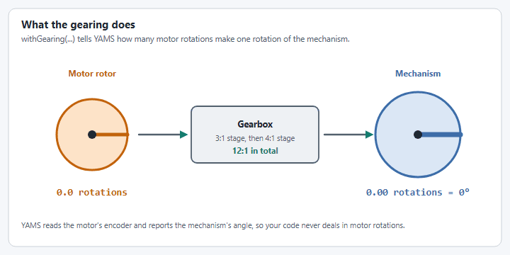
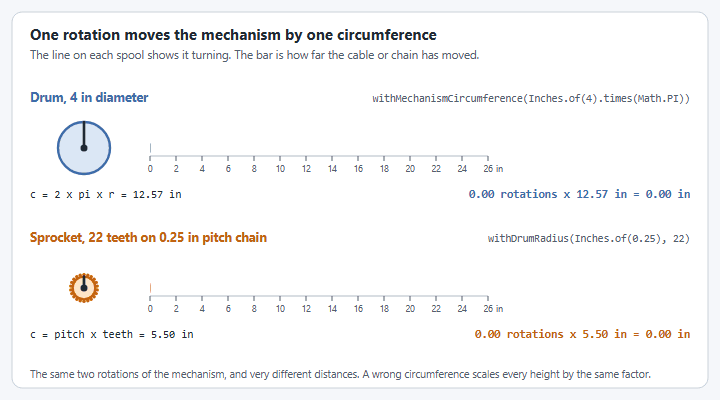

# Step 1: The motor controller


This page assumes a project with YAMS and REVLib installed. If you do not have one yet, start at [Create a project and install YAMS](../project-setup.md).


A `SmartMotorController` is how YAMS talks to a motor controller. It takes three things:

1. **The vendor's motor controller object**, here a `SparkMax`.
2. **The motor** that is plugged into it, here one NEO.
3. **A `SmartMotorControllerConfig`** that says what the motor controller should do: its control mode, its PID and feedforward gains, its motion profile, the gearing between the motor and the sprocket, how far the carriage moves for each turn of the sprocket, where the carriage starts, and how far the closed loop may take it.

YAMS applies the config to the `SparkMax` for you, and uses the same config to build the simulation.

<figure><figcaption><p>With 12:1 gearing, twelve rotations of the motor are one rotation of the mechanism.</p></figcaption></figure>

## The code



Create `ElevatorSubsystem.java` in the `subsystems` folder, next to the template's `ExampleSubsystem.java`.


```java
package first.robot.subsystems;

import static org.wpilib.units.Units.Amps;
import static org.wpilib.units.Units.Inches;
import static org.wpilib.units.Units.Meters;
import static org.wpilib.units.Units.MetersPerSecond;
import static org.wpilib.units.Units.MetersPerSecondPerSecond;

import com.revrobotics.spark.SparkLowLevel.MotorType;
import com.revrobotics.spark.SparkMax;
import org.wpilib.command2.SubsystemBase;
import org.wpilib.hardware.bus.CANPort;
import org.wpilib.math.controller.ElevatorFeedforward;
import org.wpilib.math.system.DCMotor;
import yams.commands2.config.SmartMotorControllerConfig;
import yams.core.gearing.GearBox;
import yams.core.gearing.MechanismGearing;
import yams.core.motorcontrollers.SmartMotorController;
import yams.core.motorcontrollers.enums.ControlMode;
import yams.core.motorcontrollers.enums.MotorMode;
import yams.core.motorcontrollers.local.SparkWrapper;
import yams.core.telemetry.enums.TelemetryVerbosity;

public class ElevatorSubsystem extends SubsystemBase {

  // What the motor controller should do: its control mode, gains, gearing and limits.
  private final SmartMotorControllerConfig smcConfig = new SmartMotorControllerConfig(this)
      .withControlMode(ControlMode.CLOSED_LOOP)
      // How far the carriage moves for each turn of the output shaft:
      // #25 chain has a 0.25 inch pitch, and the sprocket has 22 teeth.
      .withDrumRadius(Inches.of(0.25), 22)
      // Feedback constants (PID), on the real robot and in simulation.
      .withClosedLoopController(4, 0, 0)
      .withSimClosedLoopController(4, 0, 0)
      // The fastest the closed loop is allowed to move and accelerate the carriage.
      .withTrapezoidalProfile(MetersPerSecond.of(0.5), MetersPerSecondPerSecond.of(0.5))
      // Feedforward constants, on the real robot and in simulation.
      .withFeedforward(new ElevatorFeedforward(0, 0, 0))
      .withSimFeedforward(new ElevatorFeedforward(0, 0, 0))
      // Gearing from the motor rotor to the sprocket: a 3:1 stage and a 4:1 stage, 12:1 in total.
      .withGearing(new MechanismGearing(GearBox.fromReductionStages(3, 4)))
      .withMotorInverted(false)
      .withZeroPower(MotorMode.BRAKE)
      .withStatorCurrentLimit(Amps.of(40))
      // Where the carriage is when the robot turns on.
      .withStartingPosition(Meters.of(0))
      // The closed loop will not take the carriage past these heights.
      .withSoftLimits(Meters.of(0), Meters.of(2))
      // Telemetry name and how much to publish.
      .withTelemetry("ElevatorMotor", TelemetryVerbosity.HIGH);

  // The vendor motor controller object: a SPARK MAX with CAN ID 4.
  private final SparkMax spark = new SparkMax(CANPort.CAN_S0, 4, MotorType.kBrushless);

  // The SmartMotorController applies the config to the SPARK MAX, which drives one NEO.
  private final SmartMotorController motor = new SparkWrapper(spark, DCMotor.getNEO(1), smcConfig);
}
```




Create `ElevatorMechanism.java` in the `mechanisms` folder, next to the template's `ExampleMechanism.java`.

The config comes from `yams.commands3.config`, and it takes the `Mechanism` where Commands v2 passes the subsystem.


```java
package first.robot.mechanisms;

import static org.wpilib.units.Units.Amps;
import static org.wpilib.units.Units.Inches;
import static org.wpilib.units.Units.Meters;
import static org.wpilib.units.Units.MetersPerSecond;
import static org.wpilib.units.Units.MetersPerSecondPerSecond;

import com.revrobotics.spark.SparkLowLevel.MotorType;
import com.revrobotics.spark.SparkMax;
import org.wpilib.command3.Mechanism;
import org.wpilib.hardware.bus.CANPort;
import org.wpilib.math.controller.ElevatorFeedforward;
import org.wpilib.math.system.DCMotor;
import yams.commands3.config.SmartMotorControllerConfig;
import yams.core.gearing.GearBox;
import yams.core.gearing.MechanismGearing;
import yams.core.motorcontrollers.SmartMotorController;
import yams.core.motorcontrollers.enums.ControlMode;
import yams.core.motorcontrollers.enums.MotorMode;
import yams.core.motorcontrollers.local.SparkWrapper;
import yams.core.telemetry.enums.TelemetryVerbosity;

public class ElevatorMechanism implements Mechanism {

  // What the motor controller should do: its control mode, gains, gearing and limits.
  private final SmartMotorControllerConfig smcConfig = new SmartMotorControllerConfig(this)
      .withControlMode(ControlMode.CLOSED_LOOP)
      // How far the carriage moves for each turn of the output shaft:
      // #25 chain has a 0.25 inch pitch, and the sprocket has 22 teeth.
      .withDrumRadius(Inches.of(0.25), 22)
      // Feedback constants (PID), on the real robot and in simulation.
      .withClosedLoopController(4, 0, 0)
      .withSimClosedLoopController(4, 0, 0)
      // The fastest the closed loop is allowed to move and accelerate the carriage.
      .withTrapezoidalProfile(MetersPerSecond.of(0.5), MetersPerSecondPerSecond.of(0.5))
      // Feedforward constants, on the real robot and in simulation.
      .withFeedforward(new ElevatorFeedforward(0, 0, 0))
      .withSimFeedforward(new ElevatorFeedforward(0, 0, 0))
      // Gearing from the motor rotor to the sprocket: a 3:1 stage and a 4:1 stage, 12:1 in total.
      .withGearing(new MechanismGearing(GearBox.fromReductionStages(3, 4)))
      .withMotorInverted(false)
      .withZeroPower(MotorMode.BRAKE)
      .withStatorCurrentLimit(Amps.of(40))
      // Where the carriage is when the robot turns on.
      .withStartingPosition(Meters.of(0))
      // The closed loop will not take the carriage past these heights.
      .withSoftLimits(Meters.of(0), Meters.of(2))
      // Telemetry name and how much to publish.
      .withTelemetry("ElevatorMotor", TelemetryVerbosity.HIGH);

  // The vendor motor controller object: a SPARK MAX with CAN ID 4.
  private final SparkMax spark = new SparkMax(CANPort.CAN_S0, 4, MotorType.kBrushless);

  // The SmartMotorController applies the config to the SPARK MAX, which drives one NEO.
  private final SmartMotorController motor = new SparkWrapper(spark, DCMotor.getNEO(1), smcConfig);
}
```




Create `ElevatorSubsystem.hpp` in `src/main/include/subsystems` and `ElevatorSubsystem.cpp` in `src/main/cpp/subsystems`.

YAMS keeps a pointer to the config and to the `SparkMax`, so in C++ both are members of the subsystem. The constructor fills in the config and then creates the `SmartMotorController`, which is why that one is a `std::optional`.

`WithFeedback` is the C++ name of `withClosedLoopController`, `WithMotorGearing` of `withGearing`, `WithLinearTrapezoidProfile` of the linear `withTrapezoidalProfile`, and `WithMeasurementLimits` of the linear `withSoftLimits`. The sprocket is described with `WithMechanismCircumference(pitch, teeth)` where Java uses `withDrumRadius(pitch, teeth)`.


```cpp
#pragma once

#include <optional>

#include <rev/SparkMax.h>
#include <wpi/commands2/SubsystemBase.hpp>
#include <wpi/hardware/bus/CANPort.hpp>

#include "yams/motorcontrollers/SmartMotorControllerConfig.hpp"
#include "yams/motorcontrollers/local/SparkWrapper.hpp"

class ElevatorSubsystem : public wpi::cmd::SubsystemBase {
 public:
  ElevatorSubsystem();

 private:
  // The vendor motor controller object: a SPARK MAX with CAN ID 4.
  rev::spark::SparkMax m_spark{wpi::CANPort::CAN_S0, 4, rev::spark::SparkMax::MotorType::kBrushless};

  // What the motor controller should do. It is filled in by the constructor.
  yams::motorcontrollers::SmartMotorControllerConfig m_smcConfig;

  // The SmartMotorController, created in the constructor once the config is ready.
  std::optional<yams::motorcontrollers::local::SparkWrapper> m_motor;
};
```



```cpp
#include "subsystems/ElevatorSubsystem.hpp"

#include <wpi/math/controller/ElevatorFeedforward.hpp>
#include <wpi/math/system/DCMotor.hpp>
#include <wpi/units/acceleration.hpp>
#include <wpi/units/current.hpp>
#include <wpi/units/length.hpp>
#include <wpi/units/velocity.hpp>
#include <wpi/units/voltage.hpp>

#include "yams/gearing/GearBox.hpp"
#include "yams/gearing/MechanismGearing.hpp"

using namespace yams::gearing;
using Cfg = yams::motorcontrollers::SmartMotorControllerConfig;

ElevatorSubsystem::ElevatorSubsystem() {
  // What the motor controller should do: its control mode, gains, gearing and limits.
  m_smcConfig
      .WithSubsystem(this)
      .WithClosedLoopMode()
      // How far the carriage moves for each turn of the output shaft:
      // #25 chain has a 0.25 inch pitch, and the sprocket has 22 teeth.
      .WithMechanismCircumference(0.25_in, 22)
      // Feedback constants (PID), on the real robot and in simulation.
      .WithFeedback(4, 0, 0)
      .WithSimClosedLoopController(4, 0, 0)
      // The fastest the closed loop is allowed to move and accelerate the carriage.
      .WithLinearTrapezoidProfile(0.5_mps, 0.5_mps_sq)
      // Feedforward constants: kS, kG and kV.
      .WithFeedforward(wpi::math::ElevatorFeedforward{
          0_V, 0_V, wpi::units::unit_t<wpi::math::ElevatorFeedforward::kv_unit>{0}})
      // Gearing from the motor rotor to the sprocket: a 3:1 stage and a 4:1 stage, 12:1 in total.
      .WithMotorGearing(MechanismGearing{GearBox::FromReductionStages({3.0, 4.0})})
      .WithMotorInverted(false)
      .WithZeroPower(Cfg::MotorMode::BRAKE)
      .WithStatorCurrentLimit(40_A)
      // Where the carriage is when the robot turns on.
      .WithStartingPosition(0_m)
      // The closed loop will not take the carriage past these heights.
      .WithMeasurementLimits(0_m, 2_m)
      // Telemetry name and how much to publish.
      .WithTelemetry("ElevatorMotor", Cfg::TelemetryVerbosity::HIGH);

  // The SmartMotorController applies the config to the SPARK MAX, which drives one NEO.
  m_motor.emplace(&m_spark, wpi::math::DCMotor::NEO(1), &m_smcConfig);
}
```




## The sprocket or drum

An elevator needs one option that an arm does not: how far the carriage moves for each rotation of the output shaft. Without it YAMS cannot turn rotations into a height.

<figure><figcaption><p>Each rotation of the mechanism moves it by one circumference.</p></figcaption></figure>



```java
.withDrumRadius(Inches.of(0.25), 22)   // #25 chain (0.25 inch pitch), 22 tooth sprocket
.withDrumRadius(Inches.of(0.375), 16)  // #35 chain (0.375 inch pitch), 16 tooth sprocket
.withDrumRadius(Inches.of(0.875))      // a spool or drum with a 0.875 inch radius
```



```java
.withDrumRadius(Inches.of(0.25), 22)   // #25 chain (0.25 inch pitch), 22 tooth sprocket
.withDrumRadius(Inches.of(0.375), 16)  // #35 chain (0.375 inch pitch), 16 tooth sprocket
.withDrumRadius(Inches.of(0.875))      // a spool or drum with a 0.875 inch radius
```



```cpp
.WithMechanismCircumference(0.25_in, 22)   // #25 chain (0.25 inch pitch), 22 tooth sprocket
.WithMechanismCircumference(0.375_in, 16)  // #35 chain (0.375 inch pitch), 16 tooth sprocket
.WithMechanismRadius(0.875_in)             // a spool or drum with a 0.875 inch radius
```



A **cascading** elevator also needs its number of stages, with `withCascadingElevatorStages(2)` in Java or `WithCascadingElevatorStages(2)` in C++. See [How to find your mechanism circumference?](../../how-to/how-to-find-your-mechanism-circumference.md) for the measurements.

## Read more

Every option used here has its own section in the `SmartMotorControllerConfig` pages:

* [Motor basics](../../details/editor/config/motor-basics.md): control mode, inversion, what the motor does at zero power
* [Gearing and units](../../details/editor/config/gearing-and-units.md): gearing, and how rotations become distance
* [Closed loop control](../../details/editor/config/closed-loop-control.md), [Feedforward](../../details/editor/config/feedforward.md) and [Motion profiles](../../details/editor/config/motion-profiles.md)
* [Limits and protection](../../details/editor/config/limits-and-protection.md): soft limits and current limits
* [Simulation](../../details/editor/config/simulation.md): the simulation only gains

The PID and feedforward numbers on this page are a place to start, not tuned values. Tune them on your own mechanism with [Live tuning](../../details/live-tuning/README.md).

Previous: [Elevator](../elevator.md)

Next: [Step 2: The elevator](mechanism.md)
