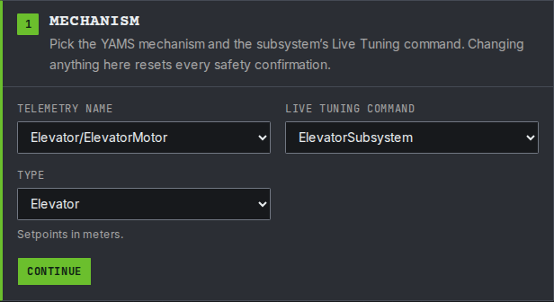
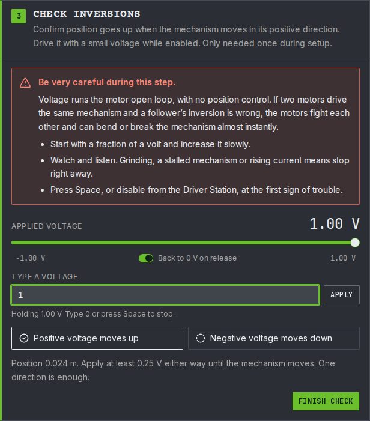
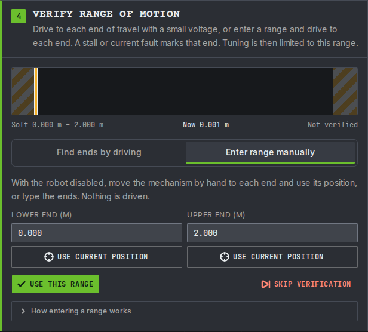
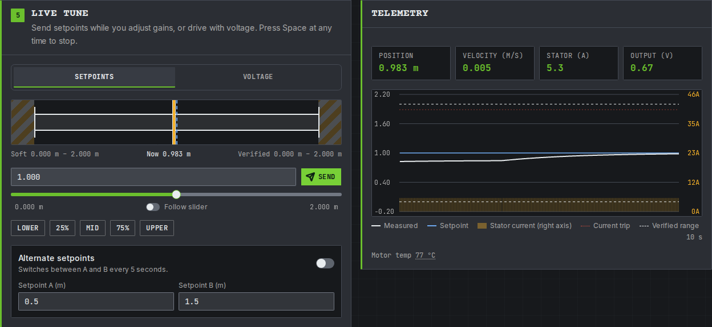
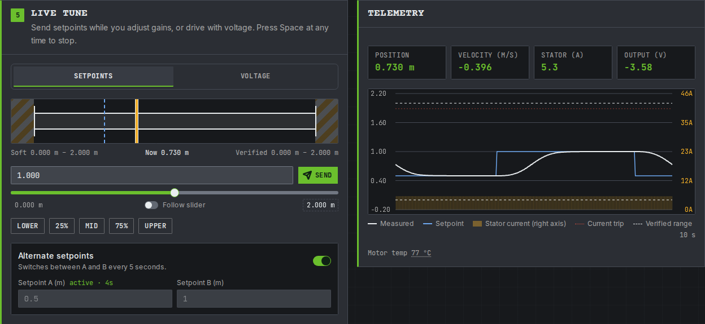
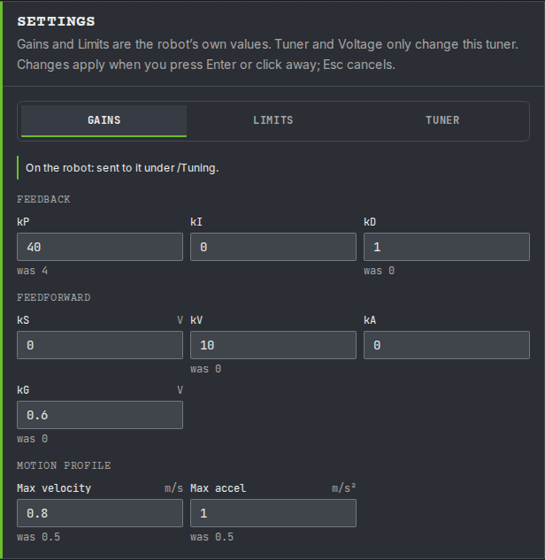

# Step 5: Tune it

The gains from step 1 are placeholders: `kP` is 4 and every feedforward gain is 0. They are enough to move the elevator, but the carriage sags below its setpoint. On this page you tune them while the simulation runs, the same way you will tune the real elevator on the robot.

You change one number at a time on a dashboard and watch a graph. Nothing is saved until you copy the numbers into your code at the end.

If you did [the arm's tune step](../arm/tune.md), this is the same except for gravity (`kG` is the same at every height) and the units (meters, not degrees).


**In simulation you are tuning the simulation's gains.** While the code runs in simulation, live tuning changes the `withSimClosedLoopController` and `withSimFeedforward` values. On the real robot it changes `withClosedLoopController` and `withFeedforward`. The two sets are kept apart because a simulated elevator is never exactly like the real one.


## Before you start

* Start the simulation and enable **Teleoperated**, as in [step 4](simulate.md). The carriage rests at 0 m.
* Do not press any of the elevator's buttons while you tune. A button runs another elevator command, which stops live tuning. If that happens, start live tuning again.

Then tune with the YAMS Live Tuner, or by typing the values in AdvantageScope and Elastic. Both change the same values, so pick one.



The [YAMS Live Tuner](../../details/live-tuning/live-tuner.md) is a web page that walks you through it: it checks the elevator before anything moves, then you send setpoints and change gains while watching a graph.



### Connect

Open [tuning.yassrobotics.com](https://tuning.yassrobotics.com/), pick **Simulation**, and press **Connect**. If your browser asks whether the page may connect to devices on your local network, allow it.

<figure><figcaption><p>Connected to the simulation, with the robot enabled in Teleop.</p></figcaption></figure>

**Check it:** the badge in the header shows `localhost`, with the robot enabled in Teleop.



### Pick the elevator

1. Under **Telemetry name**, choose `Elevator/ElevatorMotor`: the names from the elevator's and the motor's `withTelemetry`.
2. Under **Live Tuning command**, choose `ElevatorSubsystem` (Commands v2 and C++) or `ElevatorMechanism` (Commands v3).
3. Set **Type** to **Elevator**. Setpoints are in meters.
4. Press **Continue**.

<figure><figcaption><p>The tutorial elevator: its motor, its subsystem's <code>Live Tuning</code> command, and the Elevator type.</p></figcaption></figure>

**Check it:** the telemetry card shows the carriage at 0 m.



### Checklist and inversions

1. Tick every item on the pre-motion checklist, leave **Current trip (A)** at 40, and press **Continue**.
2. Tick the confirmation and press **Start voltage control**.
3. Drag the voltage slider all the way to the right and hold it. The carriage rises. Let go once **Positive voltage moves up** is ticked: the slider goes back to 0 V.
4. If the carriage does not move with the slider all the way to the right, select the number at the slider's right end, 1.00 V to start with, and raise it a little. The number at the left end sets how far the slider goes the other way. Gravity pulls the carriage down, so it can need more voltage to rise than to fall.
5. Press **Finish check**.

<figure><figcaption><p>At 1 V the carriage rises, so <strong>Positive voltage moves up</strong> is ticked.</p></figcaption></figure>

**Check it:** **Positive voltage moves up** was ticked when the carriage rose. If the Live Tuner warns that the height went the wrong way, the motor or encoder inversion in step 1 is wrong.



### Set the range of motion

Choose **Enter range manually**. The ends start at the soft limits from step 1, 0 and 2 meters, so press **Use this range**.

<figure><figcaption><p>The ends start at the elevator's soft limits.</p></figcaption></figure>

**Check it:** the Live tune card opens.



### Start live tuning and find kG

Press **Start Live Tuning**. The setpoints and gains you send are now applied to the elevator every loop.

`kG` is the voltage it takes to hold the carriage still against gravity. Gravity pulls just as hard at every height, so one `kG` is right everywhere. With `kG` at 0, only `kP` holds the carriage up, so it sags below its setpoint.

1. On the **Setpoints** tab, press **Mid**: 1 m, halfway up the 0 to 2 m range. The carriage rises, then settles below 1 m: about 0.85 m with the placeholder `kP`.
2. Once it has stopped, read its output voltage on the telemetry card. For this elevator it reads about `0.6`.
3. Type that voltage into **kG** on the Settings card's **Gains** tab, and press **Enter**.

<figure><figcaption><p>With kG at 0.6 V, the carriage climbs from where it sagged onto the 1 m setpoint.</p></figcaption></figure>

**Check it:** the measured height moves up onto the 1 m setpoint on the graph and stays there. Press **25%** (0.5 m), then **75%** (1.5 m): the carriage holds each one without sagging.



### Tune kP and kD

`kP` is how hard the motor pushes for each meter of error. A `kP` of 4 is only 0.04 volts for each centimeter, which is why the carriage sagged so far.

1. Turn on **Alternate setpoints**, with **Setpoint A** at `0.5` and **Setpoint B** at `1`. The carriage now moves between them every 5 seconds.
2. Watch each move on the graph and change **kP** on the **Gains** tab:
   * It lags behind the setpoint, or stops a few centimeters short: double `kP` (8, then 16, and so on).
   * It overshoots and bounces: lower `kP` by about a third.
3. If it still overshoots a little at a `kP` that is quick enough, raise **kD** a little at a time, starting at `0.5`.

A change that made it worse? Press **was** under the value to put the last one back.

<figure><figcaption><p>What the height looks like on the graph after each setpoint change.</p></figcaption></figure>

<figure><figcaption><p>kP 40 and kD 1, alternating between 0.5 and 1 m.</p></figcaption></figure>

**Check it:** after each change of setpoint the carriage follows the setpoint closely and stops on it, within a centimeter or so, without bouncing.



### Tune the motion profile and kV

The motion profile limits how fast the carriage moves and speeds up. On the **Gains** tab, **Max velocity** and **Max acceleration** are 0.5 m/s and 0.5 m/s² from step 1.

1. Set **Setpoint B** to `1.5`, then raise **Max velocity** and **Max acceleration** a step at a time.
2. Stop raising them when the measured height falls behind the setpoint while it moves, or the stator current on the graph jumps. This NEO and 12:1 gearing can lift the carriage at about 1.1 m/s at most, so keep **Max velocity** well below that.
3. Raise **kV** until the measured height follows the setpoint during a move, instead of falling behind and catching up at the end. For this elevator it ends up near `10`: about 12 volts divided by the 1.1 m/s top speed.

<figure><figcaption><p>Max velocity raised to 0.8 m/s and max acceleration to 1 m/s², with kV at 10.</p></figcaption></figure>

**Check it:** the carriage follows the setpoint through each move and arrives without lagging. Press **Space** to stop when you are done.





You type each value into its NetworkTables key yourself, and graph the elevator in AdvantageScope.

Open [AdvantageScope](https://docs.advantagescope.org/) and connect it to the simulation (**File > Connect to Simulator**).



### Start live tuning

YAMS gives the elevator a `Live Tuning` command. While it runs, numbers you type on the dashboard are applied to the elevator straight away.

* **Commands v2 and C++:** the command is published at `NT:/Tuning/ElevatorSubsystem/Live Tuning`, named after the subsystem. In [Elastic](https://frc-elastic.gitbook.io/docs), add `Tuning/ElevatorSubsystem/Live Tuning` to a tab and press its button.
* **Commands v3:** the command is published at `NT:/Tuning/ElevatorMechanism/Live Tuning`, named after the mechanism. Set the boolean `NT:/Tuning/ElevatorMechanism/Live Tuning/running` to `true`. In AdvantageScope, first turn on tuning mode (step 2), then click the value to change it.

**Check it:** the command shows as running. The carriage stays at 0 m.



### Find the numbers and graph the elevator

The elevator's values are under two tables. Both use the names from `withTelemetry`: `Elevator` for the elevator and `ElevatorMotor` for its motor.

| | Where | Used for |
| --- | --- | --- |
| Values you type | `NT:/Tuning/Elevator/ElevatorMotor/` | Gains, setpoints, limits |
| Values you watch | `NT:/Mechanisms/Elevator/ElevatorMotor/` | Where the carriage is and what the motor is doing |

1. In AdvantageScope, turn on **tuning mode**: the sliders icon beside the search box at the top of the sidebar. Without it, typed values are ignored.
2. Make a **Line Graph** and drag in, from `NT:/Mechanisms/Elevator/ElevatorMotor/`:
   * `measurement/position`: how high the carriage is, in meters.
   * `closedloop/setpoint/position`: how high the carriage is asked to be, in meters.
   * `motor/outputVoltage`: the voltage the motor is given.

Heights are in meters both where you type and where you read, so there is nothing to convert.

**Check it:** both position lines are at 0, and the output voltage is about 0.



### kG: hold the carriage up

`kG` is the voltage it takes to hold the carriage still against gravity. Gravity pulls the carriage down just as hard at every height, so one `kG` is right everywhere. You only need to find it once, at any height away from the stops.

With `kG` at 0, only `kP` holds the carriage up. `kP` only pushes when there is an error, so the carriage has to sag before the motor pushes hard enough. The voltage it settles at is the voltage gravity needs.

1. Type `1` into `NT:/Tuning/Elevator/ElevatorMotor/closedloop/setpoint/position`. The carriage rises, then settles below 1 m: about 0.85 m with the placeholder `kP`.
2. Once it has stopped, read `motor/outputVoltage`. For this elevator it reads about `0.6`.
3. Type that voltage into `NT:/Tuning/Elevator/ElevatorMotor/closedloop/feedforward/kG`.

**Check it:** the measured position moves up onto the 1 m setpoint and stays there. The output voltage stays about the same, because `kG` now supplies it instead of `kP`. Type `0.5`, then `1.5`: the carriage holds each one without sagging, because `kG` is the same at every height.

If the carriage drifts, adjust `kG` a little: up if it sits low, down if it sits high.



### kP and kD: reach a setpoint

`kP` is how hard the motor pushes for each meter of error. A `kP` of 4 is 4 volts per meter, only 0.04 volts for each centimeter, which is why the carriage sagged so far.

1. Type `0.5` into `closedloop/setpoint/position`, then `1`, and watch the position line each time. Move between those two for the rest of this part.
2. Compare the line with the picture below and change `NT:/Tuning/Elevator/ElevatorMotor/closedloop/feedback/kP`:
   * It lags behind the setpoint, or stops a few centimeters short: double `kP` (8, then 16, and so on).
   * It overshoots and bounces: lower `kP` by about a third.
3. If it still overshoots a little at a `kP` that is quick enough, raise `closedloop/feedback/kD` a little at a time, starting at `0.5`.

<figure><figcaption><p>What the position line looks like after a setpoint change.</p></figcaption></figure>

**Check it:** after each setpoint change the carriage follows the setpoint line closely and stops on it, within a centimeter or so, without bouncing.

The carriage cannot go past the soft limits from step 1, 0 and 2 meters. A setpoint beyond them is held at the limit.



### The motion profile and kV

The motion profile limits how fast the carriage moves and speeds up: 0.5 m/s and 0.5 m/s² from step 1. On the dashboard they are in the same units.

1. Raise `NT:/Tuning/Elevator/ElevatorMotor/closedloop/motionprofile/maxVelocity` and `maxAcceleration` a step at a time while moving between `0.5` and `1.5`.
2. Stop raising them when the measured position falls behind the setpoint while it moves, or `current/stator` jumps. This NEO and 12:1 gearing can lift the carriage at about 1.1 m/s at most, so keep `maxVelocity` well below that.
3. Add `measurement/velocity` and `closedloop/setpoint/velocity` (both in m/s) to the graph. Raise `closedloop/feedforward/kV` until the measured velocity follows the setpoint velocity during a move. `kV` only acts while the carriage moves. For this elevator it ends up near `10`: about 12 volts divided by the 1.1 m/s top speed.

**Check it:** the measured velocity sits on top of the setpoint velocity, and the carriage arrives without lagging behind.

For more on each value, see [Tuning order](../../details/live-tuning/README.md#tuning-order).





## Copy the numbers into your code

Dashboard changes are lost when the code restarts. Write the numbers you ended up with into the config from step 1. In simulation they go into the `Sim` versions.




```java
// Before
.withSimClosedLoopController(4, 0, 0)
.withSimFeedforward(new ElevatorFeedforward(0, 0, 0))

// After: your numbers. ElevatorFeedforward takes kS, kG, kV.
.withSimClosedLoopController(40, 0, 1)
.withSimFeedforward(new ElevatorFeedforward(0, 0.6, 10))
```


Copy the motion profile limits into `withTrapezoidalProfile` too.




```java
// Before
.withSimClosedLoopController(4, 0, 0)
.withSimFeedforward(new ElevatorFeedforward(0, 0, 0))

// After: your numbers. ElevatorFeedforward takes kS, kG, kV.
.withSimClosedLoopController(40, 0, 1)
.withSimFeedforward(new ElevatorFeedforward(0, 0.6, 10))
```


Copy the motion profile limits into `withTrapezoidalProfile` too.




```cpp
// Before
.WithSimClosedLoopController(4, 0, 0)
.WithSimFeedforward(wpi::math::ElevatorFeedforward{
    0_V, 0_V, wpi::units::unit_t<wpi::math::ElevatorFeedforward::kv_unit>{0}})

// After: your numbers. kP, kI, kD, then kS, kG and kV.
.WithSimClosedLoopController(40, 0, 1)
.WithSimFeedforward(wpi::math::ElevatorFeedforward{
    0_V, 0.6_V, wpi::units::unit_t<wpi::math::ElevatorFeedforward::kv_unit>{10}})
```


Copy the motion profile limits into `WithLinearTrapezoidProfile` too.



The numbers above are an example. Use the ones you found.

**Check it:** restart the simulation and enable it. Hold **A** and **B**: the carriage goes to 0.5 m and 1 m smoothly and stops on each without sagging.

## If it did not work

* **AdvantageScope: typing a value does nothing.** Turn on AdvantageScope's tuning mode, check the `Live Tuning` command is still running, and check you typed under `NT:/Tuning`, not `NT:/Mechanisms`.
* **Live Tuner: the elevator is not in the Telemetry name list.** Check the simulation is running and you connected to **Simulation**. The list only fills in once the robot code has started.
* **Live tuning stopped on its own.** A button press, or the default command, took over the elevator. On the Live Tuner, the current trip, leaving the range of motion, or pressing Space also stops it. Start it again.
* **The carriage sits on the bottom stop and will not rise.** The setpoint is still 0 m. Type a height first, then read the voltage.
* **The carriage bounces harder and harder.** `kP` is too high. Lower it, or disable and restart the simulation.
* **The numbers were gone after a restart.** They only last until the code stops. Copy them into your code, as in [Copy the numbers into your code](#copy-the-numbers-into-your-code).

More problems and fixes: [Troubleshooting](../troubleshooting.md).

## Step 6: Run it on the robot

Step 6 puts the code on the real robot. Follow [the arm's step 6: Run it on the robot](../arm/robot.md). Everything there works the same for the elevator, with these differences:

* The CAN ID is the elevator's `SparkMax`, 4 in this tutorial.
* Before each time the code starts, rest the carriage at its starting position, 0 m: all the way down.
* For the direction check, positive should move the carriage **up**.
* Tune `kG` again on the robot: a real carriage usually needs more than the simulation, and some `kS` for friction. Copy the robot's numbers into `withClosedLoopController` and `withFeedforward`.
* Check the soft limits with `2` (the top one) and `0`.
