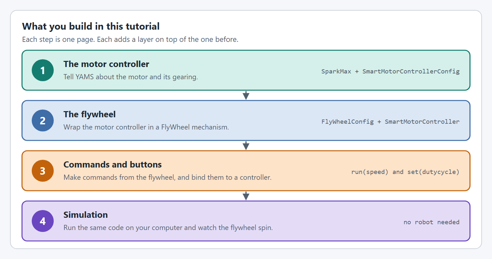

# Shooter/FlyWheels


Two motors on one shaft or gearbox? Add the second as a follower with `withFollowers`. Two motors that aren't on the same shaft or gearbox, such as one on each side of the mechanism? Make the second a loosely coupled follower with `withLooselyCoupledFollowers`: the mechanism still works as this tutorial shows. [Followers](../details/editor/config/followers.md) explains both.


## Intro

At the end of this tutorial you will have a `Shooter` that works in both real life and simulation with the same code!

<figure><figcaption></figcaption></figure>

## Details

This `Shooter` uses the following hardware and controls:

* A `SparkMax` driving one NEO controls the `Shooter`
* A `12:1` gearbox on the `Shooter`
* A 4 inch flywheel
* Holding the bottom face button (`A` on an Xbox controller) spins the `Shooter` at 60 RPM
* Holding the right face button (`B` on an Xbox controller) spins the `Shooter` at 300 RPM
* Holding the left face button (`X` on an Xbox controller) drives the `Shooter` forward
* Holding the top face button (`Y` on an Xbox controller) drives the `Shooter` backward
* With no button held, the `Shooter` coasts

## The steps

<figure><figcaption>
Four steps, one page each.
</figcaption></figure>

Every step has a tab for **Java with Commands v2**, **Java with Commands v3** and **C++**.

| Step | What you do |
| --- | --- |
| [Before you start](project-setup.md) | Create a WPILib project and install YAMS and REVLib. Skip this if you already have a project. |
| [Step 1: The motor controller](shooter-flywheels/motor-controller.md) | Configure the `SparkMax` and wrap it in a `SmartMotorController`. |
| [Step 2: The flywheel](shooter-flywheels/mechanism.md) | Describe the flywheel with a `FlyWheelConfig` and create the `FlyWheel`. |
| [Step 3: Commands and buttons](shooter-flywheels/commands.md) | Turn the `FlyWheel` into commands and bind them to controller buttons. |
| [Step 4: Simulate it](shooter-flywheels/simulate.md) | Run the code on your computer and drive the flywheel with a controller. |

## Complete Example

The following files show a complete, working Shooter from the YAMS `simple_robot-2027` Commands v2 example.





The same robot in the other two flavors:

* **Java, Commands v3:** [`mechanisms/ShooterMechanism.java`](https://github.com/Yet-Another-Software-Suite/YAMS/blob/master/examples/commands3/simple_robot-2027/src/main/java/first/robot/mechanisms/ShooterMechanism.java) in `examples/commands3/simple_robot-2027`
* **C++:** [`ShooterSubsystem.h`](https://github.com/Yet-Another-Software-Suite/YAMS/blob/master/examples/cpptest/src/main/include/subsystems/ShooterSubsystem.h) and [`ShooterSubsystem.cpp`](https://github.com/Yet-Another-Software-Suite/YAMS/blob/master/examples/cpptest/src/main/cpp/subsystems/ShooterSubsystem.cpp) in `examples/cpptest`
