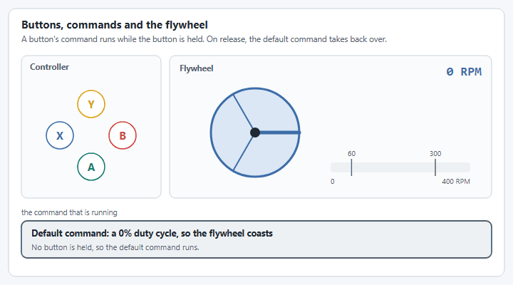

# Step 3: Commands and buttons

The `FlyWheel` makes commands for you. Your class hands them out, and the buttons schedule them.


**In a hurry?** Jump to [the complete file](#the-complete-file), copy it, and change the values called out under **For your robot**. The numbered parts explain each piece in a sentence or two. You do not need to understand all of it to get moving: the pages under **Understanding** go deeper when you want them.


## 1. Make the commands

The `FlyWheel` makes the commands. Your class only hands them out, so that the rest of the robot code never touches the motor directly.

| What it does | Java, Commands v2 | Java, Commands v3 | C++ |
| --- | --- | --- | --- |
| Spin at a speed and hold it. It never ends on its own. | `shooter.run(speed)` | `shooter.run(speed)` | `m_shooter->Run(speed)` |
| Drive at a duty cycle from -1 to 1, with the closed loop off. | `shooter.set(dutycycle)` | `shooter.set(dutycycle)` | `m_shooter->Set(dutycycle)` |
| A `Trigger` that is true while the flywheel is near a speed. | `shooter.near(speed, tolerance)` | `shooter.near(speed, tolerance)` | `m_shooter->IsNear(speed, tolerance)` |




```java
/** Spin at a speed and hold it. This command does not end on its own. */
public Command run(AngularVelocity speed) {
  return shooter.run(speed);
}

/** Drive the flywheel with a duty cycle from -1 to 1. The closed loop is not used. */
public Command set(double dutycycle) {
  return shooter.set(dutycycle);
}

/** True while the flywheel is within 50 RPM of a speed. */
public Trigger atSpeed(AngularVelocity speed) {
  return shooter.near(speed, RPM.of(50));
}
```





```java
/** Spin at a speed and hold it. This command does not end on its own. */
public Command setVelocity(AngularVelocity speed) {
  return shooter.run(speed);
}

/** Drive the flywheel with a duty cycle from -1 to 1. The closed loop is not used. */
public Command set(double dutycycle) {
  return shooter.set(dutycycle);
}

/** True while the flywheel is within 50 RPM of a speed. */
public Trigger atSpeed(AngularVelocity speed) {
  return shooter.near(speed, RPM.of(50));
}
```





```cpp
/** Spin at a speed and hold it. This command does not end on its own. */
wpi::cmd::CommandPtr Run(wpi::units::revolutions_per_minute_t speed);

/** Drive the flywheel with a duty cycle from -1 to 1. The closed loop is not used. */
wpi::cmd::CommandPtr Set(double dutycycle);

/** True while the flywheel is within 50 RPM of a speed. */
wpi::cmd::Trigger AtSpeed(wpi::units::revolutions_per_minute_t speed);
```



```cpp
wpi::cmd::CommandPtr ShooterSubsystem::Run(wpi::units::revolutions_per_minute_t speed) {
  return m_shooter->Run(wpi::units::degrees_per_second_t{speed});
}

wpi::cmd::CommandPtr ShooterSubsystem::Set(double dutycycle) {
  return m_shooter->Set(dutycycle);
}

wpi::cmd::Trigger ShooterSubsystem::AtSpeed(wpi::units::revolutions_per_minute_t speed) {
  return m_shooter->IsNear(speed, 50_rpm);
}
```




**For your robot:** Rename these to suit your robot, or add more. Each one is a single line.

Want the details? [run() vs runTo() Commands](../../details/run-vs-runto.md)

## 2. Set the default command

The **default command** runs whenever no other command is using the shooter. Here it sets a duty cycle of 0, so the flywheel coasts. In Commands v3 the default command is given the lowest priority, so that any other command for the mechanism can interrupt it.




```java
import first.robot.subsystems.ShooterSubsystem;

private final ShooterSubsystem shooter = new ShooterSubsystem();

// When no other command is using the shooter, let the flywheel coast.
shooter.setDefaultCommand(shooter.set(0));
```





```java
/** Let the flywheel coast at the lowest priority, so that any other shooter command can interrupt it. */
public Command idle() {
  return run(coroutine -> coroutine.await(shooter.set(0)))
      .withPriority(Command.LOWEST_PRIORITY)
      .named("Shooter Idle");
}
```



```java
public Robot() {
  // When no other command is using the shooter, let the flywheel coast.
  shooter.setDefaultCommand(shooter.idle());
}
```





```cpp
#include "subsystems/ShooterSubsystem.hpp"

ShooterSubsystem shooter;
```



```cpp
// When no other command is using the shooter, let the flywheel coast.
shooter.SetDefaultCommand(shooter.Set(0));
```




**For your robot:** Choose what your mechanism should do when nobody is asking anything of it.

## 3. Bind the buttons

`whileTrue` runs a command for as long as its button is held, and cancels it on release. The default command then takes back over.

<figure><figcaption><p>A held button owns the flywheel. Let go, and the default command lets it coast down.</p></figcaption></figure>




```java
// Hold a speed while the bottom (A) or right (B) face button is held.
driverController.faceDown().whileTrue(shooter.run(RPM.of(60)));
driverController.faceRight().whileTrue(shooter.run(RPM.of(300)));
// Drive the flywheel forward or backward while the left (X) or top (Y) face button is held.
driverController.faceLeft().whileTrue(shooter.set(0.3));
driverController.faceUp().whileTrue(shooter.set(-0.3));
```





```java
// Hold a speed while the bottom (A) or right (B) face button is held.
robot.exampleController.faceDown().whileTrue(robot.shooter.setVelocity(RPM.of(60)));
robot.exampleController.faceRight().whileTrue(robot.shooter.setVelocity(RPM.of(300)));
// Drive the flywheel forward or backward while the left (X) or top (Y) face button is held.
robot.exampleController.faceLeft().whileTrue(robot.shooter.set(0.3));
robot.exampleController.faceUp().whileTrue(robot.shooter.set(-0.3));
```





```cpp
// Hold a speed while the bottom (A) or right (B) face button is held.
driverController.FaceDown().WhileTrue(shooter.Run(60_rpm));
driverController.FaceRight().WhileTrue(shooter.Run(300_rpm));
// Drive the flywheel forward or backward while the left (X) or top (Y) face button is held.
driverController.FaceLeft().WhileTrue(shooter.Set(0.3));
driverController.FaceUp().WhileTrue(shooter.Set(-0.3));
```




**For your robot:** Pick your own buttons and setpoints. Use `onTrue` instead if one press should start a command that keeps running after the button is released.

## The complete file



The highlighted lines are new in this step.

Add the commands to `ShooterSubsystem.java`, then create the subsystem and bind the buttons in `RobotContainer.java`. The template bound the right face button to its example command; that binding is replaced.

<pre class="language-java" data-title="subsystems/ShooterSubsystem.java" data-line-numbers><code class="lang-java">package first.robot.subsystems;

import static org.wpilib.units.Units.Amps;
import static org.wpilib.units.Units.Inches;
<strong>import static org.wpilib.units.Units.RPM;
</strong>
import com.revrobotics.spark.SparkLowLevel.MotorType;
import com.revrobotics.spark.SparkMax;
<strong>import org.wpilib.command2.Command;
</strong>import org.wpilib.command2.SubsystemBase;
<strong>import org.wpilib.command2.button.Trigger;
</strong>import org.wpilib.hardware.bus.CANPort;
import org.wpilib.math.controller.SimpleMotorFeedforward;
import org.wpilib.math.system.DCMotor;
<strong>import org.wpilib.units.measure.AngularVelocity;
</strong>import yams.commands2.config.SmartMotorControllerConfig;
import yams.commands2.mechanisms.FlyWheel;
import yams.core.gearing.GearBox;
import yams.core.gearing.MechanismGearing;
import yams.core.mechanisms.config.FlyWheelConfig;
import yams.core.motorcontrollers.SmartMotorController;
import yams.core.motorcontrollers.enums.ControlMode;
import yams.core.motorcontrollers.enums.MotorMode;
import yams.core.motorcontrollers.local.SparkWrapper;
import yams.core.telemetry.enums.TelemetryVerbosity;

public class ShooterSubsystem extends SubsystemBase {

  // What the motor controller should do: its control mode, gains and gearing.
  private final SmartMotorControllerConfig smcConfig = new SmartMotorControllerConfig(this)
      .withControlMode(ControlMode.CLOSED_LOOP)
      // Feedback constants (PID), on the real robot and in simulation.
      // A flywheel holds a speed, so it gets no motion profile.
      .withClosedLoopController(1, 0, 0)
      .withSimClosedLoopController(1, 0, 0)
      // Feedforward constants, on the real robot and in simulation.
      .withFeedforward(new SimpleMotorFeedforward(0, 0, 0))
      .withSimFeedforward(new SimpleMotorFeedforward(0, 0, 0))
      // Gearing from the motor rotor to the flywheel: a 3:1 stage and a 4:1 stage, 12:1 in total.
      .withGearing(new MechanismGearing(GearBox.fromReductionStages(3, 4)))
      .withMotorInverted(false)
      // Coast, so that the wheel spins down by itself instead of being braked to a stop.
      .withZeroPower(MotorMode.COAST)
      .withStatorCurrentLimit(Amps.of(40))
      // Telemetry name and how much to publish.
      .withTelemetry("ShooterMotor", TelemetryVerbosity.HIGH);

  // The vendor motor controller object: a SPARK MAX with CAN ID 4.
  private final SparkMax spark = new SparkMax(CANPort.CAN_S0, 4, MotorType.kBrushless);

  // The SmartMotorController applies the config to the SPARK MAX, which drives one NEO.
  private final SmartMotorController motor = new SparkWrapper(spark, DCMotor.getNEO(1), smcConfig);

  private final FlyWheelConfig shooterConfig = new FlyWheelConfig()
      // The diameter of the flywheel, used by the simulation and for surface speeds.
      .withDiameter(Inches.of(4))
      // Telemetry name and how much to publish.
      .withTelemetry("Shooter", TelemetryVerbosity.HIGH);

  // The flywheel mechanism.
  private final FlyWheel shooter = new FlyWheel(shooterConfig, motor);

<strong>  /** Spin at a speed and hold it. This command does not end on its own. */
</strong><strong>  public Command run(AngularVelocity speed) {
</strong><strong>    return shooter.run(speed);
</strong><strong>  }
</strong>
<strong>  /** Drive the flywheel with a duty cycle from -1 to 1. The closed loop is not used. */
</strong><strong>  public Command set(double dutycycle) {
</strong><strong>    return shooter.set(dutycycle);
</strong><strong>  }
</strong>
<strong>  /** True while the flywheel is within 50 RPM of a speed. */
</strong><strong>  public Trigger atSpeed(AngularVelocity speed) {
</strong><strong>    return shooter.near(speed, RPM.of(50));
</strong><strong>  }
</strong>
  @Override
  public void periodic() {
    // Publishes the flywheel's telemetry, and applies anything changed through live tuning.
    shooter.updateTelemetry();
  }

  @Override
  public void simulationPeriodic() {
    // Runs the flywheel's physics simulation.
    shooter.simIterate();
  }
}
</code></pre>

<pre class="language-java" data-title="RobotContainer.java" data-line-numbers><code class="lang-java">package first.robot;

<strong>import static org.wpilib.units.Units.RPM;
</strong>
import org.wpilib.command2.Command;
import org.wpilib.command2.button.CommandGamepad;
import org.wpilib.command2.button.Trigger;
import first.robot.Constants.OperatorConstants;
import first.robot.commands.Autos;
import first.robot.commands.ExampleCommand;
<strong>import first.robot.subsystems.ShooterSubsystem;
</strong>import first.robot.subsystems.ExampleSubsystem;

/**
 * This class is where the bulk of the robot should be declared. Since Command-based is a
 * "declarative" paradigm, very little robot logic should actually be handled in the {@link Robot}
 * periodic methods (other than the scheduler calls). Instead, the structure of the robot (including
 * subsystems, commands, and trigger mappings) should be declared here.
 */
public class RobotContainer {
  // The robot's subsystems and commands are defined here...
  private final ExampleSubsystem exampleSubsystem = new ExampleSubsystem();
<strong>  private final ShooterSubsystem shooter = new ShooterSubsystem();
</strong>
  private final CommandGamepad driverController =
      new CommandGamepad(OperatorConstants.DRIVER_CONTROLLER_PORT);

  /** The container for the robot. Contains subsystems, OI devices, and commands. */
  public RobotContainer() {
    // Configure the trigger bindings
    configureBindings();

<strong>    // When no other command is using the shooter, let the flywheel coast.
</strong><strong>    shooter.setDefaultCommand(shooter.set(0));
</strong>  }

  /**
   * Use this method to define your trigger->command mappings. Triggers can be created via the
   * {@link Trigger#Trigger(java.util.function.BooleanSupplier)} constructor with an arbitrary
   * predicate, or via the named factories in {@link org.wpilib.command2.button.CommandGenericHID}'s
   * subclasses for {@link CommandGamepad Gamepad} gamepads or {@link
   * org.wpilib.command2.button.CommandJoystick Flight joysticks}.
   */
  private void configureBindings() {
    // Schedule `ExampleCommand` when `exampleCondition` changes to `true`
    new Trigger(exampleSubsystem::exampleCondition).onTrue(new ExampleCommand(exampleSubsystem));

<strong>    // Hold a speed while the bottom (A) or right (B) face button is held.
</strong><strong>    driverController.faceDown().whileTrue(shooter.run(RPM.of(60)));
</strong><strong>    driverController.faceRight().whileTrue(shooter.run(RPM.of(300)));
</strong><strong>    // Drive the flywheel forward or backward while the left (X) or top (Y) face button is held.
</strong><strong>    driverController.faceLeft().whileTrue(shooter.set(0.3));
</strong><strong>    driverController.faceUp().whileTrue(shooter.set(-0.3));
</strong>  }

  /**
   * Use this to pass the autonomous command to the main {@link Robot} class.
   *
   * @return the command to run in autonomous
   */
  public Command getAutonomousCommand() {
    // An example command will be run in autonomous
    return Autos.exampleAuto(exampleSubsystem);
  }
}
</code></pre>



The highlighted lines are new in this step.

Add the commands to `ShooterMechanism.java`, set the default command in `Robot.java`, and bind the buttons in `ExampleTeleop.java`.

A `Mechanism` already has a `run(...)` method that takes a coroutine, so the commands here have their own names. The default command is wrapped with `Command.LOWEST_PRIORITY`, so that any other command for the flywheel can interrupt it.

<pre class="language-java" data-title="mechanisms/ShooterMechanism.java" data-line-numbers><code class="lang-java">package first.robot.mechanisms;

import static org.wpilib.units.Units.Amps;
import static org.wpilib.units.Units.Inches;
<strong>import static org.wpilib.units.Units.RPM;
</strong>
import com.revrobotics.spark.SparkLowLevel.MotorType;
import com.revrobotics.spark.SparkMax;
<strong>import org.wpilib.command3.Command;
</strong>import org.wpilib.command3.Mechanism;
<strong>import org.wpilib.command3.Trigger;
</strong>import org.wpilib.hardware.bus.CANPort;
import org.wpilib.math.controller.SimpleMotorFeedforward;
import org.wpilib.math.system.DCMotor;
<strong>import org.wpilib.units.measure.AngularVelocity;
</strong>import yams.commands3.config.SmartMotorControllerConfig;
import yams.commands3.mechanisms.FlyWheel;
import yams.core.gearing.GearBox;
import yams.core.gearing.MechanismGearing;
import yams.core.mechanisms.config.FlyWheelConfig;
import yams.core.motorcontrollers.SmartMotorController;
import yams.core.motorcontrollers.enums.ControlMode;
import yams.core.motorcontrollers.enums.MotorMode;
import yams.core.motorcontrollers.local.SparkWrapper;
import yams.core.telemetry.enums.TelemetryVerbosity;

public class ShooterMechanism implements Mechanism {

  // What the motor controller should do: its control mode, gains and gearing.
  private final SmartMotorControllerConfig smcConfig = new SmartMotorControllerConfig(this)
      .withControlMode(ControlMode.CLOSED_LOOP)
      // Feedback constants (PID), on the real robot and in simulation.
      // A flywheel holds a speed, so it gets no motion profile.
      .withClosedLoopController(1, 0, 0)
      .withSimClosedLoopController(1, 0, 0)
      // Feedforward constants, on the real robot and in simulation.
      .withFeedforward(new SimpleMotorFeedforward(0, 0, 0))
      .withSimFeedforward(new SimpleMotorFeedforward(0, 0, 0))
      // Gearing from the motor rotor to the flywheel: a 3:1 stage and a 4:1 stage, 12:1 in total.
      .withGearing(new MechanismGearing(GearBox.fromReductionStages(3, 4)))
      .withMotorInverted(false)
      // Coast, so that the wheel spins down by itself instead of being braked to a stop.
      .withZeroPower(MotorMode.COAST)
      .withStatorCurrentLimit(Amps.of(40))
      // Telemetry name and how much to publish.
      .withTelemetry("ShooterMotor", TelemetryVerbosity.HIGH);

  // The vendor motor controller object: a SPARK MAX with CAN ID 4.
  private final SparkMax spark = new SparkMax(CANPort.CAN_S0, 4, MotorType.kBrushless);

  // The SmartMotorController applies the config to the SPARK MAX, which drives one NEO.
  private final SmartMotorController motor = new SparkWrapper(spark, DCMotor.getNEO(1), smcConfig);

  private final FlyWheelConfig shooterConfig = new FlyWheelConfig()
      // The diameter of the flywheel, used by the simulation and for surface speeds.
      .withDiameter(Inches.of(4))
      // Telemetry name and how much to publish.
      .withTelemetry("Shooter", TelemetryVerbosity.HIGH);

  // The flywheel mechanism.
  private final FlyWheel shooter = new FlyWheel(shooterConfig, motor);

<strong>  /** Spin at a speed and hold it. This command does not end on its own. */
</strong><strong>  public Command setVelocity(AngularVelocity speed) {
</strong><strong>    return shooter.run(speed);
</strong><strong>  }
</strong>
<strong>  /** Drive the flywheel with a duty cycle from -1 to 1. The closed loop is not used. */
</strong><strong>  public Command set(double dutycycle) {
</strong><strong>    return shooter.set(dutycycle);
</strong><strong>  }
</strong>
<strong>  /** True while the flywheel is within 50 RPM of a speed. */
</strong><strong>  public Trigger atSpeed(AngularVelocity speed) {
</strong><strong>    return shooter.near(speed, RPM.of(50));
</strong><strong>  }
</strong>
<strong>  /** Let the flywheel coast at the lowest priority, so that any other shooter command can interrupt it. */
</strong><strong>  public Command idle() {
</strong><strong>    return run(coroutine -> coroutine.await(shooter.set(0)))
</strong><strong>        .withPriority(Command.LOWEST_PRIORITY)
</strong><strong>        .named("Shooter Idle");
</strong><strong>  }
</strong>
  /** Call this from Robot.robotPeriodic(), before the scheduler runs. */
  public void periodic() {
    // Publishes the flywheel's telemetry, and applies anything changed through live tuning.
    shooter.updateTelemetry();
  }

  /** Call this from Robot.robotPeriodic() in simulation. */
  public void simulationPeriodic() {
    // Runs the flywheel's physics simulation.
    shooter.simIterate();
  }
}
</code></pre>

<pre class="language-java" data-title="Robot.java" data-line-numbers><code class="lang-java">package first.robot;

<strong>import static org.wpilib.units.Units.RPM;
</strong>
import org.wpilib.command3.Scheduler;
import org.wpilib.command3.button.CommandGamepad;
import org.wpilib.framework.OpModeRobot;
import org.wpilib.framework.RobotBase;
import first.robot.constants.DriverConstants;
import first.robot.mechanisms.ShooterMechanism;
import first.robot.mechanisms.ExampleMechanism;

public class Robot extends OpModeRobot {
  final ExampleMechanism exampleMechanism = new ExampleMechanism();
  final ShooterMechanism shooter = new ShooterMechanism();
  final CommandGamepad exampleController =
      new CommandGamepad(DriverConstants.DRIVER_CONTROLLER_PORT);

<strong>  public Robot() {
</strong><strong>    // When no other command is using the shooter, let the flywheel coast.
</strong><strong>    shooter.setDefaultCommand(shooter.idle());
</strong><strong>  }
</strong>
  @Override
  public void robotPeriodic() {
    // Update the mechanism before the scheduler runs its commands.
    shooter.periodic();
    if (RobotBase.isSimulation()) {
      shooter.simulationPeriodic();
    }
    Scheduler.getDefault().run();
  }
}
</code></pre>

<pre class="language-java" data-title="ExampleTeleop.java" data-line-numbers><code class="lang-java">package first.robot;

<strong>import static org.wpilib.units.Units.RPM;
</strong>
import org.wpilib.opmode.OpMode;
import org.wpilib.opmode.Teleop;

@Teleop
public class ExampleTeleop implements OpMode {
  public ExampleTeleop(Robot robot) {
    robot.exampleController.rightStick().whileTrue(robot.exampleMechanism.exampleCommand());

<strong>    // Hold a speed while the bottom (A) or right (B) face button is held.
</strong><strong>    robot.exampleController.faceDown().whileTrue(robot.shooter.setVelocity(RPM.of(60)));
</strong><strong>    robot.exampleController.faceRight().whileTrue(robot.shooter.setVelocity(RPM.of(300)));
</strong><strong>    // Drive the flywheel forward or backward while the left (X) or top (Y) face button is held.
</strong><strong>    robot.exampleController.faceLeft().whileTrue(robot.shooter.set(0.3));
</strong><strong>    robot.exampleController.faceUp().whileTrue(robot.shooter.set(-0.3));
</strong>  }
}
</code></pre>



The highlighted lines are new in this step.

Declare the commands in `ShooterSubsystem.hpp`, define them in `ShooterSubsystem.cpp`, then create the subsystem and bind the buttons in `RobotContainer`. The template bound the right face button to its example command; that binding is replaced.

<pre class="language-cpp" data-title="include/subsystems/ShooterSubsystem.hpp" data-line-numbers><code class="lang-cpp">#pragma once

#include &#x3C;optional>

#include &#x3C;rev/SparkMax.h>
<strong>#include &#x3C;wpi/commands2/CommandPtr.hpp>
</strong>#include &#x3C;wpi/commands2/SubsystemBase.hpp>
<strong>#include &#x3C;wpi/commands2/button/Trigger.hpp>
</strong>#include &#x3C;wpi/hardware/bus/CANPort.hpp>
<strong>#include &#x3C;wpi/units/angular_velocity.hpp>
</strong>
#include "yams/mechanisms/config/FlyWheelConfig.hpp"
#include "yams/mechanisms/velocity/FlyWheel.hpp"
#include "yams/motorcontrollers/SmartMotorControllerConfig.hpp"
#include "yams/motorcontrollers/local/SparkWrapper.hpp"

class ShooterSubsystem : public wpi::cmd::SubsystemBase {
 public:
  ShooterSubsystem();

<strong>  /** Spin at a speed and hold it. This command does not end on its own. */
</strong><strong>  wpi::cmd::CommandPtr Run(wpi::units::revolutions_per_minute_t speed);
</strong>
<strong>  /** Drive the flywheel with a duty cycle from -1 to 1. The closed loop is not used. */
</strong><strong>  wpi::cmd::CommandPtr Set(double dutycycle);
</strong>
<strong>  /** True while the flywheel is within 50 RPM of a speed. */
</strong><strong>  wpi::cmd::Trigger AtSpeed(wpi::units::revolutions_per_minute_t speed);
</strong>
  void Periodic() override;
  void SimulationPeriodic() override;

 private:
  // The vendor motor controller object: a SPARK MAX with CAN ID 4.
  rev::spark::SparkMax m_spark{wpi::CANPort::CAN_S0, 4, rev::spark::SparkMax::MotorType::kBrushless};

  // What the motor controller should do. It is filled in by the constructor.
  yams::motorcontrollers::SmartMotorControllerConfig m_smcConfig;

  // The SmartMotorController, created in the constructor once the config is ready.
  std::optional&#x3C;yams::motorcontrollers::local::SparkWrapper> m_motor;

  // The flywheel mechanism and its config, also set up in the constructor.
  yams::mechanisms::config::FlyWheelConfig m_shooterConfig;
  std::optional&#x3C;yams::mechanisms::velocity::FlyWheel> m_shooter;
};
</code></pre>

<pre class="language-cpp" data-title="cpp/subsystems/ShooterSubsystem.cpp" data-line-numbers><code class="lang-cpp">#include "subsystems/ShooterSubsystem.hpp"

#include &#x3C;wpi/math/controller/SimpleMotorFeedforward.hpp>
#include &#x3C;wpi/math/system/DCMotor.hpp>
#include &#x3C;wpi/units/angle.hpp>
#include &#x3C;wpi/units/current.hpp>
#include &#x3C;wpi/units/length.hpp>
#include &#x3C;wpi/units/voltage.hpp>

#include "yams/gearing/GearBox.hpp"
#include "yams/gearing/MechanismGearing.hpp"

using namespace yams::gearing;
using Cfg = yams::motorcontrollers::SmartMotorControllerConfig;
using Feedforward = wpi::math::SimpleMotorFeedforward&#x3C;wpi::units::turns>;

ShooterSubsystem::ShooterSubsystem() {
  // What the motor controller should do: its control mode, gains and gearing.
  m_smcConfig
      .WithSubsystem(this)
      .WithClosedLoopMode()
      // Feedback constants (PID), on the real robot and in simulation.
      // A flywheel holds a speed, so it gets no motion profile.
      .WithFeedback(1, 0, 0)
      .WithSimClosedLoopController(1, 0, 0)
      // Feedforward constants: kS and kV.
      .WithFeedforward(Feedforward{0_V, wpi::units::unit_t&#x3C;Feedforward::kv_unit>{0}})
      // Gearing from the motor rotor to the flywheel: a 3:1 stage and a 4:1 stage, 12:1 in total.
      .WithMotorGearing(MechanismGearing{GearBox::FromReductionStages({3.0, 4.0})})
      .WithMotorInverted(false)
      // Coast, so that the wheel spins down by itself instead of being braked to a stop.
      .WithZeroPower(Cfg::MotorMode::COAST)
      .WithStatorCurrentLimit(40_A)
      // Telemetry name and how much to publish.
      .WithTelemetry("ShooterMotor", Cfg::TelemetryVerbosity::HIGH);

  // The SmartMotorController applies the config to the SPARK MAX, which drives one NEO.
  m_motor.emplace(&#x26;m_spark, wpi::math::DCMotor::NEO(1), &#x26;m_smcConfig);

  m_shooterConfig
      // The diameter of the flywheel, used by the simulation and for surface speeds.
      .WithRollerDiameter(4_in)
      // Telemetry name.
      .WithTelemetryName("Shooter");

  // The flywheel mechanism.
  m_shooter.emplace(&#x26;m_shooterConfig, &#x26;m_motor.value());
}

<strong>wpi::cmd::CommandPtr ShooterSubsystem::Run(wpi::units::revolutions_per_minute_t speed) {
</strong><strong>  return m_shooter->Run(wpi::units::degrees_per_second_t{speed});
</strong><strong>}
</strong>
<strong>wpi::cmd::CommandPtr ShooterSubsystem::Set(double dutycycle) {
</strong><strong>  return m_shooter->Set(dutycycle);
</strong><strong>}
</strong>
<strong>wpi::cmd::Trigger ShooterSubsystem::AtSpeed(wpi::units::revolutions_per_minute_t speed) {
</strong><strong>  return m_shooter->IsNear(speed, 50_rpm);
</strong><strong>}
</strong>
void ShooterSubsystem::Periodic() {
  // Publishes the flywheel's telemetry, and applies anything changed through live tuning.
  m_shooter->UpdateTelemetry();
}

void ShooterSubsystem::SimulationPeriodic() {
  // Runs the flywheel's physics simulation.
  m_shooter->SimIterate();
}
</code></pre>

<pre class="language-cpp" data-title="include/RobotContainer.hpp" data-line-numbers><code class="lang-cpp">#pragma once

#include "Constants.hpp"
<strong>#include "subsystems/ShooterSubsystem.hpp"
</strong>#include "subsystems/ExampleSubsystem.hpp"
#include "wpi/commands2/CommandPtr.hpp"
#include "wpi/commands2/button/CommandGamepad.hpp"

/**
 * This class is where the bulk of the robot should be declared.  Since
 * Command-based is a "declarative" paradigm, very little robot logic should
 * actually be handled in the {@link Robot} periodic methods (other than the
 * scheduler calls).  Instead, the structure of the robot (including subsystems,
 * commands, and trigger mappings) should be declared here.
 */
class RobotContainer {
 public:
  RobotContainer();

  wpi::cmd::CommandPtr GetAutonomousCommand();

 private:
  // Replace with CommandPS4Controller or CommandJoystick if needed
  wpi::cmd::CommandGamepad driverController{
      OperatorConstants::DRIVER_CONTROLLER_PORT};

  // The robot's subsystems are defined here...
  ExampleSubsystem subsystem;
<strong>  ShooterSubsystem shooter;
</strong>
  void ConfigureBindings();
};
</code></pre>

<pre class="language-cpp" data-title="cpp/RobotContainer.cpp" data-line-numbers><code class="lang-cpp">#include "RobotContainer.hpp"

#include "commands/Autos.hpp"
#include "commands/ExampleCommand.hpp"
#include "wpi/commands2/button/Trigger.hpp"
<strong>#include "wpi/units/angular_velocity.hpp"
</strong>
RobotContainer::RobotContainer() {
  // Initialize all of your commands and subsystems here

<strong>  // When no other command is using the shooter, let the flywheel coast.
</strong><strong>  shooter.SetDefaultCommand(shooter.Set(0));
</strong>
  // Configure the button bindings
  ConfigureBindings();
}

void RobotContainer::ConfigureBindings() {
  // Configure your trigger bindings here

  // Schedule `ExampleCommand` when `exampleCondition` changes to `true`
  wpi::cmd::Trigger([this] {
    return subsystem.ExampleCondition();
  }).OnTrue(ExampleCommand(&#x26;subsystem).ToPtr());

<strong>  // Hold a speed while the bottom (A) or right (B) face button is held.
</strong><strong>  driverController.FaceDown().WhileTrue(shooter.Run(60_rpm));
</strong><strong>  driverController.FaceRight().WhileTrue(shooter.Run(300_rpm));
</strong><strong>  // Drive the flywheel forward or backward while the left (X) or top (Y) face button is held.
</strong><strong>  driverController.FaceLeft().WhileTrue(shooter.Set(0.3));
</strong><strong>  driverController.FaceUp().WhileTrue(shooter.Set(-0.3));
</strong>}

wpi::cmd::CommandPtr RobotContainer::GetAutonomousCommand() {
  // An example command will be run in autonomous
  return autos::ExampleAuto(&#x26;subsystem);
}
</code></pre>




These commands are helpers that start and stop the closed loop for you. If you would rather set setpoints from your own command or state machine, see [Setpoint Methods vs Command Helpers](../../details/setpoint-methods.md).


## Knowing when it is up to speed

The `atSpeed` method added in this step returns a `Trigger`. Nothing in this tutorial uses it yet: it is there for the next thing you will want, which is to feed a game piece only once the flywheel is ready.

<figure><figcaption><p>Each shot slows the wheel and it rings as it recovers. The tolerance band and a debounce keep the feeder off until it has settled.</p></figcaption></figure>

[How to shoot with a Shooter?](../../how-to/how-to-shoot-with-a-shooter.md) shows how to bind a feeder to it.

Previous: [Step 2: The flywheel](mechanism.md)

Next: [Step 4: Simulate it](simulate.md)
