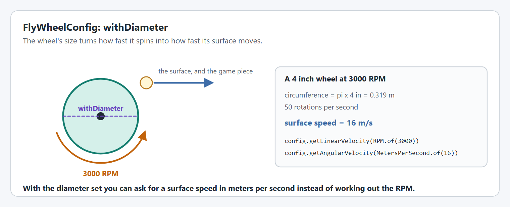

# Step 2: The flywheel

The `SmartMotorController` from step 1 is configured, but nothing tells it to move yet. A `FlyWheel` adds what makes it a flywheel: a physics simulation, a drawing of the mechanism for your dashboard, and the commands and triggers you will use in step 3.

<figure><figcaption><p>Two configs go into one mechanism.</p></figcaption></figure>


**In a hurry?** Jump to [the complete file](#the-complete-file), copy it, and change the values called out under **For your robot**. The numbered parts explain each piece in a sentence or two. You do not need to understand all of it to get moving: the pages under **Understanding** go deeper when you want them.


## 1. Describe the flywheel

`FlyWheelConfig` describes the flywheel itself. Its diameter sets the size of the drawing on your dashboard, and it is what lets you ask for a surface speed in meters per second as well as a rotation speed. The simulation does not use the diameter to spin the wheel: it uses the moment of inertia you gave the motor controller config in step 1.

<figure><figcaption><p>The diameter converts rotation speed to surface speed.</p></figcaption></figure>




```java
private final FlyWheelConfig shooterConfig = new FlyWheelConfig()
    // The diameter of the flywheel: the size of its drawing, and what turns RPM into surface speed.
    .withDiameter(Inches.of(4))
    // Telemetry name and how much to publish.
    .withTelemetry("Shooter", TelemetryVerbosity.HIGH);
```





```java
private final FlyWheelConfig shooterConfig = new FlyWheelConfig()
    // The diameter of the flywheel: the size of its drawing, and what turns RPM into surface speed.
    .withDiameter(Inches.of(4))
    // Telemetry name and how much to publish.
    .withTelemetry("Shooter", TelemetryVerbosity.HIGH);
```





```cpp
// The flywheel mechanism and its config, also set up in the constructor.
yams::mechanisms::config::FlyWheelConfig m_shooterConfig;
std::optional<yams::mechanisms::velocity::FlyWheel> m_shooter;
```



```cpp
m_shooterConfig
    // The diameter of the flywheel: the size of its drawing, and what turns RPM into surface speed.
    .WithRollerDiameter(4_in)
    // Telemetry name.
    .WithTelemetryName("Shooter");
```




**For your robot:** Set the diameter of your wheel.

Want the details? [Shooters](../../details/shooters.md) and [FlyWheelConfig](../../details/mechanism-configs/flywheel-config.md)

## 2. Create the FlyWheel

Hand the config, and the `SmartMotorController` from step 1, to the `FlyWheel`.




```java
// The flywheel mechanism.
private final FlyWheel shooter = new FlyWheel(shooterConfig, motor);
```





```java
// The flywheel mechanism.
private final FlyWheel shooter = new FlyWheel(shooterConfig, motor);
```





```cpp
// The flywheel mechanism.
m_shooter.emplace(&m_shooterConfig, &m_motor.value());
```




## 3. Update it every loop

Two calls keep the mechanism alive. `updateTelemetry()` publishes its telemetry and applies anything you change through live tuning. `simIterate()` runs the physics simulation, and only needs to run in simulation.

In Commands v2 and C++ the scheduler calls a subsystem's periodic methods for you, so there is nothing more to do.

In Commands v3 nothing calls a `Mechanism` every loop, so `Robot.java` does it, the same way as in [the arm tutorial's step 2](../arm/mechanism.md#3-update-it-every-loop), which explains each part. Every mechanism gets one line in `robotPeriodic()`, before `scheduler.run()`, and one in `simulationInit()`.

If your `Robot.java` already has `simulationInit()` and `startSimulation(...)` from the arm tutorial, add the lines below. If not, copy the whole `Robot.java` from the Commands v3 tab of [the complete file](#the-complete-file).




```java
@Override
public void periodic() {
  // Publishes the flywheel's telemetry, and applies anything changed through live tuning.
  shooter.updateTelemetry();
}

@Override
public void simulationPeriodic() {
  // Runs the flywheel's physics simulation.
  shooter.simIterate();
}
```





```java
/** Call this from Robot.robotPeriodic(), before the scheduler runs. */
public void periodic() {
  // Publishes the flywheel's telemetry, and applies anything changed through live tuning.
  shooter.updateTelemetry();
}

/** Robot.simulationInit() runs this in its own Notifier, every robot loop. */
public void simulationPeriodic() {
  // Runs the flywheel's physics simulation.
  shooter.simIterate();
}
```



```java
import first.robot.mechanisms.ShooterMechanism;

// A field of Robot.
final ShooterMechanism shooter = new ShooterMechanism();

// In robotPeriodic(), before scheduler.run():
shooter.periodic();

// In simulationInit():
startSimulation("Shooter", shooter::simulationPeriodic);
```





```cpp
void Periodic() override;
void SimulationPeriodic() override;
```



```cpp
void ShooterSubsystem::Periodic() {
  // Publishes the flywheel's telemetry, and applies anything changed through live tuning.
  m_shooter->UpdateTelemetry();
}

void ShooterSubsystem::SimulationPeriodic() {
  // Runs the flywheel's physics simulation.
  m_shooter->SimIterate();
}
```




## The complete file



The highlighted lines are new in this step.

`ShooterSubsystem` extends `SubsystemBase`, so the scheduler calls `periodic()` and `simulationPeriodic()` for you.

<pre class="language-java" data-title="subsystems/ShooterSubsystem.java" data-line-numbers><code class="lang-java">package first.robot.subsystems;

import static org.wpilib.units.Units.Amps;
<strong>import static org.wpilib.units.Units.Inches;
</strong>import static org.wpilib.units.Units.KilogramSquareMeters;

import com.revrobotics.spark.SparkLowLevel.MotorType;
import com.revrobotics.spark.SparkMax;
import org.wpilib.command2.SubsystemBase;
import org.wpilib.hardware.bus.CANPort;
import org.wpilib.math.controller.SimpleMotorFeedforward;
import org.wpilib.math.system.DCMotor;
import yams.commands2.config.SmartMotorControllerConfig;
<strong>import yams.commands2.mechanisms.FlyWheel;
</strong>import yams.core.gearing.GearBox;
import yams.core.gearing.MechanismGearing;
<strong>import yams.core.mechanisms.config.FlyWheelConfig;
</strong>import yams.core.motorcontrollers.SmartMotorController;
import yams.core.motorcontrollers.enums.ControlMode;
import yams.core.motorcontrollers.enums.MotorMode;
import yams.core.motorcontrollers.local.SparkWrapper;
import yams.core.telemetry.enums.TelemetryVerbosity;

public class ShooterSubsystem extends SubsystemBase {

  // What the motor controller should do: its control mode, gains and gearing.
  private final SmartMotorControllerConfig smcConfig = new SmartMotorControllerConfig(this)
      .withControlMode(ControlMode.CLOSED_LOOP)
      // Feedback constants (PID), on the real robot and in simulation.
      // A flywheel holds a speed, so it gets no motion profile.
      .withClosedLoopController(0.2, 0, 0)
      .withSimClosedLoopController(0.2, 0, 0)
      // Feedforward constants, on the real robot and in simulation.
      .withFeedforward(new SimpleMotorFeedforward(0, 0.19, 0))
      .withSimFeedforward(new SimpleMotorFeedforward(0, 0.19, 0))
      // Gearing from the motor rotor to the flywheel: one 1.5:1 stage.
      .withGearing(new MechanismGearing(GearBox.fromReductionStages(1.5)))
      // How hard the wheel is to spin up, used by the simulation: two 4 inch
      // wheels, 0.68 kg (1.5 lb) in all, as solid discs: 0.5 x 0.68 kg x (0.0508 m)^2.
      .withMomentOfInertia(KilogramSquareMeters.of(0.0009))
      .withMotorInverted(false)
      // Coast, so that the wheel spins down by itself instead of being braked to a stop.
      .withZeroPower(MotorMode.COAST)
      .withStatorCurrentLimit(Amps.of(40))
      // Telemetry name and how much to publish.
      .withTelemetry("ShooterMotor", TelemetryVerbosity.HIGH);

  // The vendor motor controller object: a SPARK MAX with CAN ID 4.
  private final SparkMax spark = new SparkMax(CANPort.CAN_S0, 4, MotorType.kBrushless);

  // The SmartMotorController applies the config to the SPARK MAX, which drives one NEO.
  private final SmartMotorController motor = new SparkWrapper(spark, DCMotor.getNEO(1), smcConfig);

<strong>  private final FlyWheelConfig shooterConfig = new FlyWheelConfig()
</strong><strong>      // The diameter of the flywheel: the size of its drawing, and what turns RPM into surface speed.
</strong><strong>      .withDiameter(Inches.of(4))
</strong><strong>      // Telemetry name and how much to publish.
</strong><strong>      .withTelemetry("Shooter", TelemetryVerbosity.HIGH);
</strong>
<strong>  // The flywheel mechanism.
</strong><strong>  private final FlyWheel shooter = new FlyWheel(shooterConfig, motor);
</strong>
<strong>  @Override
</strong><strong>  public void periodic() {
</strong><strong>    // Publishes the flywheel's telemetry, and applies anything changed through live tuning.
</strong><strong>    shooter.updateTelemetry();
</strong><strong>  }
</strong>
<strong>  @Override
</strong><strong>  public void simulationPeriodic() {
</strong><strong>    // Runs the flywheel's physics simulation.
</strong><strong>    shooter.simIterate();
</strong><strong>  }
</strong>}
</code></pre>



The highlighted lines are new in this step.

Nothing calls a periodic method on a Commands v3 `Mechanism`, so give the class its own `periodic()` and `simulationPeriodic()` and create the mechanism in `Robot.java`. Then call its `periodic()` from `Robot.robotPeriodic()`, before the scheduler runs, and start its `simulationPeriodic()` in its own `Notifier` from `Robot.simulationInit()`.

<pre class="language-java" data-title="mechanisms/ShooterMechanism.java" data-line-numbers><code class="lang-java">package first.robot.mechanisms;

import static org.wpilib.units.Units.Amps;
<strong>import static org.wpilib.units.Units.Inches;
</strong>import static org.wpilib.units.Units.KilogramSquareMeters;

import com.revrobotics.spark.SparkLowLevel.MotorType;
import com.revrobotics.spark.SparkMax;
import org.wpilib.command3.Mechanism;
import org.wpilib.hardware.bus.CANPort;
import org.wpilib.math.controller.SimpleMotorFeedforward;
import org.wpilib.math.system.DCMotor;
import yams.commands3.config.SmartMotorControllerConfig;
<strong>import yams.commands3.mechanisms.FlyWheel;
</strong>import yams.core.gearing.GearBox;
import yams.core.gearing.MechanismGearing;
<strong>import yams.core.mechanisms.config.FlyWheelConfig;
</strong>import yams.core.motorcontrollers.SmartMotorController;
import yams.core.motorcontrollers.enums.ControlMode;
import yams.core.motorcontrollers.enums.MotorMode;
import yams.core.motorcontrollers.local.SparkWrapper;
import yams.core.telemetry.enums.TelemetryVerbosity;

public class ShooterMechanism implements Mechanism {

  // What the motor controller should do: its control mode, gains and gearing.
  private final SmartMotorControllerConfig smcConfig = new SmartMotorControllerConfig(this)
      .withControlMode(ControlMode.CLOSED_LOOP)
      // Feedback constants (PID), on the real robot and in simulation.
      // A flywheel holds a speed, so it gets no motion profile.
      .withClosedLoopController(0.2, 0, 0)
      .withSimClosedLoopController(0.2, 0, 0)
      // Feedforward constants, on the real robot and in simulation.
      .withFeedforward(new SimpleMotorFeedforward(0, 0.19, 0))
      .withSimFeedforward(new SimpleMotorFeedforward(0, 0.19, 0))
      // Gearing from the motor rotor to the flywheel: one 1.5:1 stage.
      .withGearing(new MechanismGearing(GearBox.fromReductionStages(1.5)))
      // How hard the wheel is to spin up, used by the simulation: two 4 inch
      // wheels, 0.68 kg (1.5 lb) in all, as solid discs: 0.5 x 0.68 kg x (0.0508 m)^2.
      .withMomentOfInertia(KilogramSquareMeters.of(0.0009))
      .withMotorInverted(false)
      // Coast, so that the wheel spins down by itself instead of being braked to a stop.
      .withZeroPower(MotorMode.COAST)
      .withStatorCurrentLimit(Amps.of(40))
      // Telemetry name and how much to publish.
      .withTelemetry("ShooterMotor", TelemetryVerbosity.HIGH);

  // The vendor motor controller object: a SPARK MAX with CAN ID 4.
  private final SparkMax spark = new SparkMax(CANPort.CAN_S0, 4, MotorType.kBrushless);

  // The SmartMotorController applies the config to the SPARK MAX, which drives one NEO.
  private final SmartMotorController motor = new SparkWrapper(spark, DCMotor.getNEO(1), smcConfig);

<strong>  private final FlyWheelConfig shooterConfig = new FlyWheelConfig()
</strong><strong>      // The diameter of the flywheel: the size of its drawing, and what turns RPM into surface speed.
</strong><strong>      .withDiameter(Inches.of(4))
</strong><strong>      // Telemetry name and how much to publish.
</strong><strong>      .withTelemetry("Shooter", TelemetryVerbosity.HIGH);
</strong>
<strong>  // The flywheel mechanism.
</strong><strong>  private final FlyWheel shooter = new FlyWheel(shooterConfig, motor);
</strong>
<strong>  /** Call this from Robot.robotPeriodic(), before the scheduler runs. */
</strong><strong>  public void periodic() {
</strong><strong>    // Publishes the flywheel's telemetry, and applies anything changed through live tuning.
</strong><strong>    shooter.updateTelemetry();
</strong><strong>  }
</strong>
<strong>  /** Robot.simulationInit() runs this in its own Notifier, every robot loop. */
</strong><strong>  public void simulationPeriodic() {
</strong><strong>    // Runs the flywheel's physics simulation.
</strong><strong>    shooter.simIterate();
</strong><strong>  }
</strong>}
</code></pre>

<pre class="language-java" data-title="Robot.java" data-line-numbers><code class="lang-java">package first.robot;

<strong>import java.util.ArrayList;
</strong><strong>import java.util.List;
</strong>import org.wpilib.command3.Scheduler;
import org.wpilib.command3.button.CommandGamepad;
import org.wpilib.framework.OpModeRobot;
<strong>import org.wpilib.system.Notifier;
</strong><strong>import org.wpilib.telemetry.Telemetry;
</strong>import first.robot.constants.DriverConstants;
<strong>import first.robot.mechanisms.ShooterMechanism;
</strong>import first.robot.mechanisms.ExampleMechanism;

public class Robot extends OpModeRobot {
  final ExampleMechanism exampleMechanism = new ExampleMechanism();
<strong>  final ShooterMechanism shooter = new ShooterMechanism();
</strong>  final CommandGamepad exampleController =
      new CommandGamepad(DriverConstants.DRIVER_CONTROLLER_PORT);

<strong>  // The scheduler that runs every command.
</strong><strong>  private final Scheduler scheduler = Scheduler.getDefault();
</strong><strong>  // Each mechanism's simulation Notifier, kept so that it is not garbage collected.
</strong><strong>  private final List&#x3C;Notifier> simulationNotifiers = new ArrayList&#x3C;>();
</strong>
  public Robot() {}

  @Override
  public void robotPeriodic() {
<strong>    // Runs every loop, on the robot and in simulation.
</strong><strong>    // Update the mechanism before the scheduler runs its commands.
</strong><strong>    shooter.periodic();
</strong><strong>    scheduler.run();
</strong><strong>    // Publish the scheduler, so that a dashboard shows which commands are running.
</strong><strong>    Telemetry.log("Scheduler", scheduler, Scheduler.proto);
</strong><strong>  }
</strong>
<strong>  @Override
</strong><strong>  public void simulationInit() {
</strong><strong>    // Runs once, when the simulation starts.
</strong><strong>    // Run each mechanism's simulation in its own Notifier, every robot loop.
</strong><strong>    startSimulation("Shooter", shooter::simulationPeriodic);
</strong><strong>  }
</strong>
<strong>  /** Runs a mechanism's simulation in its own Notifier, every robot loop period. */
</strong><strong>  private void startSimulation(String name, Runnable simulationPeriodic) {
</strong><strong>    Notifier notifier = new Notifier(simulationPeriodic);
</strong><strong>    notifier.setName(name + " Simulation");
</strong><strong>    notifier.startPeriodic(getPeriod());
</strong><strong>    simulationNotifiers.add(notifier);
</strong><strong>  }
</strong>}
</code></pre>



The highlighted lines are new in this step.

`WithRollerDiameter` is the C++ name of `withDiameter`. The C++ mechanism configs take a telemetry name only.

<pre class="language-cpp" data-title="include/subsystems/ShooterSubsystem.hpp" data-line-numbers><code class="lang-cpp">#pragma once

#include &#x3C;optional>

#include &#x3C;rev/SparkMax.h>
#include &#x3C;wpi/commands2/SubsystemBase.hpp>
#include &#x3C;wpi/hardware/bus/CANPort.hpp>

<strong>#include "yams/mechanisms/config/FlyWheelConfig.hpp"
</strong><strong>#include "yams/mechanisms/velocity/FlyWheel.hpp"
</strong>#include "yams/motorcontrollers/SmartMotorControllerConfig.hpp"
#include "yams/motorcontrollers/local/SparkWrapper.hpp"

class ShooterSubsystem : public wpi::cmd::SubsystemBase {
 public:
  ShooterSubsystem();

<strong>  void Periodic() override;
</strong><strong>  void SimulationPeriodic() override;
</strong>
 private:
  // The vendor motor controller object: a SPARK MAX with CAN ID 4.
  rev::spark::SparkMax m_spark{wpi::CANPort::CAN_S0, 4, rev::spark::SparkMax::MotorType::kBrushless};

  // What the motor controller should do. It is filled in by the constructor.
  yams::motorcontrollers::SmartMotorControllerConfig m_smcConfig;

  // The SmartMotorController, created in the constructor once the config is ready.
  std::optional&#x3C;yams::motorcontrollers::local::SparkWrapper> m_motor;

<strong>  // The flywheel mechanism and its config, also set up in the constructor.
</strong><strong>  yams::mechanisms::config::FlyWheelConfig m_shooterConfig;
</strong><strong>  std::optional&#x3C;yams::mechanisms::velocity::FlyWheel> m_shooter;
</strong>};
</code></pre>

<pre class="language-cpp" data-title="cpp/subsystems/ShooterSubsystem.cpp" data-line-numbers><code class="lang-cpp">#include "subsystems/ShooterSubsystem.hpp"

#include &#x3C;wpi/math/controller/SimpleMotorFeedforward.hpp>
#include &#x3C;wpi/math/system/DCMotor.hpp>
#include &#x3C;wpi/units/angle.hpp>
#include &#x3C;wpi/units/current.hpp>
<strong>#include &#x3C;wpi/units/length.hpp>
</strong>#include &#x3C;wpi/units/voltage.hpp>

#include "yams/gearing/GearBox.hpp"
#include "yams/gearing/MechanismGearing.hpp"

using namespace yams::gearing;
using Cfg = yams::motorcontrollers::SmartMotorControllerConfig;
using Feedforward = wpi::math::SimpleMotorFeedforward&#x3C;wpi::units::turns>;

ShooterSubsystem::ShooterSubsystem() {
  // What the motor controller should do: its control mode, gains and gearing.
  m_smcConfig
      .WithSubsystem(this)
      .WithClosedLoopMode()
      // Feedback constants (PID), on the real robot and in simulation.
      // A flywheel holds a speed, so it gets no motion profile.
      .WithFeedback(0.2, 0, 0)
      .WithSimClosedLoopController(0.2, 0, 0)
      // Feedforward constants (kS and kV), on the real robot and in simulation.
      .WithFeedforward(Feedforward{0_V, wpi::units::unit_t&#x3C;Feedforward::kv_unit>{0.19}})
      .WithSimFeedforward(Feedforward{0_V, wpi::units::unit_t&#x3C;Feedforward::kv_unit>{0.19}})
      // Gearing from the motor rotor to the flywheel: one 1.5:1 stage.
      .WithMotorGearing(MechanismGearing{GearBox::FromReductionStages({1.5})})
      // How hard the wheel is to spin up, used by the simulation: two 4 inch
      // wheels, 0.68 kg (1.5 lb) in all, as solid discs: 0.5 x 0.68 kg x (0.0508 m)^2.
      .WithMOI(wpi::units::kilogram_square_meter_t{0.0009})
      .WithMotorInverted(false)
      // Coast, so that the wheel spins down by itself instead of being braked to a stop.
      .WithZeroPower(Cfg::MotorMode::COAST)
      .WithStatorCurrentLimit(40_A)
      // Telemetry name and how much to publish.
      .WithTelemetry("ShooterMotor", Cfg::TelemetryVerbosity::HIGH);

  // The SmartMotorController applies the config to the SPARK MAX, which drives one NEO.
  m_motor.emplace(&#x26;m_spark, wpi::math::DCMotor::NEO(1), &#x26;m_smcConfig);

<strong>  m_shooterConfig
</strong><strong>      // The diameter of the flywheel: the size of its drawing, and what turns RPM into surface speed.
</strong><strong>      .WithRollerDiameter(4_in)
</strong><strong>      // Telemetry name.
</strong><strong>      .WithTelemetryName("Shooter");
</strong>
<strong>  // The flywheel mechanism.
</strong><strong>  m_shooter.emplace(&#x26;m_shooterConfig, &#x26;m_motor.value());
</strong>}

<strong>void ShooterSubsystem::Periodic() {
</strong><strong>  // Publishes the flywheel's telemetry, and applies anything changed through live tuning.
</strong><strong>  m_shooter->UpdateTelemetry();
</strong><strong>}
</strong>
<strong>void ShooterSubsystem::SimulationPeriodic() {
</strong><strong>  // Runs the flywheel's physics simulation.
</strong><strong>  m_shooter->SimIterate();
</strong><strong>}
</strong></code></pre>



## Check it

Build the code again. You can already run the simulation as in [step 4](simulate.md): the flywheel is drawn, standing still. It does not spin yet, because nothing gives it a setpoint.

* **`FlyWheel` cannot be found:** the import is from the other command framework. Commands v2 uses `yams.commands2.mechanisms.FlyWheel`, Commands v3 uses `yams.commands3.mechanisms.FlyWheel`.
