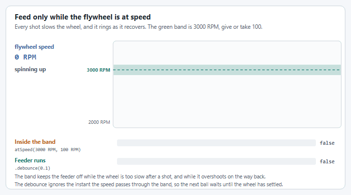

# Step 5: Tune it

The gains from step 1 are placeholders worked out from the motor: `kV` is 0.19 and `kP` is 0.2. On this page you find your own, while the simulation runs, the same way you will tune the real flywheel on the robot. You change one number at a time on a dashboard and watch a graph. Nothing is saved until you copy the numbers into your code at the end.

A flywheel is tuned differently from [an arm](../arm/tune.md) or an elevator. There is no gravity to hold up and no motion profile. `kV` does most of the work, so you find it first, with `kP` turned off, then add a little `kP` to fix what is left.


**In simulation you are tuning the simulation's gains.** While the code runs in simulation, live tuning changes the `withSimClosedLoopController` and `withSimFeedforward` values. On the real robot it changes `withClosedLoopController` and `withFeedforward`. The two sets are kept apart because a simulated flywheel is never exactly like the real one.


## Before you start

* Start the simulation and enable **Teleoperated**, as in [step 4](simulate.md). The wheel is still.
* Do not press any of the shooter's buttons while you tune. A button runs another shooter command, which stops live tuning. If that happens, start live tuning again.

Then tune with the YAMS Live Tuner, or by typing the values in AdvantageScope and Elastic. Both change the same values, so pick one.



The [YAMS Live Tuner](../../details/live-tuning/live-tuner.md) is a web page that walks you through it: it checks the flywheel before anything moves, then you send setpoints and change gains while watching a graph.



### Connect

Open [tuning.yassrobotics.com](https://tuning.yassrobotics.com/), pick **Simulation**, and press **Connect**. If your browser asks whether the page may connect to devices on your local network, allow it.

**Check it:** the badge in the header shows `localhost`, with the robot enabled in Teleop.



### Pick the flywheel

1. Under **Telemetry name**, choose `Shooter/ShooterMotor`: the names from the flywheel's and the motor's `withTelemetry`.
2. Under **Live Tuning command**, choose `ShooterSubsystem` (Commands v2 and C++) or `ShooterMechanism` (Commands v3).
3. Set **Type** to **Flywheel**, and leave **Second flywheel** at **None**. Speeds are in RPM, both where you type and on the graph.
4. Press **Continue**.

**Check it:** the telemetry card shows the wheel at 0 RPM.



### Checklist and inversions

1. Tick every item on the pre-motion checklist, leave **Current trip (A)** at 40, and press **Continue**.
2. Tick the confirmation and press **Start voltage control**.
3. Type `0.5` under **Type a voltage** and press **Enter**. The wheel spins up.
4. Type `0`, then press **Finish check**.

A flywheel has no range of motion, so the Live tune card opens next.

**Check it:** **Positive voltage moves forward** was ticked when the wheel spun up. If the Live Tuner warns that the speed went the wrong way, the motor or encoder inversion in step 1 is wrong.



### Start live tuning and find kV

Press **Start Live Tuning**. The speeds and gains you send are now applied to the flywheel every loop.

`kV` is how many volts the motor needs for each rotation per second of wheel speed. Get it right and the wheel reaches the setpoint on feedforward alone.

1. On the Settings card's **Gains** tab, type `0` into **kP** and `0` into **kV**. Now nothing drives the wheel.
2. On the **Setpoints** tab, type `3000` and press **Send**. The wheel stays still.
3. Type `0.1` into **kV**. The wheel spins up, but settles well below 3000 RPM.
4. Raise **kV** a little at a time until the measured speed settles on the setpoint. For this NEO and 1.5:1 gearing it ends up near `0.19`. If the wheel settles above the setpoint, `kV` is too high: lower it.
5. Send `2000`. The wheel should settle on it too, with the same `kV`.

**Check it:** at both 2000 and 3000 RPM the measured speed settles on the setpoint, with `kP` still at 0.

`kS` is the voltage that just overcomes friction. The simulation has no friction, so leave it at 0 here.



### Tune kP

`kP` adds a push when the wheel is slower or faster than the setpoint, such as when a game piece goes through and drags it down. It is volts for each rotation per second of error.

1. Type `0.1` into **kP**.
2. Turn on **Alternate setpoints**, with **Setpoint A** at `2000` and **Setpoint B** at `3000`. The wheel now changes speed every 5 seconds.
3. Raise **kP** a step at a time (0.2, 0.3, ...). Each step should make the wheel reach the new speed a little faster.
4. Stop, and press **was** to go back one step, when the speed overshoots the setpoint or the line gets jittery.

**Check it:** the speed reaches each new setpoint quickly and settles on it without bouncing around it. Press **Space** to stop when you are done.

A flywheel needs no `kD` and no motion profile: the wheel may speed up as fast as the motor allows.





You type each value into its NetworkTables key yourself, and graph the flywheel in AdvantageScope.

Open [AdvantageScope](https://docs.advantagescope.org/) and connect it to the simulation (**File > Connect to Simulator**).



### Start live tuning

YAMS gives the flywheel a `Live Tuning` command. While it runs, numbers you type on the dashboard are applied to the flywheel straight away.

* **Commands v2 and C++:** the command is published at `NT:/Tuning/ShooterSubsystem/Live Tuning`, named after the subsystem. In [Elastic](https://frc-elastic.gitbook.io/docs), add `Tuning/ShooterSubsystem/Live Tuning` to a tab and press its button.
* **Commands v3:** the command is published at `NT:/Tuning/ShooterMechanism/Live Tuning`, named after the mechanism. Set the boolean `NT:/Tuning/ShooterMechanism/Live Tuning/running` to `true`. In AdvantageScope, first turn on tuning mode (step 2), then click the value to change it.

**Check it:** the command shows as running. The wheel is still.



### Find the numbers and graph the flywheel

The flywheel's values are under two tables. Both use the names from `withTelemetry`: `Shooter` for the flywheel and `ShooterMotor` for its motor.

| | Where | Used for |
| --- | --- | --- |
| Values you type | `NT:/Tuning/Shooter/ShooterMotor/` | Gains, setpoints, limits |
| Values you watch | `NT:/Mechanisms/Shooter/ShooterMotor/` | How fast the wheel spins and what the motor is doing |

1. In AdvantageScope, turn on **tuning mode**: the sliders icon beside the search box at the top of the sidebar. Without it, typed values are ignored.
2. Make a **Line Graph** and drag in, from `NT:/Mechanisms/Shooter/ShooterMotor/`:
   * `mechanism/velocity`: how fast the wheel spins.
   * `closedloop/setpoint/velocity`: how fast it is asked to spin.
   * `motor/outputVoltage`: the voltage the motor is given.


**You type RPM, you read rotations per second.** A setpoint typed as `3000` (RPM) is graphed as `50` (rotations per second). Divide RPM by 60 to compare. To graph in RPM, see [See both in the same units with AdvantageScope](../../details/live-tuning/keys-and-units.md#see-both-in-the-same-units-with-advantagescope).


**Check it:** the velocity lines are at 0.



### kV: the voltage for each speed

`kV` is how many volts the motor needs for each rotation per second of wheel speed. Get it right and the wheel reaches the setpoint on feedforward alone.

1. Type `0` into `NT:/Tuning/Shooter/ShooterMotor/closedloop/feedback/kP` and `0` into `closedloop/feedforward/kV`. Now nothing drives the wheel.
2. Type `3000` into `closedloop/setpoint/velocity`. The setpoint line jumps to 50, and the wheel stays still.
3. Type `0.1` into `closedloop/feedforward/kV`. The wheel spins up, but settles well below 50.
4. Raise `kV` a little at a time until `mechanism/velocity` settles on the setpoint line. For this NEO and 1.5:1 gearing it ends up near `0.19`. If the wheel settles above the setpoint, `kV` is too high: lower it.
5. Type `2000` into the setpoint (33 on the graph). The wheel should settle on it too, with the same `kV`.

**Check it:** at both 2000 and 3000 RPM the measured speed settles on the setpoint, with `kP` still at 0.

`kS` is the voltage that just overcomes friction. The simulation has no friction, so leave it at 0 here. On the real robot, raise `closedloop/feedforward/kS` until the wheel only just starts to turn, then back it off a little, before you tune `kV`.



### kP: recover faster

`kV` gets the wheel to speed. `kP` adds a push when the wheel is slower or faster than the setpoint, such as when a game piece goes through and drags it down. It is volts for each rotation per second of error.

1. Type `0.1` into `closedloop/feedback/kP`.
2. Move the setpoint between `2000` and `3000` and watch how fast the speed gets there.
3. Raise `kP` a step at a time (0.2, 0.3, ...). Each step should make the wheel reach the new speed a little faster.
4. Stop, and go back one step, when the speed overshoots the setpoint or the line gets jittery.

<figure><figcaption><p>On the real robot each shot slows the wheel. A good kP brings it back quickly without ringing.</p></figcaption></figure>

**Check it:** the speed reaches each new setpoint quickly and settles on it without bouncing around it.

A flywheel needs no `kD` and no motion profile: the wheel may speed up as fast as the motor allows.

For more on each value, see [Tuning order](../../details/live-tuning/README.md#tuning-order).





## Copy the numbers into your code

Dashboard changes are lost when the code restarts. Write the numbers you ended up with into the config from step 1. In simulation they go into the `Sim` versions.




```java
// Before
.withSimClosedLoopController(0.2, 0, 0)
.withSimFeedforward(new SimpleMotorFeedforward(0, 0.19, 0))

// After: your numbers. SimpleMotorFeedforward takes kS, kV, kA.
.withSimClosedLoopController(0.3, 0, 0)
.withSimFeedforward(new SimpleMotorFeedforward(0, 0.188, 0))
```





```java
// Before
.withSimClosedLoopController(0.2, 0, 0)
.withSimFeedforward(new SimpleMotorFeedforward(0, 0.19, 0))

// After: your numbers. SimpleMotorFeedforward takes kS, kV, kA.
.withSimClosedLoopController(0.3, 0, 0)
.withSimFeedforward(new SimpleMotorFeedforward(0, 0.188, 0))
```





```cpp
// Before
.WithSimClosedLoopController(0.2, 0, 0)
.WithSimFeedforward(Feedforward{0_V, wpi::units::unit_t<Feedforward::kv_unit>{0.19}})

// After: your numbers. kP, kI, kD, then kS and kV.
.WithSimClosedLoopController(0.3, 0, 0)
.WithSimFeedforward(Feedforward{0_V, wpi::units::unit_t<Feedforward::kv_unit>{0.188}})
```




The numbers above are an example. Use the ones you found.

**Check it:** restart the simulation and enable it. Hold **A** and **B**: the wheel reaches 2000 and 3000 RPM quickly and holds each one.

## If it did not work

* **AdvantageScope: typing a value does nothing.** Turn on AdvantageScope's tuning mode, check the `Live Tuning` command is still running, and check you typed under `NT:/Tuning`, not `NT:/Mechanisms`.
* **Typing `0` as the setpoint does not stop the wheel.** Live tuning ignores a velocity setpoint of 0. To stop the wheel, disable the robot, or press a shooter button (which also stops live tuning).
* **Live Tuner: the flywheel is not in the Telemetry name list.** Check the simulation is running and you connected to **Simulation**. The list only fills in once the robot code has started.
* **Live tuning stopped on its own.** A button press, or the default command, took over the flywheel. On the Live Tuner, the current trip, leaving the range of motion, or pressing Space also stops it. Start it again.
* **The speed swings above and below the setpoint.** `kP` is too high. Lower it.
* **The numbers were gone after a restart.** They only last until the code stops. Copy them into your code, as in [Copy the numbers into your code](#copy-the-numbers-into-your-code).

More problems and fixes: [Troubleshooting](../troubleshooting.md).

## Step 6: Run it on the robot

Step 6 puts the code on the real robot. Follow [the arm's step 6: Run it on the robot](../arm/robot.md). It works the same for the flywheel, with these differences:

* The CAN ID is the shooter's `SparkMax`, 4 in this tutorial.
* A flywheel has no starting position and no soft limits, so skip those parts.
* For the direction check, positive should spin the wheel the way that throws a game piece **out**.
* On the first enable, hold **A** (2000 RPM) before you try **B**.
* Tune `kS`, then `kV`, then `kP` again on the robot, as in the kV and kP steps above. Friction means a real wheel needs some `kS`. Copy the robot's numbers into `withClosedLoopController` and `withFeedforward`.
