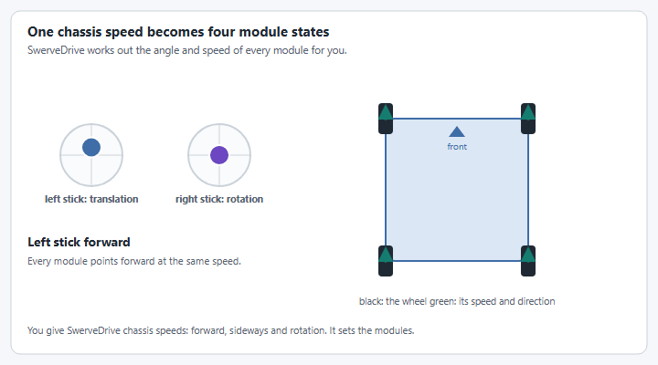
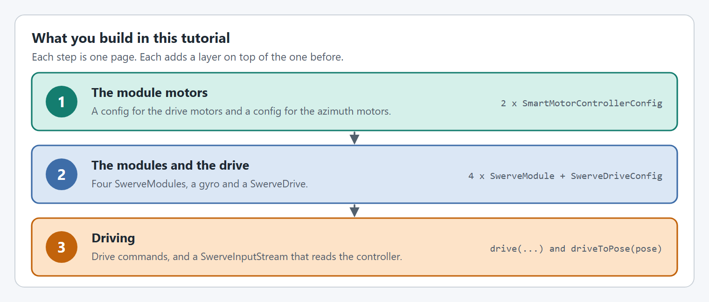

# Swerve Drive


Swerve drive requires more hardware configuration than a tank drive. Make sure you have installed YAMS, REVLib (for the `SparkMax` motor controllers) and Phoenix 6 (for the `CANcoder`s and the `Pigeon2`) before starting. [Create a project and install YAMS](project-setup.md) walks through it.


## Intro

This tutorial builds a swerve drive that works in real life and simulation with the same code.

<figure><figcaption>
You ask for a chassis speed. <code>SwerveDrive</code> works out the four modules.
</figcaption></figure>

## Details

This swerve drive uses the following hardware and controls:

* 4x `SparkMax` (NEO) drive motors, CAN IDs 1, 4, 7, 10
* 4x `SparkMax` (NEO) azimuth motors, CAN IDs 2, 5, 8, 11
* 4x `CANcoder` absolute encoders, CAN IDs 3, 6, 9, 12
* `Pigeon2` gyro, CAN ID 14
* Drive gear ratio `12.75:1`, azimuth gear ratio `6.75:1`, 4 inch wheels
* The left stick translates, and the right stick's X axis rotates
* Holding the left bumper drives to a pose on the field


**Simulation Processing Requirements**: YAMS simulates **each motor individually**. With 4 modules containing 2 motors each, that is 8 `SmartMotorController` instances running physics simulation simultaneously. This provides highly accurate simulation but requires more processing power than simplified kinematic-only simulations.


## The steps

<figure><figcaption>
Three steps, one page each.
</figcaption></figure>

Every step has a tab for **Java with Commands v2**, **Java with Commands v3** and **C++**.

| Step                                                                   | What you do                                                                                              |
| ---------------------------------------------------------------------- | -------------------------------------------------------------------------------------------------------- |
| [Before you start](project-setup.md)                                   | Create a WPILib project and install YAMS, REVLib and Phoenix 6. Skip this if you already have a project. |
| [Step 1: The module motors](swerve-drive/module-motors.md)             | A config for the drive motors and a config for the azimuth motors.                                       |
| [Step 2: The modules and the drive](swerve-drive/modules-and-drive.md) | Build four `SwerveModule`s, add the gyro, and create the `SwerveDrive`.                                  |
| [Step 3: Driving](swerve-drive/driving.md)                             | Drive commands, a `SwerveInputStream` for the sticks, and the bindings.                                  |

## Complete example

The following files from the YAMS `simple_robot-2027` Commands v2 example show a complete swerve drive implementation matching the hardware described in this tutorial.





The same drive in the other two flavors:

* **Java, Commands v3:** [`SwerveMechanism.java`](https://github.com/Yet-Another-Software-Suite/YAMS/blob/master/examples/commands3/simple_robot-2027/src/main/java/first/robot/mechanisms/SwerveMechanism.java) in `examples/commands3/simple_robot-2027`
* **C++:** [`SwerveSubsystem.h`](https://github.com/Yet-Another-Software-Suite/YAMS/blob/master/examples/cpptest/src/main/include/subsystems/SwerveSubsystem.h) and [`SwerveSubsystem.cpp`](https://github.com/Yet-Another-Software-Suite/YAMS/blob/master/examples/cpptest/src/main/cpp/subsystems/SwerveSubsystem.cpp) in `examples/cpptest`

## Next steps

* Learn about [AdvantageKit Integration](../details/advantagekit-integration.md) for swerve
* See [Organizing Configs in Constants](../details/config-organization.md) for cleaner code
* Record this drive's telemetry to a file and review it after a match, see [How do I view my DataLog in AdvantageScope?](../how-to/how-do-i-view-my-datalog-in-advantagescope.md)
