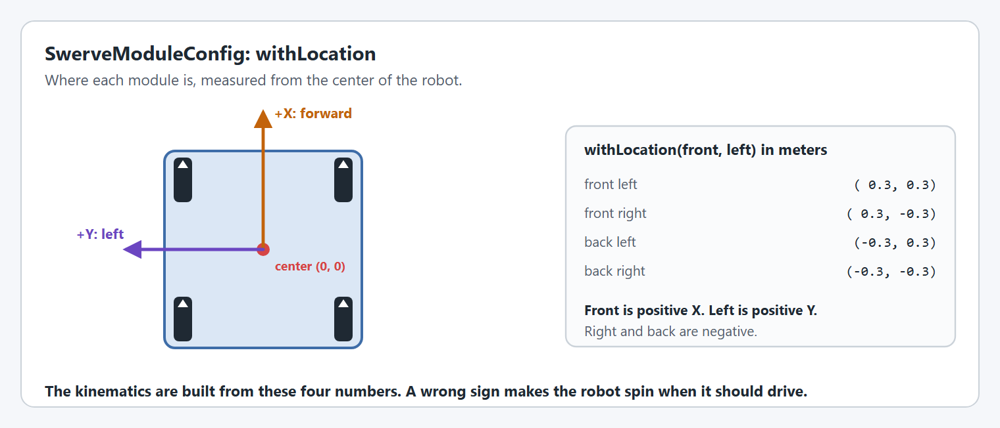
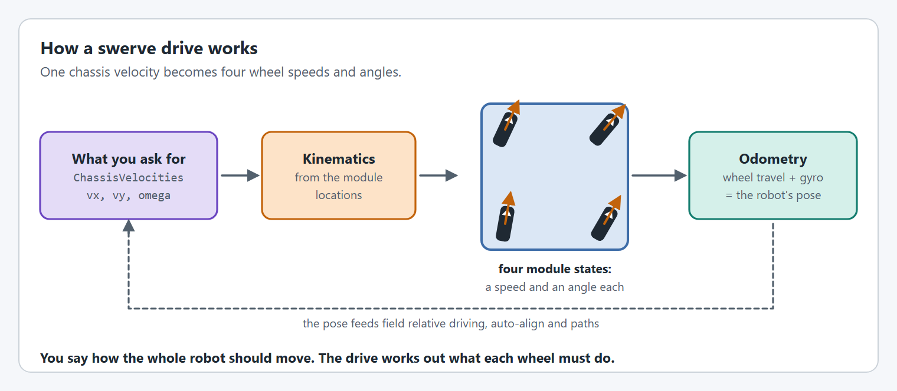

# Step 2: The modules and the drive

Four `SwerveModule`s, a gyro and a `SwerveDriveConfig` make a `SwerveDrive`.


**In a hurry?** Jump to [the complete file](#the-complete-file), copy it, and change the values called out under **For your robot**. The numbered parts explain each piece in a sentence or two. You do not need to understand all of it to get moving: the pages under **Understanding** go deeper when you want them.


## 1. Build one module

One helper builds a module from its two `SparkMax`, its `CANcoder`, a name and a location. It wraps each `SparkMax` in a `SmartMotorController` using the configs from step 1, and describes the module with a `SwerveModuleConfig`:

* **`withAbsoluteEncoder`** gives the module the `CANcoder`'s angle, so that it knows which way it points as soon as the robot turns on.
* **`withLocation`** says where the module is on the robot.
* **`withOptimization(true)`** lets the module reverse its wheel instead of turning more than 90 degrees.




```java
/** All four modules share their gearing and gains, so one method builds each of them. */
private SwerveModule createModule(SparkMax drive, SparkMax azimuth, CANcoder absoluteEncoder,
                                  String moduleName, Translation2d location) {
  SmartMotorController driveMotor = new SparkWrapper(drive, DCMotor.getNEO(1), buildDriveCfg());
  SmartMotorController azimuthMotor = new SparkWrapper(azimuth, DCMotor.getNEO(1), buildAzimuthCfg());

  return new SwerveModule(new SwerveModuleConfig(driveMotor, azimuthMotor)
      // The CANcoder tells the module which way it points when the robot turns on.
      .withAbsoluteEncoder(absoluteEncoder.getAbsolutePosition().asSupplier())
      .withTelemetry(moduleName, TelemetryVerbosity.HIGH)
      // Where the module is on the robot: +X is forward, +Y is left.
      .withLocation(location)
      // Turn the module at most 90 degrees, reversing the wheel instead of turning further.
      .withOptimization(true));
}
```





```java
/** All four modules share their gearing and gains, so one method builds each of them. */
private SwerveModule createModule(SparkMax drive, SparkMax azimuth, CANcoder absoluteEncoder,
                                  String moduleName, Translation2d location) {
  SmartMotorController driveMotor = new SparkWrapper(drive, DCMotor.getNEO(1), buildDriveCfg());
  SmartMotorController azimuthMotor = new SparkWrapper(azimuth, DCMotor.getNEO(1), buildAzimuthCfg());

  return new SwerveModule(new SwerveModuleConfig(driveMotor, azimuthMotor)
      // The CANcoder tells the module which way it points when the robot turns on.
      .withAbsoluteEncoder(absoluteEncoder.getAbsolutePosition().asSupplier())
      .withTelemetry(moduleName, TelemetryVerbosity.HIGH)
      // Where the module is on the robot: +X is forward, +Y is left.
      .withLocation(location)
      // Turn the module at most 90 degrees, reversing the wheel instead of turning further.
      .withOptimization(true));
}
```





```cpp
// Everything one module is made of. YAMS keeps pointers to the configs and the
// motor controllers, so they live here, next to the module that uses them.
struct Module {
  Module(int driveId, int azimuthId, int encoderId)
      : drive{wpi::CANPort::CAN_S0, driveId, rev::spark::SparkMax::MotorType::kBrushless},
        azimuth{wpi::CANPort::CAN_S0, azimuthId, rev::spark::SparkMax::MotorType::kBrushless},
        encoder{encoderId, ctre::phoenix6::CANBus{}} {}

  rev::spark::SparkMax drive;
  rev::spark::SparkMax azimuth;
  ctre::phoenix6::hardware::CANcoder encoder;
  yams::motorcontrollers::SmartMotorControllerConfig driveConfig;
  yams::motorcontrollers::SmartMotorControllerConfig azimuthConfig;
  std::optional<yams::motorcontrollers::local::SparkWrapper> driveMotor;
  std::optional<yams::motorcontrollers::local::SparkWrapper> azimuthMotor;
  yams::mechanisms::config::SwerveModuleConfig config;
  std::optional<yams::mechanisms::swerve::SwerveModule> module;
};

/** All four modules share their gearing and gains, so one method sets up each of them. */
void SetupModule(Module& module, const std::string& name, wpi::math::Translation2d location);
```



```cpp
void SwerveSubsystem::SetupModule(Module& module, const std::string& name,
                                  wpi::math::Translation2d location) {
  ConfigureDrive(module.driveConfig);
  ConfigureAzimuth(module.azimuthConfig);
  module.driveMotor.emplace(&module.drive, wpi::math::DCMotor::NEO(1), &module.driveConfig);
  module.azimuthMotor.emplace(&module.azimuth, wpi::math::DCMotor::NEO(1), &module.azimuthConfig);

  module.config = SwerveModuleConfig{&module.driveMotor.value(), &module.azimuthMotor.value()};
  module.config
      // The CANcoder tells the module which way it points when the robot turns on.
      .WithAbsoluteEncoder([&module]() -> wpi::units::degree_t {
        return wpi::units::turn_t{module.encoder.GetAbsolutePosition().GetValue()};
      })
      .WithTelemetry(name, Cfg::TelemetryVerbosity::HIGH)
      // Where the module is on the robot: +X is forward, +Y is left.
      .WithLocation(location)
      // Turn the module at most 90 degrees, reversing the wheel instead of turning further.
      .WithOptimization(true);

  module.module.emplace(&module.config);
}
```




**For your robot:** Nothing here usually needs changing, unless your motors are not NEOs.

Want the details? [SwerveModuleConfig](../../details/mechanism-configs/swerve-module-config.md)

## 2. The gyro, and a place for the drive

The drive needs a gyro for its heading.




```java
private final SwerveDrive drive;

// The gyro: a Pigeon2 with CAN ID 14.
private final Pigeon2 gyro = new Pigeon2(14, new CANBus(CANPort.CAN_S0));
```





```java
private final SwerveDrive drive;

// The gyro: a Pigeon2 with CAN ID 14.
private final Pigeon2 gyro = new Pigeon2(14, new CANBus(CANPort.CAN_S0));
```





```cpp
// The gyro: a Pigeon2 with CAN ID 14.
ctre::phoenix6::hardware::Pigeon2 m_gyro{14, ctre::phoenix6::CANBus{}};

// CAN IDs are grouped by module: drive, azimuth, CANcoder.
Module m_frontLeft{1, 2, 3};
Module m_frontRight{4, 5, 6};
Module m_backLeft{7, 8, 9};
Module m_backRight{10, 11, 12};

yams::mechanisms::swerve::SwerveDriveConfig m_driveConfig;
std::optional<yams::mechanisms::swerve::SwerveDrive<4>> m_drive;
```




**For your robot:** Change the CAN ID to your gyro's. In C++ this is also where the four modules get their CAN IDs.

## 3. Create the four modules

Locations use WPILib's convention: **+X is toward the front of the robot and +Y is toward its left side**.

<figure><figcaption><p>Module locations: X is forward and Y is left.</p></figcaption></figure>




```java
public SwerveSubsystem() {
  // Each module is 24 inches forward or back and 24 inches left or right of the robot center.
  // CAN IDs are grouped by module: drive, azimuth, CANcoder.
  var frontLeft = createModule(new SparkMax(CANPort.CAN_S0, 1, MotorType.kBrushless),
                               new SparkMax(CANPort.CAN_S0, 2, MotorType.kBrushless),
                               new CANcoder(3, new CANBus(CANPort.CAN_S0)), "frontleft",
                               new Translation2d(Inches.of(24), Inches.of(24)));
  var frontRight = createModule(new SparkMax(CANPort.CAN_S0, 4, MotorType.kBrushless),
                                new SparkMax(CANPort.CAN_S0, 5, MotorType.kBrushless),
                                new CANcoder(6, new CANBus(CANPort.CAN_S0)), "frontright",
                                new Translation2d(Inches.of(24), Inches.of(-24)));
  var backLeft = createModule(new SparkMax(CANPort.CAN_S0, 7, MotorType.kBrushless),
                              new SparkMax(CANPort.CAN_S0, 8, MotorType.kBrushless),
                              new CANcoder(9, new CANBus(CANPort.CAN_S0)), "backleft",
                              new Translation2d(Inches.of(-24), Inches.of(24)));
  var backRight = createModule(new SparkMax(CANPort.CAN_S0, 10, MotorType.kBrushless),
                               new SparkMax(CANPort.CAN_S0, 11, MotorType.kBrushless),
                               new CANcoder(12, new CANBus(CANPort.CAN_S0)), "backright",
                               new Translation2d(Inches.of(-24), Inches.of(-24)));
```





```java
public SwerveMechanism() {
  // Each module is 24 inches forward or back and 24 inches left or right of the robot center.
  // CAN IDs are grouped by module: drive, azimuth, CANcoder.
  var frontLeft = createModule(new SparkMax(CANPort.CAN_S0, 1, MotorType.kBrushless),
                               new SparkMax(CANPort.CAN_S0, 2, MotorType.kBrushless),
                               new CANcoder(3, new CANBus(CANPort.CAN_S0)), "frontleft",
                               new Translation2d(Inches.of(24), Inches.of(24)));
  var frontRight = createModule(new SparkMax(CANPort.CAN_S0, 4, MotorType.kBrushless),
                                new SparkMax(CANPort.CAN_S0, 5, MotorType.kBrushless),
                                new CANcoder(6, new CANBus(CANPort.CAN_S0)), "frontright",
                                new Translation2d(Inches.of(24), Inches.of(-24)));
  var backLeft = createModule(new SparkMax(CANPort.CAN_S0, 7, MotorType.kBrushless),
                              new SparkMax(CANPort.CAN_S0, 8, MotorType.kBrushless),
                              new CANcoder(9, new CANBus(CANPort.CAN_S0)), "backleft",
                              new Translation2d(Inches.of(-24), Inches.of(24)));
  var backRight = createModule(new SparkMax(CANPort.CAN_S0, 10, MotorType.kBrushless),
                               new SparkMax(CANPort.CAN_S0, 11, MotorType.kBrushless),
                               new CANcoder(12, new CANBus(CANPort.CAN_S0)), "backright",
                               new Translation2d(Inches.of(-24), Inches.of(-24)));
```





```cpp
// Each module is 24 inches forward or back and 24 inches left or right of the robot center.
SetupModule(m_frontLeft, "frontleft", wpi::math::Translation2d{24_in, 24_in});
SetupModule(m_frontRight, "frontright", wpi::math::Translation2d{24_in, -24_in});
SetupModule(m_backLeft, "backleft", wpi::math::Translation2d{-24_in, 24_in});
SetupModule(m_backRight, "backright", wpi::math::Translation2d{-24_in, -24_in});
```




**For your robot:** Change the CAN IDs, and change the 24 inches to how far your modules really are from the center of your robot.

## 4. Configure and create the drive

`SwerveDriveConfig` takes the four modules, the gyro's attitude, where on the field the robot starts, and the two PID controllers that `driveToPose()` uses in step 3.

<figure><figcaption><p>From one chassis velocity to four wheels, and back to a pose.</p></figcaption></figure>




```java
  SwerveDriveConfig config = new SwerveDriveConfig(this, frontLeft, frontRight, backLeft, backRight)
      // The gyro's attitude. Its yaw is the heading used for field relative driving.
      .withGyro(gyro::getRotation3d)
      .withStartingPose(new Pose2d(0, 0, Rotation2d.fromDegrees(0)))
      // Used by driveToPose(). A kP of 1 is a careful place to start.
      .withTranslationController(new PIDController(1, 0, 0))
      .withRotationController(new PIDController(1, 0, 0));

  drive = new SwerveDrive(config);
}
```





```java
  SwerveDriveConfig config = new SwerveDriveConfig(this, frontLeft, frontRight, backLeft, backRight)
      // The gyro's attitude. Its yaw is the heading used for field relative driving.
      .withGyro(gyro::getRotation3d)
      .withStartingPose(new Pose2d(0, 0, Rotation2d.fromDegrees(0)))
      // Used by driveToPose(). A kP of 1 is a careful place to start.
      .withTranslationController(new PIDController(1, 0, 0))
      .withRotationController(new PIDController(1, 0, 0));

  drive = new SwerveDrive(config);
}
```





```cpp
m_driveConfig
    .WithSubsystem(this)
    .WithModules({&m_frontLeft.module.value(), &m_frontRight.module.value(),
                  &m_backLeft.module.value(), &m_backRight.module.value()})
    // The gyro's attitude. Its yaw is the heading used for field relative driving.
    .WithGyro([this]() -> wpi::math::Rotation3d { return m_gyro.GetRotation3d(); })
    .WithStartingPose(wpi::math::Pose2d{})
    // Used by DriveToPose(). A kP of 1 is a careful place to start.
    .WithTranslationController(wpi::math::PIDController{1, 0, 0})
    .WithRotationController(wpi::math::PIDController{1, 0, 0});

m_drive.emplace(&m_driveConfig);
```




**For your robot:** The two controllers are only a place to start. Tune them once the robot drives well by hand.

Want the details? [SwerveDriveConfig](../../details/mechanism-configs/swerve-drive-config.md)

## 5. Update it every loop

`updateTelemetry()` must run every loop: it updates the pose estimate as well as the telemetry. `simIterate()` runs the physics simulation, and the line after it feeds the simulated heading back into the `Pigeon2`.

In Commands v2 and C++ the scheduler calls a subsystem's periodic methods for you, so there is nothing more to do.

In Commands v3 nothing calls a `Mechanism` every loop, so `Robot.java` does it. `Robot.java` has the two functions you need:

* **`robotPeriodic()`** runs every loop, on the robot and in simulation. Call the mechanism's `periodic()` here, before `scheduler.run()`, so that the commands see fresh values.
* **`simulationPeriodic()`** runs every loop in simulation only, right after `robotPeriodic()`. The template does not have it yet, so add it, and call the mechanism's `simulationPeriodic()` here.

Every mechanism you add to the robot gets one line in each of the two.

Two smaller changes tidy up the template while you are here. Keep `Scheduler.getDefault()` in a `scheduler` attribute instead of asking for it every loop, and publish the scheduler with `Telemetry.log(...)` after it runs, so that a dashboard shows which commands are running and which mechanisms they hold.




```java
@Override
public void periodic() {
  // Updates the pose estimate, the telemetry and the drive's Field2d.
  drive.updateTelemetry();
}

@Override
public void simulationPeriodic() {
  // Runs the physics simulation of all eight motors.
  drive.simIterate();
  // Keep the simulated Pigeon2 in step with the simulated robot's heading.
  gyro.getSimState().setRawYaw(drive.getSimPose().getRotation().getMeasure());
}
```





```java
/** Call this from Robot.robotPeriodic(), before the scheduler runs. */
public void periodic() {
  // Updates the pose estimate, the telemetry and the drive's Field2d.
  drive.updateTelemetry();
}

/** Call this from Robot.simulationPeriodic(). */
public void simulationPeriodic() {
  // Runs the physics simulation of all eight motors.
  drive.simIterate();
  // Keep the simulated Pigeon2 in step with the simulated robot's heading.
  gyro.getSimState().setRawYaw(drive.getSimPose().getRotation().getMeasure());
}
```



```java
import org.wpilib.telemetry.Telemetry;
import first.robot.mechanisms.SwerveMechanism;

public class Robot extends OpModeRobot {
  // ...
  final SwerveMechanism drive = new SwerveMechanism();
  // ...

  // The scheduler that runs every command.
  private final Scheduler scheduler = Scheduler.getDefault();

  // ...

  @Override
  public void robotPeriodic() {
    // Runs every loop, on the robot and in simulation.
    // Update the mechanism before the scheduler runs its commands.
    drive.periodic();
    scheduler.run();
    // Publish the scheduler, so that a dashboard shows which commands are running.
    Telemetry.log("Scheduler", scheduler, Scheduler.proto);
  }

  @Override
  public void simulationPeriodic() {
    // Runs every loop, in simulation only.
    drive.simulationPeriodic();
  }
}
```





```cpp
void Periodic() override;
void SimulationPeriodic() override;
```



```cpp
void SwerveSubsystem::Periodic() {
  // Updates the pose estimate, the telemetry and the drive's Field2d.
  m_drive->UpdateTelemetry();
}

void SwerveSubsystem::SimulationPeriodic() {
  // Runs the physics simulation of all eight motors.
  m_drive->SimIterate();
  // Keep the simulated Pigeon2 in step with the simulated robot's heading.
  m_gyro.GetSimState().SetRawYaw(m_drive->GetSimPose().Rotation().Degrees());
}
```




## The complete file



The highlighted lines are new in this step.

`SwerveSubsystem` extends `SubsystemBase`, so the scheduler calls `periodic()` and `simulationPeriodic()` for you.

<pre class="language-java" data-title="subsystems/SwerveSubsystem.java" data-line-numbers><code class="lang-java">package first.robot.subsystems;

import static org.wpilib.units.Units.Amps;
import static org.wpilib.units.Units.Inches;
import static org.wpilib.units.Units.Meters;
import static org.wpilib.units.Units.MetersPerSecond;

<strong>import com.ctre.phoenix6.CANBus;
</strong><strong>import com.ctre.phoenix6.hardware.CANcoder;
</strong><strong>import com.ctre.phoenix6.hardware.Pigeon2;
</strong><strong>import com.revrobotics.spark.SparkLowLevel.MotorType;
</strong><strong>import com.revrobotics.spark.SparkMax;
</strong>import org.wpilib.command2.SubsystemBase;
<strong>import org.wpilib.hardware.bus.CANPort;
</strong><strong>import org.wpilib.math.controller.PIDController;
</strong>import org.wpilib.math.controller.SimpleMotorFeedforward;
<strong>import org.wpilib.math.geometry.Pose2d;
</strong><strong>import org.wpilib.math.geometry.Rotation2d;
</strong><strong>import org.wpilib.math.geometry.Translation2d;
</strong><strong>import org.wpilib.math.system.DCMotor;
</strong>import yams.commands2.config.SmartMotorControllerConfig;
<strong>import yams.commands2.config.SwerveDriveConfig;
</strong><strong>import yams.commands2.swerve.SwerveDrive;
</strong>import yams.core.gearing.MechanismGearing;
<strong>import yams.core.mechanisms.config.SwerveModuleConfig;
</strong><strong>import yams.core.mechanisms.swerve.SwerveModule;
</strong><strong>import yams.core.motorcontrollers.SmartMotorController;
</strong><strong>import yams.core.motorcontrollers.local.SparkWrapper;
</strong>import yams.core.telemetry.enums.TelemetryVerbosity;

public class SwerveSubsystem extends SubsystemBase {

<strong>  private final SwerveDrive drive;
</strong>
<strong>  // The gyro: a Pigeon2 with CAN ID 14.
</strong><strong>  private final Pigeon2 gyro = new Pigeon2(14, new CANBus(CANPort.CAN_S0));
</strong>
  /** The config of one drive motor. Drive motors are velocity controlled. */
  private SmartMotorControllerConfig buildDriveCfg() {
    return new SmartMotorControllerConfig(this)
        // The wheel diameter turns wheel rotations into distance driven.
        .withWheelDiameter(Inches.of(4))
        // kP trims the velocity error that is left after the feedforward.
        .withClosedLoopController(0.3, 0, 0)
        // Gearing from the motor rotor to the wheel.
        .withGearing(new MechanismGearing(12.75))
        // kV does most of the work of holding a speed.
        .withFeedforward(new SimpleMotorFeedforward(0, 12.0 / (MetersPerSecond.of(1).in(MetersPerSecond) / Inches.of(4).in(Meters)), 0.01))
        .withStatorCurrentLimit(Amps.of(40))
        .withTelemetry("driveMotor", TelemetryVerbosity.HIGH);
  }

  /** The config of one azimuth (steering) motor. Azimuth motors are position controlled. */
  private SmartMotorControllerConfig buildAzimuthCfg() {
    return new SmartMotorControllerConfig(this)
        .withClosedLoopController(1, 0, 0)
        .withFeedforward(new SimpleMotorFeedforward(0, 1))
        // Gearing from the motor rotor to the module's steering axis.
        .withGearing(new MechanismGearing(6.75))
        // The azimuth motor rarely works hard, so it gets a lower limit.
        .withStatorCurrentLimit(Amps.of(20))
        .withTelemetry("angleMotor", TelemetryVerbosity.HIGH);
  }

<strong>  /** All four modules share their gearing and gains, so one method builds each of them. */
</strong><strong>  private SwerveModule createModule(SparkMax drive, SparkMax azimuth, CANcoder absoluteEncoder,
</strong><strong>                                    String moduleName, Translation2d location) {
</strong><strong>    SmartMotorController driveMotor = new SparkWrapper(drive, DCMotor.getNEO(1), buildDriveCfg());
</strong><strong>    SmartMotorController azimuthMotor = new SparkWrapper(azimuth, DCMotor.getNEO(1), buildAzimuthCfg());
</strong>
<strong>    return new SwerveModule(new SwerveModuleConfig(driveMotor, azimuthMotor)
</strong><strong>        // The CANcoder tells the module which way it points when the robot turns on.
</strong><strong>        .withAbsoluteEncoder(absoluteEncoder.getAbsolutePosition().asSupplier())
</strong><strong>        .withTelemetry(moduleName, TelemetryVerbosity.HIGH)
</strong><strong>        // Where the module is on the robot: +X is forward, +Y is left.
</strong><strong>        .withLocation(location)
</strong><strong>        // Turn the module at most 90 degrees, reversing the wheel instead of turning further.
</strong><strong>        .withOptimization(true));
</strong><strong>  }
</strong>
<strong>  public SwerveSubsystem() {
</strong><strong>    // Each module is 24 inches forward or back and 24 inches left or right of the robot center.
</strong><strong>    // CAN IDs are grouped by module: drive, azimuth, CANcoder.
</strong><strong>    var frontLeft = createModule(new SparkMax(CANPort.CAN_S0, 1, MotorType.kBrushless),
</strong><strong>                                 new SparkMax(CANPort.CAN_S0, 2, MotorType.kBrushless),
</strong><strong>                                 new CANcoder(3, new CANBus(CANPort.CAN_S0)), "frontleft",
</strong><strong>                                 new Translation2d(Inches.of(24), Inches.of(24)));
</strong><strong>    var frontRight = createModule(new SparkMax(CANPort.CAN_S0, 4, MotorType.kBrushless),
</strong><strong>                                  new SparkMax(CANPort.CAN_S0, 5, MotorType.kBrushless),
</strong><strong>                                  new CANcoder(6, new CANBus(CANPort.CAN_S0)), "frontright",
</strong><strong>                                  new Translation2d(Inches.of(24), Inches.of(-24)));
</strong><strong>    var backLeft = createModule(new SparkMax(CANPort.CAN_S0, 7, MotorType.kBrushless),
</strong><strong>                                new SparkMax(CANPort.CAN_S0, 8, MotorType.kBrushless),
</strong><strong>                                new CANcoder(9, new CANBus(CANPort.CAN_S0)), "backleft",
</strong><strong>                                new Translation2d(Inches.of(-24), Inches.of(24)));
</strong><strong>    var backRight = createModule(new SparkMax(CANPort.CAN_S0, 10, MotorType.kBrushless),
</strong><strong>                                 new SparkMax(CANPort.CAN_S0, 11, MotorType.kBrushless),
</strong><strong>                                 new CANcoder(12, new CANBus(CANPort.CAN_S0)), "backright",
</strong><strong>                                 new Translation2d(Inches.of(-24), Inches.of(-24)));
</strong>
<strong>    SwerveDriveConfig config = new SwerveDriveConfig(this, frontLeft, frontRight, backLeft, backRight)
</strong><strong>        // The gyro's attitude. Its yaw is the heading used for field relative driving.
</strong><strong>        .withGyro(gyro::getRotation3d)
</strong><strong>        .withStartingPose(new Pose2d(0, 0, Rotation2d.fromDegrees(0)))
</strong><strong>        // Used by driveToPose(). A kP of 1 is a careful place to start.
</strong><strong>        .withTranslationController(new PIDController(1, 0, 0))
</strong><strong>        .withRotationController(new PIDController(1, 0, 0));
</strong>
<strong>    drive = new SwerveDrive(config);
</strong><strong>  }
</strong>
<strong>  @Override
</strong><strong>  public void periodic() {
</strong><strong>    // Updates the pose estimate, the telemetry and the drive's Field2d.
</strong><strong>    drive.updateTelemetry();
</strong><strong>  }
</strong>
<strong>  @Override
</strong><strong>  public void simulationPeriodic() {
</strong><strong>    // Runs the physics simulation of all eight motors.
</strong><strong>    drive.simIterate();
</strong><strong>    // Keep the simulated Pigeon2 in step with the simulated robot's heading.
</strong><strong>    gyro.getSimState().setRawYaw(drive.getSimPose().getRotation().getMeasure());
</strong><strong>  }
</strong>}
</code></pre>



The highlighted lines are new in this step.

Nothing calls a periodic method on a Commands v3 `Mechanism`, so give the class its own `periodic()` and `simulationPeriodic()` and create the mechanism in `Robot.java`. Then call its `periodic()` from `Robot.robotPeriodic()`, before the scheduler runs, and its `simulationPeriodic()` from `Robot.simulationPeriodic()`.

<pre class="language-java" data-title="mechanisms/SwerveMechanism.java" data-line-numbers><code class="lang-java">package first.robot.mechanisms;

import static org.wpilib.units.Units.Amps;
import static org.wpilib.units.Units.Inches;
import static org.wpilib.units.Units.Meters;
import static org.wpilib.units.Units.MetersPerSecond;

<strong>import com.ctre.phoenix6.CANBus;
</strong><strong>import com.ctre.phoenix6.hardware.CANcoder;
</strong><strong>import com.ctre.phoenix6.hardware.Pigeon2;
</strong><strong>import com.revrobotics.spark.SparkLowLevel.MotorType;
</strong><strong>import com.revrobotics.spark.SparkMax;
</strong>import org.wpilib.command3.Mechanism;
<strong>import org.wpilib.hardware.bus.CANPort;
</strong><strong>import org.wpilib.math.controller.PIDController;
</strong>import org.wpilib.math.controller.SimpleMotorFeedforward;
<strong>import org.wpilib.math.geometry.Pose2d;
</strong><strong>import org.wpilib.math.geometry.Rotation2d;
</strong><strong>import org.wpilib.math.geometry.Translation2d;
</strong><strong>import org.wpilib.math.system.DCMotor;
</strong>import yams.commands3.config.SmartMotorControllerConfig;
<strong>import yams.commands3.config.SwerveDriveConfig;
</strong><strong>import yams.commands3.swerve.SwerveDrive;
</strong>import yams.core.gearing.MechanismGearing;
<strong>import yams.core.mechanisms.config.SwerveModuleConfig;
</strong><strong>import yams.core.mechanisms.swerve.SwerveModule;
</strong><strong>import yams.core.motorcontrollers.SmartMotorController;
</strong><strong>import yams.core.motorcontrollers.local.SparkWrapper;
</strong>import yams.core.telemetry.enums.TelemetryVerbosity;

public class SwerveMechanism implements Mechanism {

<strong>  private final SwerveDrive drive;
</strong>
<strong>  // The gyro: a Pigeon2 with CAN ID 14.
</strong><strong>  private final Pigeon2 gyro = new Pigeon2(14, new CANBus(CANPort.CAN_S0));
</strong>
  /** The config of one drive motor. Drive motors are velocity controlled. */
  private SmartMotorControllerConfig buildDriveCfg() {
    return new SmartMotorControllerConfig(this)
        // The wheel diameter turns wheel rotations into distance driven.
        .withWheelDiameter(Inches.of(4))
        // kP trims the velocity error that is left after the feedforward.
        .withClosedLoopController(0.3, 0, 0)
        // Gearing from the motor rotor to the wheel.
        .withGearing(new MechanismGearing(12.75))
        // kV does most of the work of holding a speed.
        .withFeedforward(new SimpleMotorFeedforward(0, 12.0 / (MetersPerSecond.of(1).in(MetersPerSecond) / Inches.of(4).in(Meters)), 0.01))
        .withStatorCurrentLimit(Amps.of(40))
        .withTelemetry("driveMotor", TelemetryVerbosity.HIGH);
  }

  /** The config of one azimuth (steering) motor. Azimuth motors are position controlled. */
  private SmartMotorControllerConfig buildAzimuthCfg() {
    return new SmartMotorControllerConfig(this)
        .withClosedLoopController(1, 0, 0)
        .withFeedforward(new SimpleMotorFeedforward(0, 1))
        // Gearing from the motor rotor to the module's steering axis.
        .withGearing(new MechanismGearing(6.75))
        // The azimuth motor rarely works hard, so it gets a lower limit.
        .withStatorCurrentLimit(Amps.of(20))
        .withTelemetry("angleMotor", TelemetryVerbosity.HIGH);
  }

<strong>  /** All four modules share their gearing and gains, so one method builds each of them. */
</strong><strong>  private SwerveModule createModule(SparkMax drive, SparkMax azimuth, CANcoder absoluteEncoder,
</strong><strong>                                    String moduleName, Translation2d location) {
</strong><strong>    SmartMotorController driveMotor = new SparkWrapper(drive, DCMotor.getNEO(1), buildDriveCfg());
</strong><strong>    SmartMotorController azimuthMotor = new SparkWrapper(azimuth, DCMotor.getNEO(1), buildAzimuthCfg());
</strong>
<strong>    return new SwerveModule(new SwerveModuleConfig(driveMotor, azimuthMotor)
</strong><strong>        // The CANcoder tells the module which way it points when the robot turns on.
</strong><strong>        .withAbsoluteEncoder(absoluteEncoder.getAbsolutePosition().asSupplier())
</strong><strong>        .withTelemetry(moduleName, TelemetryVerbosity.HIGH)
</strong><strong>        // Where the module is on the robot: +X is forward, +Y is left.
</strong><strong>        .withLocation(location)
</strong><strong>        // Turn the module at most 90 degrees, reversing the wheel instead of turning further.
</strong><strong>        .withOptimization(true));
</strong><strong>  }
</strong>
<strong>  public SwerveMechanism() {
</strong><strong>    // Each module is 24 inches forward or back and 24 inches left or right of the robot center.
</strong><strong>    // CAN IDs are grouped by module: drive, azimuth, CANcoder.
</strong><strong>    var frontLeft = createModule(new SparkMax(CANPort.CAN_S0, 1, MotorType.kBrushless),
</strong><strong>                                 new SparkMax(CANPort.CAN_S0, 2, MotorType.kBrushless),
</strong><strong>                                 new CANcoder(3, new CANBus(CANPort.CAN_S0)), "frontleft",
</strong><strong>                                 new Translation2d(Inches.of(24), Inches.of(24)));
</strong><strong>    var frontRight = createModule(new SparkMax(CANPort.CAN_S0, 4, MotorType.kBrushless),
</strong><strong>                                  new SparkMax(CANPort.CAN_S0, 5, MotorType.kBrushless),
</strong><strong>                                  new CANcoder(6, new CANBus(CANPort.CAN_S0)), "frontright",
</strong><strong>                                  new Translation2d(Inches.of(24), Inches.of(-24)));
</strong><strong>    var backLeft = createModule(new SparkMax(CANPort.CAN_S0, 7, MotorType.kBrushless),
</strong><strong>                                new SparkMax(CANPort.CAN_S0, 8, MotorType.kBrushless),
</strong><strong>                                new CANcoder(9, new CANBus(CANPort.CAN_S0)), "backleft",
</strong><strong>                                new Translation2d(Inches.of(-24), Inches.of(24)));
</strong><strong>    var backRight = createModule(new SparkMax(CANPort.CAN_S0, 10, MotorType.kBrushless),
</strong><strong>                                 new SparkMax(CANPort.CAN_S0, 11, MotorType.kBrushless),
</strong><strong>                                 new CANcoder(12, new CANBus(CANPort.CAN_S0)), "backright",
</strong><strong>                                 new Translation2d(Inches.of(-24), Inches.of(-24)));
</strong>
<strong>    SwerveDriveConfig config = new SwerveDriveConfig(this, frontLeft, frontRight, backLeft, backRight)
</strong><strong>        // The gyro's attitude. Its yaw is the heading used for field relative driving.
</strong><strong>        .withGyro(gyro::getRotation3d)
</strong><strong>        .withStartingPose(new Pose2d(0, 0, Rotation2d.fromDegrees(0)))
</strong><strong>        // Used by driveToPose(). A kP of 1 is a careful place to start.
</strong><strong>        .withTranslationController(new PIDController(1, 0, 0))
</strong><strong>        .withRotationController(new PIDController(1, 0, 0));
</strong>
<strong>    drive = new SwerveDrive(config);
</strong><strong>  }
</strong>
<strong>  /** Call this from Robot.robotPeriodic(), before the scheduler runs. */
</strong><strong>  public void periodic() {
</strong><strong>    // Updates the pose estimate, the telemetry and the drive's Field2d.
</strong><strong>    drive.updateTelemetry();
</strong><strong>  }
</strong>
<strong>  /** Call this from Robot.simulationPeriodic(). */
</strong><strong>  public void simulationPeriodic() {
</strong><strong>    // Runs the physics simulation of all eight motors.
</strong><strong>    drive.simIterate();
</strong><strong>    // Keep the simulated Pigeon2 in step with the simulated robot's heading.
</strong><strong>    gyro.getSimState().setRawYaw(drive.getSimPose().getRotation().getMeasure());
</strong><strong>  }
</strong>}
</code></pre>

<pre class="language-java" data-title="Robot.java" data-line-numbers><code class="lang-java">package first.robot;

import org.wpilib.command3.Scheduler;
import org.wpilib.command3.button.CommandGamepad;
import org.wpilib.framework.OpModeRobot;
<strong>import org.wpilib.telemetry.Telemetry;
</strong>import first.robot.constants.DriverConstants;
<strong>import first.robot.mechanisms.SwerveMechanism;
</strong>import first.robot.mechanisms.ExampleMechanism;

public class Robot extends OpModeRobot {
  final ExampleMechanism exampleMechanism = new ExampleMechanism();
<strong>  final SwerveMechanism drive = new SwerveMechanism();
</strong>  final CommandGamepad exampleController =
      new CommandGamepad(DriverConstants.DRIVER_CONTROLLER_PORT);

<strong>  // The scheduler that runs every command.
</strong><strong>  private final Scheduler scheduler = Scheduler.getDefault();
</strong>
  public Robot() {}

  @Override
  public void robotPeriodic() {
<strong>    // Runs every loop, on the robot and in simulation.
</strong><strong>    // Update the mechanism before the scheduler runs its commands.
</strong><strong>    drive.periodic();
</strong><strong>    scheduler.run();
</strong><strong>    // Publish the scheduler, so that a dashboard shows which commands are running.
</strong><strong>    Telemetry.log("Scheduler", scheduler, Scheduler.proto);
</strong><strong>  }
</strong>
<strong>  @Override
</strong><strong>  public void simulationPeriodic() {
</strong><strong>    // Runs every loop, in simulation only.
</strong><strong>    drive.simulationPeriodic();
</strong>  }
}
</code></pre>



The highlighted lines are new in this step.

In C++ everything a module is made of has to outlive the module, so a small `Module` struct holds the two `SparkMax`, the `CANcoder`, the two configs, the two `SmartMotorController`s and the `SwerveModule` itself. `SetupModule` fills one in. The `SwerveDrive` is a template on the number of modules: `SwerveDrive<4>`.

<pre class="language-cpp" data-title="include/subsystems/SwerveSubsystem.hpp" data-line-numbers><code class="lang-cpp">#pragma once

<strong>#include &#x3C;optional>
</strong><strong>#include &#x3C;string>
</strong>
<strong>#include &#x3C;ctre/phoenix6/CANcoder.hpp>
</strong><strong>#include &#x3C;ctre/phoenix6/Pigeon2.hpp>
</strong><strong>#include &#x3C;rev/SparkMax.h>
</strong>#include &#x3C;wpi/commands2/SubsystemBase.hpp>
<strong>#include &#x3C;wpi/hardware/bus/CANPort.hpp>
</strong><strong>#include &#x3C;wpi/math/geometry/Translation2d.hpp>
</strong>
<strong>#include "yams/mechanisms/config/SwerveModuleConfig.hpp"
</strong><strong>#include "yams/mechanisms/swerve/SwerveDrive.hpp"
</strong><strong>#include "yams/mechanisms/swerve/SwerveDriveConfig.hpp"
</strong><strong>#include "yams/mechanisms/swerve/SwerveModule.hpp"
</strong>#include "yams/motorcontrollers/SmartMotorControllerConfig.hpp"
<strong>#include "yams/motorcontrollers/local/SparkWrapper.hpp"
</strong>
class SwerveSubsystem : public wpi::cmd::SubsystemBase {
 public:
  SwerveSubsystem();

<strong>  void Periodic() override;
</strong><strong>  void SimulationPeriodic() override;
</strong>
 private:
  /** Fill in the config of one drive motor. Drive motors are velocity controlled. */
  void ConfigureDrive(yams::motorcontrollers::SmartMotorControllerConfig&#x26; config);

  /** Fill in the config of one azimuth (steering) motor. Azimuth motors are position controlled. */
  void ConfigureAzimuth(yams::motorcontrollers::SmartMotorControllerConfig&#x26; config);

<strong>  // Everything one module is made of. YAMS keeps pointers to the configs and the
</strong><strong>  // motor controllers, so they live here, next to the module that uses them.
</strong><strong>  struct Module {
</strong><strong>    Module(int driveId, int azimuthId, int encoderId)
</strong><strong>        : drive{wpi::CANPort::CAN_S0, driveId, rev::spark::SparkMax::MotorType::kBrushless},
</strong><strong>          azimuth{wpi::CANPort::CAN_S0, azimuthId, rev::spark::SparkMax::MotorType::kBrushless},
</strong><strong>          encoder{encoderId, ctre::phoenix6::CANBus{}} {}
</strong>
<strong>    rev::spark::SparkMax drive;
</strong><strong>    rev::spark::SparkMax azimuth;
</strong><strong>    ctre::phoenix6::hardware::CANcoder encoder;
</strong><strong>    yams::motorcontrollers::SmartMotorControllerConfig driveConfig;
</strong><strong>    yams::motorcontrollers::SmartMotorControllerConfig azimuthConfig;
</strong><strong>    std::optional&#x3C;yams::motorcontrollers::local::SparkWrapper> driveMotor;
</strong><strong>    std::optional&#x3C;yams::motorcontrollers::local::SparkWrapper> azimuthMotor;
</strong><strong>    yams::mechanisms::config::SwerveModuleConfig config;
</strong><strong>    std::optional&#x3C;yams::mechanisms::swerve::SwerveModule> module;
</strong><strong>  };
</strong>
<strong>  /** All four modules share their gearing and gains, so one method sets up each of them. */
</strong><strong>  void SetupModule(Module&#x26; module, const std::string&#x26; name, wpi::math::Translation2d location);
</strong>
<strong>  // The gyro: a Pigeon2 with CAN ID 14.
</strong><strong>  ctre::phoenix6::hardware::Pigeon2 m_gyro{14, ctre::phoenix6::CANBus{}};
</strong>
<strong>  // CAN IDs are grouped by module: drive, azimuth, CANcoder.
</strong><strong>  Module m_frontLeft{1, 2, 3};
</strong><strong>  Module m_frontRight{4, 5, 6};
</strong><strong>  Module m_backLeft{7, 8, 9};
</strong><strong>  Module m_backRight{10, 11, 12};
</strong>
<strong>  yams::mechanisms::swerve::SwerveDriveConfig m_driveConfig;
</strong><strong>  std::optional&#x3C;yams::mechanisms::swerve::SwerveDrive&#x3C;4>> m_drive;
</strong>};
</code></pre>

<pre class="language-cpp" data-title="cpp/subsystems/SwerveSubsystem.cpp" data-line-numbers><code class="lang-cpp">#include "subsystems/SwerveSubsystem.hpp"

<strong>#include &#x3C;wpi/math/controller/PIDController.hpp>
</strong>#include &#x3C;wpi/math/controller/SimpleMotorFeedforward.hpp>
<strong>#include &#x3C;wpi/math/geometry/Rotation3d.hpp>
</strong><strong>#include &#x3C;wpi/math/system/DCMotor.hpp>
</strong>#include &#x3C;wpi/units/angle.hpp>
#include &#x3C;wpi/units/current.hpp>
#include &#x3C;wpi/units/length.hpp>
#include &#x3C;wpi/units/voltage.hpp>

<strong>using namespace yams::mechanisms::config;
</strong><strong>using namespace yams::mechanisms::swerve;
</strong>using Cfg = yams::motorcontrollers::SmartMotorControllerConfig;
using Feedforward = wpi::math::SimpleMotorFeedforward&#x3C;wpi::units::turns>;

void SwerveSubsystem::ConfigureDrive(Cfg&#x26; config) {
  config
      .WithSubsystem(this)
      // The wheel diameter turns wheel rotations into distance driven.
      .WithMechanismDiameter(4_in)
      // kP trims the velocity error that is left after the feedforward.
      .WithFeedback(0.3, 0, 0)
      // Gearing from the motor rotor to the wheel.
      .WithMotorGearing(12.75)
      // kV does most of the work of holding a speed.
      .WithFeedforward(Feedforward{0_V, wpi::units::unit_t&#x3C;Feedforward::kv_unit>{12.0 / (1.0 / 0.1016)},
                                   wpi::units::unit_t&#x3C;Feedforward::ka_unit>{0.01}})
      .WithStatorCurrentLimit(40_A)
      .WithTelemetry("driveMotor", Cfg::TelemetryVerbosity::HIGH);
}

void SwerveSubsystem::ConfigureAzimuth(Cfg&#x26; config) {
  config
      .WithSubsystem(this)
      .WithFeedback(1, 0, 0)
      .WithFeedforward(Feedforward{0_V, wpi::units::unit_t&#x3C;Feedforward::kv_unit>{1}})
      // Gearing from the motor rotor to the module's steering axis.
      .WithMotorGearing(6.75)
      // The azimuth motor rarely works hard, so it gets a lower limit.
      .WithStatorCurrentLimit(20_A)
      .WithTelemetry("angleMotor", Cfg::TelemetryVerbosity::HIGH);
}

<strong>void SwerveSubsystem::SetupModule(Module&#x26; module, const std::string&#x26; name,
</strong><strong>                                  wpi::math::Translation2d location) {
</strong><strong>  ConfigureDrive(module.driveConfig);
</strong><strong>  ConfigureAzimuth(module.azimuthConfig);
</strong><strong>  module.driveMotor.emplace(&#x26;module.drive, wpi::math::DCMotor::NEO(1), &#x26;module.driveConfig);
</strong><strong>  module.azimuthMotor.emplace(&#x26;module.azimuth, wpi::math::DCMotor::NEO(1), &#x26;module.azimuthConfig);
</strong>
<strong>  module.config = SwerveModuleConfig{&#x26;module.driveMotor.value(), &#x26;module.azimuthMotor.value()};
</strong><strong>  module.config
</strong><strong>      // The CANcoder tells the module which way it points when the robot turns on.
</strong><strong>      .WithAbsoluteEncoder([&#x26;module]() -> wpi::units::degree_t {
</strong><strong>        return wpi::units::turn_t{module.encoder.GetAbsolutePosition().GetValue()};
</strong><strong>      })
</strong><strong>      .WithTelemetry(name, Cfg::TelemetryVerbosity::HIGH)
</strong><strong>      // Where the module is on the robot: +X is forward, +Y is left.
</strong><strong>      .WithLocation(location)
</strong><strong>      // Turn the module at most 90 degrees, reversing the wheel instead of turning further.
</strong><strong>      .WithOptimization(true);
</strong>
<strong>  module.module.emplace(&#x26;module.config);
</strong><strong>}
</strong>
SwerveSubsystem::SwerveSubsystem() {
<strong>  // Each module is 24 inches forward or back and 24 inches left or right of the robot center.
</strong><strong>  SetupModule(m_frontLeft, "frontleft", wpi::math::Translation2d{24_in, 24_in});
</strong><strong>  SetupModule(m_frontRight, "frontright", wpi::math::Translation2d{24_in, -24_in});
</strong><strong>  SetupModule(m_backLeft, "backleft", wpi::math::Translation2d{-24_in, 24_in});
</strong><strong>  SetupModule(m_backRight, "backright", wpi::math::Translation2d{-24_in, -24_in});
</strong>
<strong>  m_driveConfig
</strong><strong>      .WithSubsystem(this)
</strong><strong>      .WithModules({&#x26;m_frontLeft.module.value(), &#x26;m_frontRight.module.value(),
</strong><strong>                    &#x26;m_backLeft.module.value(), &#x26;m_backRight.module.value()})
</strong><strong>      // The gyro's attitude. Its yaw is the heading used for field relative driving.
</strong><strong>      .WithGyro([this]() -> wpi::math::Rotation3d { return m_gyro.GetRotation3d(); })
</strong><strong>      .WithStartingPose(wpi::math::Pose2d{})
</strong><strong>      // Used by DriveToPose(). A kP of 1 is a careful place to start.
</strong><strong>      .WithTranslationController(wpi::math::PIDController{1, 0, 0})
</strong><strong>      .WithRotationController(wpi::math::PIDController{1, 0, 0});
</strong>
<strong>  m_drive.emplace(&#x26;m_driveConfig);
</strong>}

<strong>void SwerveSubsystem::Periodic() {
</strong><strong>  // Updates the pose estimate, the telemetry and the drive's Field2d.
</strong><strong>  m_drive->UpdateTelemetry();
</strong><strong>}
</strong>
<strong>void SwerveSubsystem::SimulationPeriodic() {
</strong><strong>  // Runs the physics simulation of all eight motors.
</strong><strong>  m_drive->SimIterate();
</strong><strong>  // Keep the simulated Pigeon2 in step with the simulated robot's heading.
</strong><strong>  m_gyro.GetSimState().SetRawYaw(m_drive->GetSimPose().Rotation().Degrees());
</strong><strong>}
</strong></code></pre>




If your gyro is mounted so that the robot turning shows up as its roll or pitch instead of its yaw, add `.withGyroHeadingAxis(GyroAxis.ROLL)` or `.withGyroHeadingAxis(GyroAxis.PITCH)` to the `SwerveDriveConfig`. The default is `GyroAxis.YAW`. See [How do I use a gyro mounted on its side?](../../how-to/how-do-i-use-a-gyro-mounted-on-its-side.md).



`SwerveDrive` builds and publishes its own `Field2d` and updates it in `updateTelemetry()`, so do not create another one. Call `drive.getField2d()` when vision or autonomous code needs to plot extra objects onto the same widget.


## Read more

[Swerve Drive](../../details/swerve-drive.md), [SwerveDriveConfig](../../details/mechanism-configs/swerve-drive-config.md), [Swerve Module](../../details/swerve-module.md) and [SwerveModuleConfig](../../details/mechanism-configs/swerve-module-config.md) cover everything the drive and its modules can do.
