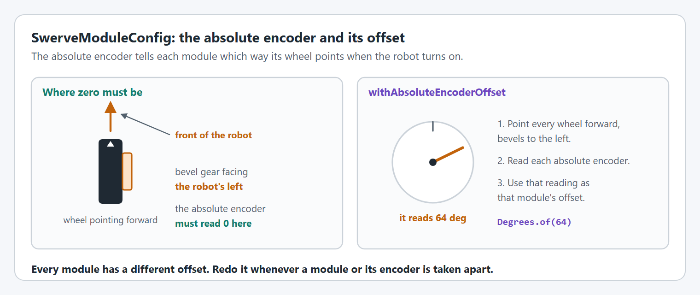

# Step 4: On the real robot

The code from steps 1 to 3 drives in simulation. A real swerve drive needs four more things before it can drive safely: the right CAN IDs, an absolute encoder offset for every module, every motor and the gyro turning the right way, and tuned gains. This step does them in that order, and ends with the first drive on the ground.

Do the checks in order. Each one ends with **What you should see** and **If not**. Do not go on to the next check until the one before it passes: a wrong offset makes the direction checks lie, and untuned modules make the first drive lie.


Keep one person at the Driver Station, ready to disable the robot, every time it is enabled. **Enter** disables it and **Space** stops it at once.




### Put the robot on blocks

Put the robot on blocks so that every wheel is clear of the blocks and of the ground, and can spin and steer freely. Use a charged battery. Deploy the code with **WPILib: Deploy Robot Code** from the command palette (<kbd>Ctrl+Shift+P</kbd>).

Connect AdvantageScope to the robot (**File > Connect to Robot**), or open an Elastic dashboard. Everything below is under `NT:/Mechanisms/swerve`, the name given to the drive's `withTelemetry` in step 2.

In Commands v3, pick the `ExampleTeleop` op mode before you enable.

**What you should see:** the code starts without errors in the Driver Station, and `NT:/Mechanisms/swerve/modules` has four modules: `frontleft`, `frontright`, `backleft` and `backright`.

**If not:** read the first error in the Driver Station. YAMS names the setting that is missing. [Troubleshooting](../troubleshooting.md) has the common ones.



### Check the CAN IDs

Every device needs the CAN ID the code gives it:

| Device | Front left | Front right | Back left | Back right |
| --- | --- | --- | --- | --- |
| Drive `SparkMax` | 1 | 4 | 7 | 10 |
| Azimuth `SparkMax` | 2 | 5 | 8 | 11 |
| `CANcoder` | 3 | 6 | 9 | 12 |

The `Pigeon2` is 14. Set the `SparkMax` IDs with the REV Hardware Client, and the `CANcoder` and `Pigeon2` IDs with Phoenix Tuner X.

The IDs must also be on the right module. Turn the front left wheel by hand, about a quarter turn of steering, and watch `NT:/Mechanisms/swerve/modules/frontleft/encoder`. Do the same for the other three.

**What you should see:** every device shows up in its tool with the ID in the table, no two devices share an ID, and turning a wheel changes only that module's `encoder`.

**If not:**

* **A device is missing.** Two devices share an ID, so only one answers. Give each its own ID.
* **Turning the front left wheel changes another module's `encoder`.** The `CANcoder`s are on the wrong modules. Change their IDs to match the table, or change the IDs in the code.
* **Every device is missing.** The code puts every device on `CANPort.CAN_S0`. If the robot is wired to another of the SystemCore's CAN ports, change `CAN_S0` in the code.



### Set the absolute encoder offsets

Each `CANcoder` is mounted at its own angle, so each reads a different number with the wheel pointing forward. The offset is that number. YAMS subtracts it from the reading, so the module reads 0 when the wheel points forward.

<figure><figcaption><p>Point every wheel forward with its bevel gear to the left, then read each encoder.</p></figcaption></figure>

1. With the robot disabled, turn every wheel by hand so that it points straight forward with its **bevel gear facing the robot's left**. Lay a straight edge along each side of the robot to line the wheels up.
2. First, check the encoder's direction: turn one wheel a little counter-clockwise, seen from above. Its `encoder` value must go **up**. If it goes down, set that `CANcoder`'s sensor direction to clockwise positive in Phoenix Tuner X, then line the wheel up again.
3. Read `NT:/Mechanisms/swerve/modules/<module>/encoder` for each module. It is the raw `CANcoder` reading in degrees, with no offset applied.
4. Put each reading, sign and all, into that module's offset in the constructor, then deploy again.




```java
// Each offset is that module's encoder reading with its wheel forward, bevel gear left.
var frontLeft = createModule(new SparkMax(CANPort.CAN_S0, 1, MotorType.kBrushless),
                             new SparkMax(CANPort.CAN_S0, 2, MotorType.kBrushless),
                             new CANcoder(3, new CANBus(CANPort.CAN_S0)), Degrees.of(64.2), "frontleft",
                             new Translation2d(Inches.of(24), Inches.of(24)));
```





```java
// Each offset is that module's encoder reading with its wheel forward, bevel gear left.
var frontLeft = createModule(new SparkMax(CANPort.CAN_S0, 1, MotorType.kBrushless),
                             new SparkMax(CANPort.CAN_S0, 2, MotorType.kBrushless),
                             new CANcoder(3, new CANBus(CANPort.CAN_S0)), Degrees.of(64.2), "frontleft",
                             new Translation2d(Inches.of(24), Inches.of(24)));
```





```cpp
// Each offset is that module's encoder reading with its wheel forward, bevel gear left.
SetupModule(m_frontLeft, "frontleft", wpi::math::Translation2d{24_in, 24_in}, 64.2_deg);
```




`64.2` is an example. Use your own reading for each of the four modules.

**What you should see:** with the wheels still pointing forward, open an AdvantageScope **Swerve** tab with `NT:/Mechanisms/swerve/states/current`. All four arrows point forward. Turn the robot off and on again: they still point forward.

**If not:**

* **One module points backward.** Its bevel gear faced right when you read it. Add 180 to its offset, or turn the wheel round and read it again.
* **One module points somewhere else.** That offset is not its own reading: check that you put each reading on the right module.
* **Every module is off by a different amount after a restart.** The offsets are still 0, or the code was not deployed again.



### Check the directions

Every angle in WPILib is counter-clockwise positive, seen from above, and every motor has to agree. The [swerve tuning command](../../details/live-tuning/README.md#swerve-drive) makes this easy: it turns every wheel to an angle, or runs every wheel at a speed, that you type on the dashboard.

Enable the robot in Teleoperated, still on blocks, and start the tuning command `NT:/Mechanisms/swerve/tuning` as [Start the tuning command](../../details/live-tuning/README.md#start-the-tuning-command) shows. The values you type are under `NT:/Tuning/swerve/`.

**Azimuth.** Type `0` into `modules/azimuth/angle`, set `modules/azimuth/enabled` to `true`, then type `90`.

**What you should see:** every wheel turns a quarter turn counter-clockwise, seen from above, and ends up pointing to the robot's left.

**If not:** if every wheel turns clockwise, set `withMotorInverted(true)` in the azimuth config from step 1. The four modules share the config, so one change fixes all four.

**Drive.** Set `modules/azimuth/enabled` to `false`. Type `0` into `modules/drive/velocity`, set `modules/drive/enabled` to `true`, then type `0.5`.

**What you should see:** every wheel points forward and rolls so that the robot would drive **forward**: the top of each wheel moves toward the front of the robot.

**If not:**

* **Every wheel rolls backward.** Set `withMotorInverted(true)` in the drive config from step 1.
* **One wheel rolls backward and the others forward.** That module's offset is 180 degrees off, because its bevel gear faced right when you read it. Add 180 to its offset.

Then set `modules/drive/inplace` to `true`. The wheels turn to form a circle, so the robot would spin counter-clockwise in place. If one wheel is not on the circle, its location in step 2 has the wrong sign.

Set `modules/drive/enabled` to `false` when you are done.



### Check the gyro

Disable the robot. Watch `NT:/Mechanisms/swerve/gyro`, the heading in degrees, and turn the whole robot counter-clockwise by hand, seen from above.

**What you should see:** the heading goes **up**.

**If not:**

* **It goes down.** Add `.withGyroInverted(true)` to the `SwerveDriveConfig` in step 2.
* **It does not change.** Check the `Pigeon2`'s CAN ID. If the ID is right, the gyro is mounted on its side: see [How do I use a gyro mounted on its side?](../../how-to/how-do-i-use-a-gyro-mounted-on-its-side.md).



### Tune the modules

The gains from step 1 are placeholders. Tune the real modules on blocks, azimuth first so that the wheels point where they are told, then drive. Follow [Tune the swerve modules](../../details/live-tuning/README.md#tune-the-swerve-modules): it uses the same tuning command as the checks above, and says which value to raise and what the graph should look like.

Copy the gains you find into `buildAzimuthCfg()` and `buildDriveCfg()` (C++: `ConfigureAzimuth` and `ConfigureDrive`), then deploy again. Values typed on the dashboard are lost when the code restarts.

**What you should see:** stepping `modules/azimuth/angle` between `0` and `90` snaps every wheel to the angle without shaking, and a `modules/drive/velocity` of `1` holds each wheel's measured speed at 1 m/s.

**If not:** the modules are still slow, or shake. See [When tuning does not help](../../details/live-tuning/README.md#when-tuning-does-not-help).



### Drive on the ground

Take the robot off the blocks and put it in an open space. Keep the maximum speed at 1 m/s from step 3: it is slow on purpose.

1. Point the robot **away from the driver station**, then turn it on. If it is already on, point it away from you and press the zero gyro button (the top face button) to run `zeroGyro()`.
2. Enable Teleoperated and push the left stick forward gently.

**What you should see:** the robot drives straight away from you. Left stick left drives it to your left without turning. Right stick left turns it counter-clockwise in place.

**If not:**

* **It drives off at an angle, or the wrong way.** The robot was not facing away from you when it was turned on or zeroed. Point it away and press the zero gyro button.
* **The direction it drives changes as it turns.** The gyro is the wrong way round: go back to [Check the gyro](#check-the-gyro).
* **It curves, or a wheel fights the others.** An offset is wrong: go back to [Set the absolute encoder offsets](#set-the-absolute-encoder-offsets).

Once it drives well, raise the two maximum velocities in step 3 a little at a time.



## After the first drive

These make a good drive better. Do them once the robot drives well by hand:

* **Speed limits.** Measure the real top speed by driving flat out, and set [`withMaximumModuleSpeed` and `withMaximumChassisSpeed`](../../details/mechanism-configs/swerve-drive-config.md#speed-limits) a little below it.
* **Drift while spinning.** Drive in a straight line while spinning. If the path bends, set [`withDiscretizationTime`](../../details/mechanism-configs/swerve-drive-config.md#withdiscretizationtime) to the loop time, then [`withGyroAngularVelocityScaleFactor`](../../details/mechanism-configs/swerve-drive-config.md#withgyroangularvelocityscalefactor) if some remains.
* **Odometry creep.** If the pose moves when the wheels only steer, set [`withCouplingRatio`](../../details/mechanism-configs/swerve-module-config.md#withcouplingratio).
* **Auto-align.** Tune the `driveToPose()` controllers last: see [Tune auto-align](../../details/live-tuning/README.md#tune-auto-align).

## Read more

* [Swerve Drive](../../details/swerve-drive.md): vision measurements, auto-align and path following
