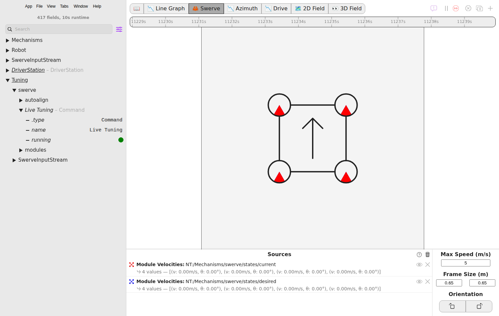
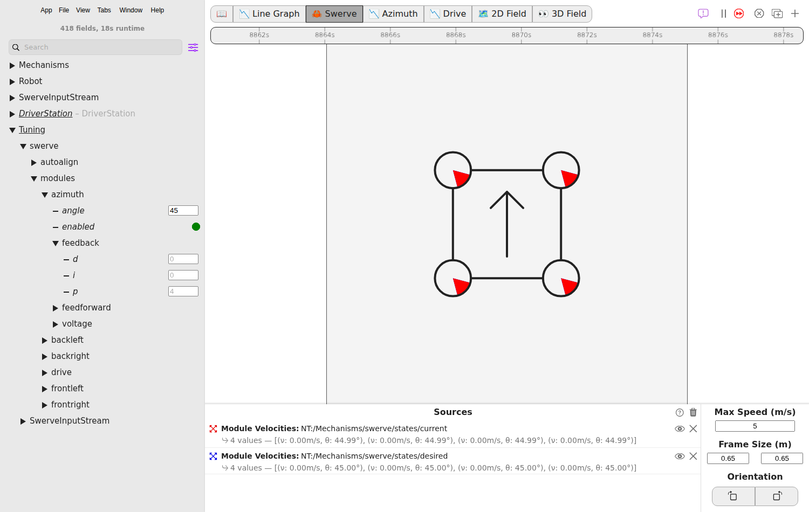
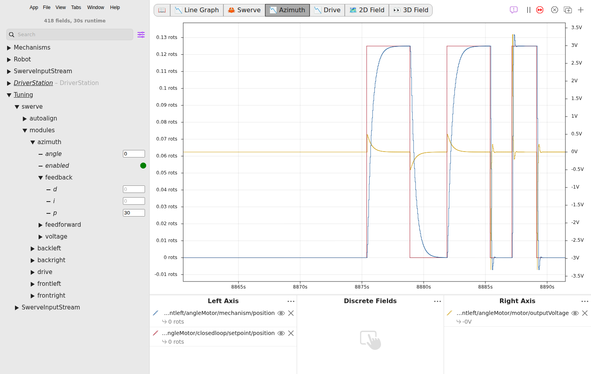
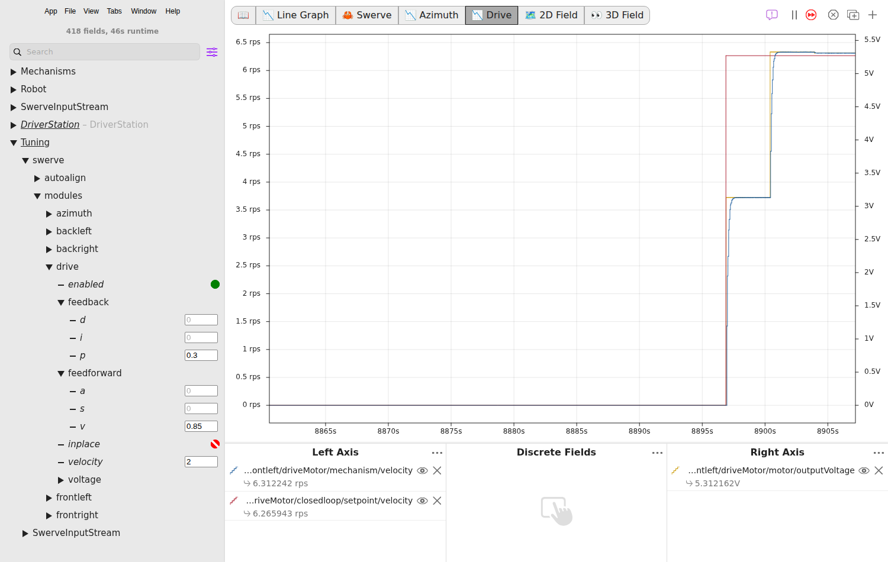

# Step 4: Tune it

The module gains from step 1 are placeholders: the azimuth motors' `kP` is 4, and the drive motors have `kV` 0.85 and `kP` 0.3. On this page you go through the swerve tuning steps in simulation, so you know them before you tune the real modules on blocks in [step 5](real-robot.md).

`SwerveDrive` has its own tuning command. It turns all four modules together, to an angle or at a speed you type, so you tune one set of azimuth gains and one set of drive gains for every module. The YAMS Live Tuner does not tune a swerve drive, so this page uses [AdvantageScope](https://docs.advantagescope.org/) to type the values and graph the result.


**Simulation is practice, not tuning.** These configs use the same gains on the robot and in simulation, and a simulated module is never exactly like a real one. Do not copy the numbers you find here into your code: step 5 tunes the real modules the same way, and those are the numbers to keep.



While it runs, the tuning command pauses the default drive command from step 3, so the sticks do nothing until you stop it.


## Before you start

* Start the simulation and enable **Teleoperated**, as in [step 3](driving.md#simulate-it).
* Open AdvantageScope and connect it to the simulation (**File > Connect to Simulator**).
* Turn on **tuning mode**: the sliders icon beside the search box at the top of the sidebar. Without it, the values you type and the dots you click are not sent to the robot.

The names on this page come from the tutorial's code: `swerve` from `SwerveDriveConfig.withTelemetry`, `frontleft` from the module's, and `angleMotor` and `driveMotor` from the motors'.



### Set up the tabs

Make three tabs with the **+** button at the top right:

1. A **Swerve** tab. Drag `NT:/Mechanisms/swerve/states/current` and `NT:/Mechanisms/swerve/states/desired` into it. It draws each module's angle: where it points, and where it is told to point.
2. A **Line Graph** for the azimuth. Drag in, from `NT:/Mechanisms/swerve/modules/frontleft/angleMotor/`:
   * `mechanism/position`: where the module points, in rotations.
   * `closedloop/setpoint/position`: where it is told to point.
3. A **Line Graph** for the drive. Drag in, from `NT:/Mechanisms/swerve/modules/frontleft/driveMotor/`:
   * `mechanism/velocity`: how fast the wheel turns, in rotations per second.
   * `closedloop/setpoint/velocity`: how fast it is told to turn.

One module is enough to graph: the tuning command sends all four the same setpoint.

**Check it:** the Swerve tab shows four modules, all pointing forward.



### Start the tuning command

In the sidebar, open `Mechanisms/swerve/tuning` and click the dot next to `running`, so that it turns green.

<figure><figcaption>
The tuning command running.
</figcaption></figure>

**Check it:** `running` stays green, and the sticks no longer drive the robot. Nothing moves yet: no tuning mode is on.



### Turn the wheels

The azimuth values are under `Tuning/swerve/modules/azimuth`.

1. Type `0` into `angle` and press **Enter**.
2. Click the dot next to `enabled`, so that it turns green. The drive motors are held at 0, so the wheels only turn in place.
3. Type `45` into `angle`. Every module turns to 45 degrees.

Keep each change under 90 degrees. For a bigger one, YAMS may turn the wheel the short way round and run it backwards, which makes the graphs hard to read.

<figure><figcaption>
Every module at the 45 degrees typed into <code>angle</code>.
</figcaption></figure>

**Check it:** on the Swerve tab, all four modules point at 45 degrees.



### Tune the azimuth kP

Open the azimuth graph. `feedback/p`, under `azimuth`, is the `kP` from step 1: volts for each rotation the module is away from its angle.

1. Type `0`, then `45`, into `angle`, and watch the position line. With `kP` at 4 it takes about a second to get there.
2. Raise `feedback/p`, and step the angle again each time:
   * It turns slowly, or stops short of the angle: raise `p`.
   * It overshoots and swings back: lower `p` by about a third.
3. If it still overshoots a little at a `p` that is quick enough, add a little `feedback/d`, starting at `0.1`.

<figure><figcaption>
45 degrees is 0.125 rotations. At <code>p</code> 4 (left) the module takes about a second. At 30 (right) it gets there almost at once.
</figcaption></figure>

**Check it:** after each change of angle the modules snap to it and stop without shaking.



### Tune the drive kV and kP

Open the drive graph. The drive values are under `Tuning/swerve/modules/drive`.

1. Type `0` into `velocity`, then click the dot next to `enabled`. Azimuth tuning turns itself off, and every module points straight ahead.
2. Type `0` into `feedback/p`, so you can see what the feedforward does on its own.
3. Type `2` into `velocity`: 2 meters per second for every wheel. The graph shows it as about 6.3 rotations per second of the 4 inch wheel.
4. Raise `feedforward/v` until the wheel's speed settles on the setpoint. For a NEO on 6.75:1 it ends up near `0.85`. Below that, the wheel settles short.
5. Raise `feedback/p` until the speed gets there quickly. If it starts to buzz or overshoot, it is too high.

<figure><figcaption>
<code>feedforward/v</code> raised from 0.5 to 0.85: the wheel climbs from 3.7 onto the 6.3 rotations per second setpoint.
</figcaption></figure>

**Check it:** at a `velocity` of `1` and of `2`, the wheel's speed settles on the setpoint.



### Stop

1. Click `enabled` under `drive` so that it turns red, and type `0` into `velocity`.
2. Click `running` under `Mechanisms/swerve/tuning` so that it turns red.

**Check it:** the sticks drive the robot again.



## If it did not work

* **Typing a value or clicking a dot does nothing.** Turn on AdvantageScope's tuning mode, and check that `running` under `Mechanisms/swerve/tuning` is green.
* **`Mechanisms/swerve/tuning` is missing.** The tuning command is only there when `SwerveDriveConfig` has both a translation and a rotation controller, as in step 2, and the drive's telemetry is `TelemetryVerbosity.HIGH`.
* **The modules do not turn to the angle.** Check that `enabled` under `azimuth` is green, and that `running` under `Mechanisms/swerve/tuning` still is.
* **A wheel turns the other way and runs backwards.** The angle changed by 90 degrees or more. Step between closer angles, such as 0 and 45.

For every tuning value, including auto-align, see [Swerve drive](../../details/live-tuning/README.md#swerve-drive) on the Live tuning page. More problems and fixes: [Troubleshooting](../troubleshooting.md).
