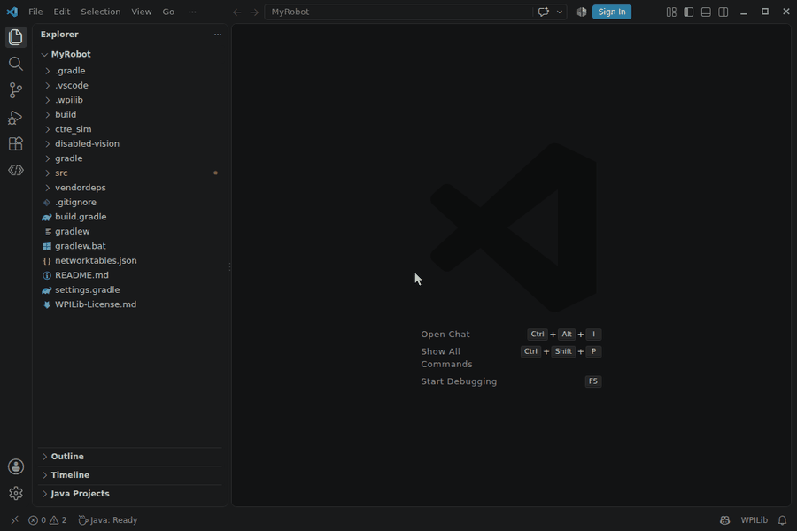
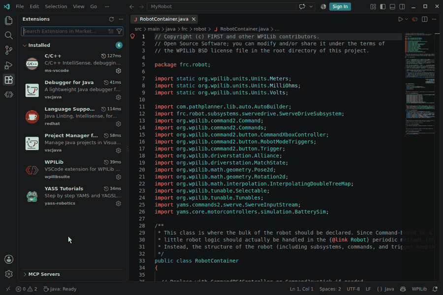

# Install the YASS Tutorials extension

The YASS Tutorials extension brings these tutorials into WPILib VS Code. It adds a **YASS** tab that lists every YAMS and YAGSL tutorial step by step, and opens each step beside your code. The tutorials are the same as on this site, so the extension is optional.



### Download the extension

Download [yass-tutorials.vsix](https://github.com/Yet-Another-Software-Suite/yass-tutorials-vscode/releases/download/latest/yass-tutorials.vsix).



### Install it in WPILib VS Code

1. Click **Extensions** in the activity bar on the left.
2. Click **...** at the top of the Extensions view.
3. Click **Install from VSIX...**, pick the `yass-tutorials.vsix` you downloaded and click **Open**.

**YASS Tutorials** appears in the list of installed extensions, and a book icon appears in the activity bar.

<figure><figcaption>
Installing yass-tutorials.vsix from the Extensions view.
</figcaption></figure>


Install it in WPILib VS Code, the one the WPILib installer adds. The extension uses WPILib's extension to create robot projects and install vendordeps.




### Open a tutorial

Click the book icon. **Your Robot Project** shows whether your project has YAMS and YAGSL; click either one to install it. Under **Tutorials**, click the arrow beside a tutorial to see its steps, then click a step to open it beside your code.

<figure><figcaption>
Opening the Arm tutorial's first step beside the code.
</figcaption></figure>



## What it adds

* **Copy**, **Insert** and **Create file** on every code sample. **Insert** puts the code at the cursor in the file you were last editing.
* One code language for every sample: **Java, Commands v2**, **Java, Commands v3** or **C++**. By default it matches your project.
* A check mark for each step you finish, and a search across every tutorial.
* A button that opens WPILib's vendor library list when a tutorial needs a library your project doesn't have, such as REVLib for a `SparkMax`.

## Updates

The tutorials update themselves: the extension checks for new ones every day and keeps the ones it has for when you are offline. Click **Refresh** at the top of **Tutorials** to check right away.

The extension itself doesn't update on its own. To get new features, download `yass-tutorials.vsix` again and install it the same way.
