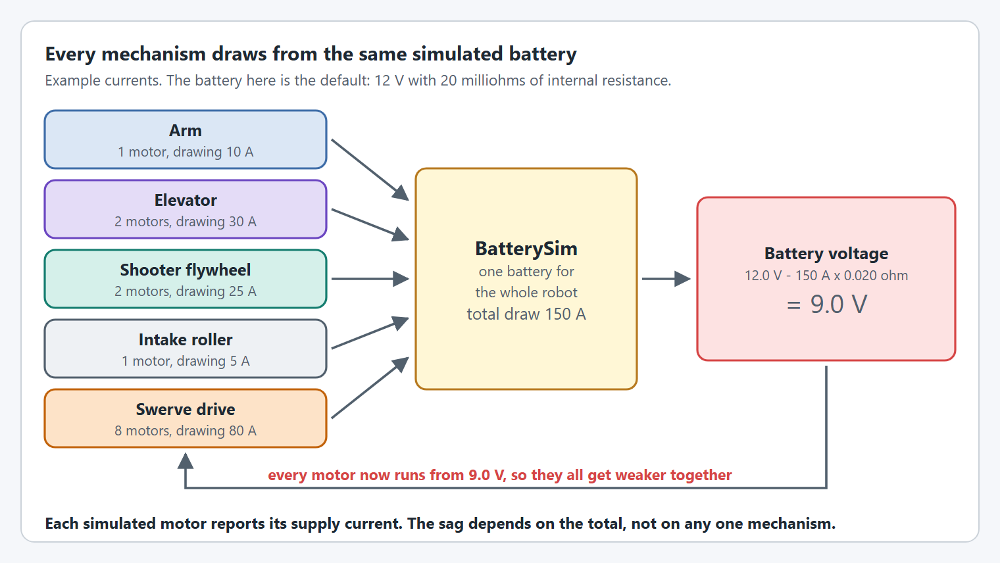
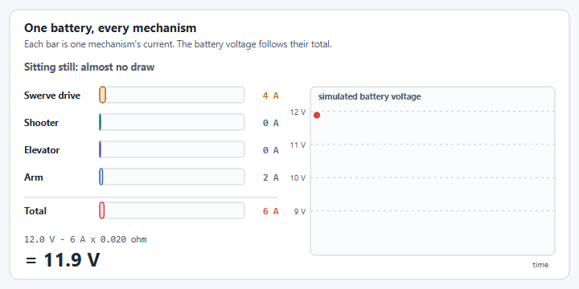
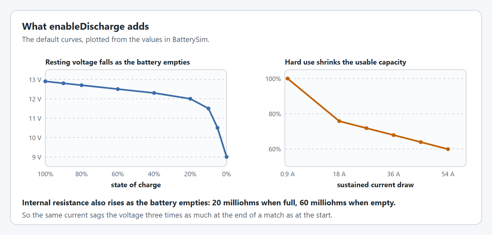

# Battery Simulation

YAMS models a single, shared robot battery in simulation instead of letting each mechanism compute its own voltage sag in isolation. Every simulated `SmartMotorController`, whether driven by an `ArmSimSupplier`, `ElevatorSimSupplier`, `DCMotorSimSupplier`, or a hardware wrapper (`SparkWrapper`, `TalonFXWrapper`, `TalonFXSWrapper`, `NovaWrapper`), reports its current draw into [`BatterySim`](https://yet-another-software-suite.github.io/YAMS/javadocs/yams/core/motorcontrollers/simulation/BatterySim.html), which combines every mechanism's draw into one realistic loaded-voltage calculation and writes it to `RoboRioSim`.


This is automatic. You do not need to call anything for basic voltage sag under combined load, it happens as soon as a mechanism has a sim supplier attached and `simIterate()`/`SimIterate()` is called each loop, same as [Simulation without a mechanism](../details/editor/#simulation-without-a-mechanism).


<figure><figcaption><p>Every simulated motor reports into one battery, and every motor runs from the result.</p></figcaption></figure>

## Why this matters

Before, if two mechanisms each computed `RoboRioSim.setVInVoltage(...)` from only their own current draw, whichever mechanism updated last would overwrite the other's contribution, so the simulated battery would never actually see the _combined_ draw of the whole robot. With a shared `BatterySim`, a flywheel spinning up while an elevator is climbing will sag the simulated bus voltage the same way a real battery would under both loads at once, which is exactly the scenario that trips brownouts on a real robot. See [Limiting Power Consumption](../details/editor/limiting-power-consumption.md) for how to guard against that on top of realistic simulation.


**Power consumption is not the only thing that causes brownouts.** The battery simulation only models the current your mechanisms draw. Electrical issues can also cause brownouts and excessive power draw on a real robot, and the simulation cannot see any of them. They include, and are not limited to:

* **Shorts**, such as a pinched wire or a frame short.
* **Incorrect wiring**, such as loose or badly crimped connections, loose battery terminals, or the wrong breaker.
* **Wire limitations**, such as wire that is too thin or too long for the current it carries.

A robot that never browns out in simulation can still brown out for these reasons. If the real robot browns out when the simulation says it should not, check the electrical system before changing current limits.


## Battery sag vs battery drain

The battery voltage drops for two different reasons, and the simulation models them separately.

| | Battery sag | Battery drain |
| --- | --- | --- |
| What it is | The voltage dropping **while current is being drawn**, because of the battery's internal resistance. | The battery **emptying** as amp-hours are used up over a match. |
| How fast | Instant. It follows the current loop by loop. | Slow. It builds up over minutes. |
| Does it recover? | Yes. The voltage comes back as soon as the load stops. | No. It stays until the battery is recharged. |
| What it changes | The loaded voltage only. | The resting voltage goes down and the internal resistance goes up. |
| In YAMS | Always on. See [How each mechanism affects the battery](#how-each-mechanism-affects-the-battery). | Off until you call `BatterySim.enableDischarge(...)`. See [Realistic discharge over a match](#realistic-discharge-over-a-match). |

The two add up. A drained battery starts from a lower resting voltage and has more internal resistance, so the same current sags it further. That is why a move that is fine at the start of a match can brown out at the end of it.

## How each mechanism affects the battery

The loaded voltage is the resting voltage minus the total current times the battery's internal resistance:

`battery voltage = resting voltage - (sum of every motor's supply current) x internal resistance`

With the default 12 V and 20 milliohm battery, every 50 A of total draw costs 1 V.

<figure><figcaption><p>A few seconds of a match: the voltage follows the total, and it is lowest when the peaks line up.</p></figcaption></figure>

Mechanisms do not load the battery evenly. Each one has moments when it draws a lot and long stretches when it draws very little.

<figure><figcaption><p>When each kind of mechanism draws current.</p></figcaption></figure>

| Mechanism | Motors that report | Draws the most when | What changes it |
| --- | --- | --- | --- |
| `Arm` | 1 or 2 | Starting and stopping a move, and holding away from vertical | Arm length and mass (MOI), gearing, motion profile acceleration |
| `Elevator` | 1 to 4 | Accelerating upward, then a steady draw to hold a height | Carriage mass, drum radius, gearing, motion profile acceleration |
| `FlyWheel` (shooters, rollers, intakes) | 1 to 4 | Spinning up from rest, and recovering after each shot | Wheel MOI, target speed, stator current limit |
| `Pivot` (turrets, wrists) | 1 | Short bursts when starting and stopping | MOI, motion profile acceleration |
| `SwerveDrive` | 8: four drive and four azimuth | Accelerating, changing direction, and pushing | Robot mass, drive gearing, drive stator current limit |

### Swerve drives

A swerve drive is not one load, it is eight. Each module's drive motor and azimuth motor is its own `SmartMotorController`, and each one reports its own supply current to `BatterySim` when `SwerveDrive.simIterate()` runs. Nothing extra is needed to include the drivetrain.

* The **drive motors** dominate. Four of them accelerating a full weight robot is normally the largest draw on the robot.
* The **azimuth motors** draw short bursts when the modules change heading, and little while driving straight.
* Because the drive is the largest load, it also sets the voltage every other mechanism gets. A shooter that reaches its speed with the robot parked can fall short while the robot is accelerating.


To keep the peaks from lining up, set stator and supply current limits on the biggest loads and stagger the moves that can wait. See [Limiting Power Consumption](../details/editor/limiting-power-consumption.md).


## Accurate current draw starts with an accurate MOI

`BatterySim` can only sag voltage as realistically as the current draw it's fed, and that current draw comes straight out of each mechanism's physics simulation (`SingleJointedArmSim`/`DCMotorSim`/`ElevatorSim`). Those models derive current from the torque needed to produce a given acceleration, so if the moment of inertia doesn't match your real mechanism, the simulated current, and therefore the simulated voltage sag, won't either. A default/guessed MOI tends to make mechanisms look artificially light, understating both acceleration current spikes and how much they actually sag the bus.

Set a real MOI on the `SmartMotorControllerConfig` with `.withMomentOfInertia(Distance, Mass)` (estimated from a simple rod/arm model) or `.withMomentOfInertia(MomentOfInertia)` (a known/measured value), see [MOI](../details/turrets-wrists.md#moment-of-inertia) for the full explanation and an example.


This is the same MOI used for PID/feedforward tuning in simulation, so getting it right pays off twice: more realistic control-loop behavior _and_ more realistic battery sag under load.


## Realistic discharge over a match

By default the simulated battery holds a constant nominal voltage and resistance (12V / 20 mΩ), enough to model voltage sag under instantaneous load, but not a battery getting weaker over the course of a match. Call `BatterySim.enableDischarge(...)` to layer state-of-charge modeling on top: as amp-hours are drawn from the battery, its open-circuit voltage droops along a discharge curve and its internal resistance rises, both becoming more pronounced as the battery empties, the same way a real lead-acid FRC battery behaves late in a match. The amp-hours drawn are also derated by discharge rate, so heavy sustained current drains the modeled capacity faster than the same amp-hours drawn slowly, see [Capacity derating](#capacity-derating) below.

<figure><figcaption><p>The default discharge curves.</p></figcaption></figure>



```java
import yams.core.motorcontrollers.simulation.BatterySim;

// Somewhere in robotInit(), with a fresh, fully-charged 18Ah battery model:
BatterySim.enableDischarge(18.0, Volts.of(12.9), MilliOhms.of(20));
```

| Method                                                    | Description                                                                                         |
| --------------------------------------------------------- | --------------------------------------------------------------------------------------------------- |
| `enableDischarge(double capacityAh, Voltage, Resistance)` | Turns on discharge modeling with the given capacity and nominal (fully-charged) voltage/resistance. |
| `disableDischarge()`                                      | Reverts to a constant nominal voltage/resistance.                                                   |
| `resetDischarge()`                                        | Resets the simulated battery back to a full charge, e.g. between test runs.                         |
| `getStateOfCharge()`                                      | Returns the current state of charge from `0` (empty) to `1` (full), for telemetry or dashboards.    |



The same model is available as `yams::motorcontrollers::simulation::BatterySim`:

```cpp
#include <yams/motorcontrollers/simulation/BatterySim.hpp>

// Somewhere during robot setup:
yams::motorcontrollers::simulation::BatterySim::EnableDischarge(
    18.0, wpi::units::volt_t{12.9}, wpi::units::ohm_t{0.020});
```

| Method                                                            | Description                                                                         |
| ----------------------------------------------------------------- | ----------------------------------------------------------------------------------- |
| `EnableDischarge(double capacityAh, wpi::units::volt_t, wpi::units::ohm_t)` | Turns on discharge modeling with the given capacity and nominal voltage/resistance. |
| `DisableDischarge()`                                              | Reverts to a constant nominal voltage/resistance.                                   |
| `ResetDischarge()`                                                | Resets the simulated battery back to a full charge.                                 |
| `GetStateOfCharge()`                                              | Returns the current state of charge from `0` (empty) to `1` (full).                 |




Discharge only affects simulation. On a real robot `BatterySim` is never consulted, the SystemCore reports the actual battery voltage from hardware.



Call `BatterySim.resetDischarge()` in `testInit()` or at the start of a unit test if you want every simulated match to start from a full charge rather than carrying over drain from a previous run.


## Custom discharge curves

`enableDischarge(...)` sags voltage along a curve tuned for a typical FRC sealed lead-acid battery, flat through most of the charge, then dropping off quickly near depletion. Not every sealed lead-acid battery you want to model behaves exactly that way, so call `BatterySim.replaceSOCInterpolation(...)` **before** `enableDischarge(...)` to swap in your own curve.

Reach for this when:

* **You're simulating a well-used competition battery**, which sags earlier and harder than a fresh one, a flatter, lower curve reproduces "that one tired battery" instead of assuming every match starts fresh.
* **You have measured data**, e.g. from putting a real battery on a load tester, feeding in the actual voltage-vs-state-of-charge points gives the most accurate brownout predictions for that specific battery.



```java
import org.wpilib.math.interpolation.InterpolatingDoubleTreeMap;
import yams.core.motorcontrollers.simulation.BatterySim;

// Model a well-used competition battery that sags earlier and more severely than a new one.
InterpolatingDoubleTreeMap wornBatteryCurve = new InterpolatingDoubleTreeMap();
wornBatteryCurve.put(0.00, 8.0);
wornBatteryCurve.put(0.05, 9.5);
wornBatteryCurve.put(0.10, 10.5);
wornBatteryCurve.put(0.20, 11.2);
wornBatteryCurve.put(0.40, 11.6);
wornBatteryCurve.put(0.60, 11.9);
wornBatteryCurve.put(0.80, 12.2);
wornBatteryCurve.put(0.90, 12.4);
wornBatteryCurve.put(1.00, 12.6);

BatterySim.replaceSOCInterpolation(wornBatteryCurve);
// Pair with a reduced usable capacity and higher resistance to match a worn battery.
BatterySim.enableDischarge(15.0, Volts.of(12.6), MilliOhms.of(28));
```



```cpp
#include <map>
#include <yams/motorcontrollers/simulation/BatterySim.hpp>

// Model a well-used competition battery that sags earlier and more severely than a new one.
std::map<double, double> wornBatteryCurve{
    {0.00, 8.0},  {0.05, 9.5},  {0.10, 10.5}, {0.20, 11.2}, {0.40, 11.6},
    {0.60, 11.9}, {0.80, 12.2}, {0.90, 12.4}, {1.00, 12.6},
};

yams::motorcontrollers::simulation::BatterySim::ReplaceSOCInterpolation(wornBatteryCurve);
// Pair with a reduced usable capacity and higher resistance to match a worn battery.
yams::motorcontrollers::simulation::BatterySim::EnableDischarge(
    15.0, wpi::units::volt_t{12.6}, wpi::units::ohm_t{0.028});
```




Keys and values should span the full `[0, 1]` state-of-charge range. Querying outside the range you defined just returns the nearest endpoint's voltage instead of extrapolating, so a table missing the low or high end will not sag realistically there.


## Capacity derating

Sealed lead-acid batteries are far less coulombically efficient than lithium chemistries at high discharge rates. This is known as the Peukert effect: the faster you discharge a lead-acid battery, the fewer total amp-hours it actually delivers before it's empty. A battery rated for 18 Ah at a light 0.9A discharge (the 20-hour rate its label is based on) might only deliver ~11 Ah at a sustained 54A draw, well within normal FRC match currents.

`enableDischarge(...)` accounts for this by derating the amp-hours consumed against a discharge-current → capacity-fraction curve, so a match spent at high sustained current drains the modeled state of charge faster than the same amp-hours drawn gently would. The default curve is averaged from discharge testing across five FRC battery manufacturers, see [Detailed FRC Battery Comparison for 2026](https://www.chiefdelphi.com/t/detailed-frc-battery-comparison-for-2026/508077). Call `BatterySim.replaceCapacityDerating(...)` **before** `enableDischarge(...)` if you have measured discharge-rate-vs-capacity data for your own battery.



```java
import org.wpilib.math.interpolation.InterpolatingDoubleTreeMap;
import yams.core.motorcontrollers.simulation.BatterySim;

InterpolatingDoubleTreeMap measuredDerating = new InterpolatingDoubleTreeMap();
measuredDerating.put(0.9, 1.000);
measuredDerating.put(20.0, 0.80);
measuredDerating.put(40.0, 0.65);
measuredDerating.put(60.0, 0.55);

BatterySim.replaceCapacityDerating(measuredDerating);
BatterySim.enableDischarge(18.0, Volts.of(12.9), MilliOhms.of(20));
```



```cpp
#include <map>
#include <yams/motorcontrollers/simulation/BatterySim.hpp>

std::map<double, double> measuredDerating{
    {0.9, 1.000}, {20.0, 0.80}, {40.0, 0.65}, {60.0, 0.55},
};

yams::motorcontrollers::simulation::BatterySim::ReplaceCapacityDerating(measuredDerating);
yams::motorcontrollers::simulation::BatterySim::EnableDischarge(
    18.0, wpi::units::volt_t{12.9}, wpi::units::ohm_t{0.020});
```



## Related pages

* [Limiting Power Consumption](../details/editor/limiting-power-consumption.md)
* [Simulation without a mechanism](../details/editor/#simulation-without-a-mechanism)
* [Simulation Only PID + FeedForward](../details/editor/simulation-only-pid-+-feedforward.md)
* [MOI](../details/turrets-wrists.md#moment-of-inertia)
