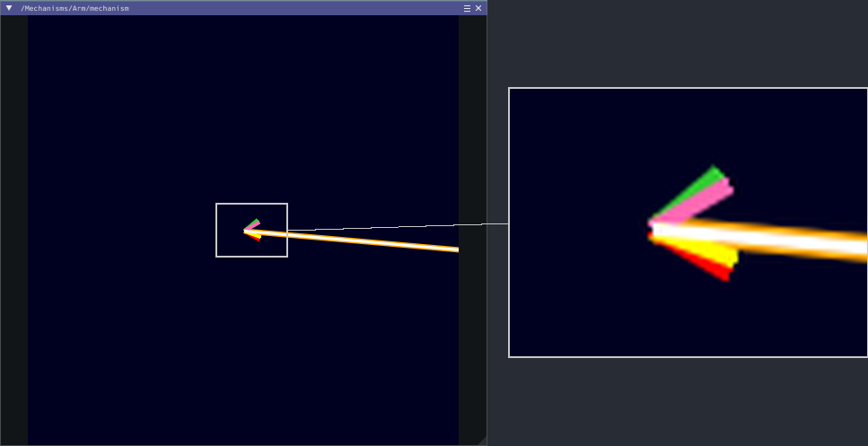

# Telemetry

Telemetry is what YAMS tells you about your mechanisms while the code runs: where each one is, where it was asked to go, and what its motors are doing. You watch it live on a dashboard, and you can record it to look at after a match.

## Where to find your mechanism's values

While the code runs, YAMS publishes to NetworkTables, which dashboards such as AdvantageScope and Elastic read. It uses two tables, and nothing goes under `NT:/SmartDashboard`.

<figure><figcaption><p>An elevator named <code>Elevator</code> with a motor named <code>ElevatorMotor</code>.</p></figcaption></figure>

| Table            | Holds                                   | Path                                       |
| ---------------- | --------------------------------------- | ------------------------------------------ |
| `NT:/Mechanisms` | What the mechanism is doing. Read-only. | `NT:/Mechanisms/<Mechanism>/<Motor>/<key>` |
| `NT:/Mechanisms` | The mechanism's `Mechanism2d`           | `NT:/Mechanisms/<Mechanism>/mechanism`     |
| `NT:/Tuning`     | Values you can edit                     | `NT:/Tuning/<Mechanism>/<Motor>/<key>`     |
| `NT:/Tuning`     | The `Live Tuning` command               | `NT:/Tuning/<Subsystem>/Live Tuning`       |

`<Mechanism>` and `<Motor>` are the telemetry names given to `withTelemetry(...)` on the mechanism config and on the `SmartMotorControllerConfig`. `<Subsystem>` is the subsystem's `getName()` in Commands v2 (its class name by default), or the Commands v3 `Mechanism`'s name. For the `ArmSubsystem` in the [Arm tutorial](../tutorials/arm.md), that is `NT:/Mechanisms/Arm/ArmMotor/...`, `NT:/Tuning/Arm/ArmMotor/...` and `NT:/Tuning/ArmSubsystem/Live Tuning`. See [Live tuning](../details/live-tuning/README.md) for how to use the tunable side.

## The Mechanism2d window

Every mechanism draws itself in a `Mechanism2d`, at `NT:/Mechanisms/<Mechanism>/mechanism`. It is the window you open in the Sim GUI or AdvantageScope in the tutorials' "Simulate it" step. It is published on the real robot too, but everything it shows is also in the numeric values, so you don't need it there.

<figure><figcaption><p>The Arm tutorial's arm in the Sim GUI, with the pivot enlarged on the right.</p></figcaption></figure>

Besides the mechanism itself, it draws a white line for the setpoint and short lines at its limits:

| Color | Shows |
| --- | --- |
| White | The setpoint |
| Green | The upper hard limit |
| Red | The lower hard limit |
| Pink | The upper soft limit |
| Yellow | The lower soft limit |

Use them to see at a glance whether the mechanism is heading where you asked, and how close it is to its limits.



## Choosing what a motor publishes

There are two ways to choose: pick a verbosity level, or pick the fields yourself.

### Verbosity levels

`withTelemetry(name, TelemetryVerbosity)` is the quick way. Each level includes the one before it.

<figure><figcaption><p>HIGH includes MID, and MID includes LOW.</p></figcaption></figure>

| Level  | Adds                                                                                                                                                                                                        | Good for                                              |
| ------ | ----------------------------------------------------------------------------------------------------------------------------------------------------------------------------------------------------------- | ----------------------------------------------------- |
| `LOW`  | Positions, velocities and accelerations (`mechanism/*`, `measurement/*`, `rotor/*`, and `externalencoder/*` when there is an external encoder), the setpoints (`closedloop/setpoint/*`) and the active slot | Competition, where you only need to see what happened |
| `MID`  | `motor/outputVoltage`, `current/stator`, `current/supply`                                                                                                                                                   | Checking power draw                                   |
| `HIGH` | Every tunable value, `motor/temperature`, `closedloop/period`, the status booleans, and the `Live Tuning` command                                                                                            | Tuning and development                                |

### Choosing fields yourself

Build a `SmartMotorControllerTelemetryConfig` and enable only what you want:

A fragment from an arm subsystem:

```java
SmartMotorControllerTelemetryConfig motorTelemetryConfig = new SmartMotorControllerTelemetryConfig()
          .withMechanismPosition()
          .withRotorPosition()
          .withMechanismLowerLimit()
          .withMechanismUpperLimit();

SmartMotorControllerConfig motorConfig = new SmartMotorControllerConfig(this)
      .withClosedLoopController(4, 0, 0)
      .withTrapezoidalProfile(DegreesPerSecond.of(180), DegreesPerSecondPerSecond.of(90))
      .withSoftLimits(Degrees.of(-30), Degrees.of(100))
      .withGearing(new MechanismGearing(GearBox.fromReductionStages(3, 4)))
      .withZeroPower(MotorMode.BRAKE)
      .withTelemetry("ArmMotor", motorTelemetryConfig);
```

`withCustom(...)` covers everything else. Use it for a field with no `with*()` method of its own, or to switch several fields in one call. It takes a `BooleanTelemetryField` or `DoubleTelemetryField`, or an array of either, and a boolean:

```java
SmartMotorControllerTelemetryConfig motorTelemetryConfig = new SmartMotorControllerTelemetryConfig()
          .withTelemetryVerbosity(TelemetryVerbosity.LOW)
          .withCustom(SmartMotorControllerTelemetry.DoubleTelemetryField.SupplyCurrent, true)
          .withCustom(new SmartMotorControllerTelemetry.BooleanTelemetryField[]{
              SmartMotorControllerTelemetry.BooleanTelemetryField.MotorInversion,
              SmartMotorControllerTelemetry.BooleanTelemetryField.EncoderInversion
          }, false);
```

In C++ the methods are `WithCustom(field, enabled)` and `WithCustom(std::vector, enabled)`. The Java classes are in `yams.core.telemetry`, and `TelemetryVerbosity` is in `yams.core.telemetry.enums`.

The [`SmartMotorControllerTelemetryConfig` javadoc](https://yet-another-software-suite.github.io/YAMS/javadocs/yams/core/telemetry/SmartMotorControllerTelemetryConfig.html) lists every method.

## Recording a match to a DataLog

NetworkTables only shows what is happening now. To look back at a match afterwards, also send the same values to a DataLog file on the SystemCore.

<figure><figcaption><p>One set of values, two places to send them.</p></figcaption></figure>

| Destination         | On by default? | Turn it on or off with                | Use it for                   |
| ------------------- | -------------- | ------------------------------------- | ---------------------------- |
| NetworkTables (NT4) | Yes            | `withoutNetworkTables()` turns it off | Watching and tuning live     |
| DataLog file        | No             | `withDataLogName(name)` turns it on   | Reviewing a match afterwards |

Both are set on `SmartMotorControllerTelemetryConfig`. `MechanismTelemetry` does the work: every mechanism, and every `SwerveModule`, owns one, and it sends the same values to both destinations.

To record the arm from the [Arm tutorial](../tutorials/arm.md), give its motor a telemetry config with a DataLog name, in place of the `TelemetryVerbosity` it was given:



```java
// What the arm motor publishes: the MID fields, live and to a DataLog.
SmartMotorControllerTelemetryConfig armMotorTelemetry = new SmartMotorControllerTelemetryConfig()
    .withTelemetryVerbosity(TelemetryVerbosity.MID)
    .withDataLogName("Arm/ArmMotor");

SmartMotorControllerConfig smcConfig = new SmartMotorControllerConfig(this)
    // ... the rest of the config from the tutorial
    .withTelemetry("ArmMotor", armMotorTelemetry);
```

`SmartMotorControllerTelemetryConfig` is in `yams.core.telemetry`.



```cpp
// What the arm motor publishes: the MID fields, live and to a DataLog.
yams::telemetry::SmartMotorControllerTelemetryConfig armMotorTelemetry;
armMotorTelemetry
    .WithTelemetryVerbosity(Cfg::TelemetryVerbosity::MID)
    .WithDataLogName("Arm/ArmMotor");

m_smcConfig
    // ... the rest of the config from the tutorial
    .WithTelemetry("ArmMotor", armMotorTelemetry);
```



Every field the config turns on is then also written to the DataLog under `Arm/ArmMotor`. Only the values you read are logged; the values you can type under `NT:/Tuning` are not. To log during matches without filling NetworkTables, add `.withoutNetworkTables()` to the telemetry config. Live tuning then has nothing to edit, so leave it off while you tune.


Set a DataLog name for competition matches. It is one line, and it means you can see what actually happened on the field.



A DataLog uses storage on the SystemCore, and logging everything fills it quickly. Log only what you need. See the [WPILib DataLog docs](https://docs.wpilib.org/en/stable/docs/software/telemetry/datalog.html#custom-data-logging-using-datalog).


* [DataLog Best Practices](../details/datalog-best-practices.md): choosing what to log, and how it works for `SwerveDrive`.
* [How do I view my DataLog in AdvantageScope?](../how-to/how-do-i-view-my-datalog-in-advantagescope.md): a step by step walkthrough.

## Swerve drive telemetry

A swerve drive publishes poses, chassis velocities and module states. Those are not single numbers, so they are published as NT4 structs that AdvantageScope understands directly.

<figure><figcaption><p>What a swerve drive publishes, and at which verbosity.</p></figcaption></figure>

### Setting it up

`SwerveDrive` and `SwerveModule` have their own telemetry configs. They work the same way as a motor's: every field is off until a verbosity level or a `with*()` method turns it on.

| Config                        | Passed to                                        | Notable fields                                                                       |
| ----------------------------- | ------------------------------------------------ | ------------------------------------------------------------------------------------ |
| `SwerveDriveTelemetryConfig`  | `SwerveDriveConfig.withTelemetry(name, config)`  | `withPose()`, `withGyro()`, `withCurrentModuleStates()`, `withDesiredModuleStates()` |
| `SwerveModuleTelemetryConfig` | `SwerveModuleConfig.withTelemetry(name, config)` | `withAbsoluteEncoder()`, `withState()`                                               |

```java
SwerveDriveTelemetryConfig driveTelemetryConfig = new SwerveDriveTelemetryConfig()
    .withTelemetryVerbosity(TelemetryVerbosity.HIGH)
    .withPose()
    .withGyro()
    .withCurrentRobotRelativeChassisSpeeds()
    .withFieldRelativeChassisSpeeds()
    .withDesiredRobotRelativeChassisSpeeds()
    .withDesiredModuleStates()
    .withCurrentModuleStates()
    .withDataLogName("swerve");

SwerveDriveConfig driveConfig = new SwerveDriveConfig(this, frontLeft, frontRight, backLeft, backRight)
    .withGyro(gyro::getRotation3d)
    .withTelemetry("swerve", driveTelemetryConfig);
```

`new SwerveDriveTelemetryConfig(TelemetryVerbosity.HIGH)` is shorthand for `new SwerveDriveTelemetryConfig().withTelemetryVerbosity(TelemetryVerbosity.HIGH)`. `SwerveModuleTelemetryConfig` has the same shorthand.

### Things that differ from a motor

* **The name is required.** `SwerveDriveConfig.withTelemetry(...)` always takes the name first: `withTelemetry(name, TelemetryVerbosity)` or `withTelemetry(name, SwerveDriveTelemetryConfig)`. There is no `withTelemetryName(...)`.
* **DataLog is set on the telemetry config.** `SwerveDriveConfig` and `SwerveModuleConfig` have no `withDataLogName(...)`. Use `SwerveDriveTelemetryConfig.withDataLogName(...)` and `SwerveModuleTelemetryConfig.withDataLogName(...)`.
* **A module's state is `HIGH` only.** At `LOW` and `MID` a module publishes only its absolute encoder angle.
* **The motors are configured separately.** Neither swerve config reaches the drive and azimuth motors inside a module. Give each motor's `SmartMotorControllerConfig` its own `.withTelemetry(name, SmartMotorControllerTelemetryConfig)`, as for any other motor. See [DataLog Best Practices](../details/datalog-best-practices.md).
* **`withCustom(...)` works here too.** It takes a `DoubleTelemetryField`, `StructTelemetryField`, `StructArrayTelemetryField` or `BooleanTelemetryField`, or an array of one, and a boolean.


WPILib 2027 renamed `ChassisSpeeds` to `ChassisVelocities` and `SwerveModuleState` to `SwerveModuleVelocity`. The YAMS method and telemetry field names (`withDesiredModuleStates()`, `setSwerveModuleStates(...)`, `withFieldRelativeChassisSpeeds()`) kept their old spelling.


<details>

<summary>How struct telemetry works: StructTelemetry and StructArrayTelemetry</summary>

`SmartMotorControllerTelemetry` publishes plain numbers and booleans with `DoubleTelemetry` and `BooleanTelemetry`. Swerve telemetry is built on two generic counterparts:

| Class                     | Publishes                 | Used for                                                  |
| ------------------------- | ------------------------- | --------------------------------------------------------- |
| `StructTelemetry<T>`      | One struct value          | `Pose2d`, `ChassisVelocities`, one `SwerveModuleVelocity` |
| `StructArrayTelemetry<T>` | An array of struct values | The four module `SwerveModuleVelocity[]` fields           |

Both behave like `DoubleTelemetry`: they can be enabled per field, sent to NetworkTables and to a DataLog, and, for fields marked tunable, read back a value edited on the dashboard. You do not normally construct them yourself. The swerve telemetry configs create and manage them.

</details>

### Live tuning

At `HIGH` verbosity `SwerveDriveTelemetryConfig` also publishes tunable keys for auto-align and for the drive and azimuth motors under `NT:/Tuning/<name>/`. See [Tune a swerve drive](../details/live-tuning/swerve-drive.md) for the keys and how to use them.

## Units

Values you read under `NT:/Mechanisms` are in rotations and rotations per second, or meters and meters per second for a mechanism with a circumference. Values you type under `NT:/Tuning` are in degrees and RPM, or meters. AdvantageScope can show any value in other units: right-click it in a graph legend and choose **Convert Units...**.

[Live tuning keys and units](../details/live-tuning/keys-and-units.md#units-of-each-key) lists the unit of every key.

## Next

* Watch your mechanism while you tune it: [Step 5: Tune it](../tutorials/arm/tune.md)
* Review a match afterwards: [How do I view my DataLog in AdvantageScope?](../how-to/how-do-i-view-my-datalog-in-advantagescope.md)
