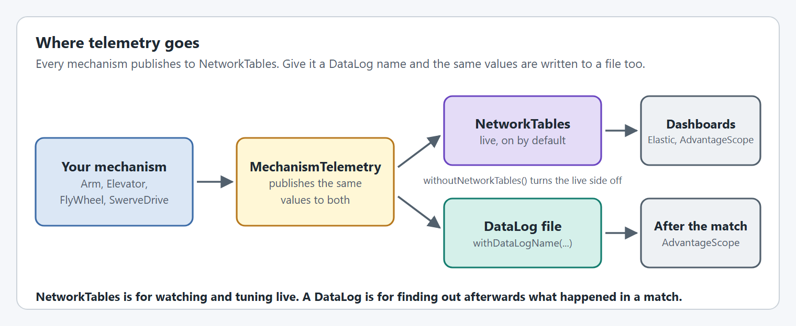
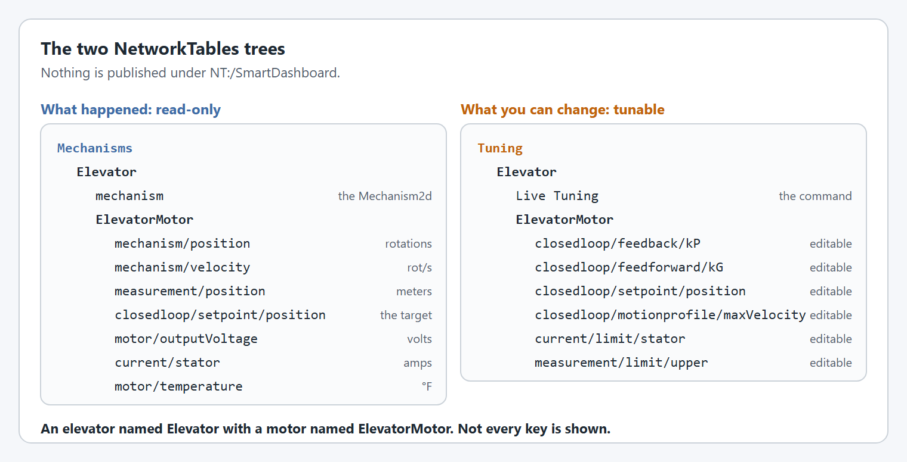
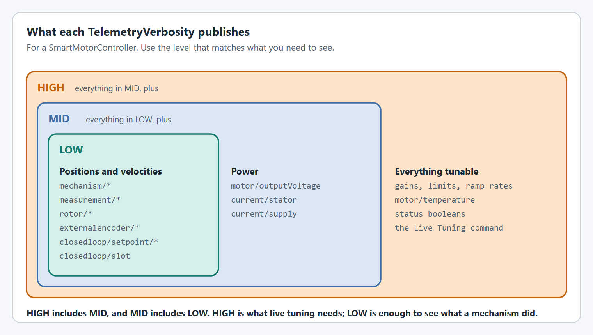

# Telemetry

## The basics of telemetry

<figure><figcaption><p>One set of values, two places to send them.</p></figcaption></figure>

| Destination | On by default? | Turn it on or off with | Use it for |
| --- | --- | --- | --- |
| NetworkTables (NT4) | Yes | `withoutNetworkTables()` turns it off | Watching and tuning live |
| DataLog file | No | `withDataLogName(name)` turns it on | Reviewing a match afterwards |

Both are set on `SmartMotorControllerTelemetryConfig`. `MechanismTelemetry` does the work: every mechanism, and every `SwerveModule`, owns one, and it sends the same values to both destinations.


Set a DataLog name for competition matches. It is one line, and it means you can see what actually happened on the field.



A DataLog uses storage on the SystemCore, and logging everything fills it quickly. Log only what you need. See the [WPILib DataLog docs](https://docs.wpilib.org/en/stable/docs/software/telemetry/datalog.html#custom-data-logging-using-datalog).


**Going further**

* [DataLog Best Practices](../details/datalog-best-practices.md): choosing what to log, and how it works for `SwerveDrive`.
* [How do I view my DataLog in AdvantageScope?](../how-to/how-do-i-view-my-datalog-in-advantagescope.md): a step by step walkthrough.

## NetworkTables

YAMS publishes under two tables. Nothing goes under `NT:/SmartDashboard`.

<figure><figcaption><p>An elevator named <code>Elevator</code> with a motor named <code>ElevatorMotor</code>.</p></figcaption></figure>

| Table | Holds | Path |
| --- | --- | --- |
| `NT:/Mechanisms` | What the mechanism is doing. Read-only. | `NT:/Mechanisms/<Mechanism>/<Motor>/<key>` |
| `NT:/Mechanisms` | The mechanism's `Mechanism2d` | `NT:/Mechanisms/<Mechanism>/mechanism` |
| `NT:/Tuning` | Values you can edit | `NT:/Tuning/<Mechanism>/<Motor>/<key>` |
| `NT:/Tuning` | The `Live Tuning` command | `NT:/Tuning/<Subsystem>/Live Tuning` |

`<Mechanism>` and `<Motor>` are the telemetry names given to `withTelemetry(...)` on the mechanism config and on the `SmartMotorControllerConfig`. See [Live tuning](../details/live-tuning/README.md) for how to use the tunable side.

## Simulation vs Reality

The simulation view of each mechanism is done with `Mechanism2d`'s. These windows could be outputted while on the actual robot but that is not necessary as all of the data from the `Mechanism2d` is in the Telemetry fields and accessible to the user.



## Mechanism Telemetry

A mechanism's table is a folder: it holds the `Mechanism2d` and one table for each `SmartMotorController` in the mechanism, so the values are easy to find.

<figure><figcaption></figcaption></figure>

## Smart Motor Controller Telemetry

There are two ways to choose what a motor publishes: pick a verbosity level, or pick the fields yourself.

### Verbosity levels

`withTelemetry(name, TelemetryVerbosity)` is the quick way. Each level includes the one before it.

<figure><figcaption><p>HIGH includes MID, and MID includes LOW.</p></figcaption></figure>

| Level | Adds | Good for |
| --- | --- | --- |
| `LOW` | Positions, velocities and accelerations (`mechanism/*`, `measurement/*`, `rotor/*`, and `externalencoder/mechanism/*` when there is an external encoder), the setpoints (`closedloop/setpoint/*`) and the active slot | Competition, where you only need to see what happened |
| `MID` | `motor/outputVoltage`, `current/stator`, `current/supply` | Checking power draw |
| `HIGH` | Every tunable value, `motor/temperature`, the status booleans, and the `Live Tuning` command | Tuning and development |

### Choosing fields yourself

Build a `SmartMotorControllerTelemetryConfig` and enable only what you want:

```java
SmartMotorControllerTelemetryConfig motorTelemetryConfig = new SmartMotorControllerTelemetryConfig()
          .withMechanismPosition()
          .withRotorPosition()
          .withMechanismLowerLimit()
          .withMechanismUpperLimit();
          
SmartMotorControllerConfig motorConfig = new SmartMotorControllerConfig(this)
      .withClosedLoopController(4, 0, 0)
      .withTrapezoidalProfile(DegreesPerSecond.of(180), DegreesPerSecondPerSecond.of(90))
      .withSoftLimits(Degrees.of(-30), Degrees.of(100))
      .withGearing(new MechanismGearing(GearBox.fromReductionStages(3, 4)))
      .withZeroPower(MotorMode.BRAKE)
      .withTelemetry("ElevatorMotor", motorTelemetryConfig);
```

`withCustom(...)` covers everything else. Use it for a field with no `with*()` method of its own, or to switch several fields in one call. It takes a `BooleanTelemetryField` or `DoubleTelemetryField`, or an array of either, and a boolean:

```java
SmartMotorControllerTelemetryConfig motorTelemetryConfig = new SmartMotorControllerTelemetryConfig()
          .withTelemetryVerbosity(TelemetryVerbosity.LOW)
          .withCustom(SmartMotorControllerTelemetry.DoubleTelemetryField.SupplyCurrent, true)
          .withCustom(new SmartMotorControllerTelemetry.BooleanTelemetryField[]{
              SmartMotorControllerTelemetry.BooleanTelemetryField.MotorInversion,
              SmartMotorControllerTelemetry.BooleanTelemetryField.EncoderInversion
          }, false);
```

| | Java | C++ |
| --- | --- | --- |
| Switch a field | `withCustom(field, enabled)` | `WithCustom(field, enabled)` |
| Switch several | `withCustom(fields[], enabled)` | `WithCustom(std::vector, enabled)` |
| Package | `yams.core.telemetry` | |
| Verbosity enum | `yams.core.telemetry.enums.TelemetryVerbosity` | |

See the `SmartMotorControllerTelemetryConfig` API reference page for the full method list.

## Swerve Drive Telemetry

A swerve drive publishes poses, chassis velocities and module states. Those are not single numbers, so they are published as NT4 structs that AdvantageScope understands directly.

<figure><figcaption><p>What a swerve drive publishes, and at which verbosity.</p></figcaption></figure>

### Setting it up

`SwerveDrive` and `SwerveModule` have their own telemetry configs. They work the same way as a motor's: every field is off until a verbosity level or a `with*()` method turns it on.

| Config | Passed to | Notable fields |
| --- | --- | --- |
| `SwerveDriveTelemetryConfig` | `SwerveDriveConfig.withTelemetry(name, config)` | `withPose()`, `withGyro()`, `withCurrentModuleStates()`, `withDesiredModuleStates()` |
| `SwerveModuleTelemetryConfig` | `SwerveModuleConfig.withTelemetry(name, config)` | `withAbsoluteEncoder()`, `withState()` |

```java
SwerveDriveTelemetryConfig driveTelemetryConfig = new SwerveDriveTelemetryConfig()
    .withTelemetryVerbosity(TelemetryVerbosity.HIGH)
    .withPose()
    .withGyro()
    .withCurrentRobotRelativeChassisSpeeds()
    .withFieldRelativeChassisSpeeds()
    .withDesiredRobotRelativeChassisSpeeds()
    .withDesiredModuleStates()
    .withCurrentModuleStates()
    .withDataLogName("swerve");

SwerveDriveConfig driveConfig = new SwerveDriveConfig(this, frontLeft, frontRight, backLeft, backRight)
    .withGyro(gyro::getRotation3d)
    .withTelemetry("swerve", driveTelemetryConfig);
```

`new SwerveDriveTelemetryConfig(TelemetryVerbosity.HIGH)` is shorthand for `new SwerveDriveTelemetryConfig().withTelemetryVerbosity(TelemetryVerbosity.HIGH)`. `SwerveModuleTelemetryConfig` has the same shorthand.

### Things that differ from a motor

* **The name is required.** `SwerveDriveConfig.withTelemetry(...)` always takes the name first: `withTelemetry(name, TelemetryVerbosity)` or `withTelemetry(name, SwerveDriveTelemetryConfig)`. There is no `withTelemetryName(...)`.
* **DataLog is set on the telemetry config.** `SwerveDriveConfig` and `SwerveModuleConfig` have no `withDataLogName(...)`. Use `SwerveDriveTelemetryConfig.withDataLogName(...)` and `SwerveModuleTelemetryConfig.withDataLogName(...)`.
* **A module's state is `HIGH` only.** At `LOW` and `MID` a module publishes only its absolute encoder angle.
* **The motors are configured separately.** Neither swerve config reaches the drive and azimuth motors inside a module. Give each motor's `SmartMotorControllerConfig` its own `.withTelemetry(name, SmartMotorControllerTelemetryConfig)`, as for any other motor. See [DataLog Best Practices](../details/datalog-best-practices.md).
* **`withCustom(...)` works here too.** It takes a `DoubleTelemetryField`, `StructTelemetryField`, `StructArrayTelemetryField` or `BooleanTelemetryField`, or an array of one, and a boolean.


WPILib 2027 renamed `ChassisSpeeds` to `ChassisVelocities` and `SwerveModuleState` to `SwerveModuleVelocity`. The YAMS method and telemetry field names (`withDesiredModuleStates()`, `setSwerveModuleStates(...)`, `withFieldRelativeChassisSpeeds()`) kept their old spelling.


<details>

<summary>How struct telemetry works: StructTelemetry and StructArrayTelemetry</summary>

`SmartMotorControllerTelemetry` publishes plain numbers and booleans with `DoubleTelemetry` and `BooleanTelemetry`. Swerve telemetry is built on two generic counterparts:

| Class | Publishes | Used for |
| --- | --- | --- |
| `StructTelemetry<T>` | One struct value | `Pose2d`, `ChassisVelocities`, one `SwerveModuleVelocity` |
| `StructArrayTelemetry<T>` | An array of struct values | The four module `SwerveModuleVelocity[]` fields |

Both behave like `DoubleTelemetry`: they can be enabled per field, sent to NetworkTables and to a DataLog, and, for fields marked tunable, read back a value edited on the dashboard. You do not normally construct them yourself. The swerve telemetry configs create and manage them.

</details>

### Live tuning

At `HIGH` verbosity `SwerveDriveTelemetryConfig` also publishes tunable keys for auto-align and for the drive and azimuth motors under `NT:/Tuning/<name>/`. See [Live tuning: Swerve drive](../details/live-tuning/README.md#swerve-drive) for the keys and how to use them.

## Colors

You may notice there are different colors in the Mechanism windows displayed for simulation. These are there to provide you with reference points of your Soft and Hard Limits.

* Green is the upper hard limit
* Red is the lower hard limit
* Pink is the upper soft limit
* Yellow is the lower soft limit

These are provided to you so you can identify relative motion easily between the simulation and reality.

## Telemetry Units

All telemetry values in YAMS are logged with specific units. Understanding these units helps you interpret data correctly and configure your visualization tools.

### Standard Telemetry Units

| NetworkTables key | Unit | Description |
| --- | --- | --- |
| `mechanism/position` | Rotations (rot) | Position of the mechanism output shaft |
| `mechanism/velocity` | Rotations per second (rot/s) | Velocity of the mechanism output shaft |
| `rotor/position` | Rotations (rot) | Position of the motor rotor, before gearing |
| `rotor/velocity` | Rotations per second (rot/s) | Velocity of the motor rotor |
| `closedloop/setpoint/position` | Rotations, or meters for linear mechanisms | Closed loop position target |
| `closedloop/setpoint/velocity` | rot/s, or m/s | Closed loop velocity target |
| `mechanism/limit/lower`, `mechanism/limit/upper` | Degrees (deg) | Soft limits |
| `motor/outputVoltage` | Volts (V) | Voltage being applied to the motor |
| `current/supply` | Amps (A) | Current drawn from the battery |
| `current/stator` | Amps (A) | Current through the motor windings |
| `motor/temperature` | Fahrenheit (°F) | Motor temperature |

### Linear Mechanism Units

When a mechanism has a circumference (from `.withMechanismCircumference()`, or one of the `.withWheelDiameter()`, `.withWheelRadius()` or `.withDrumRadius()` helpers), the linear keys are published too:

| NetworkTables key | Unit | Description |
| --- | --- | --- |
| `measurement/position` | Meters (m) | Linear position of the mechanism |
| `measurement/velocity` | Meters per second (m/s) | Linear velocity of the mechanism |
| `measurement/limit/lower`, `measurement/limit/upper` | Meters (m) | Soft limits in linear units |


YAMS logs rotational units by default. Linear units are calculated from rotational units using your configured circumference: `linear = rotational × circumference`


## Using AdvantageScope for Unit Conversion

AdvantageScope provides powerful unit conversion capabilities that let you view telemetry data in whatever units make sense for your analysis, without changing your robot code.

### Changing Display Units

To change how a value is displayed in AdvantageScope:

1. Add the telemetry field to a graph (Line Graph, Discrete, etc.)
2. Right-click on the field in the legend
3. Select **"Convert Units..."**
4. Choose your desired output unit from the list

For example, you can convert:

* Rotations → Degrees, Radians, or custom mechanism units
* Rotations per Second → RPM, Degrees per Second, Radians per Second
* Meters → Inches, Feet, Centimeters
* Meters per Second → Feet per Second, Inches per Second

### Multiple Units on the Same Axis

AdvantageScope allows you to plot values with **different units on the same axis**, which is incredibly useful for comparing related measurements:

**Example: Comparing Position and Velocity** You can plot both `mechanism/position` (in degrees) and `mechanism/velocity` (in degrees/second) on the same graph to see how velocity changes relative to position during a motion profile.

**Example: Comparing Setpoint vs Actual** Plot `closedloop/setpoint/position` and `mechanism/position` with the same unit conversion to directly compare your target trajectory against actual mechanism movement.

**Example: Analyzing Current Draw** Plot `current/supply` and `current/stator` together to understand the relationship between battery load and motor torque output.

### Setting Up Unit Conversion in AdvantageScope

1. **Open Line Graph**: Drag fields from the sidebar to a Line Graph tab
2. **Access Unit Settings**: Right-click on any field in the graph legend
3. **Select Convert Units**: Choose the conversion you want
4. **Apply to Multiple Fields**: Each field can have its own conversion, allowing mixed-unit comparisons


**Pro Tip**: When tuning a mechanism, convert position to your natural units (degrees for arms, inches for elevators) and plot alongside velocity. This helps you visualize how your motion profile executes and identify where the mechanism accelerates, cruises, and decelerates.


### Common Unit Conversions for FRC

| Original Unit | Useful Conversions  | Use Case                             |
| ------------- | ------------------- | ------------------------------------ |
| Rotations     | Degrees, Radians    | Arm angles, turret position          |
| Rotations     | Inches, Centimeters | Elevator height (with circumference) |
| rot/s         | RPM                 | Flywheel speed                       |
| rot/s         | deg/s, rad/s        | Arm angular velocity                 |
| Meters        | Inches, Feet        | Elevator/linear mechanism position   |
| m/s           | ft/s, in/s          | Linear mechanism velocity            |

### Exporting Data with Units

When exporting data from AdvantageScope, the exported values use the **converted units** you have selected in the display. This makes it easy to:

* Share data with team members in familiar units
* Import into spreadsheets for further analysis
* Create documentation with consistent unit conventions
